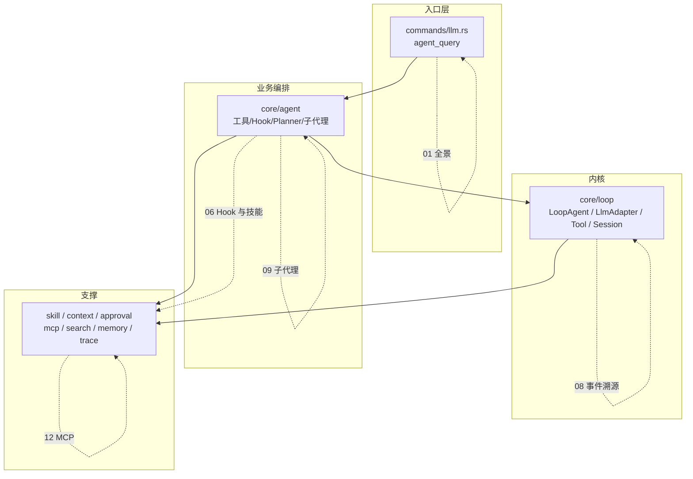

---
title: mdgo Agent 实现细节系列：导读与阅读路线
date: 2026-11-10
tags: [Agent, Rust, 架构, 索引]
summary: 12 篇专题 + 导读的导航：每篇回答什么问题、对应哪些代码、按什么顺序读，以及贯穿全系列的术语与设计原则。
---

# mdgo Agent 实现细节系列：导读与阅读路线

> 这是一组从源码反推出来的技术文档，不是产品介绍。全部结论以当前代码为准，
> 引用格式为 `文件:行号`，路径相对 `tauri/src-tauri/src`。

## 1. 这个系列讲什么

mdgo 是一个 Tauri 桌面知识库应用。它的 Agent 子系统要在一个本地进程里完成：

- 把用户问题变成一次**有预算、可取消、可降级**的模型调用；
- 在高频工具调用中维持**一致性**（工具结果与模型历史配对、写操作不重复、危险操作需审批）；
- 在上下文不断增长时**压缩而不丢关键信息**；
- 让"模型说了什么"和"实际做了什么"**可核对**（事件溯源 + 防幻觉 + 证据校验）。

这套代码 `src` 下共 136 个 Rust 文件、约 6.3 万行（快照：`8076140` + 未提交改动）。
本系列不追求覆盖每一行，而是抽出**有决策含量的实现**：为什么这样分层、为什么用这个
阈值、失败时退到哪、哪些地方注释和实现已经不一致。

**不讲**：前端渲染细节、文档格式解析（另有 `docs/文档解析管线升级方案` 系列）、
日程/书签等业务功能本身。

## 2. 全景：文档与代码的对应关系

## 3. 文档清单

| # | 文档 | 回答的问题 | 主要代码 |
|---|---|---|---|
| 01 | [Agent 技术全景](01-Agent%20技术全景-一次提问的完整链路.md) | 一条消息经过哪些阶段？失败怎么降级？事件协议长什么样？ | `commands/llm.rs`、`lib.rs` |
| 02 | [Loop 内核](02-Loop%20内核-turn-step%20状态机与请求装配.md) | turn/step 怎么计数？每轮 system 怎么拼？两级重试差在哪？ | `core/loop/loop.rs` |
| 03 | [LLM 适配层](03-LLM%20适配层-双协议流式与错误重试.md) | OpenAI/Anthropic 的 SSE 怎么装配成工具调用？错误怎么分类？ | `core/loop/{openai,anthropic,llm_seam}.rs` |
| 04 | [工具系统](04-工具系统-契约-注册与并行调度.md) | 工具契约怎么设计？并行调度如何保序、如何保证安全默认？ | `core/loop/{tool,tool_calls}.rs` |
| 05 | [工具实现](05-工具实现-文件读写与结构化编辑.md) | 路径怎么防越界？`edit` 为什么不唯一就失败？大文档怎么按章节改？ | `core/agent/tools/` |
| 06 | [Hook 与技能](06-Hook%20体系与技能门禁.md) | 四组钩子的调用时机？L1/L2/L3 渐进披露如何省 token？软门禁怎么防误杀？ | `core/loop/hooks.rs`、`core/skill/` |
| 07 | [上下文工程](07-上下文工程-Token%20预算与压缩.md) | 预算怎么算？摘要+滑窗怎么选？应急压缩为什么不用 LLM？ | `core/context/`、`core/db/token_budget.rs` |
| 08 | [事件溯源会话](08-事件溯源会话与持久化.md) | 为什么存事件不存消息？`derive_history` 怎么配对工具调用？如何落库/分叉？ | `core/loop/session.rs`、`services/chat.rs` |
| 09 | [子代理与多 Agent](09-子代理与多%20Agent%20协同.md) | 子代理如何隔离、限权、取消？DocAgent 为什么有两个宿主？ | `core/subagent/`、`core/docagent/` |
| 10 | [安全防线](10-安全防线-审批-注入防护与防幻觉.md) | 审批门怎么 fail-closed？注入怎么包裹？"声称已做"怎么识别？ | `core/approval/`、`core/security.rs` |
| 11 | [可观测性与评测](11-可观测性与评测-Trace-指标与基准.md) | Trace 怎么分阶段？指标口径有哪些坑？检索基准怎么跑？ | `core/trace.rs`、`core/eval/`、`bin/benchmark.rs` |
| 12 | [MCP 与外部工具](12-MCP-外部工具与前端事件桥.md) | MCP 生命周期怎么管？外部进程如何进入工具表？WS 桥解决什么？ | `core/mcp/`、`core/bridge/` |

## 4. 三条阅读路线

**路线 A：只想了解架构（约 40 分钟）**
01 → 02 → 06 → 10。
先建立"阶段 + 状态机"的整体图，再看 Hook 如何把业务约束插入内核，最后看安全边界。

**路线 B：想自己实现一个 Agent 循环（约 2 小时）**
02 → 03 → 04 → 07 → 08。
这五篇构成一个最小可用内核：循环、协议适配、工具调度、上下文预算、事件历史。
05 与 09 是实现层面的参考，可以按需查。

**路线 C：关心生产可用性（约 3 小时）**
01 → 06 → 10 → 11 → 12。
重点在降级、审批、防幻觉、可观测与外部依赖治理。

## 5. 贯穿全系列的六个术语

| 术语 | 含义 | 首次出现 |
|---|---|---|
| **turn / step** | turn 是一次用户请求；step 是一次模型调用及其工具批次。模型每调用一次工具，就需要下一个 step 把结果回填。 | 02 |
| **技能（Skill）** | 声明式能力包：`SKILL.md` 声明何时用、能用哪些工具、注入哪些规则。分 L1 目录 / L2 正文 / L3 参考文档三层披露。 | 06 |
| **软门禁** | 技能声明类工具始终对模型可见（避免 `UnknownToolCall` 致命错误），但未激活技能时由 Hook 拦截并返回引导。 | 06 |
| **预检索 vs agentic** | 预检索是"回答前先检索一次"；agentic 是"模型自己决定何时调 `kb_search`"。mdgo 两者都有：只有预激活技能声明检索时才预检索。 | 01 |
| **事件溯源** | 会话是仅追加的事件日志，模型历史由 `derive_history` 投影；system prompt 与工具 schema 不落日志。 | 08 |
| **grounding / 防幻觉** | 两道后置校验：Action Claim Guard 识别"声称已执行但没调工具"，Grounding Validator 识别"没有来源却下结论"。 | 10 |

## 6. 五个反复出现的设计原则

读这套代码时，你会发现同样的取舍反复出现。提前记住它们，后面每篇都会轻松很多：

1. **fail-open 优先，fail-closed 只用于危险动作。** 规划、查询扩展、记忆检索、技能预激活
   失败都降级继续；只有"计划确认"和"审批"超时才按拒绝处理。
2. **同步回调只做确定性工作。** `retry_prepare`、压缩摘要降级路径都不调用 LLM——错误恢复
   路径不能再产生新的失败点。
3. **"模型可见即已记录"。** 任何进入模型请求的消息必须来自事件日志投影，不能临时拼。
4. **安全默认（secure by default）。** 工具的 `concurrency_safe` 默认 false、审批默认 ask、
   路径默认拒绝越界、MCP 工具默认纳入门禁放行集但调用仍受审批约束。
5. **压缩/预算的单一事实来源。** 所有阈值集中在 `core/agent/limits.rs`，工具 schema 与
   代码层 clamp 引用同一常量，避免"schema 说 50、代码只收 20"。

## 7. 文档约定

- 代码引用：`` `tauri/src-tauri/src/xxx.rs:123` ``，行号对应写作时的代码快照；
- 代码片段：逐字来自源码，通常省略错误处理与日志，只保留主路径；
- "代码中未见"：明确表示某能力在本次阅读范围内没有实现，而不是"应该没有"；
- 标注"口径陷阱"的地方，是注释与实现不一致或统计定义容易误解的位置，维护时优先核对。

## 8. 版本与维护

- 代码基线：`8076140`（`style：AI按钮使用入口修改`）+ 写作时未提交的
  `main.html`/`doc-qa.js` 改动；
- 若代码后续改动触及 `core/loop`、`core/agent`、`commands/llm.rs`，优先同步 01/02/04/06 四篇；
- 各篇末尾都有"相关文件"表，可作为改动影响面的检查清单。

---

从 [01 Agent 技术全景](01-Agent%20技术全景-一次提问的完整链路.md) 开始。
