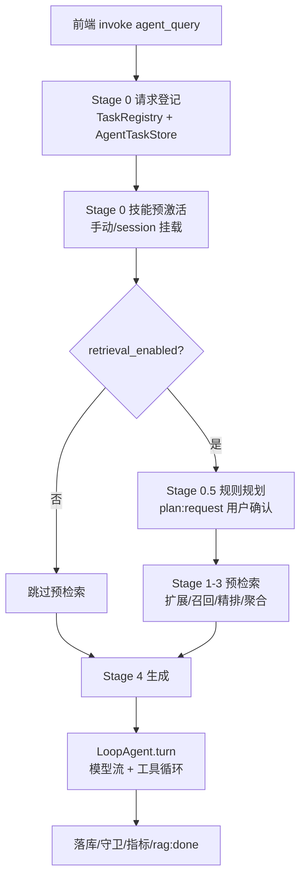

---
title: Agent 技术全景：一次提问从 IPC 到流式回答的完整链路
date: 2026-11-10
tags: [Agent, Rust, Tauri, RAG, 架构]
summary: 以一次 agent_query 为主线，拆解 mdgo Agent 子系统的分层、各执行阶段、事件协议与失败降级策略。
---

# Agent 技术全景：一次提问从 IPC 到流式回答的完整链路

> 本文是「mdgo Agent 实现细节」系列的总览篇。适合想了解一个本地知识库应用如何把
> RAG 检索、工具调用、技能系统、审批与压缩串成一条可控链路的 Rust/后端工程师。
> 读完你应该能回答：一条用户消息在后端经过了哪些阶段、每个阶段失败时会发生什么、
> 哪些状态是进程内的、哪些落库、以及内核与业务的分界线在哪里。

## 1. 系统边界：Agent 不只是"调一次模型"

mdgo 是一个 Tauri 桌面应用：前端（`main.html` + `css_js/`）负责交互，Rust 后端
（`tauri/src-tauri/src`）负责文件系统、索引、检索与 Agent 运行时。Agent 子系统的职责不是
"把问题发给模型"，而是把下面这些异质能力编排成一条**可取消、可观测、可降级**的流水线：

- 技能（Skill）：声明式的能力包，决定"这次任务该用哪些工具、注入哪些规则"；
- 检索（RAG）：混合召回 + 精排 + 文档级聚合，决定"回答依据什么"；
- 工具（Tool）：文件读写、文档结构化编辑、子代理、MCP 外部工具等；
- 审批（Approval）：破坏性操作执行前的人工确认；
- 压缩（Compaction）：历史超预算时的摘要/滑窗/应急压缩；
- 事件（Event）：把增量文本、工具轨迹、阶段进度实时推给前端。

代码按依赖方向分为四层，**上层依赖下层，反向不依赖**：

```text
┌──────────────────────────────────────────────────────────────┐
│ commands/            IPC 命令层：agent_query / kb_llm_query   │
│                      DocAgent / 审批 / 计划 / 任务状态命令     │
├──────────────────────────────────────────────────────────────┤
│ core/agent/          业务编排层：工具实现、Hook、规划器、       │
│                      Planner、子代理装配、任务状态中心         │
├──────────────────────────────────────────────────────────────┤
│ core/loop/           自研 Agent 内核：turn/step 状态机、        │
│                      LLM seam、工具调度、事件溯源 Session      │
├──────────────────────────────────────────────────────────────┤
│ 支撑层：core/{skill,context,approval,mcp,search,memory,        │
│         document,db,trace,eval,security,validation}           │
└──────────────────────────────────────────────────────────────┘
```

模块注册见 `tauri/src-tauri/src/core/mod.rs:1-40`，内核的公开窄接口见
`core/loop/mod.rs:38-47`。一个刻意的约束是：**业务层只依赖内核的窄接口**，内核不知道
"知识库""技能""审批"这些业务概念；Hook 与 Tool 是业务反接内核的唯二入口。

`core` 整体是私有模块（`lib.rs:6`），只在 `bench` feature 下通过 `bench_api` 暴露少量符号
（`lib.rs:16-20`）——避免把 20 多个内部模块变成对外 API。

## 2. 一次提问的完整阶段

入口是 Tauri 命令 `agent_query`（`commands/llm.rs:899`）。它的返回类型是
`Result<(), String>`，但**几乎所有业务失败都不走 `Err`**：后端把错误转成 `rag:error`
事件推给前端，然后 `return Ok(())`。这样前端只需处理一种协议，IPC 层不会因业务失败
产生未捕获的 rejection。



### 2.1 请求登记与取消源收敛

`agent_query` 一进来做三件事：

1. `task_registry.register(&request_id)` 创建 `CancellationToken` 并登记
   （`commands/llm.rs:910`，`TaskRegistry` 定义在 `commands/llm.rs:106-138`）；
2. `state.agent_tasks.register(...)` 把任务写入后端状态中心
   （`commands/llm.rs:913-915`），供"切出页面再切回"时用快照恢复视图；
3. 同会话替换：遍历 `agent_tasks.list()`，若同一 `session_id` 已有 `Running` 的旧请求，
   取消它并标记 `Cancelled`（`commands/llm.rs:919-936`）。

第 3 点是"取消来源收敛"：显式取消有三个入口——停止按钮、同会话新请求、应用退出。
前两个入口都会落到同一个 `CancellationToken`，第三个由进程退出兜底。这避免了同会话
并发 Agent 任务堆积，也避免旧任务的 `rag:delta` 继续往新回答里插字。

随后 `top_k` 被 clamp 到 1..50（`commands/llm.rs:938`），请求级 todo 被清空
（`commands/llm.rs:945`），请求计数 +1（`commands/llm.rs:940-942`）。

### 2.2 Stage 0：技能预激活（不是"技能匹配"）

技能激活的决策**已经交给模型**（渐进式披露）：本地只处理两类显式预激活——用户手动
`/技能名` 触发，以及会话挂载的技能（`commands/llm.rs:1000-1047`）。真正的激活动作由
`activate_skill` 工具完成，见 `06-Hook 体系与技能门禁.md`。

这一阶段还做两件容易被忽略的事：

- 把"读会话挂载表 + 重建技能注册表"这两段阻塞 I/O 放进 `spawn_blocking`
  （`commands/llm.rs:1012-1035`），避免阻塞异步运行时；
- 手动触发时用**清理后的查询**（剥离 `/技能名` 前缀）进入后续检索，清理结果为空则回退
  原查询（`commands/llm.rs:1049-1055`）。

### 2.3 检索参数合成：技能优先，Security 兜底

检索阈值不是全局常量，而是 `resolve_retrieval_policy` 合成出来的
（`commands/llm.rs:1093`，实现在 `core/skill/policy.rs`）：技能声明优先 → 请求级/全局
配置兜底 → Security clamp。产物有五个：`top_k`、`min_score`、`rerank_min_score`、
`max_docs`、`max_chunks_per_doc`，它们同时作用于预检索与 `kb_search` 工具
（`commands/llm.rs:1093-1099`）。

### 2.4 预检索是否执行：`retrieval_enabled`

关键判断在 `commands/llm.rs:1104`：只有**预激活技能声明了检索工具**时才做 Stage 1-3。
没有预激活技能、或技能没声明检索时直接跳过，交给 Agent 按需调用检索工具。这是
"RAG 预检索与 Agent 解耦"：无关消息不会触发昂贵的查询扩展与向量检索。

### 2.5 Stage 0.5：规则规划与用户确认

`should_plan(&query)` 是纯规则路由，零 LLM 开销（`core/agent/planner.rs:87`）：
长度 ≥120 字符、含任务动词、中等长度含多意图连接词，满足其一即规划；但疑问句结尾、
"查看/解释/翻译/总结"等轻量单动作会被显式抑制。规则细节与反例守卫见该文件
`54-128` 行的注释与单测。

判定要通过规划时，执行一次**独立非流式调用** `generate_plan_json`（不占 20 轮执行预算），
再用 `validate_plan_json` 做 JSON Schema 校验，最多 3 次尝试（1 次原始 + 2 次修正），
总时限 90 秒（`commands/llm.rs:1141-1146`）。全部失败 **fail-open**：降级为"不规划"，
继续原流程，并推一条 `rag:status` 告知用户。

计划生成后不是直接注入，而是等用户确认：`plan:request` 事件携带
goal/steps/acceptance/risks/touchpoints/non_goals/rollback，`plan_respond` 回传
`PlanDecision`；等待同时监听取消信号与 60 秒超时，超时/通道异常按**拒绝**处理
（fail-closed，`commands/llm.rs:1216-1279`）。批准后计划文本经 `to_preamble_text`
拼进 Stage 4 的 system prompt（`commands/llm.rs:1838-1843`）。

### 2.6 Stage 1-3：预检索流水线

这是全链路最"重"的一段，但设计上只有四个动作：

1. **并行**：原始查询立即向量化+召回，同时让 LLM 做查询扩展；扩展有独立 5 秒总时限
   （`limits.rs:40`），超时/失败 fail-open 为空（`commands/llm.rs:1459-1477`）。规则门
   `should_expand` 会先挡掉超短/文件名/纯符号查询，避免白花一次 LLM 调用。
2. **扩展查询治理**：批量向量化后按 cosine ≥ 0.92 去重（`limits.rs:46`），最多保留 2 条
   （`limits.rs:31`）；代码类意图（`RetrievalIntent::Code`）还会从查询里抽符号 token，
   经符号索引补 Entity 变体，总数不超过 3（`commands/llm.rs:1554-1599`）。
3. **候选池统一精排**：原始召回 + 各扩展召回 + 符号命中合并成 pool，每条命中打上
   `query_sources` 来源标记，再交 `indexer.rerank_pool` 按来源查询分别计分取 max
   （`commands/llm.rs:1654-1693`）。精排不可用时回退 RRF 序。
4. **聚合与上下文构建**：`aggregate_hits` 做文档级去重/排序/跨查询一致性加成，
   `build_context_text` 按文档分组、文档内按 `chunk_index` 重排，总字符受
   `MAX_CONTEXT_CHARS = 12_000` 限制（`limits.rs:24`）。上下文过
   `security::wrap_suspicious` 注入防护后进入 system。

任一步无命中都不算失败：降级为空上下文，Agent 仍可用 `kb_search` 工具按需检索。

### 2.7 Stage 4：生成

`agent_generate_loop_v2`（`commands/llm.rs:2670`）只做生成，不再碰检索。顺序是：

1. **历史压缩**：先应用会话压缩检查点，再按 token 预算压缩（详见 07 篇）；
2. **播种会话**：把压缩后的 `ChatMessage` 投影成事件日志（`seed_session_from_messages`，
   `commands/llm.rs:2041`）；
3. **组装 system**：Agent 规约（`resources/agent/rag_agent.md`）→ 上一请求过程摘要 →
   检索上下文（其中已包含计划 preamble 与记忆块）→ 技能目录/路由；
   注意这里的顺序不是随意排的：稳定内容在前，便于 provider 前缀缓存（详见 02 篇）；
4. **构造内核**：`LoopConfig::new(DEFAULT_MAX_TURNS=20, system)`，
   `retry_prepare = session.emergency_compact`（`commands/llm.rs:2789-2798`）；
5. **注册工具与 Hook**：工具注册表 → 技能门禁 Hook → 审批 Hook → 溢出重试 Hook →
   技能指令 Hook（顺序不可随意换，见 06 篇）；
6. **执行 turn**：把 `LoopEvent` 映射成前端事件，实时转发；
7. **收尾**：事件落库 → 防幻觉/grounding → 任务状态 → `rag:done`/`rag:error` → 指标。

## 3. 状态放在哪里

Agent 的共享状态集中在 `AppState`（`lib.rs:122-184`）。与 Agent 强相关的有：

| 字段 | 类型/容量 | 作用 |
|---|---|---|
| `agent_tasks` | `AgentTaskStore`（64 桶，终态保留 30 分钟） | 后台任务快照：文本、工具轨迹、trace、thinking |
| `approval_pending` | `Mutex<HashMap<String, oneshot::Sender>>` | 审批挂起表，IPC 与 `approval_respond` 共享 |
| `plan_pending` | 同上 | 计划确认挂起表 |
| `user_question_pending` | 同上（值为 `Option<String>`） | `ask_user_question` 的等待通道 |
| `subagent_results` | `LruResultStore`（16 条） | 子代理完整输出，供 `read_subagent_result` 取回 |
| `llm_client_cache` | 最多 8 项，近似 FIFO | 按 `endpoint|model|key|effort` 指纹复用客户端 |
| `memory_store` / `memory_vectors` | 全局单例 | 跨会话长期记忆与向量索引 |
| `mcp` | `McpRegistry` | MCP 服务器配置、连接与工具清单 |

注意两个容量治理细节：任务快照超 64 时**只淘汰终态任务，running 永不淘汰**
（`core/agent/task_store.rs:306-335`）；LLM 客户端缓存上限 8，溢出时逐条移除而不是清空
（`lib.rs:343-351`），否则多角色路由（Main/Planner/Summary）会把命中率打回零。不过实现用的是
`HashMap::keys().next()`——注释写"近似 FIFO"，实际 HashMap 无插入序，淘汰对象是任意的；
要真 FIFO 需要换 `IndexMap` 或维护插入队列。

## 4. 前端事件协议

后端 → 前端的 Agent 事件（以代码中的字面量为准）：

| 事件 | 触发点 | 载荷要点 |
|---|---|---|
| `rag:status` | 各阶段开始 | `stage`（planning/expanding/searching/compressing/generating）、`message` |
| `rag:delta` | 模型文本增量 | `request_id`、`content` |
| `rag:thinking` | 推理增量 | 不占回答正文，前端可折叠 |
| `rag:done` | 正常/取消收尾 | 完整内容、引用来源、prompt/completion/cached tokens |
| `rag:error` | 失败 | 错误文案 |
| `agent:tool_call` / `agent:tool_result` | 工具轨迹 | 由 `emit_pending_tool_events` 从 `ToolCallBus` 实时 drain |
| `agent:max-turns` | 轮次耗尽 | `max_turns`（取自实际配置，不写死常量） |
| `plan:request` / `plan:rejected` | 规划确认 | 计划结构 / 拒绝原因 |
| `approval:request` | 审批门 | 待批准的工具调用 |
| `question:request` | 澄清提问 | 问题与选项 |
| `trace:event` | 阶段耗时 | `TraceBus` 快照 |
| `llm:delta` / `llm:usage` / `llm:done` / `llm:error` | 非 RAG 普通对话 | 独立通道 |

`agent:max-turns` 的 `max_turns` 特意从 `config.max_turns` 取（`commands/llm.rs:2793`），
因为"事件里报的上限"和"实际生效的上限"一旦各写一份，未来按会话配置轮次时提示就会撒谎。

## 5. 失败与降级矩阵

这套链路的原则是：**能降级就不失败，必须失败就保留已生成内容**。

| 环节 | 失败表现 | 处理 |
|---|---|---|
| LLM 未配置/客户端初始化失败 | `rag:error` + 任务 Failed | 早退，但先收尾任务状态，防全局任务条滞留 running |
| 规划生成/校验/超时 | 无计划 | fail-open，`rag:status` 告知"已降级为直接执行" |
| 计划确认超时 | 视为拒绝 | fail-closed，中止且 `content` 置空（不污染历史） |
| 查询扩展超时 | 仅原始查询 | fail-open，扩展结果为空 |
| 预检索无命中/低于阈值 | 空上下文 | 交给 Agent 工具按需检索（agentic 模式） |
| 历史超预算 | 压缩 | 摘要+滑窗，失败退纯滑窗，"压缩永不失败" |
| 上下文溢出 | HTTP 400 / `context_length_exceeded` | `OverflowRetryHook` → `emergency_compact` → 重试 1 次 |
| 流式中途断开 | `LlmError` | 已产出内容时**不重试**（避免重复副作用），保留部分内容 |
| 工具失败 | `is_error` 结果回填 | 模型自纠/换路，不影响整轮 |
| 达到 20 轮 | `MaxTurns` | 保留半截内容 + `agent:max-turns` 提示可继续 |
| 用户取消 | `Cancelled` | 保留已生成内容，`rag:done` 照常发出 |

"流式中途断开不重试"值得单独强调：重放会重复已经执行的工具副作用（比如第二次 `write`），
所以重试只发生在**尚未产出任何内容**的启动阶段（`core/loop/loop.rs:454-484`）。

## 6. 内核与业务的分界线

| 关注点 | 内核（`core/loop`） | 业务（`core/agent`、`commands`） |
|---|---|---|
| 消息/内容块/流事件 | `types.rs` 定义 | 只消费，不定义 |
| 请求发送 | `LlmAdapter` seam | 按协议选 adapter（OpenAI/Anthropic） |
| 轮次/预算/取消 | `LoopAgent` 状态机 | 传入 `LoopConfig`、`CancellationToken` |
| 工具执行 | 调度器（并行/超时） | 工具实现与注册表构建 |
| 准入控制 | Hook 调用点 | 技能门禁/审批/Hook 实现 |
| 历史 | `Session` 事件日志与投影 | 落库、压缩检查点、播种 |
| 提示词 | 每轮装配 + 预算提醒 | 规约、技能指令、计划、记忆 |

这种切法的直接收益：`core/loop` 可以完全离线单测（`loop.rs` 末尾的 `MockAdapter` 脚本化
测试覆盖多步工具往返、MaxTurns、取消、预算提醒、溢出重试、结果截断），而业务层改动
（换检索策略、加技能）不会碰内核。

## 7. 阅读路线

本系列按"从外到内、从骨架到细节"组织：

1. **01 全景**（本文）：链路、阶段、事件、降级；
2. **02 Loop 内核**：turn/step 状态机、请求装配、预算与取消；
3. **03 LLM 适配层**：双协议流式、SSE 装配、错误分类；
4. **04 工具系统**：契约、注册、并行调度；
5. **05 工具实现**：文件读写、精确编辑、大文档结构化编辑；
6. **06 Hook 与技能**：四组钩子、渐进式披露、软门禁；
7. **07 上下文工程**：token 预算、摘要压缩、应急压缩；
8. **08 事件溯源**：事件模型、投影规则、SQLite 持久化；
9. **09 子代理与多 Agent**：隔离、权限、DocAgent、Planner、任务中心；
10. **10 安全防线**：审批、注入防护、防幻觉、证据校验；
11. **11 可观测性与评测**：Trace、指标、基准；
12. **12 MCP 与外部工具**：MCP 生命周期、动态外部工具、WebSocket 桥。

## 8. 关键文件

| 文件 | 职责 |
|---|---|
| `tauri/src-tauri/src/commands/llm.rs` | 编排层：Stage 0-4、事件转发、守卫、收尾 |
| `tauri/src-tauri/src/core/agent/mod.rs` | 检索助手、`KbSearchConfig`、ACTION_CLAIMS、质量计数 |
| `tauri/src-tauri/src/core/agent/limits.rs` | 全部预算/上限常量的单一来源 |
| `tauri/src-tauri/src/core/agent/planner.rs` | 规则路由与计划模型 |
| `tauri/src-tauri/src/core/agent/task_store.rs` | 后台任务快照中心 |
| `tauri/src-tauri/src/core/loop/` | 自研 Agent 内核（状态机/seam/工具/会话） |
| `tauri/src-tauri/src/lib.rs` | `AppState` 装配、日志、命令注册 |

---

**下一篇**：[02 Loop 内核：turn-step 状态机与请求装配](02-Loop%20内核-turn-step%20状态机与请求装配.md)
