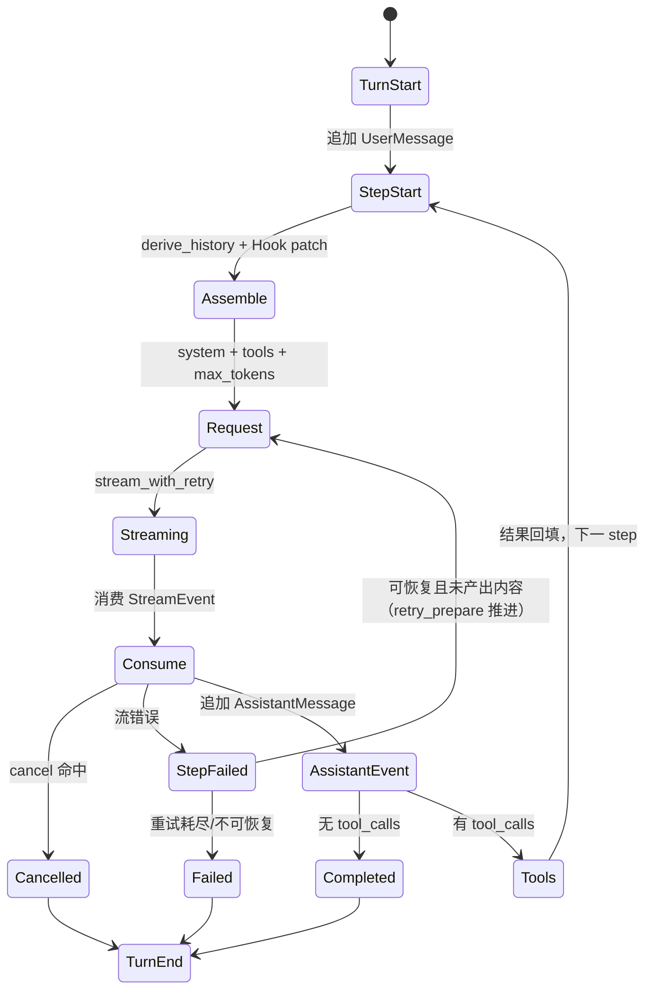

# Loop 内核：turn/step 状态机、请求装配与取消语义

> 本文讲 `core/loop` 的核心——`LoopAgent`。它只有约 500 行主体代码，却决定了
> "一轮 Agent 请求最多调几次模型、每次发什么、工具结果怎么回填、失败后能不能重试、
> 用户点停止时停在哪"。适合想自己实现 Agent 循环或正在评估框架的读者。

## 1. 为什么自己写循环

mdgo 早期用 rig 的 Agent 抽象，后来整体替换为自研内核。原因不是"造轮子"，而是三个
具体诉求无法在通用框架里同时满足：

1. **请求装配要可控**：system 要按"稳定前缀 + 易变尾巴"拆分，才能命中 provider 的
   前缀缓存；工具列表要能按技能动态窄化；预算提醒要按剩余轮次追加。
2. **错误恢复要分清阶段**：启动失败可以安全重试，流中途断开不能重试（会重复工具副作用）；
   上下文溢出需要先压缩再重试，而压缩本身是同步回调。
3. **状态要可回放**：所有进入模型的消息必须来自事件日志投影，不能有"临时拼进去"的
   历史——这是会话分叉、压缩、审计的前提。

内核的模块边界（`core/loop/mod.rs:3-17`）是单向依赖：

```text
types（消息/内容块/流事件/错误，无依赖）
  ↑
llm_seam（LlmAdapter 抽象）
  ↑                    ↑
openai / anthropic    session（事件溯源）
  ↑
tool（契约）→ tool_calls（调度）→ loop（状态机）
                                   ↑
                                hooks（四组钩子）
```

## 2. 配置对象：所有旋钮都在一处

`LoopConfig`（`core/loop/loop.rs:36-56`）是唯一的行为配置源：

| 字段 | 默认值 | 语义 |
|---|---|---|
| `max_turns` | 调用方传入（业务用 20） | 模型调用次数预算，1-based |
| `system_prompt` | 调用方传入 | 基础规约，每轮请求前置 |
| `budget_warning_threshold` | 3 | 剩余轮次 ≤3 时注入预算提醒 |
| `max_request_retries` | 1 | `on_request_error` 返回 Retry 的最大次数 |
| `max_parallel_tools` | 4 | 同一批工具调用的并行上限 |
| `max_stream_retries` | 2 | 流启动阶段瞬时错误的自动重试次数 |
| `stream_retry_base_ms` | 800 | 指数退避基数（叠加 0–400ms 抖动） |
| `max_tokens` | `None` | 输出上限；`None` 时不发送 |
| `retry_prepare` | `None` | 重试前的同步准备回调（如压缩会话） |

`max_turns` 的语义容易误解：它限制的是**模型调用次数**，不是工具调用次数。一次模型
调用（step）可以并行执行多个工具；工具结果回填后模型"欠"下一次请求，于是进入下一 step。
业务侧 `DEFAULT_MAX_TURNS = 20`（`core/agent/limits.rs:12`）。

## 3. 一次 turn 的完整时序

`LoopAgent::turn`（`core/loop/loop.rs:170`）的结构可以概括为
"claim 输入 → 0..n 个 step → 收尾"。



具体顺序（行号对应 `core/loop/loop.rs`）：

1. `turn = session.current_turn() + 1`，追加 `TurnStart`（180-181）；
2. 若输入有纯文本，追加 `UserMessage { id: "u_{turn}" }`（183-190）——只有文本，
   用户消息不带工具块；
3. 进入 step 循环：先检查取消（199），再 `steps += 1`，超预算立即收尾为 `MaxTurns`
   （203-207）；
4. 追加 `StepStart`，调用 `derive_history()` 取投影历史（208-210）；
5. 计算 `HookCtx`（turn/step/model/request_id/remaining）并装配请求（212-230）；
6. `stream_with_retry` 发起请求；失败走 `try_recover`（233-249）；
7. `tokio::select! { biased; cancel, stream.next() }` 消费事件（260-291）；
8. 取消/流错误/正常三种收尾（293-322）：
   - 取消 → 追加 `AssistantMessage { interrupted: true }` → `TurnEnd(Aborted)`；
   - 流错误且**已有产出** → 不重试，直接 Failed；
   - 正常 → 追加 `AssistantMessage`；
9. 无工具调用则跳出循环，`TurnEnd(Completed)`；否则先逐条追加 `ToolCall` 事件，
   再 `execute_tool_calls`，逐条追加 `ToolResult`（328-354），回到 step 顶部。

### 3.1 不变式："模型可见即已记录"

每轮请求的消息来自 `Session::derive_history()`，system prompt 与工具 schema 每轮现装配、
**不落事件日志**（`core/loop/loop.rs:9-10`）。这条不变式带来两个直接结果：

- 会话日志只记录"发生过的事实"（用户说了什么、模型说了什么、调了什么工具、结果是什么），
  不记录"这次请求的 system 长什么样"；
- 因此改提示词不会污染历史，压缩/分叉/回放都只需处理事件。

代价是每次请求都要重新拼 system，但这本来就是必要的（时间、预算、技能指令每轮可能变）。

### 3.2 取消的四个落点

取消不是"一刀切 abort"，而是在四个安全点检查：

| 落点 | 行为 |
|---|---|
| step 顶部 | 不再发起新请求，`TurnEnd(Aborted)`，返回 `Cancelled` |
| 流消费中（`select!` biased） | 立即停止读流，把已产出的文本作为 `interrupted` 助手消息落日志 |
| 工具执行中 | `execute_tool_calls` 对未启动的调用返回 `ToolError::Cancelled`，已启动的 drain 到静止 |
| 等待审批/计划确认 | 由命令层的 `tokio::select!` 直接返回，不等满超时 |

`biased` 很关键：`select!` 默认随机选择就绪分支，取消信号与流事件同时就绪时可能先处理
流事件；`biased` 让取消优先，保证"点停止"的响应不被高频 delta 拖住。

## 4. 每轮请求怎么装配

`assemble_request`（`core/loop/loop.rs:363-431`）按固定顺序拼 system：

```text
基础规约（业务传入的 system_prompt）
  + 各 Hook 的 preamble_override（按添加顺序拼接）
  + "\n\n" + 时间块（[当前时间] 本地时间 … 星期X，时区）
  + 预算提醒（剩余轮次 ≤ 阈值时）
```

### 4.1 时间块为什么放在末尾

时间块每轮都变。如果放在 system 最前面，provider 的前缀缓存（Anthropic 的
`cache_control`、OpenAI 的自动前缀缓存）会因为第一个 token 就变化而整体失效。
放在末尾后，规约 + 工具 + 技能指令构成稳定前缀，缓存能命中；适配器再用
`VOLATILE_SYSTEM_MARKER = "[当前时间]"`（`core/loop/llm_seam.rs:24`）把这一段单独放进
"无缓存断点"的块。

时间块的内容本身也有讲究：日期 + 时分 + 星期 + 时区，并明确告诉模型
"用户说今天/现在/明天时一律以此为准，禁止自行推算"（`core/loop/loop.rs:395-414`）。
会话可能很长，时间必须逐请求刷新、绝不落会话日志缓存。

### 4.2 预算提醒：把"硬失败"变成"软收尾"

当 `remaining = max_turns - step` 小于等于阈值（默认 3）时，追加一段强约束提醒：
"请停止调用任何工具，直接基于已有信息生成最终答案；如果信息不足，请如实说明缺口"
（`core/loop/loop.rs:421-429`）。

这是用提示词换可用性：`MaxTurns` 仍然会截断，但模型通常会在最后 3 轮把已有材料组织成
答案，而不是继续调工具然后被硬截断。业务层还会额外发 `agent:max-turns` 事件，让前端提示
"轮次用尽，可回复继续"。

### 4.3 工具 schema 的窄化

`assemble_tool_schemas`（`core/loop/loop.rs:434-451`）只看 `active_tools`：

- `None` → 注册表里全部工具；
- `Some(list)` → 只暴露列表内且确实注册过的工具。

`active_tools` 由 Hook 的 `RequestPatch` 提供（技能指令 Hook 用它做技能级窄化）。注意
"暴露"与"可执行"是两件事：即使某个工具没暴露，模型仍可能凭历史或猜测调用它，所以
调度器还要处理"工具不存在"的情况（见 04 篇）。

## 5. 两级重试：启动阶段 vs 请求失败

这是整个内核最容易被写错的地方。mdgo 把它拆成两条独立路径。

### 5.1 第一级：流启动阶段的退避重试

`stream_with_retry`（`core/loop/loop.rs:457-484`）只在 `adapter.stream()` **返回错误**时重试，
此时还没有任何内容产出，重发是安全的。条件是 `LlmError::is_retryable()` 且次数未耗尽：

```rust
Err(e) if e.is_retryable() && attempt < self.config.max_stream_retries => {
    attempt += 1;
    let delay = backoff_delay(attempt, self.config.stream_retry_base_ms);
    // 等待期间同样响应取消
    tokio::select! {
        _ = cancel.cancelled() => return Err(LoopError::Cancelled),
        _ = tokio::time::sleep(delay) => {}
    }
}
```

退避公式（`core/loop/loop.rs:527-535`）：

```text
delay = base × 2^(min(attempt-1, 5)) + jitter(0..400ms)
```

指数封顶在 5 次方（base=800ms 时最大 25.6s），抖动用于打散并发请求，避免同时重试
再次顶到限流。

可重试的错误分类在 `LlmError::is_retryable`（`core/loop/types.rs:180-187`）：
连接/超时/provider 文本错误，以及 429、408、5xx；401/403/404/上下文溢出/非法请求不可重试。

### 5.2 第二级：`on_request_error` 钩子 + `retry_prepare`

流已经启动后出错，或第一级重试耗尽时，走 `try_recover`（`core/loop/loop.rs:488-519`）：

1. 依次询问 Hook 的 `on_request_error`，第一个返回动作的生效；
2. `RetryAction::Retry` 时，检查 `retries < max_request_retries`（默认 1）；
3. 调用 `config.retry_prepare(&mut session)`——**同步**回调，返回 `true` 表示"已经推进了
   条件，可安全重发"；
4. 推进才 `retries += 1` 并 `continue`；`false` 按失败处理，防死循环。

同步是刻意的：`retry_prepare` 要在重发前修改会话，而它不能是"再发一次 LLM 请求"——
错误恢复路径本身再次溢出就死循环了。业务侧因此传入 `Session::emergency_compact`
（不做 LLM 摘要，纯确定性压缩，见 07/08 篇）。

### 5.3 为什么"已产出内容"不重试

流中途断开时，如果已经产出了文本或工具调用，重试意味着**重放**：模型可能再次发起同一个
`write`/`delete`，副作用重复。代码里用两个条件判断（`core/loop/loop.rs:304-315`）：

```rust
let retryable = step_content.is_empty() && step_tool_calls.is_empty();
if retryable { /* 走 try_recover */ }
```

宁可返回 `Failed` 并保留已生成内容，也不冒重复副作用的风险。

## 6. 结果回填：两套视图

工具执行结果会走两条路：

- **前端/日志**：`LoopEvent::ToolResult` 携带完整结果，经命令层转发成
  `agent:tool_result` 卡片；
- **模型历史**：追加 `SessionEvent::ToolResult` 前先过 `truncate_tool_result`
  （`core/loop/loop.rs:346-354`），把单条结果截到 `MAX_TOOL_RESULT_CHARS = 24_000`
  字符，保留首 4/5 + 尾 1/5，中间插入"工具结果过长已截断"的说明
  （`core/loop/session.rs:398-410`）。

这套双视图的意义：用户需要看到完整 grep 输出才能判断，但模型上下文不能被一条输出独占。
`derive_history` 还有第二层累计预算（`MAX_HISTORY_TOOL_RESULT_CHARS = 120_000`），会把
最旧的工具结果替换成占位符而保留配对结构（`core/loop/session.rs:168-183`）。

## 7. 测试即规格

`core/loop/loop.rs:537-973` 的测试用脚本化 `MockAdapter` 把内核行为钉死，值得当作
规格来读：

| 测试 | 验证的不变式 |
|---|---|
| `multi_step_tool_round_trip` | 两次请求的消息角色序列为 system/user/assistant/tool；事件顺序 delta→tool_call→tool_result→delta |
| `max_turns_stops_loop` | 每次都请求工具时，第 2 次调用后返回 MaxTurns |
| `cancellation_returns_cancelled` | 请求前已取消 → 不发请求 |
| `budget_warning_injected` | 剩余轮次不足时 system 含"预算提醒" |
| `request_error_retry_with_prepare` | 溢出 + 压缩推进 → 重试成功 |
| `retry_exhausted_fails` | `retry_prepare` 返回 false → 不重试 |
| `retries_transient_stream_start_failure` | 429 恰好重试一次后成功 |
| `does_not_retry_non_retryable_stream_error` | 400 不重试 |
| `oversized_tool_result_is_truncated_in_history` | 历史中的工具结果被截断且有说明 |

这些测试全部不依赖网络、不依赖 Tauri，说明内核与业务/协议确实解耦了。

## 8. 设计取舍与已知边界

**取舍一：turn 内多个 step 共享一个 `content` 累积器。** 返回的 `content` 是所有 step 的
文本拼接，前端看到的是连续流。这样"模型先说一句、调工具、再说结论"读起来自然；代价是
无法从 `TurnOutcome` 直接区分"哪段是工具前/后的文本"，需要时得读事件日志。

**取舍二：`TurnEndReason::MaxTokens` 被复用。** 轮次耗尽时 `finish_turn` 传的是
`MaxTokens`（`core/loop/loop.rs:205`），语义上更接近"截断"而非"token 用完"。事件消费者
如果按 reason 统计，需要知道这个约定。

**已知边界：`StepEnd` 事件定义了但循环未追加。** `SessionEvent::StepEnd` 在
`session.rs:50` 有变体，`loop.rs` 只追加 `StepStart`。当前没有消费者依赖 `StepEnd`，
但如果未来要按 step 统计耗时，需要补上。

**已知边界：`on_event` 是同步 `FnMut`。** 命令层在回调里直接 `emit` 前端事件，
如果 emit 变慢会阻塞流消费。当前 Tauri emit 足够快，但不应在回调里做重 I/O。

**已知边界：取消不保证工具立即停止。** 调度器对已启动的工具只能"drain 到静止"，
工具实现必须自己尊重 `ctx.cancel`；对不检查取消的第三方工具，取消会被拖到其自然结束。

## 9. 相关文件

| 文件 | 内容 |
|---|---|
| `tauri/src-tauri/src/core/loop/loop.rs` | `LoopAgent`、`LoopConfig`、请求装配、两级重试 |
| `tauri/src-tauri/src/core/loop/types.rs` | 消息/内容块/`StreamEvent`/`LlmError` |
| `tauri/src-tauri/src/core/loop/llm_seam.rs` | `LlmAdapter`、`CompletionRequest`、`VOLATILE_SYSTEM_MARKER` |
| `tauri/src-tauri/src/core/loop/session.rs` | 事件日志、`derive_history`、截断、应急压缩 |
| `tauri/src-tauri/src/core/loop/tool_calls.rs` | 并行调度与 Hook 裁决 |
| `tauri/src-tauri/src/core/loop/hooks.rs` | 四组钩子契约 |
| `tauri/src-tauri/src/core/agent/limits.rs` | 业务侧预算常量 |

---

**上一篇**：[01 全景](01-Agent%20技术全景-一次提问的完整链路.md)
**下一篇**：[03 LLM 适配层](03-LLM%20适配层-双协议流式与错误重试.md)
