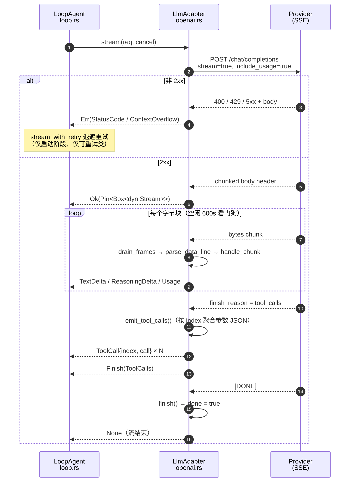

# LLM 适配层：双协议流式与错误重试

> 一句话摘要：适配层只做 transport（发请求、解 SSE、装配工具调用），重试/超时/校验留给策略层；本文逐行对照 `core/loop/{llm_seam,openai,anthropic}.rs` 与 `services/{llm,anthropic}.rs` 讲清这条边界的实现代价。
> 适合谁读：写过 Rust 异步流/SSE 客户端、准备给自家 Agent 接第二家模型 provider 的后端工程师。假设你熟悉 `Future`/`Stream`、`tokio::select!` 与 `CancellationToken`。

---

## 1. 定位：适配层解决的问题

### 1.1 transport 与 policy 分离

`llm_seam.rs` 的模块文档把边界写死了（`tauri/src-tauri/src/core/loop/llm_seam.rs:1-6`）：

> 职责：transport（把 `CompletionRequest` 发送到 provider，产出 `CompletionResponse` 或 `StreamEvent` 流）。
> **重试/超时/输出校验是策略**，由调用方包装（对齐 DSH "transport 与 policy 分离"）——adapter 只做单次请求。

这条分工带来三个直接后果，都能在代码里找到对应物：

| 关注点 | 归属 | 代码位置 |
| --- | --- | --- |
| 发 HTTP、解 SSE、拼 tool_call 参数 | adapter | `core/loop/openai.rs:191-282`、`core/loop/anthropic.rs:96-154` |
| 启动阶段退避重试 | loop 策略 | `core/loop/loop.rs:457-484`（`stream_with_retry`） |
| 非流式退避重试 | services 策略 | `services/llm.rs:219-258`（`retry_loop`） |
| 错误恢复（压缩后重发） | Hook 策略 | `core/loop/loop.rs:486-509`（`try_recover`） |

adapter 因此只做"一次尝试"，不必关心自己是否会被重放——这正是 `stream()` 文档强调"单次尝试"的原因（`llm_seam.rs:99-100`）。

### 1.2 依赖倒置：core 不认识任何 provider

`types.rs` 头部注释（`tauri/src-tauri/src/core/loop/types.rs:1-6`）说明了动机：`core/loop` 自有一套 `ToolCall`/`LlmMessage`/`StreamEvent`，替代原先 rig 的类型，"协议适配器（OpenAI/Anthropic）与 Agent 循环只依赖本类型，不依赖任何具体 provider（依赖倒置）"。

依赖方向在 `core/loop/mod.rs:3-12` 里排成单向链：`types`（无依赖）→ `llm_seam` → `openai`/`anthropic` → `loop`。业务层只看到 `Arc<dyn LlmAdapter>`。选协议的地方只有一个函数：

```rust
// tauri/src-tauri/src/core/agent/loop_tools.rs:3387-3406
pub fn build_loop_adapter(
    llm_cfg: &crate::LlmConfig,
) -> Arc<dyn crate::core::r#loop::LlmAdapter> {
    if llm_cfg.protocol == "anthropic" {
        Arc::new(crate::core::r#loop::AnthropicAdapter::new(
            llm_cfg.endpoint.clone(),
            llm_cfg.api_key.clone(),
            llm_cfg.model.clone(),
            llm_cfg.max_tokens.unwrap_or(0),
            None, // thinking 档位暂不映射（reasoning_effort → thinking_budget 后续接入）
        ))
    } else {
        Arc::new(crate::core::r#loop::OpenAiAdapter::new(
            llm_cfg.endpoint.clone(),
            llm_cfg.model.clone(),
            llm_cfg.api_key.clone(),
            llm_cfg.reasoning_effort.clone(),
        ))
    }
}
```

注意 `thinking_budget` 传的是 `None`：**Agent 路径下 Anthropic 的 extended thinking 不开启**，档位映射只存在于 Chat 命令层（`commands/llm.rs:3059-3065`，见 §4.9）。这是过渡态，注释自己写明了。

### 1.3 为什么由 adapter 装配完整 ToolCall

`StreamEvent::ToolCall` 的契约（`types.rs:143-145`）是"一个**完整**的工具调用（在 finish_reason=ToolCalls 前按模型序逐个抛出；`index` 为模型给定的调用序号）"。若把"拼参数"上提到 loop，会同时污染三处：

1. **loop 得懂协议**：OpenAI 是 `delta.tool_calls[i].function.arguments` 字符串分片累加，Anthropic 是 `content_block_start` 声明 `tool_use` + `input_json_delta` 累加，两套状态机完全不同。
2. **`index` 的语义只有 adapter 能给**：OpenAI 的 `index` 是同一 choice 内的工具序号，装配顺序就是 `Vec` 下标（`openai.rs:411-415` 用 `while self.tool_calls.len() <= idx` 扩容）。
3. **可单测性**：`SseParser` 是纯结构（`openai.rs:311-317`），单测直接 `push_bytes` 喂真实帧（`openai.rs:694-750`），无需起 HTTP。

---

## 2. 类型与契约（表格 + 关键结构体代码）

### 2.1 类型清单

| 类型 | 位置 | 作用 | 关键点 |
| --- | --- | --- | --- |
| `ToolSchema` | `llm_seam.rs:28-33` | 模型可见工具 | `name`/`description`/`parameters`（JSON Schema） |
| `CompletionRequest` | `llm_seam.rs:38-51` | 协议无关请求 | 8 个字段，见 §2.2 |
| `CompletionResponse` | `llm_seam.rs:70-77` | 非流式响应 | `content`（拼接文本块）、`tool_calls`、`usage`、`finish_reason` |
| `LlmAdapter` | `llm_seam.rs:89-108` | transport seam | `model` / `complete` / `stream` |
| `LlmAdapterRef` | `llm_seam.rs:111` | 别名 | `Arc<dyn LlmAdapter>` |
| `ContentBlock` | `types.rs:46-60` | 内容块 | `Text` / `ToolCall` / `ToolResult{is_error}` |
| `LlmMessage` | `types.rs:64-67` | 一条消息 | `role` + `Vec<ContentBlock>` |
| `TokenUsage` | `types.rs:100-113` | 用量 | 5 个 u32，含缓存两字段 |
| `StreamEvent` | `types.rs:137-150` | 流式增量词汇 | 5 个变体 |
| `LlmError` | `types.rs:153-175` | 协议无关错误 | 10 个变体 + `is_retryable` |
| `LoopError` | `core/loop/error.rs:12-23` | 循环级聚合 | `Llm(LlmError)` / `MaxTurns` / `Cancelled` |

```rust
// tauri/src-tauri/src/core/loop/llm_seam.rs:89-111
#[async_trait]
pub trait LlmAdapter: Send + Sync {
    /// 模型标识
    fn model(&self) -> &str;
    /// 非流式补全（单次尝试）
    async fn complete(
        &self,
        req: CompletionRequest,
        cancel: CancellationToken,
    ) -> Result<CompletionResponse, LlmError>;
    /// 流式补全（单次尝试；取消后流以 `LlmError::Cancelled` 结束）。
    ///
    /// 返回已固定的 `Pin<Box<dyn Stream + Send>>`（Unpin，可直接 `next()`）——适配器在源头
    /// 固定具体流类型。适配器内部把 SSE 增量装配为完整工具调用并按模型序抛出。
    async fn stream(
        &self,
        req: CompletionRequest,
        cancel: CancellationToken,
    ) -> Result<Pin<Box<dyn Stream<Item = Result<StreamEvent, LlmError>> + Send>>, LlmError>;
}

/// 方便的 `Arc<dyn LlmAdapter>` 别名。
pub type LlmAdapterRef = Arc<dyn LlmAdapter>;
```

用 `Pin<Box<dyn Stream + Send>>` 而非 `impl Stream` 是务实选择：trait 方法无法用 `async fn` 返回 `impl Trait`（会破坏 `dyn` 兼容），且调用方（`loop.rs:250-251`）需要 `Stream` 本身 `Unpin` 才能直接 `next()`。adapter 在源头把具体类型钉成 `Pin<Box<Unfold<...>>>`（`openai.rs:281`、`anthropic.rs:153`）再 coerce 成 trait 对象。

### 2.2 `CompletionRequest` 的字段契约

```rust
// tauri/src-tauri/src/core/loop/llm_seam.rs:37-51
#[derive(Debug, Clone)]
pub struct CompletionRequest {
    pub messages: Vec<LlmMessage>,
    /// 模型可见工具（空 = 无工具）
    pub tools: Vec<ToolSchema>,
    pub max_tokens: Option<u32>,
    /// OpenAI 兼容顶层 `reasoning_effort`（low/medium/high）
    pub reasoning_effort: Option<String>,
    /// JSON Schema（结构化输出；`None` = 不约束）
    pub output_schema: Option<serde_json::Value>,
    pub temperature: Option<f32>,
    pub stream: bool,
    /// 附加顶层参数字段（合并进请求体；供 provider 特定参数透传）
    pub extra_params: Option<serde_json::Value>,
}
```

| 字段 | OpenAI 通道 | Anthropic 通道 |
| --- | --- | --- |
| `messages` | 逐条 `to_openai_message`（`openai.rs:90`） | 首条 system 提为顶层（`anthropic.rs:45-51`），其余过滤成 `user`/`assistant`（`services/anthropic.rs:277-283`） |
| `tools` | 映射为 `tools[]`（`openai.rs:114-131`） | **完全忽略**（无工具协议面） |
| `max_tokens` | `Some` 才写 `max_tokens`（`openai.rs:96-98`） | 必然写入，来自构造参数（`services/anthropic.rs:224`） |
| `reasoning_effort` | 请求级优先、回退 adapter 默认（`openai.rs:103-107`） | 不消费，改由 `thinking_budget` 控制（`services/anthropic.rs:249-254`） |
| `output_schema` | `response_format.json_schema`（`openai.rs:108-113`） | 不消费 |
| `temperature` | 透传（`openai.rs:99-101`） | **不消费** |
| `stream` | 覆盖参数：`stream()` 固定传 `true`（`openai.rs:197`） | 恒为 `true`（`services/anthropic.rs:226` 写死） |
| `extra_params` | 末位合并，可覆盖任意顶层键（`openai.rs:135-142`） | 不消费 |

**system 消息如何拼接**：adapter 不做"多条 system 合并"。OpenAI 侧原样保留多条 `role:system` 消息；Anthropic 侧 `split_system` 用 `find` 取**第一条** system（`anthropic.rs:46-51`），其余静默丢弃。真正的拼接在更上游——loop 把基础规约、Hook `preamble_override`、时间块、预算提醒依次 `push_str` 成**一条** system（`loop.rs:363-431`），Chat 命令层则 `system_parts.join("\n\n")`（`commands/llm.rs:3117`）。

**`stream_options.include_usage`** 只在流式请求注入（`openai.rs:132-134`），为的是拿收尾 usage 块。`extra_params` 则无条件覆盖（`openai.rs:135-142`）——`model`/`messages` 也会被盖掉。这既是透传能力（书签摘要传 `{"enable_thinking": false}`，`services/llm.rs:833`），也是自伤面，代码里没有白名单。

**`VOLATILE_SYSTEM_MARKER` 与前缀缓存**：常量在 `llm_seam.rs:17-24`，注释把原理写全了——provider 的前缀缓存只能复用**稳定前缀**，loop 每轮往 system 末尾追加 `[当前时间]…`，若断点打在整段 system 上，缓存键一分钟一变。所以 adapter 负责"把 system 拆成稳定前缀 + 易变尾巴，断点只打在前者上"。切分实现在 `services/anthropic.rs:173-183`：

```rust
// tauri/src-tauri/src/services/anthropic.rs:173-183
fn split_system_stable_prefix(system: &str) -> (&str, Option<&str>) {
    const MARKER: &str = "[当前时间]";
    match system.find(MARKER) {
        Some(pos) => {
            // 回退到标记前的空行分隔处，避免把上一句截断
            let split = system[..pos].rfind("\n\n").unwrap_or(pos);
            (&system[..split], Some(&system[split..]))
        }
        None => (system, None),
    }
}
```

这里有一份**重复字面量** `const MARKER = "[当前时间]"`，与 `llm_seam::VOLATILE_SYSTEM_MARKER` 靠单测交叉校验防漂移（`services/anthropic.rs:638-645`）。OpenAI 侧不使用该标记——它依赖 provider 的自动前缀缓存，没有可插入断点的字段，代码里也没有针对 system 的分块逻辑。

---

## 3. 流式请求全流程

以 OpenAI 兼容端点为例（Anthropic 差异见 §4.8-4.10）。步骤都能在 `openai.rs:191-282` 与 `loop.rs:198-291` 找到。

1. **loop 组装请求**：`assemble_request` 产出 system（`loop.rs:363-431`），拼 `history = session.derive_history()`，设 `stream = true`、`max_tokens`、工具 schema（`loop.rs:222-230`）。
2. **策略层重试包装**：`stream_with_retry` 调 `adapter.stream()`；`Err(e)` 且 `e.is_retryable()` 且 `attempt < max_stream_retries`（默认 2，`loop.rs:66`）时退避 `backoff_delay(attempt, 800ms)` 重发（`loop.rs:457-484`）。
3. **adapter 发请求**：`http_client(STREAM_TOTAL_TIMEOUT)` 建 client（总超时 1800s、连接超时 15s，`openai.rs:33-41`），`build_body(&req, true)`，`bearer_auth(api_key)`，`POST {base}/chat/completions`；`tokio::select!` 让 `cancel` 能在连接阶段直接返回 `Cancelled`（`openai.rs:204-207`）。
4. **非 2xx 立即失败**：读完 body → `map_http_error(status, &text)`（`openai.rs:208-212`）。这一步必须在返回流**之前**做，否则启动失败只能从流里冒出来，第 2 步的重试就失效（`core/loop/anthropic.rs:105-107` 的注释专门讲了旧实现踩过的坑）。
5. **返回固定流**：`resp.bytes_stream()` 包进 `StreamState{bytes, parser, cancel, errored}`，`futures::stream::unfold` 驱动，`Box::pin` 后 coerce 成 trait 对象（`openai.rs:214-281`）。
6. **逐块解析**：`bytes.next()` 受 `STREAM_IDLE_TIMEOUT`（600s）看门狗约束；每块 `parser.push_bytes(&chunk)` → `drain_frames()` 切帧 → `parse_data_line()` 抽 `data:` → `handle_chunk()` 累积到 `pending` 队列（`openai.rs:242-246`、`335-351`）。
7. **事件外抛**：unfold 每次 poll 优先 `pending.pop_front()`，把 `TextDelta`/`ReasoningDelta`/`Usage`/`ToolCall`/`Finish` 逐个交给 loop（`openai.rs:224-227`）。
8. **工具调用装配点**：收到 `finish_reason: "tool_calls"` 时先 `emit_tool_calls()` 把 N 个 `PartialToolCall` 按 index 序压成完整 `ToolCall`，再压 `Finish(ToolCalls)`（`openai.rs:381-391`）。
9. **收尾**：`[DONE]` 或字节流结束触发 `finish()`，补发遗漏的 `Finish`，置 `done = true`，unfold 返回 `None`（`openai.rs:454-468`、`229-231`）。



---

## 4. 关键实现细节

### 4.1 请求体构造：只写该写的键

`build_body`（`openai.rs:89-143`）的骨架只有 `model`/`messages`/`stream` 三个键，其余全部条件注入。两个取舍：用老字段 **`max_tokens`** 而不是 `max_completion_tokens`（兼容 Ollama/vLLM/LM Studio）；结构化输出统一成 `{"type":"json_schema","json_schema":{"name":"output","strict":true,"schema":…}}`，`name` 硬编码 `"output"`（`openai.rs:108-113`）。

有意思的是 `services/llm.rs` 反而**主动避开** `output_schema`：书签摘要因"本地引擎如 LM Studio 不支持 strict json_schema"改走 prompt 约束（`services/llm.rs:827-833`），规划同理（`services/llm.rs:563`）。

### 4.2 SSE 帧切分：必须消费分隔符

帧切分是两条独立字节扫描取更早者（`openai.rs:473-494`）：`\n\n` 与 `\r\n\r\n` 都支持，返回**分隔符起始下标**（即帧内容长度）。调用方必须自己消费分隔符，否则下一次 `find_frame_end` 返回 0、`drain(..0)` 不推进 → 死循环：

```rust
// tauri/src-tauri/src/core/loop/openai.rs:335-351
    fn drain_frames(&mut self) {
        while let Some(pos) = find_frame_end(&self.buf) {
            let frame: Vec<u8> = self.buf.drain(..pos).collect();
            // 消费分隔符（`\n\n` 或 `\r\n\r\n`）——必须消费，否则 find_frame_end
            // 在下一次迭代返回 0，drain(..0) 不推进 → 死循环
            if self.buf.starts_with(b"\r\n\r\n") {
                self.buf.drain(..4);
            } else if self.buf.starts_with(b"\n\n") {
                self.buf.drain(..2);
            } else if self.buf.first() == Some(&b'\n') {
                self.buf.drain(..1);
            }
            if let Some(data) = parse_data_line(&frame) {
                self.handle_data(&data);
            }
        }
    }
```

`parse_data_line`（`openai.rs:499-514`）只认 `data:` 前缀，多行 `data:` 用 `\n` 拼接（单测 `openai.rs:686-690` 断言 `{"a":1}\n{"b":2}`），`event:`/`id:`/注释行忽略。`[DONE]` **原样返回**给 `handle_data` 识别（`openai.rs:354-357`），注释解释了为什么不靠连接关闭判结束：keep-alive 连接可能不立即关闭响应体（`openai.rs:496-498`）。JSON 解析失败的行直接 `return` 忽略（`openai.rs:358-361`）——容忍 `ping`/注释，但真正的帧损坏也无声。

### 4.3 多 tool_call delta 的 index 聚合

OpenAI 的流式工具调用按 index 分片到达：首片带 `id` + `name`，后续片只带 `arguments` 片段。适配器用 `Vec<PartialToolCall>` 按 index 散列累积（`openai.rs:303-308`、`409-433`）：

```rust
// tauri/src-tauri/src/core/loop/openai.rs:409-433
            if let Some(tcs) = delta.get("tool_calls").and_then(|v| v.as_array()) {
                for tc in tcs {
                    let idx = tc.get("index").and_then(|v| v.as_u64()).unwrap_or(0) as usize;
                    while self.tool_calls.len() <= idx {
                        self.tool_calls.push(PartialToolCall::default());
                    }
                    let slot = &mut self.tool_calls[idx];
                    if let Some(id) = tc.get("id").and_then(|v| v.as_str()) {
                        if !id.is_empty() {
                            slot.id = Some(id.to_string());
                        }
                    }
                    if let Some(f) = tc.get("function") {
                        if let Some(n) = f.get("name").and_then(|v| v.as_str()) {
                            if !n.is_empty() {
                                slot.name.push_str(n);
                            }
                        }
                        if let Some(a) = f.get("arguments").and_then(|v| v.as_str()) {
                            if !a.is_empty() {
                                slot.arguments.push_str(a);
                            }
                        }
                    }
                }
            }
```

三个细节决定它对真实网关的鲁棒性：

- `index` 缺失时 `unwrap_or(0)`，容忍不规范端点省略 index。
- **`id` 是覆盖、`name`/`arguments` 是追加**：`name` 首片整段到达，后续片空串被 `!n.is_empty()` 挡掉，所以 `push_str` 与"覆盖"等效但能容忍 name 也被切片。
- 空片（`arguments: ""`）不进拼接，避免把空串塞进 JSON。

装配在 `emit_tool_calls`（`openai.rs:438-452`）收口：`std::mem::take` 保证只抛一次，`enumerate()` 把 `Vec` 下标当 `index`；**只有拿到 `id` 的槽位才抛出**（`if let Some(id) = &p.id`），没有 id 的半成品静默丢弃，因为 `ContentBlock::ToolResult.tool_call_id` 无法配对。

### 4.4 三条收尾路径与 finish 幂等

`finish_seen` 是个一次性闸门：`finish()` 只在未见 finish 时压入收尾 `Finish`——有工具调用则 `emit_tool_calls()` + `Finish(ToolCalls)`，否则 `Finish(Other("stream_ended"))`，最后置 `done = true`（`openai.rs:454-468`）。

到达 `finish()` 的路径有三条：`[DONE]`（`openai.rs:354`）、字节流正常结束 `Ok(None)`（`openai.rs:258-259`）、读错误/空闲超时（`openai.rs:248`、`266`）。第三条有个易错点，注释点名了（`openai.rs:249-251`）：`finish()` 可能压入收尾 `Finish`，若不清空 `pending`，下一轮 poll 会先吐 `Err(...)` 再吐 `Ok(Finish)`，让 loop 误以为这轮"正常结束"。所以 Err 分支统一 `pending.clear()`。若 provider 显式给了 `finish_reason`，`finish()` 就是空操作，只补 `done = true`。

另一处防御在 `handle_chunk`：`finish_seen` 后不再处理 delta（`openai.rs:394-397`），因为部分网关在 finish 块后还会发空 delta 块。`usage` 则在 finish 判断**之前**解析（`openai.rs:367-372`），所以"usage 与 finish 同块"的网关不丢用量。

### 4.5 usage 解析与两套缓存口径

`parse_usage`（`openai.rs:526-545`）用一个闭包同时服务顶层键与嵌套键（`prompt_tokens_details.cached_tokens`），路径走空一律归零。`cache_creation_input_tokens` 在 OpenAI 通道**恒为 0**——OpenAI 的自动缓存没有"写入量"概念，这个字段只对 Anthropic 有意义（`types.rs:110-112` 的注释也是这么写的）。

### 4.6 错误体解析 → `LlmError` 映射

```rust
// tauri/src-tauri/src/core/loop/openai.rs:145-157
    /// 根据状态码 + 响应体映射为错误（识别上下文溢出）。
    fn map_http_error(status: reqwest::StatusCode, body: &str) -> LlmError {
        let code = status.as_u16();
        let lower = body.to_ascii_lowercase();
        if code == 400
            && (lower.contains("context_length_exceeded")
                || lower.contains("maximum context length")
                || lower.contains("context window"))
        {
            return LlmError::ContextOverflow;
        }
        LlmError::StatusCode(code, truncate(body, 2000))
    }
```

策略是"**状态码 + 小写关键字匹配**"，不做 JSON 结构解析——各家兼容网关的错误体形状差异太大（OpenAI `error.code`、Ollama `error` 字符串、vLLM 纯文本都有）。响应体截断到 2000 字符，`truncate` 按 `chars()` 计数避免切坏 UTF-8（`openai.rs:607-615`）。`ContextOverflow` 单列一个变体的原因在 `types.rs:167-168`：它是**唯一**能把"确定性失败"转成"可恢复动作"的错误。

### 4.7 超时三件套 + 空闲看门狗 + 取消

| 常量 | 值 | 位置 | 覆盖范围 |
| --- | --- | --- | --- |
| `DEFAULT_TIMEOUT` | 600s | `openai.rs:26` | 非流式 `complete` 总时限 |
| `STREAM_TOTAL_TIMEOUT` | 1800s | `openai.rs:33` | 流式请求总兜底（连接+发送+读 body） |
| `STREAM_IDLE_TIMEOUT` | 600s | `openai.rs:39` | **每块**数据之间的空闲看门狗 |
| `CONNECT_TIMEOUT` | 15s | `openai.rs:41` | 连接阶段快速失败 |
| `ANTHROPIC_REQUEST_TIMEOUT` | 1800s | `services/anthropic.rs:19` | Anthropic 总时限 |
| `ANTHROPIC_STREAM_IDLE_TIMEOUT` | 600s | `services/anthropic.rs:21` | Anthropic 空闲看门狗 |

为什么总超时不够？`openai.rs:27-32` 写得很清楚：`reqwest` 的 `.timeout()` 覆盖整个请求，慢模型长流式生成会被整点掐断（日志表现为 `llm: http: error decoding response body`）；而空闲看门狗"每收到一个数据块即重新计时"，慢但持续吐字的流不会被误杀。代价是注释里标 🟠 L26 的边界：**不输出 `reasoning_content` 且静默思考超过 10 分钟**的推理端点会被误杀为死流（错误明确、可重试）。

取消用 `CancellationToken`，三处埋点：建连前 `tokio::select!` 与 `send` 竞争（`openai.rs:179-182`、`204-207`）；流内 poll 时 `is_cancelled()` → 抛一次 `Err(Cancelled)`，`errored` 标志防重复（`openai.rs:233-239`、`286-291`）；**非流式读体阶段没有埋点**——`resp.text().await` 不可中断（`openai.rs:184`）。

### 4.8 Anthropic：`/v1/messages` 请求体与 system 分块

URL 拼接去重 `/v1`：base 以 `/v1` 结尾用 `{base}/messages`，否则 `{base}/v1/messages`（`services/anthropic.rs:202-209`）。请求头三个：`Content-Type`、`x-api-key`、`anthropic-version: 2023-06-01`（`services/anthropic.rs:299-307`）。system 是**顶层字段**且以内容块数组发送，断点只打稳定前缀：

```rust
// tauri/src-tauri/src/services/anthropic.rs:228-248
        if let Some(s) = system.map(|s| s.trim()).filter(|s| !s.is_empty()) {
            // Prompt caching：system 以内容块数组发送，**只给稳定前缀打断点**。
            // 稳定前缀（规约 + 技能指令）可被 provider 缓存复用；时间块/预算提醒
            // 放在不带断点的第二块里，它们变化不会让缓存键整体失效。
            let (stable, volatile) = split_system_stable_prefix(s);
            let mut blocks: Vec<serde_json::Value> = Vec::new();
            let stable = stable.trim();
            if !stable.is_empty() {
                blocks.push(serde_json::json!({
                    "type": "text",
                    "text": stable,
                    "cache_control": { "type": "ephemeral" }
                }));
            }
            if let Some(v) = volatile.map(str::trim).filter(|v| !v.is_empty()) {
                blocks.push(serde_json::json!({ "type": "text", "text": v }));
            }
            if !blocks.is_empty() {
                body["system"] = serde_json::json!(blocks);
            }
        }
```

三个边界：稳定前缀为空时**只发一个无断点块**（不会出现空 text 块）；`volatile` 块不带 `cache_control`；无 system 时干脆不写该字段（单测 `services/anthropic.rs:594-596`）。

### 4.9 Anthropic：thinking 档位与 token 预算

四个常量在 `services/anthropic.rs:27-30`，注释注明"逐档递增，对齐主流 Agent 的 token 预算映射；Anthropic 官方建议范围 1024~32000"：

| 档位 | 常量 | 值 |
| --- | --- | --- |
| `low` | `THINK_BUDGET_LOW` | 2048 |
| `medium` | `THINK_BUDGET_STANDARD` | 4096 |
| `high` | `THINK_BUDGET_HIGH` | 8192 |
| `xhigh` | `THINK_BUDGET_MAX` | 16384 |

映射发生在 Chat 命令层（`commands/llm.rs:3059-3065`），`auto`/空串/其它值 → `None` = 不启用。请求体侧有个协议硬约束：

```rust
// tauri/src-tauri/src/services/anthropic.rs:249-254
        if let Some(budget) = self.thinking_budget {
            // thinking 开启时 max_tokens 必须大于 budget_tokens
            let max_tokens = self.max_tokens.max(budget + 1024);
            body["max_tokens"] = serde_json::json!(max_tokens);
            body["thinking"] = serde_json::json!({ "type": "enabled", "budget_tokens": budget });
        }
```

`max(self.max_tokens, budget + 1024)` 只是协议要求（`max_tokens` 必须严格大于 `budget_tokens`）；`+1024` 这个缓冲值是实现选择，单测 `services/anthropic.rs:599-614` 也只断言了"大于 budget"。`max_tokens` 另有兜底：构造时 `if max_tokens > 0 { max_tokens } else { 4096 }`（`services/anthropic.rs:197`）。

### 4.10 Anthropic：事件装配与"先发起再返回流"

事件解析走弱类型 JSON（`SseEvent`，`services/anthropic.rs:67-116`），`handle_sse_line` 按 `type` 分派（`services/anthropic.rs:484-532`）：

| 事件 | 处理 | 位置 |
| --- | --- | --- |
| `content_block_delta` + `delta.type == text_delta` | 累积正文 + 回调 `Delta` | `services/anthropic.rs:485-495` |
| `content_block_delta` + `thinking_delta`/`signature_delta` | **忽略**，不进正文 | `services/anthropic.rs:496-498` |
| `message_start` / `message_delta` | 更新 usage（`message.usage` 优先，回退顶层 `usage`） | `services/anthropic.rs:501-523` |
| `error` | 只 `log::warn!`，**不终止流** | `services/anthropic.rs:524-530` |
| `content_block_start`/`stop`、`message_stop`、`ping` | 忽略 | `services/anthropic.rs:531` |

注意这里没有工具状态机：`tool_use` 块的 `input_json_delta` 根本不被识别（只处理 `text_delta`，其它 delta_type 落到 `_ => {}`）。适配器层把结论写明白了（`core/loop/anthropic.rs:8-9`）："现有客户端不含工具编排（tool_use/tool_result 块），v3 Agent 路径使用 Anthropic 时模型不可见工具（等同纯对话）"。

最关键的架构决策是 `open_stream` 与 `pump` 的拆分：

```rust
// tauri/src-tauri/src/core/loop/anthropic.rs:105-114
        // **先发起请求再返回流**：启动阶段的 429/5xx/连接失败必须以 `Err` 从 stream()
        // 返回，loop 的 `stream_with_retry` 才能退避重试（旧实现在 spawn 内部发起，
        // 错误只能从流里冒出来，启动重试对 Anthropic 完全失效）。
        let opened = self
            .client
            .open_stream(system.as_deref(), &messages)
            .await
            .map_err(map_anthropic_error)?;

        let (tx, rx) = tokio::sync::mpsc::channel::<Result<StreamEvent, LlmError>>(64);
```

响应建立后才 spawn 消费任务，用容量 64 的 mpsc 把回调事件转成流（`anthropic.rs:117-152`）：`pump` 正常返回就发 `Finish(Stop)`，出错则把 `map_anthropic_error` 的结果塞进通道。Anthropic 的 `complete()` 是"流式收集"（`anthropic.rs:70-94`），因为底层客户端只有流式接口（`services/anthropic.rs:226` 把 `stream: true` 写死），代价是 `finish_reason` 恒为 `Some(Stop)`、`tool_calls` 恒为空。

### 4.11 用 `ContentBlock` 抹平协议差异

| 差异 | OpenAI 表达 | Anthropic 表达 | mdgo 的塌缩方式 |
| --- | --- | --- | --- |
| system 位置 | `messages[0].role = "system"` | 顶层 `system` 字段 | `LlmRole::System` 消息；Anthropic 侧提为顶层（`anthropic.rs:45-51`） |
| 工具调用 | assistant 的 `tool_calls[]`（`content` 可为 `null`） | `content` 数组里的 `tool_use` 块 | `ContentBlock::ToolCall(ToolCall)` |
| 工具结果 | 独立 `role:"tool"` 消息 + `tool_call_id` | user 消息里的 `tool_result` 块 | `LlmRole::Tool` + `ContentBlock::ToolResult` |
| 错误标记 | 无原生字段 | `tool_result.is_error` | `ToolResult.is_error: bool`（`#[serde(default)]`） |

`to_openai_message`（`openai.rs:618-668`）的 `LlmRole::Tool` 分支把 `Text` 与 `ToolResult.content` 拼成 `content`，输出 `{"role":"tool","content":…,"tool_call_id":…}`。注意解构里的 `..` 把 `is_error` **吞掉了**——OpenAI 协议没有这个字段，错误只能靠工具自己写进 `content` 文本。所以 `is_error` 是 Anthropic 方言的原生能力，在 OpenAI 通道上是"有损降级"。

assistant 带工具调用时 `content` 的取值也有讲究（`openai.rs:654-661`）：`tool_calls` 非空且无文本时写 `null`，有文本时写字符串——OpenAI 要求 `content` 键存在。

配对不变式由 session 层保证而非适配器：`derive_history` 两遍扫描先建 `has_result`/`assistant_call` 索引，**只投影已配对的** `ToolCall` 与 `ToolResult`（`core/loop/session.rs:188-267`）。注释解释了按 step 遮蔽的理由："一个 step = 一次 assistant 消息 + 它的全部工具结果；按 step 遮蔽才能保证 tool_call 与 tool_result 同进同退（否则会产生协议拒绝的孤儿消息）"（`session.rs:279-283`）。适配器由此可以假设输入始终配对。

### 4.12 `services/llm.rs`：非流式重试策略

`retry_loop` 是泛型重试骨架（`services/llm.rs:219-258`），三个常量决定耐心（`services/llm.rs:171-180`）：`LLM_RETRY_MAX = 5`（首次之外的**额外**尝试，共 6 次）、`LLM_RETRY_BASE_MS = 2000`（每次翻倍）、`LLM_RETRY_MAX_MS = 32_000`。第三个常量的注释记录了 M26 修复：旧值 120s 在退避序列下永远达不到，是死常量，还让最坏等待膨胀到小时级。

```rust
// tauri/src-tauri/src/services/llm.rs:234-254
        match call().await {
            Ok(value) => return Ok(value),
            Err(e) => {
                // 达到上限 / 不可重试 / 已取消 → 立即返回（取消优先于重试）
                if attempt >= max_retries || !is_retryable(&e) || cancel.is_cancelled() {
                    return Err(e);
                }
                let delay = base_delay
                    .saturating_mul(2u32.saturating_pow(attempt as u32))
                    .min(max_delay);
                log::warn!(
                    "[llm] 调用失败，{}ms 后第 {} 次重试: {}",
                    delay.as_millis(),
                    attempt + 1,
                    e
                );
                tokio::select! {
                    _ = cancel.cancelled() => return Err(e),
                    _ = tokio::time::sleep(delay) => {}
                }
                attempt += 1;
            }
        }
```

退避序列是 `2s / 4s / 8s / 16s / 32s`（`2^attempt` 封顶 32s），**无抖动**——与 loop 侧 `backoff_delay` 的 `+0..400ms` 抖动（`loop.rs:527-534`）不同。没有 jitter 意味着多请求同时打满限流会同步重试。

`is_retryable` 是注入的函数指针（泛型 `E` 让骨架能给非 `LlmError` 复用，单测里就用 `String` 当错误，`services/llm.rs:963-984`）；业务侧固定传 `is_retryable_llm_error`，它只是 `e.is_retryable()` 的转发（`services/llm.rs:207-209`）。`completion_with_retry` → `completion_with_retry_n(request, cancel, LLM_RETRY_MAX)`（`services/llm.rs:356-383`）；**查询扩展**用独立预算 `QUERY_EXPANSION_RETRY_MAX`，因为"预检索预算从紧，总时限由调用方 timeout 包裹"（`services/llm.rs:453-455`）。

`reasoning_effort` 透传只有一处，做的是归一化而非映射（`services/llm.rs:301-309`）：`trim().to_lowercase()` 让前端传来的 `"High"` 也合法，之后原样进请求体，不做枚举校验。若 provider 只认 `low/medium/high`，传 `xhigh` 会被拒（400 → `InvalidRequest` → 不重试）。

### 4.13 多模型路由与客户端指纹缓存

`LLMClient` 只持有一个 `Arc<dyn LlmAdapter>`（`services/llm.rs:260-269`），且**固定为 `OpenAiAdapter`**（`services/llm.rs:282-287`）。也就是说规划/摘要/评审/扩展/书签摘要这些非流式业务，即使配置 `protocol = "anthropic"` 也仍走 OpenAI 兼容协议——Anthropic 适配器只接在 Agent/Chat 的流式路径上。这个点容易被误解，代码里没有显式断言或报错。

多模型路由靠 `ModelRole` + 指纹缓存（`lib.rs:332-352`）：指纹是 `{endpoint}|{model}|{api_key}|{reasoning_effort}`，命中即 clone（`LLMClient` 内部是 `Arc`，clone 廉价）；容量上限 `MAX_CACHED_CLIENTS = 8`，超出时 `cache.keys().next()` 删一条。指纹含 `api_key`（轮换密钥即重建）、含 `reasoning_effort`（改档位即重建）。注意 `HashMap::keys()` 是**哈希序**而非插入序，所以注释里的"近似 FIFO"实际是"任意淘汰一条"，与真正 LRU/FIFO 都有偏差。路由本身在 `LlmConfig::model_for_role`（`lib.rs:103-118`）：`Planner`/`Summary` 各有可选模型，空则回退主模型。

---

## 5. 设计取舍与失败模式

### 5.1 `is_retryable` 判定表

```rust
// tauri/src-tauri/src/core/loop/types.rs:178-186
    /// 是否可重试（瞬时错误：429/408/5xx/连接/超时/流中断/provider 文本）。
    /// 对齐 DSH `retryableCodes`（RATE_LIMIT/SERVER/TIMEOUT/TRANSPORT）。
    pub fn is_retryable(&self) -> bool {
        match self {
            LlmError::Http(_) | LlmError::Timeout | LlmError::Provider(_) => true,
            LlmError::StatusCode(code, _) => *code == 429 || *code == 408 || (500..=599).contains(code),
            _ => false,
        }
    }
```

| 变体 | 可重试 | 语义 |
| --- | --- | --- |
| `Http(_)` | ✅ | 连接重置/读中断/reqwest 超时全部归到这里（`types.rs:182`） |
| `Timeout` | ✅ | **当前无构造点**（见 §5.3） |
| `Provider(_)` | ✅ | 无状态码的 provider 文本，保守可重试 |
| `StatusCode(429)` | ✅ | 限流（`types.rs:183`） |
| `StatusCode(408)` | ✅ | 请求超时 |
| `StatusCode(500..=599)` | ✅ | 服务端错误 |
| `StatusCode(其它)` | ❌ | 400/401/403/404 等确定性业务错误（`types.rs:183`） |
| `Sse(_)` / `Json(_)` | ❌ | 解析失败，重发大概率同样失败（`types.rs:184` 的 `_`） |
| `Cancelled` | ❌ | 用户意图 |
| `ContextOverflow` | ❌ | 不能靠重发解决，必须压缩后重发 |
| `InvalidRequest(_)` | ❌ | 参数/鉴权错误 |
| `Other(_)` | ❌ | 未知，保守不重试 |

两条容易忽略的后果：`Provider` 可重试意味着"provider 文本错误"要退避 5 次；`Other` 不可重试意味着漏分类的错误会直接失败——所以适配器宁可把错误塞进 `StatusCode`/`Http` 也不要塞 `Other`。

Anthropic 侧分类在 `services/anthropic.rs:139-159`，比 OpenAI 多一个 **529（overloaded）**，且 `None` 状态码（连接阶段）恒可重试：

```rust
// tauri/src-tauri/src/core/loop/anthropic.rs:162-173
fn map_anthropic_error(e: crate::services::anthropic::AnthropicError) -> LlmError {
    if e.is_context_overflow() {
        return LlmError::ContextOverflow;
    }
    if e.is_retryable() {
        return match e.status {
            Some(code) => LlmError::StatusCode(code, e.message),
            None => LlmError::Http(e.message),
        };
    }
    LlmError::InvalidRequest(e.to_string())
}
```

顺序必须是"溢出 → 可重试 → 其余一律 `InvalidRequest`"，最后一条兜底而不用 `Other`，就是为了让它真正不可重试。注释记录了修复动机（`anthropic.rs:157-161`）：旧实现把所有失败包成 `Provider`，副作用是"401/403/400 也会被退避重试，一次配错 Key 要多等数秒；`ContextOverflow` 永远不出现，`OverflowRetryHook`/`emergency_compact` 对 Anthropic 无效"。

### 5.2 与 loop 的启动重试 / request-error 钩子的分工

循环细节见 [02-Loop 内核-turn-step 状态机与请求装配.md](<02-Loop 内核-turn-step 状态机与请求装配.md>)，适配层只需知道三个契约：

| 层次 | 何时生效 | 重试什么 | 参数 | 位置 |
| --- | --- | --- | --- | --- |
| `stream_with_retry` | `adapter.stream()` 返回 `Err` | 仅**启动阶段**（尚未产出内容）的可重试错误 | `max_stream_retries = 2`、`base 800ms` + 抖动 | `loop.rs:457-484`、`66-67` |
| `try_recover` | 启动失败或流内失败 | `on_request_error` 返回 `Retry` **且** `retry_prepare` 推进成功 | `max_request_retries = 1` | `loop.rs:486-509`、`64` |
| `retry_loop` | `adapter.complete()` 返回 `Err` | 非流式全阶段 | 5 次、2s 起、32s 封顶 | `services/llm.rs:219-258` |

1. **启动错误必须从 `stream()` 返回 `Err`，不能只从流里冒**。这是 `open_stream` 拆分的全部理由（`core/loop/anthropic.rs:105-107`），也是 `openai.rs:208-212` 在返回流之前检查状态码的原因。
2. **流内错误不该被重试**。一旦吐过字节，重放会重复输出文本、甚至重复触发工具副作用。`loop.rs:304-315` 用"`step_content.is_empty() && step_tool_calls.is_empty()`"作为是否交给 `request-error` 的判据——适配器每抛出一个 `TextDelta`，就把这条请求的可恢复性降一级。
3. **`ContextOverflow` 必须能被稳定产出**。`on_request_error` 本身没有内置实现（`hooks.rs:101-103` 返回 `None`），溢出恢复靠注入的 Hook；OpenAI 靠 `400 + context_length_exceeded/maximum context length/context window`（`openai.rs:149-155`），Anthropic 靠 `400 + prompt is too long` 等四个关键字（`services/anthropic.rs:150-159`）。

### 5.3 降级与失败模式清单

**已实现的降级**

- **非流式失败 → 业务 fail-open**：规划失败返回 `None`（`services/llm.rs:591-594`）、扩展失败返回 `ExpansionResult::default()`（`services/llm.rs:467-470`）、摘要失败返回 `None`（`services/llm.rs:707-713`）。上层继续跑，只是没有规划/扩展/摘要。
- **结构化输出失效 → prompt 兜底**：`review_text`/书签摘要用本地 `JsonSchemaValidator` 二次校验，网关不支持 `response_format` 也不致命（`services/llm.rs:625-646`、`911-925`）。
- **Anthropic 无工具 → 纯对话**：`tools` 被忽略，模型看不见工具，退化成语义正确的普通对话（`core/loop/anthropic.rs:8-9`）。

**代码中未见 / 明确未实现**

1. **Anthropic 工具协议面完全缺失**：`split_system` 把 `LlmRole::Tool` 消息映射成 `role:"tool"` 后，在 `open_stream` 里被 `filter(|m| m.role == "user" || m.role == "assistant")` 丢掉（`services/anthropic.rs:277-283`）；`tool_use`/`input_json_delta` 没有任何解析分支（`services/anthropic.rs:484-532`）。Anthropic 走 Agent 路径时，历史里的工具结果会**静默消失**（不报错）。
2. **Anthropic 取消不产生 `LlmError::Cancelled`**：`pump` 在 `cancel.cancelled()` 时 `break` 并 `Ok(full_content)`（`services/anthropic.rs:363-367`），适配器随后发 `Finish(Stop)`（`core/loop/anthropic.rs:139-142`）。这与 trait 文档"取消后流以 `LlmError::Cancelled` 结束"（`llm_seam.rs:99`）不一致；实际症状被 loop 掩盖——loop 在 `select!` 的 `biased` 分支里自己先捕获取消（`loop.rs:261-263`）。
3. **Anthropic 通道 `try_send` 会静默丢事件**：回调里 `let _ = tx.try_send(...)`（`core/loop/anthropic.rs:121`、`129`），容量 64（`anthropic.rs:114`）。消费端慢时超出的 `TextDelta` 直接丢弃，不重试、不报错。
4. **流式 usage 可能丢失**：OpenAI 标准流把 `usage` 放在 `finish_reason` **之后**的独立块里，而 loop 收到 `Finish` 即 `finished = true` 退出消费循环（`loop.rs:260-284`），后续 `Usage` 不会被读到；代码中未见"等 usage 再收尾"的处理。Anthropic 不受影响（usage 在 `message_start`/`message_delta`，早于适配器补发的 `Finish`）。
5. **`LlmError::Timeout` 无构造点**：全仓只出现在 `is_retryable`、`Display`、测试里（`types.rs:182`、`196`、`235`；`services/llm.rs:1095`）。reqwest 超时经 `e.to_string()` 变成 `LlmError::Http`，空闲看门狗也构造成 `Http("流式响应空闲超时…")`（`openai.rs:273-276`）。这个变体是预留的。
6. **非流式读体阶段不可取消**：`resp.text().await` 没有 `select!` 保护（`openai.rs:184`），600s 内取消只能等。
7. **`extra_params` 无白名单**：可覆盖 `model`/`messages`/`stream`（`openai.rs:135-142`）；两边都不是 object 时整体忽略，不报错。
8. **Anthropic 无 `temperature`/`top_p`/`stop_sequences`**：`build_request_body` 只写 `model`/`max_tokens`/`messages`/`stream`/`system`/`thinking`（`services/anthropic.rs:217-256`）。
9. **`is_retryable_status_code` 是死代码**：`services/llm.rs:182-187` 自带 `#[allow(dead_code)]`，注释说明"当前仅测试路径使用…保留供回归"。
10. **`services/llm.rs:160-167` 的文档注释仍在讲 rig**（"基于 Rig OpenAI provider…Rig 默认注入 `stream_options`"），但实现早已换成自研 `OpenAiAdapter`，且 `stream_options` 是自己显式注入的（`openai.rs:132-134`）。

### 5.4 旧文档与现码的偏差（写作时核对）

| 旧文档断言 | 现码事实 |
| --- | --- |
| `docs/Agent 短板补齐规划.md:67`、`docs/Agent 能力验收清单.md:125`："上限 120s、最多 5 次尝试" | `LLM_RETRY_MAX_MS = 32_000`（32s，`services/llm.rs:180`）；`LLM_RETRY_MAX = 5` 是**重试**次数，总尝试 6 次（`services/llm.rs:171-172`） |
| `docs/Agent 能力建设归档.md:86`："`LLMClient::new` 注入 300s 超时 client" | `DEFAULT_TIMEOUT = 600s`（`openai.rs:26`）；`openai.rs:70-71` 自己标注"旧注释默认 300s 已过时" |
| `docs/Agent 内核架构.md` 系列称双协议已统一 | 工具协议面未统一：Anthropic 无 `tool_use`/`tool_result` 映射（`core/loop/anthropic.rs:8-9`、`services/anthropic.rs:484-532`） |

---

## 6. 小结与相关文件

适配层做对的三件事，值得抄：

1. **把"装配"放进 adapter**：SSE 增量 → 完整 `ToolCall` 的状态机被关在 `SseParser` 里，纯函数可单测，loop 只看到协议无关的 `StreamEvent`。
2. **启动错误必须同步返回**：`open_stream` / `openai.rs` 都在返回流之前检查状态码，这是"启动重试"真正生效的前提。
3. **错误分类决定恢复能力**：`ContextOverflow` 与 `InvalidRequest` 两个变体的存在，使"压缩后重试"与"立刻失败"成为可能；把它们混进 `Provider` 会让整个恢复策略失效（`core/loop/anthropic.rs:157-161` 的教训）。

还没做对的，在 §5.3 里逐条列了——最影响可用性的是 Anthropic 工具协议面缺失和流式 usage 的时序。

| 文件 | 职责 |
| --- | --- |
| `tauri/src-tauri/src/core/loop/types.rs` | 协议无关类型：`ContentBlock`/`LlmMessage`/`StreamEvent`/`TokenUsage`/`LlmError` + `is_retryable` |
| `tauri/src-tauri/src/core/loop/llm_seam.rs` | `LlmAdapter` trait、`CompletionRequest`/`CompletionResponse`/`ToolSchema`、`VOLATILE_SYSTEM_MARKER` |
| `tauri/src-tauri/src/core/loop/openai.rs` | OpenAI 兼容适配器：请求体、`SseParser`、tool_call 聚合、错误映射、三档超时 |
| `tauri/src-tauri/src/core/loop/anthropic.rs` | Anthropic 适配器：消息/system 拆分、`open_stream` + mpsc 流转 `StreamEvent`、错误映射 |
| `tauri/src-tauri/src/services/anthropic.rs` | Anthropic 底层客户端：`/v1/messages`、system 分块 + `cache_control`、thinking 预算、SSE 事件解析 |
| `tauri/src-tauri/src/services/llm.rs` | 非流式业务客户端：`retry_loop`、`reasoning_effort` 透传、规划/扩展/摘要/评审/书签摘要 |
| `tauri/src-tauri/src/core/agent/loop_tools.rs` | `build_loop_adapter`：按 `LlmConfig.protocol` 选择实现 |
| `tauri/src-tauri/src/lib.rs` | `model_for_role` 路由 + `llm_client_for_cfg` 指纹缓存（上限 8） |
| `tauri/src-tauri/src/core/loop/loop.rs` | 消费方：`stream_with_retry`、`try_recover`、system 装配 |

系列其他篇：[00-导读.md](00-导读.md)、[01-Agent 技术全景-一次提问的完整链路.md](<01-Agent 技术全景-一次提问的完整链路.md>)、[02-Loop 内核-turn-step 状态机与请求装配.md](<02-Loop 内核-turn-step 状态机与请求装配.md>)、[04-工具系统-契约-注册与并行调度.md](<04-工具系统-契约-注册与并行调度.md>)、[07-上下文工程-Token 预算与压缩.md](<07-上下文工程-Token 预算与压缩.md>)。
