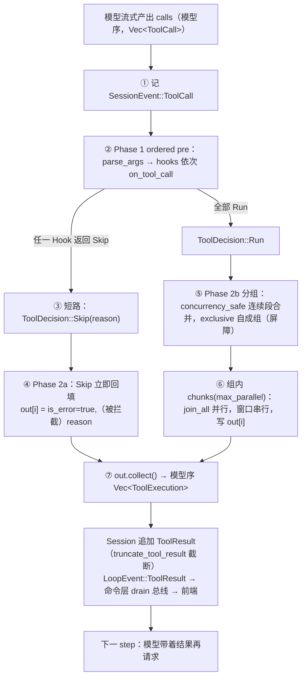

---
title: 工具系统：契约、注册与并行调度
date: 2026-11-10
tags: [Agent, Rust, 工具调用, 并发调度]
summary: 从 ToolSpec/Tool/ToolRegistry/ToolEventSink 四件套出发，拆解 mdgo Agent 的工具注册表、三层可见性与「ordered pre + exclusive 屏障 + 有界并行 + 模型序提交」调度器。
---

# 工具系统：契约、注册与并行调度

> 本文只讲一件事：模型吐出 `tool_calls` 之后，到结果回到模型历史之前，这一小段路径上到底发生了什么。内容包括接口契约（谁依赖谁）、注册表怎么拼出来、可见性为什么分三层、并行调度器的两个阶段与失败模式。
>
> 读者画像：有 Rust 后端经验，读过一点 async/tokio，想照着改或照着抄这套工具系统的人。所有结论以当前代码为准，行号标注格式为 `文件:行号`。

## 1. 定位

### 1.1 在 loop 里的位置

工具系统是 `core/loop` 的「执行侧」：上游是模型流式输出（`core/loop/openai.rs` / `anthropic.rs`），下游是会话事件（`SessionEvent::ToolResult`）与前端事件（`agent:tool_call` / `agent:tool_result`）。`LoopAgent::turn` 的 step 循环里，工具执行是一个明确的水位线（`tauri/src-tauri/src/core/loop/loop.rs:324-356`）：

```text
stream 收集 ToolCall → 追加 AssistantMessage → 追加 ToolCall 事件
  → execute_tool_calls(...)（Hook 裁决 + 并行调度）
  → 每个结果 append 进 Session（进模型历史前截断）
  → 回到 step 顶部，模型再请求一次
```

也就是说，工具系统本身**不碰模型、不碰 HTTP、不碰审批弹窗**。它只拿到「一批模型序的 ToolCall」，返回「一批同序的 ToolExecution」。这条边界是整套设计的骨架。

### 1.2 四个文件的职责

| 文件 | 职责 | 关键导出 |
| --- | --- | --- |
| `core/loop/tool.rs` | 契约层：schema、执行、注册表、事件出口四个独立接口 | `ToolSpec` / `Tool` / `ToolRegistry` / `ToolEventSink` / `HashMapToolRegistry` |
| `core/loop/tool_calls.rs` | 调度层：Hook 裁决、分组、有界并行、模型序提交、超时/取消 | `execute_tool_calls` / `ToolExecution` / `DEFAULT_MAX_PARALLEL` |
| `core/agent/loop_tools.rs` | 业务层：43 个 `impl Tool`、注册表构建、技能/MCP/桥接/外部工具的增量注册、`BusToolEventSink` | `build_loop_tool_registry` / `register_skill_tools` / `register_mcp_tools` |
| `core/agent/tools/mod.rs` | 基础设施层：文件读写实现、`ToolCallBus` 轨迹总线、重复调用熔断、输出截断常量 | `tool_call_bus` / `record_tool_call` / `record_tool_result` |

设计意图写在模块头注释里：**接口隔离**（schema / 执行 / 事件 / 注册表分离）、**依赖倒置**（工具不感知 LLM/循环/审批，只依赖注入的运行上下文）、**开闭原则**（新增工具 = 实现 `Tool` 并注册，不改调度器）（`tauri/src-tauri/src/core/loop/tool.rs:3-11`）。这不是空话——调度器 `execute_tool_calls` 的入参里确实只有 `&dyn ToolRegistry`、`&[Arc<dyn LoopHook>]` 和一个 sink，没有任何 Agent/Provider 类型（`tauri/src-tauri/src/core/loop/tool_calls.rs:35-44`）。

## 2. 契约与数据结构

### 2.1 ToolSpec：一份 spec，两种视角

```rust
pub struct ToolSpec {
    pub name: String,
    pub description: String,
    /// JSON Schema（模型可见 `parameters`）
    pub parameters: Value,
    /// 输出契约（可选；结构化结果校验/前端类型化渲染用，永不上模型）
    pub output_schema: Option<Value>,
    /// 单次执行超时（毫秒；超过取消并记为失败，永不上模型）
    pub timeout_ms: Option<u64>,
    /// 是否可与同轮其他工具并行执行（**默认 false = exclusive 串行**）
    pub concurrency_safe: bool,
}
```

（逐字来自 `tauri/src-tauri/src/core/loop/tool.rs:23-33`）

这五个字段的分配很关键，它是「**白名单投影**」：只有 `name` / `description` / `parameters` 会被投影给模型，另外三个是**纯调度元数据**。投影发生的地方在 `assemble_tool_schemas`——它逐字段构造 `ToolSchema`，而不是把 `ToolSpec` 直接序列化下发：

```rust
out.push(ToolSchema {
    name: s.name.clone(),
    description: s.description.clone(),
    parameters: s.parameters.clone(),
});
```

（`tauri/src-tauri/src/core/loop/loop.rs:443-447`；`ToolSchema` 只有这三个字段，见 `tauri/src-tauri/src/core/loop/llm_seam.rs:26-33`）

为什么值得专门设计成「投影」而不是「给 `ToolSpec` 打个 `#[serde(skip)]`」？三个理由：

1. **协议兼容性**：`output_schema` 是给前端类型化渲染/结构化校验用的（注释原文），一旦混进 OpenAI 的 `tools[].function` 里，轻则被网关忽略，重则被严格校验的端点拒请求。
2. **信息泄漏面**：`timeout_ms`/`concurrency_safe` 暴露给模型没有收益，只会诱导模型对调度行为做猜测（例如「这个工具可以并行，我一次发五个」）。
3. **演进安全**：以后往 `ToolSpec` 加字段（重试策略、审计标签、预算成本），默认行为是「不上模型」，而不是「意外上了模型」。默认安全比默认开放更好维护。

`ToolSpec::new` 把两个可选字段填成 `None`、并发标记填成 `false`（`tauri/src-tauri/src/core/loop/tool.rs:36-47`）。所以每个工具的最小实现只需要关心「名字 + 描述 + 参数 schema」。

### 2.2 Tool：唯一的执行入口

```rust
#[async_trait]
pub trait Tool: Send + Sync {
    fn spec(&self) -> &ToolSpec;
    /// 执行一次调用；返回**规范化的无损 JSON 值**（对齐 DSH canonical output）。
    /// 必须尊重 `ctx.cancel`（取消后尽快返回 [`ToolError::Cancelled`]）。
    async fn execute(&self, args: Value, ctx: &ToolRunContext<'_>) -> Result<Value, ToolError>;
}
```

（`tauri/src-tauri/src/core/loop/tool.rs:113-119`）

两个约定值得注意：

- `spec(&self) -> &ToolSpec` 返回**引用**，意味着 spec 必须活到工具对象生命周期结束。因此绝大多数工具用 `static OnceLock<ToolSpec>` 惰性构造一次（如 `KbSearchTool`，`tauri/src-tauri/src/core/agent/loop_tools.rs:164-188`）；只有 schema 依赖运行时配置的（桥接工具、外部工具、MCP 工具）才把 spec 存成结构体字段（`BridgeTool`，`tauri/src-tauri/src/core/agent/loop_tools.rs:1934-1953`）。
- 返回值是 `Value` 而不是 `String`。这样工具可以返回结构化对象（列表、diff 数组），由调度器统一决定怎么变成模型可读文本（见 §4.3）。工具自己不做「序列化成人类可读字符串」的决策。

### 2.3 ToolRunContext：只注入四样东西

```rust
pub struct ToolRunContext<'a> {
    pub request_id: &'a str,
    pub call_id: &'a str,
    pub cancel: &'a CancellationToken,
    /// 轨迹/前端事件出口
    pub sink: &'a dyn ToolEventSink,
}
```

（`tauri/src-tauri/src/core/loop/tool.rs:90-96`）

四个字段全是不带所有权的借用，生命周期就是「单次调用」。这是刻意的：

- `request_id`：写轨迹/日志的关联键；工具不拿它去查全局状态（真实配置是通过 `KbSearchConfig.request_id` 提前注入到工具结构体里的，见 `tauri/src-tauri/src/core/agent/mod.rs:319-320`）。
- `call_id`：让工具的 `on_call`/`on_result` 能对上同一次调用。
- `cancel`：唯一的取消信号源，工具必须响应。
- `sink`：唯一的对外出口。

**为什么不让工具感知 LLM / 审批？** 因为这两件事都需要「跨工具聚合的信息」：审批要看本轮完整动作序列、要弹一个全局模态框、要 fail-closed；LLM 调用要看 token 预算、要重试、要流式。把这些塞进工具上下文，等于让 43 个工具各自实现一份审批语义（必然不一致），也会让工具单测必须 mock 一个 LLM。现在的分工是：审批/门禁在 Hook 层（`LoopHook::on_tool_call`，`tauri/src-tauri/src/core/loop/hooks.rs:86-88`），在**调用之前**统一裁决；工具只负责「被放行之后怎么干」。例外是 `self_review`/`doc_agent` 这类**工具本身就是一次 LLM 调用**的场景——那也只在工具内部通过业务服务完成，不外泄到契约层。

### 2.4 ToolRegistry 与 HashMapToolRegistry

```rust
pub trait ToolRegistry: Send + Sync {
    fn get(&self, name: &str) -> Option<Arc<dyn Tool>>;
    fn names(&self) -> Vec<String>;
}
```

（`tauri/src-tauri/src/core/loop/tool.rs:122-125`）

只有「按名取」和「列名」两个方法，没有 `register`。这是接口隔离的体现：调度器和 loop 只需要查询，**注册能力只存在于具体实现 + 构建期**（`HashMapToolRegistry::register`，`tauri/src-tauri/src/core/loop/tool.rs:138-141`），避免运行期出现「loop 中途往注册表塞工具」这种不可推理的路径。`names()` 返回 `Vec<String>` 而不是借用型迭代器，是为了保持 trait object 安全（返回 `impl Iterator` 会让 `ToolRegistry` 不能作为 `dyn`）——代价是每次调用克隆一份名字，但 `names()` 只在 `active_tools == None` 时用（`tauri/src-tauri/src/core/loop/loop.rs:435-438`），成本可忽略。

### 2.5 ToolEventSink、ToolResult、ToolError

```rust
pub trait ToolEventSink: Send + Sync {
    fn on_call(&self, call_id: &str, tool: &str, args_preview: &str, args: &Value);
    fn on_result(&self, call_id: &str, tool: &str, ok: bool, summary: &str, result: Option<&str>);
}
```

（`tauri/src-tauri/src/core/loop/tool.rs:99-102`）

sink 是**同步方法**，不是 async——因为它只做「写内存总线/写日志」，不该引入等待点；一旦 async，工具的每个执行路径都要 `?` 一个可能与业务无关的错误。默认实现 `NullSink` 直接丢弃（`tauri/src-tauri/src/core/loop/tool.rs:105-110`），让「没接命令层」的场景零成本。

`ToolResult` 只有 `call_id` / `content` / `is_error` 三个字段（`tauri/src-tauri/src/core/loop/tool.rs:50-55`）：它是要回填进模型历史的，越窄越好；富信息（耗时、结构化结果）走 sink 或 `ToolCallEvent`，不进历史。

`ToolError` 六个变体（`NotFound` / `InvalidArgs` / `Failed` / `Timeout` / `Cancelled` / `Internal`，`tauri/src-tauri/src/core/loop/tool.rs:59-72`），`Display` 全部输出中文（`tauri/src-tauri/src/core/loop/tool.rs:74-85`）。原因很实际：错误的 `to_string()` 会**直接变成**模型看到的 `content`（`tauri/src-tauri/src/core/loop/tool_calls.rs:165-172`），所以错误文案本身就是 prompt 的一部分，必须对模型友好。

顺带一个代码事实：`ToolError::NotFound` 这个变体在 `src` 里**从未被构造**（grep 结果只有 `Display` 分支）。未知工具走的是调度器里直接拼字符串的路径（§4.2），这个变体目前是死代码。

## 3. 一轮工具调用的完整流程

把 §1.1 的水位线拆细，一次 `tool_calls` 批量执行是 7 步：



编号与代码位置的对应：

1. **收集**：`StreamEvent::ToolCall` 在消费流的循环里被 push 进 `step_tool_calls`，同时 `on_event(LoopEvent::ToolCall)`（`tauri/src-tauri/src/core/loop/loop.rs:275-278`）。注意此时**还没有任何裁决**，只是收集。
2. **记录**：每个 call 先 append `SessionEvent::ToolCall{call_id,name,arguments}`（`tauri/src-tauri/src/core/loop/loop.rs:328-334`），保证「模型发了什么」在会话日志里可回放，即使后续被 Hook 拦掉。
3. **Phase 1**：`for call in &calls`，逐个按模型序跑 Hook（`tauri/src-tauri/src/core/loop/tool_calls.rs:49-63`）。**串行**，不是并行——因为审批要弹窗、技能门禁要读写激活态，且裁决顺序有语义（先门禁后审批，见 §5.3）。
4. **Phase 2a**：被 Skip 的调用立即以错误结果回填，`content = "（被拦截）{reason}"`，同时 `sink.on_result(..., false, ...)`（`tauri/src-tauri/src/core/loop/tool_calls.rs:65-76`）。回填发生在**执行阶段之前**，所以「被拦截」的调用永远不会被 `run_one` 看到。
5. **Phase 2b 分组**：见 §4.1。
6. **有界并行**：见 §4.1。
7. **提交**：`out.into_iter().map(|o| o.expect("每个调用必已填充"))`（`tauri/src-tauri/src/core/loop/tool_calls.rs:110`）。这个 `expect` 是个**不变量断言**：Phase 2a 覆盖 Skip、Phase 2b 覆盖 Run，两者并集恰好是全集，所以任何 `None` 都是调度器 bug。用 panic 而不是静默跳过，是因为「少一个 tool result」在 OpenAI 协议里会直接导致下一轮请求 400（assistant 的 tool_calls 与 tool 消息必须一一配对），那比 panic 更难排查。

### 3.1 两阶段的边界为什么画在这里

Phase 1 只产出 `Vec<ToolDecision>`，不改 `out`；Phase 2a 只回填 Skip；Phase 2b 只处理 Run。三段互不重叠的好处是：**裁决逻辑可以并行化改造而不动执行逻辑**（比如以后审批改成并行预取），执行逻辑也可以换成别的池子而不动裁决。代价是每个 call 的 args 被解析了两次（Phase 1 一次、`run_one` 一次，`tauri/src-tauri/src/core/loop/tool_calls.rs:51` 与 `:121`）——对 JSON 参数（通常 < 2KB）来说，这点开销换来的是「Hook 看到的一定是解析后的最终参数」，值得。

## 4. 关键实现细节

### 4.1 分组：exclusive 屏障 + 连续安全组

```rust
let mut groups: Vec<Vec<usize>> = Vec::new();
for &i in &run_indices {
    let safe = tool_concurrency_safe(tools, &calls[i].name);
    let can_join = groups
        .last()
        .is_some_and(|g| tool_concurrency_safe(tools, &calls[*g.first().unwrap_or(&i)].name));
    if safe && can_join {
        groups.last_mut().expect("last 存在").push(i);
    } else {
        groups.push(vec![i]);
    }
}
```

（逐字来自 `tauri/src-tauri/src/core/loop/tool_calls.rs:80-91`）

读这段代码要抓住两点：

- **只有「连续」的 safe 调用才会合并**。`read(A) → edit(A) → read(A)` 会产生 3 个组：`[read]`、`[edit]`、`[read]`。这不只是保守，而是**语义正确性**：后一个 read 可能依赖前一个 edit 的结果，并行会读到旧内容。
- **`can_join` 判定的是「上一组的首元素」**。因为一组要么以 safe 工具开头（则可能继续追加），要么以 exclusive 工具开头（则拒绝任何加入），所以「组首元素的并发属性」等价于「整组属性」。这个写法省了一个 `Group{safe: bool}` 结构体，但可读性一般——想改这块的人第一遍基本都会愣一下。

然后是有界并行：

```rust
for group in groups {
    // 有界滚动池：按 max_parallel 分窗，窗内并行，窗口串行（结果按模型序提交）
    for chunk in group.chunks(max_parallel.max(1)) {
        let futs: Vec<_> = chunk
            .iter()
            .map(|&i| {
                let call = calls[i].clone();
                let cancel = cancel.clone();
                run_one(tools, call, request_id, cancel, sink)
            })
            .collect();
        let results = futures::future::join_all(futs).await;
        for (k, &i) in chunk.iter().enumerate() {
            out[i] = Some(results[k].clone());
        }
    }
}
```

（逐字来自 `tauri/src-tauri/src/core/loop/tool_calls.rs:92-108`）

几个工程细节：

- `max_parallel.max(1)`：防配置成 0 导致 `chunks(0)` panic（`chunks` 对 0 会 panic）。这是对外部配置的防御，不是多余。
- `cancel.clone()` 进每个 future：`CancellationToken` 是 `Arc` 语义，clone 便宜。
- `join_all` + 下标回写 `out[i]`：**结果顺序天然正确**，不需要排序，也不需要 `FuturesOrdered`。反过来如果用 `buffer_unordered`，就得额外带索引再排序。
- 注释叫「滚动池」，实际语义是**分批屏障**：窗口内 `join_all` 全部完成才开下一个窗口，不会「空出一个槽就补一个」。对工具这种粒度（毫秒~秒级、通常 1–6 个并发）够用，但严格说不是 rolling pool（见 §6 已知限制）。
- 组之间是串行的：`for group in groups` 是 `await` 链，所以 exclusive 工具天然成为**屏障**——它之前的 safe 组全部完成后才开始，它之后的 safe 组必须等它结束。

### 4.2 单次执行：参数、未知工具、超时、取消

`run_one` 是唯一真正碰业务的地方（`tauri/src-tauri/src/core/loop/tool_calls.rs:114-175`）。顺序是：解析参数 → 打 `on_call` → 查注册表 → 加超时/取消 → 执行 → 规范化 → 打 `on_result`。

**参数解析失败 = `Value::Null`，不报错**：

```rust
fn parse_args(arguments: &str) -> Value {
    serde_json::from_str(arguments).unwrap_or_else(|_| Value::Null)
}
```

（`tauri/src-tauri/src/core/loop/tool_calls.rs:177-179`）

这是「错误注入模型自纠」的第一个环节：模型偶尔会产出非 JSON 的参数（尤其流式拼接边界）。如果这里直接失败，模型只会看到「参数解析失败」而无从修正；返回 `Null` 之后，工具自己的 `args.get("x")` 会拿到 `None`，进而返回一条**该工具专属**的 `InvalidArgs` 提示（例如 `kb_search` 的「检索关键词为空，请提供 query 参数」，`tauri/src-tauri/src/core/agent/loop_tools.rs:197-199`），模型据此能改对参数。副作用是 Hook 也会看到 `Null`：审批策略是按**工具名**命中的，参数拿不到只会让弹窗里的路径显示成 `?`（`tauri/src-tauri/src/core/approval/policy.rs:39-43`），既不会误放行也不会报错。

**未知工具的错误结果**：先查注册表，查不到就构造一条 `is_error=true` 的 `ToolResult`，内容 `"工具不存在: {name}"`，并打 `on_result`（`tauri/src-tauri/src/core/loop/tool_calls.rs:125-133`）。这条路径不进 `ToolError`，因为它不是「工具执行失败」，而是「根本没有工具」。

值得强调的是：**在主链上，这条路径通常轮不到**。`SkillGateHook` 会先对未知名字返回 `Skip`（「工具 '{}' 当前不可用（未由任何已激活技能声明）」`tauri/src-tauri/src/core/agent/loop_hooks.rs:143-146`），于是模型看到的是「被拦截」而不是「不存在」——前者暗示「换个方式也许能行」，后者暗示「你可能记错了工具名」，对自纠的引导不同。真正会走到 `工具不存在` 的是**子代理**：它不挂 `SkillGateHook`，注册表已按白名单过滤（`tauri/src-tauri/src/core/subagent/mod.rs:185-196`），模型若调了白名单外的名字（比如只读模式下调 `edit`），就会拿到这条错误。

**超时 + 取消**：

```rust
let outcome = match spec.timeout_ms {
    Some(t) => tokio::select! {
        _ = cancel.cancelled() => Err(ToolError::Cancelled),
        r = tokio::time::timeout(std::time::Duration::from_millis(t), tool.execute(args, &ctx)) => {
            match r {
                Ok(Ok(v)) => Ok(v),
                Ok(Err(e)) => Err(e),
                Err(_) => Err(ToolError::Timeout { timeout_ms: t }),
            }
        }
    },
    None => tokio::select! {
        _ = cancel.cancelled() => Err(ToolError::Cancelled),
        r = tool.execute(args, &ctx) => r,
    },
};
```

（逐字来自 `tauri/src-tauri/src/core/loop/tool_calls.rs:137-152`）

设计要点：

- **超时是 spec 级可选**，不是全局强制。绝大多数工具 `timeout_ms = None`，靠工具内部自带的超时（`webfetch` 10s、外部 HTTP 30s、前端桥 5s，见 `tauri/src-tauri/src/core/agent/limits.rs:95-103`）。唯一设置 `timeout_ms` 的是宿主 A 的文档工具集：`TOOL_TIMEOUT_MS = 15_000`（`tauri/src-tauri/src/core/docagent/tools.rs:40,42-47`）。
- **取消永远优先**：即使 `timeout_ms` 是 `None`，`select!` 也监听 `cancel.cancelled()`。`select!` 的两个分支都是「取消则丢弃 future」，因此工具被 drop 时，其内部持有的网络连接/文件句柄按 Rust 语义释放。
- `time::timeout` 包住的是 `tool.execute(...)` 返回的 future 本身，所以超时对**所有 await 点**生效，不需要工具配合。但取消需要工具配合：注释里明确要求「必须尊重 `ctx.cancel`」（`tauri/src-tauri/src/core/loop/tool.rs:116-118`），因为 `select!` 只能丢弃外层 future，工具内部的 `spawn_blocking` 之类是丢不掉的。

**取消的批量语义**（模块头注释，`tauri/src-tauri/src/core/loop/tool_calls.rs:11-12`）：取消后**未启动**的调用仍会产出 `ToolError::Cancelled` 结果，已启动的 drain 到静止。前者是为了「回放完整」——每个 `tool_call` 都必须有对应 `tool_result`，否则历史不合法；后者是因为强行 abort 会留下半写文件。代价是取消不是瞬时的：当前 chunk 里的工具都要各自响应取消才返回。

### 4.3 结果规范化：一条规则，两个出口

```rust
fn value_to_content(v: &Value) -> String {
    if let Some(s) = v.as_str() {
        s.to_string()
    } else {
        v.to_string()
    }
}
```

（`tauri/src-tauri/src/core/loop/tool_calls.rs:197-203`）

规则只有一条：**字符串原样，其余 JSON 序列化**。这条规则让「文本型工具」（read/grep/git）不做任何转义（避免 `"..."` 引号污染模型上下文），而「结构化工具」自动得到紧凑 JSON。`preview` 则走另一条路：

```rust
fn preview(v: &Value) -> String {
    let s = if v.is_string() {
        v.as_str().unwrap_or("").to_string()
    } else {
        v.to_string()
    };
    if s.chars().count() > 120 {
        let mut t: String = s.chars().take(120).collect();
        t.push('…');
        t
    } else {
        s
    }
}
```

（逐字来自 `tauri/src-tauri/src/core/loop/tool_calls.rs:181-194`）

120 个字符 + 省略号，按 `char` 计数而不是 `len()`——中文/emoji 不会从中间截断。这个 preview 同时用于 `on_call` 的 `args_preview`（§4.2 的 `let args_preview = preview(&args)`，`tauri/src-tauri/src/core/loop/tool_calls.rs:122`）和成功结果的 `summary`（`:158`），也就是**前端卡片上那一行灰字**。它不进模型历史，只进事件，所以可以放心截断。

成功与失败的规范化在同一个 `match` 里收口（`tauri/src-tauri/src/core/loop/tool_calls.rs:154-174`）：

| 情形 | `content` | `is_error` | sink `on_result` |
| --- | --- | --- | --- |
| 成功 | `value_to_content(&v)` | `false` | `ok=true, summary=preview(&v), result=Some(content)` |
| 失败 | `e.to_string()`（中文文案） | `true` | `ok=false, summary=msg, result=Some(msg)` |
| 超时 | `"执行超时（{t}ms）"` | `true` | 同上（走 `Err` 分支） |
| 取消 | `"已取消"` | `true` | 同上（走 `Err` 分支） |
| 被拦截 | `"（被拦截）{reason}"` | `true` | `ok=false`，由 Phase 2a 直接打点 |
| 未知工具 | `"工具不存在: {name}"` | `true` | `ok=false`，由 `run_one` 提前返回 |

注意「被拦截」「未知工具」两种情形**不经过** `value_to_content`/`preview`，是提前 return 的独立路径。这保证了拦截文案不被动过（reason 可能很长，且已由 Hook 精心措辞）。

### 4.4 事件时序与一个值得注意的重复打点

单次执行的事件时序是严格 `on_call → (执行) → on_result`，成功和失败都保证恰好一次 `on_result`（早退路径各自补打）。这个「成对」性质是前端轨迹卡片能闭合的前提。

但代码里存在一个值得注意的事实：**调度器统一打点，工具自己也在打点**。

- `run_one` 在查表之前就打 `sink.on_call(&call.id, &call.name, &args_preview, &args)`（`tauri/src-tauri/src/core/loop/tool_calls.rs:123`），成功/失败再各打一次 `on_result`（`:159` / `:168`）。
- 而工具实现内部**几乎全部**又自己调了一次 `ctx.sink.on_call` / `on_result`（44 处 `ctx.sink.on_call`，如 `KbSearchTool` 的 `tauri/src-tauri/src/core/agent/loop_tools.rs:210,214`）。

接入 `BusToolEventSink` 后，同一次逻辑调用会向 `ToolCallBus` 写入两组 call + 两组 result 事件。总线按「同工具名的第一个未被引用的 call」配对（`tauri/src-tauri/src/core/agent/tools/mod.rs:146-162`），所以两组都能配上对，不会留下永远 pending 的孤儿卡片；但前端 handler 是逐条入时间线的、未见按 `call_id` 去重（`css_js/modules/agent.js:415-447`），因此从代码看同一次调用会出现两张卡片。这更像「历史遗留的双写」而不是设计——调度器的打点让 `run_one` 能覆盖全部工具（包括不自报的工具），工具内的打点则各自定制了更友好的 `args_preview`（如 `grep` 只传 pattern，`tauri/src-tauri/src/core/agent/loop_tools.rs:514`）。两者择一是待清理项（见 §6）。

### 4.5 出口截断：三处不同的预算

工具输出是上下文膨胀的主要来源，代码里有三个独立的截断点，各有各的口径：

| 位置 | 上限 | 作用对象 | 代码 |
| --- | --- | --- | --- |
| 调度器 `preview` | 120 字符 | 事件里的摘要/参数预览 | `core/loop/tool_calls.rs:181-194` |
| `record_tool_result_structured` | 12,000 字符 | `ToolCallBus` 事件里的 `result`（历史回放用） | `core/agent/tools/mod.rs:271-273` |
| `truncate_tool_result` | 24,000 字符（首 4/5 + 尾 1/5） | 进入 `SessionEvent::ToolResult` 的结果 | `core/loop/session.rs:18,398-410` |

三者是三个旋钮：**事件**要小（走 IPC，走前端内存），**历史回放**要中，**模型上下文**要大但要保头保尾（错误信息和结论通常在尾部，`core/loop/session.rs:403-408` 的格式串会告诉模型怎么续读）。注意截断只发生在写 Session 时——UI/日志拿到的是完整结果（`core/loop/loop.rs:346-353` 的注释与 `LoopEvent::ToolResult` 先发后截）。

另外 `ToolCallBus` 还有两个防爆字段上限：`MAX_TRACKED_REQUESTS = 64`（请求桶上限，超限逐桶淘汰最旧的**非当前请求**桶）、`MAX_TRACKED_ARGS_CHARS = 12_000`（参数轨迹截断，防 `edit` 的大 `new_string` 撑爆事件负载）（`tauri/src-tauri/src/core/agent/tools/mod.rs:291-294`）。这是典型的背压：宁可丢别人的陈旧轨迹，也不让当前请求的卡片被冲掉。

### 4.6 注册表怎么构建

`HashMapToolRegistry` 只有 `register` / `get` / `names`（`tauri/src-tauri/src/core/loop/tool.rs:128-152`），构建完全靠函数拼装，没有宏、没有 inventory、没有启动期自动发现。主入口是一个 51 行的函数，开头是「只读工具先行」：

```rust
pub fn build_loop_tool_registry(cfg: KbSearchConfig) -> HashMapToolRegistry {
    let mut reg = HashMapToolRegistry::new();
    // 只读（concurrency_safe=true）
    reg.register(Arc::new(KbSearchTool::new(cfg.clone())));
    reg.register(Arc::new(CodeLookupTool::new(cfg.clone())));
    reg.register(Arc::new(ReadTool::new(cfg.clone())));
    reg.register(Arc::new(ReadDocumentTool::new(cfg.clone())));
    reg.register(Arc::new(GrepTool::new(cfg.clone())));
```

（逐字来自 `tauri/src-tauri/src/core/agent/loop_tools.rs:746-753`；后续 40 余行是同一节奏的 `reg.register(Arc::new(XxxTool::new(cfg.clone())));`，中间穿插写工具、文档结构、Git、记忆、子代理、桥接/外部工具的注册，末尾以 `reg` 返回，见 `:754-798`）

每个工具都 `Arc::new(XxxTool::new(cfg.clone()))`——**工具是每请求重建的**，`KbSearchConfig` 被 clone 了 40+ 次。这不是疏忽：`cfg` 里带 `request_id`、`cancel`、`skill_state`、`search_sink`，全是请求级状态（`tauri/src-tauri/src/core/agent/mod.rs:306-352`），工具天然无法跨请求复用。代价是每请求 41 次 `Arc` 分配 + 41 次 `KbSearchConfig` clone（其中含数个 `Arc` 与 `String`），量级在微秒级，可接受。

**真实的工具清单**（按代码归类，`build_loop_tool_registry` 共 41 个 + 增量 2 个技能工具 + N 个外部/MCP）：

| 工具族 | 工具（`concurrency_safe`） | 数量 | 注册位置 |
| --- | --- | --- | --- |
| 检索 | `kb_search`(T)、`code_lookup`(T) | 2 | `loop_tools.rs:749-750` |
| 文件读 | `read`(T)、`read_document`(T)、`grep`(T)、`ls`(T)、`glob`(T) | 5 | `:751-755` |
| 文件写 | `write`(F)、`edit`(F)、`multi_edit`(F) | 3 | `:757-759` |
| 文档结构 | `md_outline`(T)、`read_section`(T)、`read_relevant`(T) / `replace_section`(F)、`insert_after_heading`(F)、`apply_patch`(F)、`delete`(F) | 7 | `:761-767` |
| Git | `git_status`(T)、`git_diff`(T) / `git_commit`(F)、`git_checkout`(F) | 4 | `:768-771` |
| 记忆 / 待办 | `search_memory`(T)、`todo_write`(T) / `remember`(F)、`forget`(F) | 4 | `:773-776` |
| 子代理 / 多代理 | `deep_research`(T)、`parallel_research`(T)、`read_subagent_result`(T)、`doc_agent`(T)、`parallel_doc_agent`(T) / `spawn_subagent`(F) | 6 | `:778-783` |
| 网络 | `web_search`(T)、`webfetch`(T) | 2 | `:795-796` |
| 反思 / 澄清 | `self_review`(T) / `ask_user_question`(F) | 2 | `:785-786` |
| 日程 / 书签 | `schedule`(F)、`search_bookmarks`(T)、`get_bookmark`(T) | 3 | `:788-790` |
| 前端桥 | `pomodoro`(F)、`raw-parse`(F)、`open-ui`(F) | 3 | `:792` → `register_bridge_tools`（`:2007-2087`） |
| 外部 HTTP | 配置驱动，`ExternalToolDef` 逐个注册，默认 0 | N | `:793` → `register_external_tools`（`:2189-2193`） |

（T = `concurrency_safe = true`，F = `false`/exclusive。这 41 个里 24 个用 `read_only_spec` 辅助函数构造、因而 safe（`tauri/src-tauri/src/core/agent/loop_tools.rs:141-149`），其余 17 个走 `ToolSpec::new` 保持默认 `false`；`register_skill_tools` 注册的两个技能工具同样用 `read_only_spec`。）

增量注册有两个函数，分别解决「依赖运行时资源」的两类工具：

1. **技能工具**：`register_skill_tools(reg, cfg, registry, state)` 注册 `activate_skill` / `deactivate_skill`（`tauri/src-tauri/src/core/agent/loop_tools.rs:1904-1914`）。为什么要单独一个函数？因为这两个工具需要 `Arc<SkillRegistry>` 与 `Arc<ActiveSkillState>`，而 `KbSearchConfig` 里虽然也有同名字段（`tauri/src-tauri/src/core/agent/mod.rs:339-343`），但组装方（命令层）明确想表达「这两个是技能子系统提供的，不是文件子系统提供的」。子代理白名单也不含它们。
2. **MCP 工具**：`register_mcp_tools` 是 **async** 的，因为要 `await` MCP registry 的 `list()` / `get()`（`tauri/src-tauri/src/core/agent/loop_tools.rs:2236-2277`）。它返回注册名列表，这个返回值很重要——不是日志用，而是给 `SkillInstructionHook.mcp_tool_names` 用来把 MCP 工具加进可见性白名单（`tauri/src-tauri/src/commands/llm.rs:2809,2831-2835`）。注册名做了规范化：

```rust
let normalized = format!(
    "mcp_{}_{}",
    info.name.replace([' ', ':'], "_"),
    def.name.replace([' ', ':'], "_")
);
```

（逐字来自 `tauri/src-tauri/src/core/agent/loop_tools.rs:2246-2250`）

下划线命名是为了兼容 OpenAI function name 约束（注释原文，`:2196-2198`）；调用时仍用原始 `server`/`tool` 名回查 `McpRegistry::call_tool`（`:2221`）。这是「对外名字可规范化，对内身份不能变」的典型处理。

命令层的组装顺序是固定的（`tauri/src-tauri/src/commands/llm.rs:2799-2835`）：`build_loop_tool_registry` → `register_skill_tools` → `register_mcp_tools`（拿到名字）→ 构造 `allow_extra`（外部工具 ∪ MCP 名字）→ `set_tools` → `set_sink(BusToolEventSink)` → 挂 Hook（门禁 → 审批 → 溢出恢复 → 技能指令）。

还有两个**形态不同**的注册表，说明这套抽象是可复用的：

- **子代理**：先构建完整表，再按白名单过滤。`filter_registry` 遍历白名单、`get(name)` 存在才注册（`tauri/src-tauri/src/core/agent/loop_tools.rs:3408-3420`）。只读集 15 个、写型集 = 只读集 + 9 个写工具（`tauri/src-tauri/src/core/subagent/mod.rs:42-71`）。白名单外 = 不注册 = 模型不可见，且子代理**不挂**技能门禁（`:186`），所以越权调用直接落到「工具不存在」。
- **宿主 A（文档小助手）**：`doc_file_tools(dir, rel)` 构造 3 个只读工具 `doc_outline` / `doc_search` / `doc_read_section`，**绑定当前文件**，模型无法提供路径（`tauri/src-tauri/src/core/docagent/tools.rs:514-521`）。这三个是唯一显式设置 `timeout_ms` 的工具（15s），也是唯一「路径不在参数里」的工具——安全边界从「参数校验」前移到了「能力本身不含路径」。

## 5. 可见性与安全默认（软门禁 / exclusive）

### 5.1 三层语义（外加一层运行期窄化）

| 层 | 常量/来源 | 内容 | 是否杜绝「未知工具」 |
| --- | --- | --- | --- |
| L1 常驻 | `BASE_TOOLS`（35 个，`core/agent/mod.rs:128-135`） | 文件读写、文档结构、Git、网络、子代理、记忆、todo、技能激活、反思/澄清 | 是 |
| L2 软门禁可见 | `SKILL_GATED_VISIBLE_TOOLS`（8 个，`core/agent/mod.rs:144-147`） | `kb_search`/`code_lookup`/`schedule`/`pomodoro`/`raw-parse`/`open-ui`/`search_bookmarks`/`get_bookmark` | 是（可见但可能不执行） |
| L3 增量可见 | 外部工具 + MCP 工具名（`SkillInstructionHook` 逐轮拼接） | 配置驱动 | 否（列表来自运行时） |
| L4 运行期窄化 | `pre_request` 的 `RequestPatch.active_tools` | L1 ∪ L2 ∪ L3 ∪ 已激活技能声明工具 | — |

关键数字：L1(35) + L2(8) = 43，恰好等于 `build_loop_tool_registry` 的 41 个 + `register_skill_tools` 的 2 个。也就是说静态注册的名字与可见名单**完全对齐**，正常情况下不存在「注册了但不可见」的静默丢工具（外部工具与 MCP 工具另经 L3 追加）。

`active_tools` 的组装在 `SkillInstructionHook::pre_request`（`tauri/src-tauri/src/core/agent/loop_hooks.rs:79-113`），它同时负责注入已激活技能的约束摘要（≤800 字符，`:36-74`）。生效路径是 `assemble_request` 收集 patch、**最后一个非 None 的 patch 生效**（`tauri/src-tauri/src/core/loop/loop.rs:379-381`），然后 `assemble_tool_schemas` 按名单投影（`:434-451`）。

### 5.2 为什么是「软门禁」而不是硬过滤

模块注释把历史讲得很清楚（`tauri/src-tauri/src/core/agent/mod.rs:120-127`）：早期用 `active_tools` 做**硬过滤**（未激活技能的工具不发给模型），模型却仍可能凭上下文/历史调用它 —— 在 rig 里这会变成 `UnknownToolCall` 致命错误，整个流式请求失败。

需要如实说明的一点：**当前代码里不存在名为 `UnknownToolCall` 的错误类型**，grep 只命中 `core/agent/mod.rs:124` 与 `:137` 两处注释（描述 rig 时代的历史成因）。现在的兜底有三层，所以也不需要一个专门的致命错误：

1. **可见层**：L2 的 8 个工具**始终**出现在 `active_tools` 里，模型看得到、调得动 → 不会产生「调了不存在的工具」。
2. **裁决层**：`SkillGateHook` 对「不在 `base_tools`、不在 `allow_extra`、未被任何激活技能声明」的调用返回 `Skip(引导文案)`（`tauri/src-tauri/src/core/agent/loop_hooks.rs:128-147`），模型下一轮可先 `activate_skill` 再重试。
3. **执行层兜底**：即使门禁被绕过（例如子代理、或未来新挂载路径），工具内部还有一道 `skill_gated(...)` 纯函数守卫（`tauri/src-tauri/src/core/agent/loop_tools.rs:43-48`），未解锁时返回 **`Ok(引导字符串)` 而不是 `Err`**（`KbSearchTool`，`:200-208`；`BridgeTool`，`:1966-1982`）。

第三层的 `Ok(...)` 值得单独说：它让「未激活」看起来像**成功执行但没做事**，而不是失败。理由是这样模型不会进入错误恢复分支（重试同一调用），而是顺着引导文案去激活技能。这是一种「把控制流藏进内容里」的 prompt 工程手法，代价是质量指标会把它算成 `tool_success`（`record_tool_result` 按 `ok` 计数，`tauri/src-tauri/src/core/agent/tools/mod.rs:274-280`），成功率略有虚高。

### 5.3 Hook 顺序：先门禁、后审批

挂载顺序固定为 `SkillGateHook` → `ApprovalHook` → `OverflowRetryHook` → `SkillInstructionHook`（`tauri/src-tauri/src/commands/llm.rs:2820-2835`），而 `execute_tool_calls` 的 Phase 1 是**按顺序短路**：任一 Hook 返回 `Skip` 就停止后续判断（`tauri/src-tauri/src/core/loop/tool_calls.rs:53-61`）。

注释给了理由（`tauri/src-tauri/src/core/agent/loop_hooks.rs:8`）：先技能门禁可以避免「对本来就不该调用的工具弹审批窗」打扰用户。另外 `SkillGateHook` 内部还把**重复调用熔断**放在了最前（`guard_duplicate_call`，`tauri/src-tauri/src/core/agent/loop_hooks.rs:130-135`）——同一请求内「连续相同 (工具, 规范化参数)」第 3 次起直接 Skip 并附上「请换参数或换策略」的文案（`tauri/src-tauri/src/core/agent/tools/mod.rs:339-369`）。参数规范化会先按键名排序再扁平拼接（`:310-332`），所以模型调整 JSON 键序不会绕过熔断。

### 5.4 exclusive 是默认值，不是例外

`concurrency_safe` 的默认值是 `false`（`tauri/src-tauri/src/core/loop/tool.rs:32-33,44`）。主链上 `read_only_spec` 是唯一把它置 `true` 的辅助函数（`tauri/src-tauri/src/core/agent/loop_tools.rs:141-149`；宿主 A 另有一个同构的 `readonly_spec`，`core/docagent/tools.rs:42-47`）。也就是说：

- 新增工具忘了声明 → 自动 exclusive → 只损失并发度，不损失正确性。
- 未知工具名 → `tool_concurrency_safe` 返回 `false`（`is_some_and` 对 `None` 为 false，`tauri/src-tauri/src/core/loop/tool_calls.rs:205-207`）→ 自成一组、串行。未注册的东西绝不会被并行调度。

反过来，`concurrency_safe = true` 的判定标准是「**只读且互不依赖**」，代码里给了几处有意识的边界：

- `self_review` 标了 safe（`loop_tools.rs:1692-1693`），尽管它内部会调一次 LLM——因为它不写任何共享状态，与其他只读工具并行无副作用。
- `doc_agent` / `parallel_doc_agent` / `deep_research` 标了 safe（`:835,1017,1143`），它们内部各自派生独立子 Agent（独立 `request_id`、独立注册表）。
- `spawn_subagent` 反而是 exclusive（`:1276`）：它会写全局 `subagent_results` 表并可能触发写型子代理的审批串。
- `todo_write` 标了 safe（`:3337-3338`）：它的状态按 `request_id` 分桶（`core/agent/tools/mod.rs:3174`），并发写同一请求的 todo 理论上存在竞态，但语义上是「覆盖式清单」，最后写入者胜，不产生错误状态。
- `schedule` exclusive（`:3448` 注释明确「等待期间独占执行」）、`ask_user_question` exclusive（`:1776`，「等待用户期间不并行其他工具」）、三个桥接工具 exclusive（会影响前端 UI/工作区）。

`open-ui` 特别典型：它「只是打开一个页面」，但会**切换当前工作区视图**，与其他工具的用户可见副作用冲突，所以必须 exclusive。这说明判定标准不是「有没有写磁盘」，而是「有没有可观察副作用」。

## 6. 设计取舍与已知限制

### 6.1 为什么不用 trait object 做动态 schema 校验

一个自然的想法是：`Tool` 加一个 `fn validate(&self, args: &Value) -> Result<(), String>`，或者干脆在调度器里用 `jsonschema` crate 按 `spec.parameters` 校验。代码没有这么做，理由是：

1. **schema 是给模型看的，不是给机器执行的**。这些 `parameters` 里塞了大量自然语言说明（`read` 的 `description` 就有数百字，`loop_tools.rs:317`），`minimum`/`maxItems` 只是软提示。真按 JSON Schema 严格校验，模型稍一越界（多传一个字段、少传一个可选字段）就会失败，反而增加无效往返。实际做法是**宽容解析 + 代码层 clamp**：`resolve_top_k` 把 `top_k` 钳到 `[1, MAX_TOP_K]`（`:50-58`），`ls`/`glob` 的 `max_items` 用 `.clamp(1, MAX_LIST_ITEMS)`（`core/agent/tools/mod.rs:1113`），`ranges` 用 `.take(MAX_READ_RANGES)` 截断（`loop_tools.rs:121`）。所有上限常量集中在 `core/agent/limits.rs`（单一来源），schema 里的 `maximum` 与代码里的 clamp 引用同一个常量（如 `KB_TOP_K_SCHEMA_MAX = 50`，`limits.rs:26`）。
2. **校验错误的信息量不如工具自己的报错**。`kb_search` 能说「检索关键词为空，请提供 query 参数」，通用校验器只能说「required property 'query' is missing」。前者更像人话，模型更容易照着改。
3. **唯一例外是 MCP**：外部工具的 schema 不受我们控制，所以在执行前显式 `validate_args`（`tauri/src-tauri/src/core/agent/loop_tools.rs:2215-2217`）。这是「信任边界」原则——自家工具用宽容解析，外来工具用严格校验。

### 6.2 并发上限、超时、背压

- **并发上限**：`DEFAULT_MAX_PARALLEL = 4`（`core/loop/tool_calls.rs:32`），但实际生效值是 `LoopConfig.max_parallel_tools`（默认也是 4，`core/loop/loop.rs:45-46,65`）。为什么是 4：模型一轮很少发超过 6 个调用；同时 4 个并发对本地 embedding/HTTP 端点是安全水位；再高收益递减而故障面（连接池、文件句柄、审批并发）上升。没有全局信号量——上限是**每批**的，跨 step 天然串行。
- **超时**：默认无（`timeout_ms = None`），把超时责任交给工具内部。好处是「不同工具的合理超时差异巨大」（`webfetch` 10s、外部 HTTP 30s、子代理 12 轮），一个全局值必然误杀；坏处是「新工具忘了自带超时」就会永久挂住一个 chunk。宿主 A 的三个文档工具是唯一显式设 15s 的地方（`core/docagent/tools.rs:40`），因为它们的输入是用户随手打开的大文件，最不可控。
- **背压**：三处硬上限 + 逐桶淘汰（§4.5）。`ToolCallBus` 用「淘汰非当前请求的桶」而不是「清空整表」（`core/agent/tools/mod.rs:94-104`），因为并发子代理/多请求场景下清表会冲掉主链卡片。`todo` 状态另有 `MAX_TODO_REQUESTS = 128` / `MAX_TODO_ITEMS = 50`（`core/agent/tools/mod.rs:3172-3174`）。
- **错误注入模型自纠**：所有失败都变成 `is_error=true` 的**正常**工具结果（不是异常），模型在下一 step 能看到错误文案并换路（`core/loop/loop.rs:346-354`）。这比「失败即整轮失败」鲁棒得多，代价是模型可能固执重试——由熔断（§5.3）和 `max_turns = 20`（`core/agent/limits.rs:12`）兜底。

### 6.3 已知限制（按代码事实）

1. **事件双写**（§4.4）：调度器与工具各打一次 `on_call`/`on_result`，`BusToolEventSink` 不去重，时间线可能出现重复卡片。修复方向是二选一，需要先确认前端是否依赖工具内定制的 `args_preview`。
2. **「滚动池」名不副实**（§4.1）：`chunks` + `join_all` 是分批屏障，一个慢调用会推迟同组下一个窗口的启动。真正的滚动池需要 `FuturesUnordered` + 完成即补位。
3. **`output_schema` 无使用者**：字段存在但全仓库没有 `output_schema = Some(...)`（grep 只在 `ToolSpec::new` 里赋 `None`），结构化渲染目前靠 `ToolCallEvent.structured` 另一条路（`core/agent/tools/mod.rs:57-60`）。
4. **`on_invalid_tool_call` 未接线**：`LoopHook` 定义了它（`core/loop/hooks.rs:91-98`），但 `core/loop` 里没有任何调用点（grep 仅命中定义）。「无效工具自纠」目前完全靠工具结果回填实现。
5. **`ToolError::NotFound` 是死变体**（§2.5）。
6. **`active_tools` 的静默丢弃**：`assemble_tool_schemas` 按名单查表，查不到就跳过（`core/loop/loop.rs:435-449`），反过来「注册了但没进名单」也静默不可见。新增工具时忘改 `BASE_TOOLS` 不会报错，只会「模型看不见」——这是当前最容易被忽略的坑。
7. **每请求重建 41 个工具**（§4.6）：`spec()` 里的 `OnceLock` 让 schema 只构造一次，但工具对象本身每次都新建。若未来工具初始化变重（如加载索引），需要引入请求无关的共享层。

## 7. 小结与相关文件

这套工具系统的三个支点是：**契约窄**（四个接口各管一件事，工具只看到 `ToolRunContext`）、**可见性软**（宁可让模型看得见再温和拒绝，也不要硬过滤制造致命错误）、**调度保守**（默认串行，只有显式声明只读才并行，结果永远按模型序）。代价写在 §6：有遗留的双写、有名不副实的滚动池、有一处未接线的 Hook——但整体边界干净，新增工具的路径是「写一个结构体 + 注册一行」，不需要碰调度器。

相关文件与延伸阅读：

- 系列导读：[00-导读.md](00-导读.md)
- 上游（请求装配与 turn/step 状态机）：[02-Loop 内核-turn-step 状态机与请求装配.md](<02-Loop 内核-turn-step 状态机与请求装配.md>)
- 上游（流式与错误重试）：[03-LLM 适配层-双协议流式与错误重试.md](<03-LLM 适配层-双协议流式与错误重试.md>)
- 下游（工具实现细节）：[05-工具实现-文件读写与结构化编辑.md](<05-工具实现-文件读写与结构化编辑.md>)
- 裁决层（门禁与审批）：[06-Hook 体系与技能门禁.md](<06-Hook 体系与技能门禁.md>)
- 安全与防幻觉：[10-安全防线-审批-注入防护与防幻觉.md](<10-安全防线-审批-注入防护与防幻觉.md>)
- MCP 与前端事件桥：[12-MCP-外部工具与前端事件桥.md](<12-MCP-外部工具与前端事件桥.md>)

本次核对涉及的源码：

| 主题 | 文件 |
| --- | --- |
| 契约 | `tauri/src-tauri/src/core/loop/tool.rs` |
| 调度 | `tauri/src-tauri/src/core/loop/tool_calls.rs` |
| 业务工具与注册 | `tauri/src-tauri/src/core/agent/loop_tools.rs` |
| 可见性常量 | `tauri/src-tauri/src/core/agent/mod.rs` |
| Hook 契约 | `tauri/src-tauri/src/core/loop/hooks.rs`、`core/agent/loop_hooks.rs` |
| 轨迹总线 | `tauri/src-tauri/src/core/agent/tools/mod.rs` |
| 结果截断 | `tauri/src-tauri/src/core/loop/session.rs` |
| 上限常量 | `tauri/src-tauri/src/core/agent/limits.rs` |
| 组装入口 | `tauri/src-tauri/src/commands/llm.rs` |
