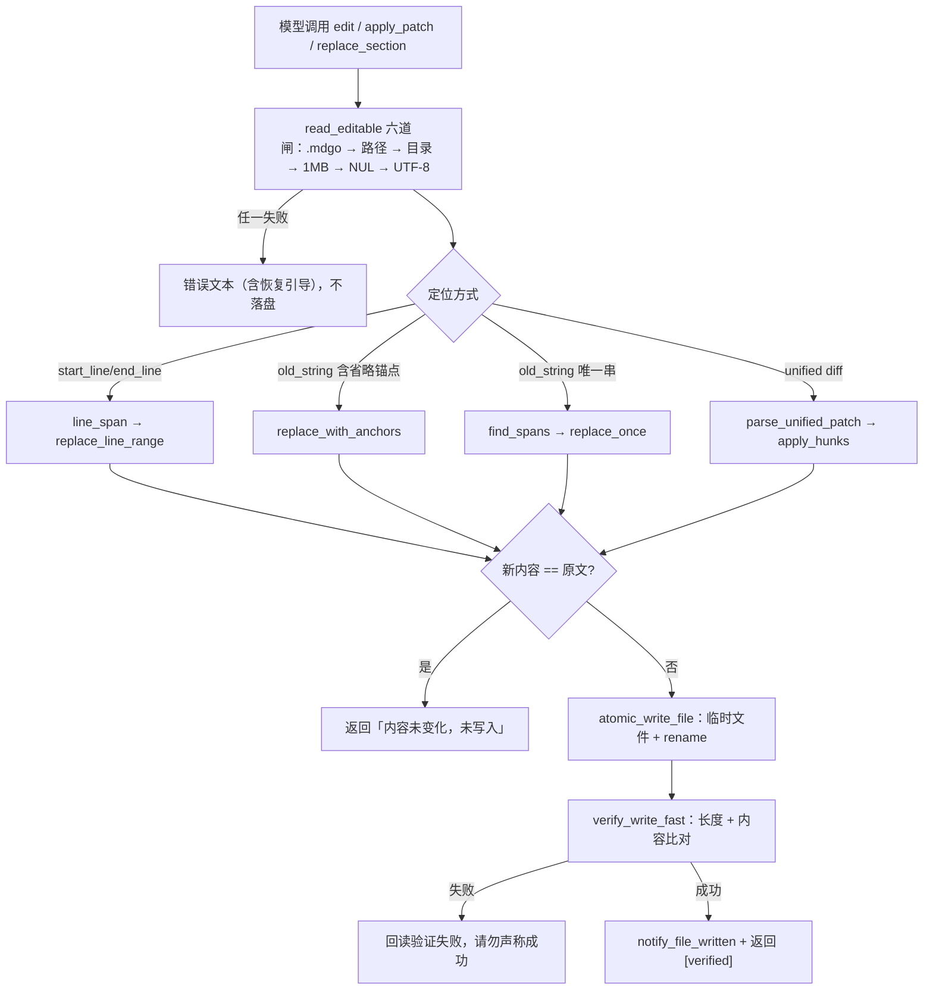
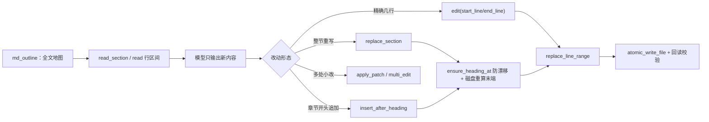

---
title: 工具实现：文件读写与结构化编辑
date: 2026-11-10
tags: [Agent, Rust, 文件操作, 文档结构]
summary: 从 read/edit 的路径与匹配约束，到大文档「先看结构、按区间读写」的 text_ops 算法与 unified diff 落地细节。
---

# 工具实现：文件读写与结构化编辑

> 本文拆 mdgo Agent 子系统里最"接地气"的一层：它到底怎么读写用户磁盘上的文件。内容包括工具 schema 与输出契约、路径安全边界的每一道闸、`edit` 的唯一匹配与归一化回退、`multi_edit`/`apply_patch` 的两阶段原子性，以及大文档场景下 `md_outline → read_section → replace_section` 与 `text_ops.rs` 里的行区间/锚点/diff 算法。所有结论都对着当前代码写，标注了 `文件:行号`；与 `docs/` 下早期设计文档不一致处，一律以代码为准。
>
> 适合读者：有 Rust/后端经验、准备接手或改造 Agent 工具层的工程师；也适合想给自己的 Agent 设计文件编辑协议的人。

## 1. 工具全景与分工

### 1.1 注册表事实

所有工具在 `build_loop_tool_registry` 里一次性注册（`tauri/src-tauri/src/core/agent/loop_tools.rs:746`）。与本篇相关的分两族：

- **文件族**：`read`、`read_document`、`write`、`edit`、`multi_edit`、`apply_patch`、`delete`、`ls`、`glob`、`grep`；
- **文档结构族**：`md_outline`、`read_section`、`replace_section`、`insert_after_heading`、`read_relevant`。

它们全部在 `BASE_TOOLS` 里（`core/agent/mod.rs:128`），意味着**不随技能白名单窄化**——文件操作被视为常驻能力，模型永远看得见。

一个容易忽略的契约点：只读工具用 `read_only_spec` 包装，唯一差异是把 `concurrency_safe` 置为 `true`（`loop_tools.rs:141`）；写工具走 `ToolSpec::new`，该字段默认 `false`（`core/loop/tool.rs:33`），于是调度器把写调用当成 exclusive 屏障串行执行——同一轮的多个 `edit` 不会互相踩。并行调度的细节留给 [04-工具系统-契约-注册与并行调度.md](04-工具系统-契约-注册与并行调度.md)。

### 1.2 工具清单

| 工具 | 关键输入 | 输出要点 | 硬上限（常量） | 并行 | 需审批 |
| --- | --- | --- | --- | --- | --- |
| `read` | `path` \| `paths`、`offset` \| `start_line`/`end_line` \| `ranges` | `行号\| 内容`，页尾给续读 `start_line` | 单页 `MAX_FILE_READ_CHARS=8192`（limits.rs:56）；`paths≤10`、`ranges≤8` | 是 | 否 |
| `read_document` | `path`、`offset` | 元信息行 + Markdown 正文 | 单次 8192 字符（同 `MAX_FILE_READ_CHARS`） | 是 | 否 |
| `ls` | `pattern`、`max_items`（默认 30） | 相对路径 + 字节；超限报剩余数 | `MAX_LIST_ITEMS=60`（limits.rs:60） | 是 | 否 |
| `glob` | `pattern`、`max_items` | 同上 | 60；模式长度 ≤128（mod.rs:1156） | 是 | 否 |
| `grep` | `pattern`、`max_files`（默认 10）、`include`/`exclude`、`context_lines≤5`、`match_mode`、`list_only` | 文件路径行 + `  行号: 内容`（context 模式用 `>` / `  --`） | 输出 60k 字符、20 文件、单文件 2MB、累计扫描 200MB | 是 | 否 |
| `write` | `rel_path`、`content` | `已创建/覆盖写入…[verified]` | 1MB（按字节，`MAX_EDIT_FILE_BYTES`） | 否 | 是 |
| `edit` | `rel_path`、`new_string` + (`old_string` \| `start_line`) | `已更新…替换 N 处（原 X → 新 Y 字符）` | 目标文件 ≤1MB；`multi_edit` 才有条目数上限 | 否 | 是 |
| `multi_edit` | `edits[]`（同文件可多条） | `已批量更新 N 个文件 / M 处替换` | `MAX_MULTI_EDITS=10`（limits.rs:70） | 否 | 是 |
| `apply_patch` | `patch`（unified diff） | `已应用补丁：N 文件 / M hunk` | 补丁 ≤200KB（mod.rs:2588） | 否 | 是 |
| `delete` | `rel_path` | `已删除文件 … [verified] 回读确认不存在` | 仅单文件，不支持目录 | 否 | 是 |
| `md_outline` | `path` | `#`×层级 + 标题 + `[行 a-b / N 字符]` | 最多 400 章节（`MD_OUTLINE_MAX_ITEMS`） | 是 | 否 |
| `read_section` | `path`、`heading`、`max_chars` | 章节头 + 带行号正文 | `max_chars` clamp 到 512~8192（mod.rs:2483） | 是 | 否 |
| `replace_section` | `path`、`heading`、`content` | `已替换章节「…」（行 a-b）` | 仅 `.md/.markdown/.mdx/.txt` | 否 | 是 |
| `insert_after_heading` | `path`、`heading`、`content` | `已在「…」（行 N）之后插入 1 段内容` | 同上 | 否 | 是 |
| `read_relevant` | `path`、`query`、`budget_tokens`（默认 8000） | 预算内选段 + 未注入章节清单 | 预算 clamp 512~32000（mod.rs:2565） | 是 | 否 |

审批清单位于 `core/approval/policy.rs:44` 起：`write`/`edit`/`multi_edit`/`delete`/`replace_section`/`insert_after_heading`/`apply_patch` 全部弹确认，且 `apply_patch` 会先从 `+++` 行解析出目标文件列表写进摘要（policy.rs:86），避免用户"盲批"一个改多文件的补丁。审批与注入防护的完整链路见 [10-安全防线-审批-注入防护与防幻觉.md](10-安全防线-审批-注入防护与防幻觉.md)。

### 1.3 分工：read vs read_document

两者是**互斥**的，不是"一个兜底另一个"：

- `read` 走 `document_converter_label` 判断（mod.rs:730），只要文件格式在注册表里且转换器不是 `Converter::Plain`，直接报错并点名 `read_document`（mod.rs:619）；
- `read_document` 反向拒绝：未登记格式提示"若它是文本/代码文件，请用 read"，登记了但转换器是 Plain 的文件同样拒绝（mod.rs:811-822）。

背后的动机写在 `read_text` 的注释里：PDF/Office/ODF/RTF/EPUB 是压缩包或 OLE 容器，`from_utf8_lossy` 只会产出满屏替换字符，既无信息量还污染上下文。`read_document` 的输出是**转换后的 Markdown**，前置一行元信息（转换器 / 来源类型 / 形态 / 页数，mod.rs:869），并带 `[转换提示]`、`[注意] 该文档有 N 页无法提取文本`（mod.rs:878-893）。分页语义与 `read` 一致，仍是字符 `offset`。

### 1.4 输出与错误约定

成功结果都是**中文自然语句 + `[verified]` 尾标**，例如 `已更新 docs/a.md：替换 1 处（原 120 字符 → 140 字符）；[verified] 已确认写入落盘`（mod.rs:2158）。`[verified]` 不是装饰：它来自写后的回读校验（见 3.3），语义是"这次写真的落盘了"，与防幻觉的"动作声称守卫"闭环。

失败走 `ToolError`（`core/loop/tool.rs:59`）：参数问题用 `InvalidArgs`（显示为 `参数无效: …`），业务失败用 `Failed`（原样显示业务文案）。文件工具几乎全部用 `Failed`，因为错误文案本身就是给模型的自纠信息。

## 2. 路径解析与安全边界

### 2.1 三道闸

所有路径最终都落到三个解析函数（mod.rs:516 / 528 / 534）：

```rust
fn safe_resolve_new(dir_path: &str, rel: &str) -> Result<PathBuf, String> {
    let base = std::fs::canonicalize(dir_path)
        .map_err(|e| format!("无法访问目录: {}", e))?;
    let rel_path = Path::new(rel);
    // 拒绝绝对路径与含 `..` 的路径（防穿越）
    if rel_path.is_absolute()
        || rel_path
            .components()
            .any(|c| matches!(c, std::path::Component::ParentDir))
    {
        return Err("路径越界：仅允许访问限定目录内的文件".into());
    }
    let parent = rel_path.parent().unwrap_or_else(|| Path::new(""));
    let file_name = rel_path
        .file_name()
        .ok_or_else(|| "非法文件路径".to_string())?;
    // 父目录必须已存在且位于根目录内（canonicalize 解析符号链接防逃逸）
    let full_parent = std::fs::canonicalize(base.join(parent))
        .map_err(|e| format!("目标目录不存在: {}", e))?;
    if !full_parent.starts_with(&base) {
        return Err("路径越界：仅允许访问限定目录内的文件".into());
    }
    Ok(full_parent.join(file_name))
}
```

要点逐条：

1. **词法闸**：绝对路径、含 `ParentDir`（`..`）的路径直接拒绝。这是唯一能拦住"目标尚不存在"的手段，因为 `canonicalize` 对不存在的路径必然失败。
2. **规范化闸**：`canonicalize` 解析符号链接后再 `starts_with(base)`。所以"库里放一个指向 `C:\Windows` 的符号链接，再让模型读 `link/x`"这种逃逸会落在 `路径越界` 上。
3. **再次规范化 + 组件级 `.mdgo` 闸**：`ensure_not_mdgo`（mod.rs:1866）按 canonical 结果的**相对组件**逐段比较（忽略 ASCII 大小写），能抓住 `a/../.mdgo/config.yaml` 这种绕过字符串前缀检查的写法。

`.mdgo` 是应用内部数据目录（配置/技能/索引），字符串前缀检查在 `is_mdgo_internal`（mod.rs:1855），只做 `trim_start_matches(['/', '\\'])` 后比较 `.mdgo`、`.mdgo/`、`.mdgo\`——它挡不住 `..`，所以 canonical 之后的二次校验不是冗余。

### 2.2 write 为什么多一段前置校验

`write_file` 会创建父目录，因此它必须把**所有静态校验提到任何副作用之前**（mod.rs:2645 的注释明确写了这条 P0-10 规则）：

```
词法拒绝（绝对路径/..） → 父目录组件不得含 .mdgo → base.join(parent) 前缀检查
→ 此时才 create_dir_all → safe_resolve_new 二次确认 → ensure_not_mdgo → 原子写
```

顺序反了会怎样？假设先建目录再校验，一次"越界写入"的失败调用会在磁盘上留下被创建的空目录——这就是代码注释里说的"失败路径不再产生副作用"。

### 2.3 目录/文件黑名单

黑名单是 gitignore 风格的，实现在 `core/db/utils.rs` 的 `IgnoreMatcher`（utils.rs:52）。它只服务**列举与搜索**：`ls`/`glob`/`grep` 全部经过 `get_or_refresh_cache` 的遍历结果（mod.rs:428），而这些结果在 `walk_dir_all` 里逐条走 `is_kb_dir_allowed` / `is_kb_file_allowed`（mod.rs:497-505）。

语义细节：

- `!` 前缀取反、`/` 后缀仅目录、含 `/` 匹配完整相对路径、不含 `/` 只匹配文件名、`**/` 任意层（utils.rs:44-51）；
- **目录规则会自动扩展一条"其下所有文件"规则**（utils.rs:90-101），所以 `assets/` 既过滤目录也过滤文件；
- 内置规则额外排除隐藏项（`.` 开头）、`$` 结尾、`.tmp`/`.log`、`~` 结尾、`~$` 开头（utils.rs:274-286）；
- 匹配前统一 `replace('\\', "/")`（utils.rs:210），Windows 相对路径与 `/` 分隔口径一致。

⚠️ 一个需要明确的边界：**黑名单不拦 `read`**。`read_with` 只过 `safe_resolve`（mod.rs:985），如果你知道确切路径，被拉黑的文件照样能读。代码里没有为此加限制——黑名单的定位是"别主动扫进来"，不是访问控制；若需要真正的访问控制，得在 `read` 路径上另加一层。

## 3. 读写与精确编辑

### 3.1 read：为什么按行渲染

`read` 的输出是 `1234| 内容`（`text_ops::render_numbered_lines_with_end`，text_ops.rs:755）。模块注释给了原因：模型需要用**行号**定位后续的行范围编辑，而字符 offset 与行号无法互推——这正是旧实现"大文件盲翻页"的根因（mod.rs:594）。

分页策略（`render_read`，mod.rs:633）：

- 大文件横幅：`总行数 > 2000 || 总字符 > 200_000` 时先提示"建议先 md_outline 看结构"，横幅里带约 KB 数（mod.rs:638）；
- **单页预算 8192 字符**，按行累加；**单行超预算时行内截断**并注明省略了多少字符（`该行过长，已省略 N 字符`），否则一条 1MB 的单行 JSON 会整页灌进上下文（text_ops.rs:781-793 的注释与回归测试）；
- `ranges` 模式共享同一个预算，逐段递减；预算耗尽时提示剩余区间另发一次 `read`（mod.rs:672-679）；
- 旧 `offset`（字符）模式保留兼容，内部换算成起始行，页尾给 `续读请用 start_line=…`（mod.rs:700-720）；
- `start_line` 越界**明确报错**而不是夹到末行（mod.rs:686），因为静默夹取会让模型把最后一行当成第 N 行继续编辑。

### 3.2 write 与写盘原子性

`atomic_write_file`（mod.rs:1886）先写同目录 `*.mdgo-tmp`，再 `rename`：

```rust
    match std::fs::rename(&tmp, full) {
        Ok(()) => Ok(()),
        Err(_) => {
            // Windows：目标已存在导致 rename 失败，退化为删除+重命名
            if std::fs::remove_file(full).is_ok() {
                std::fs::rename(&tmp, full).map_err(|e| {
                    let _ = std::fs::remove_file(&tmp);
                    format!("写入文件失败: {}", e)
                })
            } else {
                let _ = std::fs::remove_file(&tmp);
                Err("写入文件失败：无法替换目标文件".into())
            }
        }
    }
```

Unix 上 `rename` 是原子替换；**Windows 上目标存在时 `rename` 会失败**，于是退化为"删除目标 + 重命名"——这里有一个极短的窗口期，目标文件不存在。代码接受了这个 trade-off（注释写明"窗口期极短"），但它是真实的并发风险：窗口内崩溃/断电会丢文件。所有失败路径都会清理临时文件。

`write` 的另外两件事：写入前记录 `existed`（mod.rs:2678，写完再判断恒为真），写入后 `notify_file_written` 发 `agent:file-written` 事件让前端增量更新文件树（新建才插节点，覆盖零成本）；以及 `.canvas` 分支，见第 5 节。

### 3.3 回读校验（Mutation Verification）

`verify_write_fast`（mod.rs:1918）是 `[verified]` 的来源：

- 恒定一次 `stat` 比字节长度，长度不符直接失败：`回读验证失败：写入后文件大小 N 字节 ≠ 预期 M 字节，操作可能未完全生效，请勿声称成功`；
- 内容全等比较只在 `expected.len() <= 2MB` 时做（`CONTENT_VERIFY_MAX_BYTES`），**debug 构建无条件比对**（`cfg!(debug_assertions) || …`，mod.rs:1930）。注释里说得很直白：不要退化成"只比长度"，长度相同但内容错位是最难发现的静默失败。

注意 `apply_patch` 的收尾消息里 `[verified]` 是**字面量**，而非 `commit_write` 的返回值——每个文件的回读校验仍然逐次执行（失败会 `?` 提前返回），但文件数 >1 时你只看到一条汇总（mod.rs:2603-2610）。

### 3.4 edit：唯一匹配 + 归一化回退

`edit` 有三种互斥方式，schema 层就用 `anyOf` 逼出定位参数（loop_tools.rs:2391）：

1. `start_line`/`end_line` + `new_string`：行范围整段替换，**不需要复制旧正文**；
2. `old_string` + `new_string`：唯一匹配；
3. 再加 `replace_all=true`：全量替换。

两种方式同时给会报 `start_line 行范围替换与 old_string 互斥，请二选一`（mod.rs:2127）。

字符串匹配的核心是 `text_ops::find_spans`（text_ops.rs:153）：**先精确匹配，精确匹配为 0 次时才走归一化匹配**。归一化只做两件"模型几乎必然会有的差异"（text_ops.rs:61）：

- `\r\n` 与孤立 `\r` → `\n`；
- 每行行尾空格/制表符删除。

精确优先很重要：如果无条件归一化，"模型抄了一个略有出入的片段"就可能误命中别的段落。

失败时的自纠信息是这套设计的一半价值：

```rust
    let spans = find_spans(content, old);
    if spans.is_empty() {
        return Err(match nearest_hint(content, old) {
            Some(hint) => format!(
                "未找到与 old_string 匹配的内容（已尝试忽略行尾空白与 CRLF 差异）。最近似位置：{hint}。请用 read 确认原文后重试"
            ),
            None => "未找到与 old_string 匹配的内容（已尝试忽略行尾空白与 CRLF 差异），请用 read 确认原文后重试".into(),
        });
    }
    if !replace_all && spans.len() > 1 {
        return Err(format!(
            "old_string 匹配到 {} 处，请提供更长的上下文使其唯一，或改用 replace_all=true / 行范围替换",
            spans.len()
        ));
    }
```

`nearest_hint`（text_ops.rs:220）拿 `old` 首行做归一化子串探测，从整行开始逐步缩短前缀（4~40 字符），返回 `第 N 行（内容：…）`。这是"用最少 token 让模型找到自己错在哪"的典型做法。

写回时 `new_string` 先被 `to_eol` 转成文件主导换行风格（text_ops.rs:206-207），避免把 CRLF 文档逐次改成混合行尾。`detect_eol` 的判定是三者取最多、并列时 `CRLF > CR > LF`（text_ops.rs:36-47），孤立 `\r` 的老式 Mac 文件也能正确识别。

### 3.5 省略锚点：不必复述整章

`replace_with_anchors`（text_ops.rs:271）允许 `old_string` 里出现**独占一行的省略标记**：`…`、`...`、`……`、`// ... existing ...`、`/* ... */`、`<!-- ... -->`（白名单在 `is_elision_line`，text_ops.rs:250）。中段被省略后，只要求各段**按顺序出现且不重叠**，替换范围 = 首段起点 → 末段终点（`find_anchor_group`，text_ops.rs:339）。

两个容易踩的实现细节：

- 返回值是"**处数**"而不是"段数"。一组锚点算一处，上层才能生成"替换 1 处"而不是误导模型；
- `Err` 与 `Ok(None)` 语义不同：首段没找到 → `Ok(None)` 表示扫描结束；首段找到但后续段找不到 → `Err("省略锚点的第 N 段未在文件中找到：…")`，这是真错误，必须报给模型（text_ops.rs:344-353）。

### 3.6 multi_edit：两阶段、all-or-nothing

`multi_edit_batch`（mod.rs:2200）修的是旧实现的"丢更新"缺陷：每个 edit 都基于原始内容构造结果，同一文件出现两次时后一次覆盖前一次。

现在是严格两阶段：

- **阶段 1（不写盘）**：按文件分组（保留首次出现顺序），逐文件 `read_editable`，同一文件的 N 条编辑依次应用到"演化中的内容"上；任一失败即整体 `Err`，一个文件都不写；
- **阶段 2**：逐文件比较"最终内容 vs 读盘时的原文"，只有真正变化的文件才 `commit_write`（各写一次、各校验一次、各通知一次），未变化的进 `unchanged` 列表并在结果里说明。

```rust
    let mut outputs: Vec<(PathBuf, String, String, usize, String)> = Vec::with_capacity(order.len());
    for rel in &order {
        let (full, mut content) = read_editable(cfg, rel, "编辑")?;
        let original = content.clone();
        let mut applied = 0usize;
        for (idx, item) in groups.get(rel).into_iter().flatten() {
            if item.old_string.is_empty() {
                return Err(format!("第 {} 条（{}）old_string 不能为空", idx + 1, rel));
            }
            let (next, n) = text_ops::replace_with_anchors(
                &content,
                &item.old_string,
                &item.new_string,
                item.replace_all,
            )
            .map_err(|e| format!("第 {} 条（{}）: {}", idx + 1, rel, e))?;
            content = next;
            applied += n;
        }
        outputs.push((full, content, rel.clone(), applied, original));
    }
```

注意错误文案里的 `第 N 条（path）`：N 是**原始数组下标**（1 起），不是分组内的序号，模型据此能定位到自己写的第几条。

### 3.7 delete 与"回收站"

`delete_file`（mod.rs:2698）就是 `std::fs::remove_file` + `exists()` 回读确认，**不可恢复，没有回收站**。代码里确有 `TRASH_DIR_NAME = "mdgo_trash"`（`core/db/utils.rs:21`），但那只服务前端"删除目录"的场景（`commands/fs.rs:451` 起：整体复制到 `mdgo_trash/{日期}_{目录名}`），Agent 的 `delete` 工具不经过它——审批文案也写的是"删除操作不可恢复，已删除内容无法通过本应用找回"（policy.rs:69）。

### 3.8 一次编辑的完整校验流



## 4. 大文档结构化编辑（重点）

### 4.1 问题定义

`read` 的单页预算 8192 字符。一份 3000 行的规范文档按页翻完要 20+ 次工具调用，每一次都塞进上下文；等模型翻到目标章节，前几页的 token 已经占满预算。更糟的是"改一段"——`old_string` 模式要求**逐字复制旧正文**，改 200 行就要先读 200 行、再输出 200 行旧文 + 200 行新文。

于是有了这套设计：**先看结构，再按区间/章节读写，改动的 token 成本只取决于新内容**。

### 4.2 章节是怎么解析出来的

结构工具复用了 DocAgent 的解析器 `core/docagent`：

- `DocSection` 有 `heading`（无 `#` 前缀）、`line_start`（含标题行，1 起）、`line_end`（含）、`text`（不含标题行的正文）（`core/docagent/mod.rs:34-45`）；
- `parse_doc`（docagent/mod.rs:267）先剥 BOM、再 `strip_front_matter`（只认首行 `---` 开启、下一个 `---` 闭合的块），**行号按"含 front matter"计算**，保证与编辑器可见行一致；
- 标题判定是严格的 ATX：`#`~`######` 且**第 N+1 个字符必须是空格**，否则不算标题（`atx_heading_len`，docagent/mod.rs:248）；
- 章节是**扁平列表**，层级不参与切分——下一个任意级别标题就是上一节的结束边界。`md_outline` 展示时再按行首 `#` 数补出层级（mod.rs:2451）。

`md_outline` 的输出形如 `##安装  [行 12-48 / 1536 字符]`（实际格式为 `#`.repeat(level) + 标题），并在超过 400 个章节时截断提示"请用 grep 或行范围读取"（mod.rs:2444）。它还会调用 `push_kb_source` 登记引用来源（mod.rs:2470）——否则"用 md_outline 读过再作答"的回答会被 grounding 守卫判成"未读取任何本地文件"。

标题定位 `find_doc_section`（mod.rs:2291）是三级策略：精确（大小写不敏感）→ 唯一包含。重名直接报错并建议改用行号：

```
标题「安装」匹配到 2 个章节（重名标题），请改用行号（start_line/end_line）
```

模糊匹配到多个时，错误里会列出前 6 个候选及行号（mod.rs:2324-2332），模型下一轮基本能一次改对。

### 4.3 按章节读

`read_section`（mod.rs:2475）先用 `find_doc_section` 拿章节，再用 `render_numbered_lines` 渲染，预算 `max_chars.min(8192).max(512)`。这条链路同样登记引用来源，但用的是 `sec.text`（不含标题行）。

### 4.4 按章节写的两个关键防御

`replace_section`（mod.rs:2502）的流程值得完整拆开，因为它是"缓存 + 行号 + 并发"三者交互最密集的地方：

1. `ensure_markdown_like`：只允许 `.md/.markdown/.mdx/.txt`（mod.rs:2343）。PDF/Office 的正文是转换产物，按行号写回会破坏原文件，必须拒绝；
2. `doc_of` → `find_doc_section` 拿 `line_start`（这里用的是**可能带缓存的**解析结果）；
3. `read_editable` 重新读磁盘当前内容；
4. `ensure_heading_at`（mod.rs:2374）**防并发漂移**：确认"第 line_start 行"现在仍然是目标标题，否则报 `章节位置已变化：第 N 行现在是「…」而不是「…」（文件可能被其它操作修改过），请重新调用 md_outline 后再试`；
5. `section_range_in`（mod.rs:2401）**在磁盘当前内容上重算末端**：下游第一个 ATX 标题的上一行是原始末端，再回退到最后一个非空行。注释给了两个理由——DOC 缓存可能落后于一次并发写入；缓存里的 `line_end` 还包含"下一节之前的空行"，直接用它替换会吃掉节间分隔空行；
6. `replace_line_range` 写回，内容未变化则直接返回"未写入"。

比较前统一 `normalize_heading_text`（mod.rs:2365）去掉 BOM/零宽字符/`#`/首尾空白再小写——`parse_doc` 会剥 BOM 而落盘内容不会，不剥的话带 BOM 的文档第 1 行标题永远"对不上"。

`insert_after_heading`（mod.rs:2537）复用同一套定位与漂移检查，落点是标题行的行尾；`insert_after_line`（text_ops.rs:424）在"末行无换行"时会先补一个换行，否则新内容会粘在末行尾部（`a\nb` + `X` 写成 `a\nbX\n` 的经典 bug，有回归测试）。

### 4.5 按问题选段

`read_relevant`（mod.rs:2558）把问题词面和预算交给 `docagent::build_context`：全文在预算内就全文注入，否则打分选段并附上未注入章节清单（最多列 12 个）。预算是 **token** 而不是字符，clamp 到 512~32000。这条路径适合"这篇大文档里哪里讲了 X"，而不是逐页 read。

### 4.6 apply_patch：unified diff 的落地细节

`apply_patch` 分两步：`parse_unified_patch`（text_ops.rs:488）→ `apply_hunks`（text_ops.rs:610）。`tools::apply_patch` 负责两阶段提交：先在内存里把所有文件都算出来，任一失败整体拒绝，然后逐文件 `commit_write`（mod.rs:2587-2611）。补丁本身 ≤200KB。

解析端的容错全部来自真实踩坑（text_ops.rs:484-487）：

- `\ No newline at end of file` **跳过**，且**不能**当 hunk 边界（否则后面的 `+` 行会被漏掉，补丁只应用一半）；
- hunk 内的**裸空行**按"空上下文行"处理——模型常把 `" "` 写成空行；只有"空行 + 紧接着文件头/hunk 头"才当分隔符，避免吞掉多文件补丁之间的空行；
- 路径前缀 `a/`、`b/` 剥离；`--- /dev/null` 时取旧路径；
- 行前缀用 `chars().next()` 取，不用 `split_at(1)`——补丁行首是中文字符时后者会 panic（有回归测试）。

应用端的定位算法（`find_block`，text_ops.rs:692）：

1. 用 `hunk.old_start - 1` 加上前面 hunk 造成的**字节位移** `shift` 估一个提示位置 `hint`，再与 `search_from` 取大；
2. `hint` 可能落在多字节字符中间，先对齐到 `is_char_boundary`；
3. 从该点向后**精确**找"旧行序列"；失败则归一化重试（忽略 CRLF/行尾空白），且归一化映射必须用 `norm_byte_for_orig` 换算**字节**偏移，不能把 `map` 下标当偏移（否则多字节内容会在字符中间切片 panic）；
4. "文件末行无换行"的兜底：去掉块尾换行再试一次，但**只在命中文件末尾时接受**：

```rust
        let found = find_block(&out, &old_block, hint, search_from).or_else(|| {
            if old_block_no_tail == old_block {
                return None;
            }
            // 只有在**文件末尾**才接受"去掉行尾"的匹配：否则短块会命中别的行中间
            // （例如块 "a" 命中 "xabc"），造成错误替换。
            find_block(&out, &old_block_no_tail, hint, search_from)
                .filter(|(span, _)| span.end == out.len())
        });
```

没有这个 `.filter()`，一行的块 `"a"` 会命中 `"xabc"` 中间的 `a`——**静默改坏比失配更糟**。有专门的回归测试（`trimmed_block_fallback_only_matches_at_eof`，text_ops.rs:1021）。

失配时的错误同样是自纠导向：`第 N 个 hunk 未找到匹配位置（期望约第 M 行、共 K 行上下文，该行实际为：…）`（text_ops.rs:655）。

### 4.7 设计动机回顾



三种定位方式（行号 / 标题 / diff）解决的是同一个成本问题：**旧正文只需被读一次（甚至不必读），写回的 token 量与新内容成正比**。`text_ops.rs` 里所有函数都是纯函数、不碰文件系统（text_ops.rs:11），这让上述算法能被单测逐条钉住——该文件的测试模块占了近 1/4 篇幅，几乎每个 bug 都留着编译期可执行的注释。

## 5. 缓存与副作用

### 5.1 工具结果缓存（`tools/cache.rs`）

`ToolResultCache` 是有界 LRU，进程级单例，容量 **256**（cache.rs:84）：

- **键**：`read` 用 `read-v2|{display}|{offset}|{start_line}|{end_line}|{ranges:?}`（mod.rs:608）；`read_document` 用 `doc|{rel_path}|{offset}`（mod.rs:832）；
- **失效**：条目携带文件 `mtime_ns`，读取前 `stat` 一次，mtime 不一致即失效并顺手删除该条（cache.rs:41-49）。没有 TTL；
- **只读工具专属**：`edit`/`write`/`delete` 绝不缓存（cache.rs:10 的注释写明"副作用工具缓存会掩盖真实状态"）；
- 命中即刷新访问序，满容量时淘汰最久未访问的一条。

⚠️ 已知薄弱点：`read` 的键里只有 **mtime**，没有 size。低时间戳分辨率的文件系统或"同一毫秒内两次写入"可能命中旧结果——`docagent` 的解析缓存就因为这个问题把 size 也放进了键（docagent/mod.rs:207 的注释：经典的 ABA）。工具结果缓存目前没有这一层。

### 5.2 文件列表缓存（`mod.rs:383`）

`ls`/`glob`/`grep` 共享 `FileListSnapshot`：

- **键**：canonicalize 后的目录绝对路径（符号链接与大小写变体共享同一份）；
- **TTL**：30 分钟（`CACHE_TTL`，mod.rs:386），仅为兜底；
- **黑名单指纹**：`blacklist_fingerprint`（mod.rs:411）对排序后的目录/文件黑名单做 `DefaultHasher`，指纹变化即重建——用户改黑名单后不必等 TTL；
- **容量**：无上限，但每个目录一份快照；遍历深度上限 `WALK_MAX_DEPTH=10`（mod.rs:388），**条目数无上限**（`walk_dir_all` 注释：无数量限制），10 万文件的库首次 `grep` 会全量遍历一次；
- **主动失效**：文件监听器在变更时调用 `invalidate_file_list_cache`（watcher.rs:290 / 655 / 774），内部同样 canonicalize 以对齐 key。

### 5.3 写操作的可见副作用

一次成功的写会连带三件事：

1. **前端增量更新**：`notify_file_written` 发 `agent:file-written`，载荷 `{rel_path, created, size, mtime}`（mod.rs:2001）。注释明确"绝不触发全量扫描"——10 万级知识库下每次写入全量刷新不可接受；
2. **写盘节奏标记**：`mark_agent_write` 记录进程内**单调时钟**时间戳与连续写次数（窗口 `AGENT_WRITE_BURST_WINDOW_MS = 10_000`）。用单调时钟而不是墙钟，是因为墙钟回拨会让"刚写过"永久为真，watcher 就再也不索引了（mod.rs:1943-1947）；
3. **watcher 让路**：`defer_for_agent_write`（watcher.rs:541）在 Agent 连续编辑期间推迟重建索引，避免每写一个文件就触发一次全量索引。

### 5.4 Canvas 校验触发

`write` 唯一会"改写模型输入"的分支是 `.canvas`：`rel_path.ends_with(".canvas")` 时先过 `canvas::validate_canvas_json`（mod.rs:2640）。管线是**确定性**的（canvas.rs:176）：

```
JSON parse → nodes 非空 → 类型归一化(link/bookmark → url) → ID 重编号(n1..nN) + 边引用重写
→ 过滤悬空边 + 补边 id → file/image 节点路径存在性（不存在降级为 text）
→ 几何校验（width/height > 0，x/y 有限） → to_string_pretty 序列化
```

设计取向写在 canvas.rs:3-9：**布局完全由模型负责，系统只做机器可验证的合法性校验，绝不计算/覆盖坐标**。所以：

- 几何非法 → 拒绝写入，错误文案直接教模型补全：`节点 n1（text）缺少有效尺寸：width/height 必须 > 0（当前 0 x 0）。布局由模型负责，请为每个节点提供完整的 x/y/width/height`；
- 但 ID 重编号、悬空边删除、file 节点降级是**静默**的：`let _degraded = degrade_missing_file_nodes(...)`（canvas.rs:189），降级数量被丢弃，模型拿不到"你有 2 个节点被降级"的提示。回读校验比对的是规范化后的 `effective` 内容，因此也不会报错。

这也意味着 `.canvas` 落盘的字节**通常不等于**模型给的字符串（`to_string_pretty` 重排缩进 + ID 重编号）。布局职责在技能侧：`canvas` 技能明确要求"节点位置 x/y、尺寸 width/height 由模型自行设计，程序禁止重算"（`tauri/src-tauri/resources/skills/canvas/SKILL.md`），工具侧只保证"落盘的一定合法可渲染"。

## 6. 失败模式与已知限制

### 6.1 错误/降级矩阵

| 场景 | 触发点 | 模型看到 | 是否落盘 |
| --- | --- | --- | --- |
| 绝对路径 / `..` 穿越 | `safe_resolve_new:539`、`write_file:2648` | `路径越界：仅允许访问限定目录内的文件` | 否 |
| 符号链接逃逸 | `safe_resolve_in:521` | 同上（canonicalize 后前缀不符） | 否 |
| 目标不存在（read/edit） | `safe_resolve_in:520` | `文件不存在: …` | 否 |
| 目标是目录 | `read_text:599` | `… 是目录，请改用 ls 查看目录内容` | 否 |
| 二进制文档走 read | `read_text:619` | `… 是二进制文档（转换器：anydoc），不能按文本直读。请改用 read_document` | 否 |
| 文本文件走 read_document | `mod.rs:819` | `… 是文本类文件（可直接读取），请用 read 工具` | 否 |
| 文档转换失败 | `read_document:841` | `无法解析 …（needs_ocr）：… 建议：该文件是扫描件…`（`skip_remedy` 表，mod.rs:744） | 否 |
| 非 UTF-8 文件被编辑 | `read_editable:2058` | `… 不是有效的 UTF-8 文本文件，拒绝编辑以避免损坏` | 否 |
| 含 NUL 字节 | `read_editable:2055` | `… 是二进制文件，仅支持编辑文本文件` | 否 |
| 编辑目标 >1MB | `read_editable:2047` | `… 超过 1MB（N 字节），请改用其他方式编辑` | 否 |
| write 内容 >1MB | `write_file:2632` | `… 内容超过 1MB（N 字节），write 单次写入上限为 1MB` | 否 |
| `.mdgo` 内部数据 | `read_editable:2034`、`ensure_not_mdgo:1874` | `.mdgo 为应用内部数据目录（配置/技能/索引），不允许编辑` | 否 |
| `old_string` 0 次匹配 | `replace_once:192` | `未找到…最近似位置：第 N 行（内容：…）…请用 read 确认原文后重试` | 否 |
| `old_string` 多次匹配 | `replace_once:200` | `old_string 匹配到 N 处，请提供更长的上下文使其唯一…` | 否 |
| 章节标题重名 | `find_doc_section:2307` | `标题「…」匹配到 N 个章节（重名标题），请改用行号` | 否 |
| 章节行号漂移 | `ensure_heading_at:2379` | `章节位置已变化：第 N 行现在是「…」…请重新调用 md_outline 后再试` | 否 |
| 非 Markdown 扩展名 | `ensure_markdown_like:2352` | `… 仅支持 .md/.markdown/.mdx/.txt` | 否 |
| hunk 失配 | `apply_hunks:655` | `第 N 个 hunk 未找到匹配位置（期望约第 M 行…该行实际为：…）` | 否（阶段 1） |
| 补丁格式错误 | `parse_unified_patch:578` | `补丁为空：未找到 ---/+++ 文件头` 等 | 否 |
| 回读不一致 | `verify_write_fast:1924` | `回读验证失败：…请勿声称成功` | 可能已写 |
| 删除后仍存在 | `delete_file:2712` | `删除验证失败：… 仍然存在，操作可能未生效` | 已尝试 |
| canvas 非法 | `validate_canvas_json:178` | `无效的 JSON Canvas 格式: …` / `画布无节点` | 否 |

### 6.2 截断与预算的多个层次

同一个工具结果会被几道上限依次处理，位置不同、语义也不同：

| 层 | 常量 | 值 | 位置 | 作用 |
| --- | --- | --- | --- | --- |
| 工具内部 | `MAX_FILE_READ_CHARS` | 8 192 | `agent/limits.rs:56` | `read`/`read_section`/`read_document` 单页 |
| 工具内部 | `MAX_GREP_OUTPUT_CHARS` | 60 000 | `agent/limits.rs:66` | `grep` 输出总字符 |
| 事件/回放 | `MAX_RESULT_CHARS` | 12 000 | `tools/mod.rs:271` | 写入 `ToolCallBus` 的 result 字段 |
| 模型历史 | `MAX_TOOL_RESULT_CHARS` | 24 000 | `loop/session.rs:18` | 进入对话历史前截断，保留首 4/5 + 尾 1/5 |
| 历史累计 | `MAX_HISTORY_TOOL_RESULT_CHARS` | 120 000 | `loop/session.rs:24` | 超出后从最旧的结果开始替换为占位符 |

`truncate_tool_result`（session.rs:398）的截断文案本身就是给模型的指令：

```rust
    format!(
        "{head}\n\n…[工具结果过长已截断：原 {n} 字符，仅保留首 {head_len} + 尾 {tail_len} 字符；如需完整内容请缩小参数范围后重新调用]\n\n{tail}"
    )
```

也就是说，**模型看到的可能比 UI 上显示的短**（UI/日志保留完整结果）。上下文预算与压缩策略的系统性讨论在 [07-上下文工程-Token 预算与压缩.md](<07-上下文工程-Token 预算与压缩.md>)，这里只强调一点：工具层的分页（8k/页 + 续读指引）是第一道闸，历史截断是最后一道，二者不是同一个旋钮。

### 6.3 真实存在的能力缺口

以下都是代码里能读出来的边界，不是猜测：

1. **读取不检测 NUL**：`read_text` 只用 `document_converter_label` 挡注册表内的二进制文档（mod.rs:619）。读 `assets/logo.png` 会走 `from_utf8_lossy` 返回一堆替换字符——没有"这是二进制"的拦截。`grep` 反而有 NUL 检测（mod.rs:1555）。
2. **并发写没有文件锁**：`edit`/`replace_section` 是"读全文 → 内存算 → 写全文"，中间没有锁，也没有 compare-and-swap。`replace_section` 有 `ensure_heading_at` 这类**事后验证**，`edit`/`multi_edit` 完全没有——外部编辑器在窗口期改了同一文件，会被整篇覆盖。Windows 上 `atomic_write_file` 的"删除 + 重命名"退化又额外拉长了窗口。
3. **工具结果缓存只认 mtime**：见 5.1，同毫秒写入可能命中旧内容。
4. **`glob` 结果包含目录条目**：`walk_dir_all` 把目录以 `rel/` 形式压进同一份快照（mod.rs:500），`glob_files` 过滤时没有剔除（mod.rs:2752），于是 `glob("src")` 会返回 `src/  (0 字节)`。`grep` 在候选过滤时用 `!rel.ends_with('/')` 排除了目录（mod.rs:1515），两者行为不一致。
5. **`read` 的黑名单豁免**：见 2.3，被拉黑文件仍可直接 `read`。
6. **`apply_patch` 不校验行号、不产生 `.rej`**：`old_start` 只作为搜索提示，实际靠"旧行序列"向后顺序匹配。上下文过短时理论上可能命中错误位置（已有 EOF 限制与唯一性说明，但没有 git 那种 fuzz 值 + reject 文件机制）。
7. **编码只有 UTF-8 与非 UTF-8 两种结局**：`read` 宽容（lossy），编辑严格（拒绝）。GBK 文件用 `read` 能看（乱码），用 `edit` 直接拒绝——这是刻意的取舍（宁可不改，不可改坏），但用户得不到"请转码"的引导。
8. **`md_outline` 只认 ATX 标题**：Setext 风格（`===` / `---` 下划线）不被识别为标题，整篇会被当作单章节。`parse_doc` 与 `atx_heading_level` 的判定都要求 `#` 后跟空格（docagent/mod.rs:261、mod.rs:2392）。

### 6.4 Windows 相关

- `canonicalize` 在 Windows 上返回 `\\?\C:\...` 形式；因为**两边都 canonicalize** 再 `starts_with`，前缀比较自洽，不会误判越界；
- 相对路径统一 `replace('\\', "/")` 后再做黑名单/glob 匹配（utils.rs:210、mod.rs:495）；
- `.mdgo` 组件比较用 `eq_ignore_ascii_case`（mod.rs:1872）以适配大小写不敏感的 NTFS；
- `run_git_tool` 用 `CREATE_NO_WINDOW`（0x08000000）隐藏控制台窗口（mod.rs:1705）；
- 临时文件命名是 `{原文件名}.mdgo-tmp`，与被写文件同目录——保证 `rename` 不跨卷。

## 7. 小结与相关文件

把这一篇压缩成四句话：

1. **安全边界是"词法 + 规范化 + 组件级"三层**，写工具还必须把校验全部前置到任何 `create_dir_all` 之前；
2. **编辑语义的核心是"精确匹配优先、归一化兜底、失败给最近似位置"**，写回保持文件原换行风格；
3. **大文档靠结构工具消灭 token 浪费**：`md_outline` 建地图，`replace_section`/行区间只输出新内容，`apply_patch` 用 3 行上下文改多处；
4. **每个写操作都有回读校验**（长度必有、内容 ≤2MB 或 debug），失败直接告诉模型"请勿声称成功"。

代码索引（按阅读顺序）：

- `tauri/src-tauri/src/core/agent/tools/mod.rs`：工具主实现（路径、读写、结构、缓存、grep/glob/ls）
- `tauri/src-tauri/src/core/agent/tools/text_ops.rs`：纯函数编辑内核（换行、归一化、行区间、锚点、diff）
- `tauri/src-tauri/src/core/agent/tools/cache.rs`：工具结果 LRU
- `tauri/src-tauri/src/core/agent/tools/canvas.rs`：`.canvas` 确定性校验管线
- `tauri/src-tauri/src/core/agent/loop_tools.rs`：工具 schema/注册/参数解析
- `tauri/src-tauri/src/core/agent/limits.rs`：全部上限常量（单一来源）
- `tauri/src-tauri/src/core/docagent/mod.rs`：章节解析与按问题选段
- `tauri/src-tauri/src/core/db/utils.rs`：gitignore 风格 `IgnoreMatcher`
- `tauri/src-tauri/src/core/loop/session.rs`：工具结果进历史前的截断
- `tauri/src-tauri/src/core/approval/policy.rs`：写工具的审批摘要

系列其他篇目：[00-导读.md](00-导读.md)、[04-工具系统-契约-注册与并行调度.md](04-工具系统-契约-注册与并行调度.md)、[07-上下文工程-Token 预算与压缩.md](<07-上下文工程-Token 预算与压缩.md>)、[10-安全防线-审批-注入防护与防幻觉.md](10-安全防线-审批-注入防护与防幻觉.md)。
