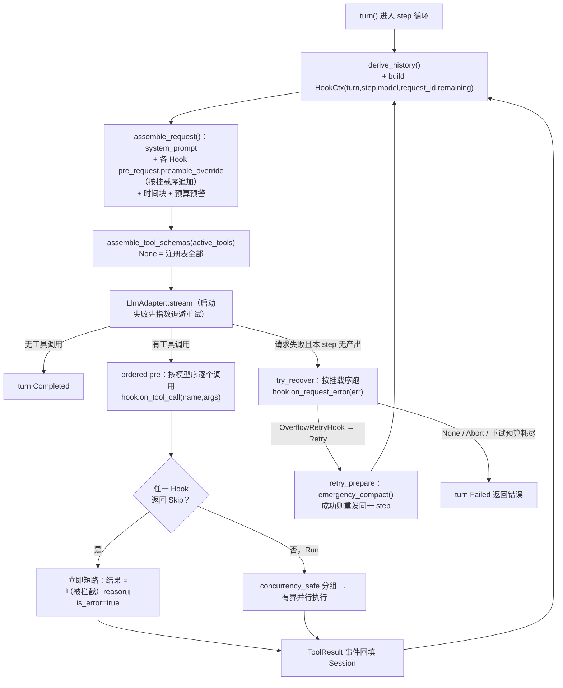

# Hook 体系与技能门禁：把「模型能看见什么、能调什么」做成可组合策略

> 本文只讲一件事：mdgo 的 Agent 循环本身不写业务策略，所有「请求前改什么」「工具执行前拦不拦」「请求炸了怎么办」都由挂在 `LoopAgent` 上的 Hook 决定。我们按当前代码逐项对照 trait 签名、结构体字段、常量与用户可见文案，并标出与旧设计文档不一致的地方。
>
> 适合读者：有 Rust/后端经验、想给自家 Agent 加可组合策略层或技能（Skill）体系的工程师。前置阅读建议：[02-Loop 内核：turn/step 状态机与请求装配](<02-Loop 内核-turn-step 状态机与请求装配.md>)。

## 1. 为什么要 Hook 层

重构前（rig 内核）用的是 rig 的 `AgentHook`（六类钩子）。当前内核把它按语义收敛成四组，并在模块头注释里固定了与 DSH（DeepSeek Harness）waterfall 的对应关系：

```
//! Loop Hook 抽象——把 rig 的 `AgentHook` 六类 1:1 迁移为 loop 语义（对齐 DSH 的
//! `agent/pre-step`、`agent/request`、`tools/pre-execute`、`agent/request-error` waterfall）。
```

（`tauri/src-tauri/src/core/loop/hooks.rs:1-2`）

为什么要单独抽一层，而不是把逻辑写进 `LoopAgent::turn`：

1. **循环只负责状态机**。`turn` 的职责是「step 循环 + 流式消费 + 工具调度 + 事件追加」（`core/loop/loop.rs:170-360`）。策略一旦写进循环，测试一个策略就要跑整条流式链路。
2. **策略需要组合与短路**。四个 Hook 的挂载是一个 `Vec<Arc<dyn LoopHook>>`（`core/loop/loop.rs:125`、`148-150`），新增策略只需 `add_hook`，不必改循环。
3. **默认实现即开闭原则**。trait 的四个方法全部带默认实现——`RequestPatch::default()` / `ToolDecision::Run` / `None` / `None`（`core/loop/hooks.rs:80-103`），只关心一件事的 Hook 可以只实现一个方法。

还有一个关键的分工：**「可见性」与「可用性」被拆成两件事**。`BASE_TOOLS` 的注释把原因写得很直白——检索类工具不在基础工具里，若用 `active_tools` 硬过滤掉，模型调用它会得到「工具不存在」级别的致命错误；因此改成「始终可见 + 软门禁 Skip + 工具闭包守卫」，注释把后两者称为「双层拦截」（`core/agent/mod.rs:120-127`，详见 §4.2）。

## 2. 四组钩子的契约

### 2.1 签名、时机、短路语义、默认实现

| 钩子 | 签名（`core/loop/hooks.rs`） | 调用时机 | 短路语义 | 默认实现 |
| --- | --- | --- | --- | --- |
| `pre_request` | `fn pre_request(&self, _ctx: &HookCtx, _messages: &[LlmMessage]) -> RequestPatch`（:80） | 每个 step 组装请求时、发请求前（`loop.rs:221`） | **不短路**：所有 Hook 按挂载序全部执行，产物合并 | `RequestPatch::default()` |
| `on_tool_call` | `async fn on_tool_call(&self, _ctx: &HookCtx, _name: &str, _args: &Value) -> ToolDecision`（:86） | 工具批次执行前的 ordered pre 阶段，按模型序逐调用（`tool_calls.rs:48-63`） | **短路**：任一 Hook 返回 `Skip` 立即停止后续 Hook 与该调用的执行 | `ToolDecision::Run` |
| `on_invalid_tool_call` | `fn on_invalid_tool_call(&self, _ctx: &HookCtx, _name: &str, _available: &[String]) -> Option<String>`（:91） | 设计意图是「模型调用了不存在的工具」时给自纠提示 | 返回 `Some` 即作为提示回填 | `None` |
| `on_request_error` | `async fn on_request_error(&self, _ctx: &HookCtx, _err: &LoopError) -> Option<RetryAction>`（:101） | 请求失败且本 step 无任何产出时（`loop.rs:233-249`、`304-315`） | 首个返回 `Some` 的 Hook 生效（`loop.rs:497-518`） | `None` |

`on_invalid_tool_call` 的现状要单独说明：**全仓库没有任何实现或调用点**（`grep on_invalid_tool_call` 只命中 trait 定义与模块注释）。未知工具实际走的是执行阶段的兜底——`run_one` 里 `tools.get(&call.name)` 为 `None` 时直接产出 `is_error = true`、内容为 `工具不存在: {name}` 的结果（`core/loop/tool_calls.rs:125-133`）。也就是说这条路当前是「工具结果回填」，不是「Hook 注入」。

另外要注意：`on_tool_call` 与 `on_request_error` 是 `async fn`，`pre_request` 与 `on_invalid_tool_call` 是同步 `fn`。前者异步的原因写在注释里——审批门需要 `await` 用户确认（`hooks.rs:85-86`）。

### 2.2 三个数据结构

`RequestPatch` 只有三个字段，语义边界很清晰：

```rust
/// 每轮请求补丁（对齐 rig `RequestPatch`）。
#[derive(Debug, Clone, Default)]
pub struct RequestPatch {
    /// 覆盖/追加 system prompt（在基础规约之后拼接）
    pub preamble_override: Option<String>,
    /// 窄化本轮可见工具（`None` = 全部已注册工具）
    pub active_tools: Option<Vec<String>>,
    /// 附加顶层参数字段
    pub extra_params: Option<Value>,
}
```

（`core/loop/hooks.rs:18-27`）

`HookCtx` 是只读快照：`turn / step / model / request_id / remaining_turns`（`hooks.rs:48-56`），其中 `remaining_turns = max_turns - step`（`loop.rs:211`），Hook 与循环之间不共享借用。

`ToolDecision` 只有 `Run` 与 `Skip(String)` 两个变体（`hooks.rs:30-36`）；`RetryAction` 只有 `Retry` 与 `Abort`（`hooks.rs:39-45`）。刻意不提供 `Skip` 之外的三态（比如 `Ask`），是为了让「拦截」只有一种表达：**把原因作为工具结果回填，让模型自纠**。

### 2.3 `SkillInstructionHook`：每轮约束摘要 + 可见工具窄化

结构体三个字段（`core/agent/loop_hooks.rs:29-33`）：

```rust
pub struct SkillInstructionHook {
    pub state: Arc<ActiveSkillState>,
    pub registry: Arc<SkillRegistry>,
    pub mcp_tool_names: Vec<String>,
}
```

`pre_request` 做两件事：

1. **约束摘要**（`skill_constraint_summary`，:36-74）：遍历 `state.active_only()`（仅 `Active`，warm 不算），每条生成 `- 名称（id vN）：desc`，desc 截到 120 字符（`MAX_DESC_CHARS`），整块预算 800 字符（`MAX_SUMMARY_CHARS`），超预算就 `break`（不是截断单条）。拼成的引导文案是固定字符串：「[已激活技能（约束摘要每轮常驻；正文仅注入一次，需完整内容可用 read 读取对应技能 SKILL.md，正文已随启动加载进内存、读取不落盘）：…]」（:69-72）。无激活技能时不注入（`preamble_override = None`）。
2. **可见工具并集**（:86-111）：`BASE_TOOLS` ∪ `SKILL_GATED_VISIBLE_TOOLS` ∪ `load_external_tools_or_default()` 的工具名 ∪ `mcp_tool_names` ∪ `state.allowed_tools()` 的声明工具，逐项去重后作为 `patch.active_tools = Some(visible)`。

这个并集有个容易被忽略的后果：`active_tools` 里可能出现注册表中不存在的名字（例如技能声明了某个已被移除的工具），此时 `assemble_tool_schemas` 用 `tools.get(&name)` 过滤，不存在的直接跳过（`loop.rs:434-451`），不会报错。

### 2.4 `SkillGateHook`：软门禁 + 重复调用熔断

```rust
        if self.base_tools.contains(&name) || self.allow_extra.contains(name) {
            return ToolDecision::Run;
        }
        let declared = self.state.allowed_tools().unwrap_or_default();
        if declared.iter().any(|t| t == name) {
            return ToolDecision::Run;
        }
        ToolDecision::Skip(format!(
            "工具 '{}' 当前不可用（未由任何已激活技能声明）。可先声明该工具的技能，或改用其他工具。",
            name
        ))
```

（`core/agent/loop_hooks.rs:136-146`，逐字）

裁决顺序是四段，**熔断在最前面**：

1. 防重复调用熔断：`guard_duplicate_call(&ctx.request_id, name, &args.to_string())`，同一 request 内「连续相同（工具，规范化参数）」≥2 次后，第 3 次起返回 `Skip`（`loop_hooks.rs:129-135`，实现在 `core/agent/tools/mod.rs:339-369`）。注意它只算「连续」重复，所以 `read(A) → edit(A) → read(A)` 不会被误伤；但反过来说，`read` 同样会被熔断，提示文案里也点名了 read 分页续读。
2. `base_tools`（装配时传的是 `BASE_TOOLS`，`commands/llm.rs:2820-2824`）或 `allow_extra`（外部工具名 ∪ MCP 工具名，`llm.rs:2810-2814`）→ `Run`。
3. `state.allowed_tools()` 里有该名字（已激活技能声明）→ `Run`。
4. 否则 `Skip` + 上面的引导文案。

`allowed_tools()` 的三态语义直接决定门禁行为（`core/skill/activation.rs:301-323`）：`None`（无任何激活记录）→ `unwrap_or_default()` 得到空列表 → 只放行 base/extra；`Some(空)`（激活了技能但都没声明工具）同样只放行 base/extra；`Some(list)` 放行并集。注意 **warm（`Candidate`）技能不参与解锁**，过滤条件写死在 `a.status != ActivationStatus::Active` 就 `continue`。

### 2.5 `ApprovalHook`：审批门，细节留给安全篇

只有一个字段 `gate: Arc<ApprovalGate>`（`loop_hooks.rs:151-153`）。`on_tool_call` 调 `self.gate.check(&ctx.request_id, name, args).await`，`Ok` → `Run`，`Err(denial)` → `Skip(skip_message(name, &denial))`（:157-170）。

`skip_message`（:193-224）按 `DenialCategory` 分四种文案（`UserRejected` / `ChannelUnavailable` / `Timeout` / `PolicyDenied`），共同点是明确禁止模型在对话里索要「确认/取消」文本——审批只走系统弹窗。具体策略、通道与超时语义见 [10-安全防线：审批、注入防护与防幻觉](<10-安全防线-审批-注入防护与防幻觉.md>)。

装配上有一个细节：只有 `state.approval_gate` 为 `Some` 时才挂这个 Hook（`llm.rs:2825-2827`），子代理只在写模式下挂（`core/subagent/mod.rs:197-199`）。

### 2.6 `OverflowRetryHook`：把溢出归类为可重试

无字段的 unit struct（`loop_hooks.rs:177`）。`on_request_error` 只做一件事：`err.is_context_overflow()` 为真则返回 `Some(RetryAction::Retry)`，否则 `None`（:181-189）。判定在 `core/loop/error.rs:30-32`，只认 `LoopError::Llm(LlmError::ContextOverflow)`。

它本身**不压缩**。压缩动作由调用方注入的 `LoopConfig.retry_prepare` 承担（`loop.rs:53-55`），mdgo 传的是 `Session::emergency_compact`：

```rust
    config.retry_prepare = Some(Arc::new(
        |session: &mut crate::core::r#loop::Session| session.emergency_compact(),
    ));
```

（`commands/llm.rs:2796-2798`）

重试预算是 `max_request_retries = 1`（`loop.rs:64`），且 `try_recover` 要求 `retry_prepare` 返回 `true`（确实推进了）才重发，否则按失败处理——这两道闸一起防死循环（`loop.rs:488-519`）。

### 2.7 挂载与生命周期

几个容易踩的实现细节：

- **Hook 集合在 `LoopAgent` 构造期固定**。`LoopAgent` 每次请求新建一次（`commands/llm.rs:2815`），`add_hook` 只是 `self.hooks.push(hook)`（`loop.rs:148-150`），没有 `remove_hook`。所以「临时摘掉一个 Hook」只能换实例，不能运行期改集合。
- **trait 要求 `Send + Sync`**（`hooks.rs:78`），因为 `turn()` 返回的 future 会被 `spawn`/跨线程轮询；`on_tool_call` 与 `on_request_error` 是 `async fn`，内部可 `await`（审批、超时）。
- **Hook 尽量无内部可变状态**。`SkillInstructionHook` 每 step 重算摘要与并集，自身零字段之外的状态；`SkillGateHook` 的状态全在 `Arc<ActiveSkillState>` 和 `guard_duplicate_call` 的全局静态表里。真正的内部状态只有 `ApprovalGate` 的「同一 run 内已决缓存」（`core/approval/mod.rs:106-109`），用来避免多轮重复弹窗。
- **Hook 不持有 loop 的借用**。`HookCtx` 全是拥有字段（`hooks.rs:47-56`），所以 Hook 可以在 `assemble_request` 里同步调用，也可以在工具执行任务里跨 `await` 持有 `&HookCtx`（`tool_calls.rs:38-63` 传的是引用，生命周期由调用方保证）。

## 3. 一次请求里的执行顺序



### 3.1 `assemble_request` 的合并语义

三个字段的合并规则**各不相同**，这是最容易写错的地方：

```rust
        for h in &self.hooks {
            let patch = h.pre_request(hook_ctx, history);
            if let Some(p) = patch.preamble_override {
                if !p.trim().is_empty() {
                    system.push_str("\n\n");
                    system.push_str(&p);
                }
            }
            if patch.active_tools.is_some() {
                active_tools = patch.active_tools;
            }
            if let Some(ep) = patch.extra_params {
                match (&mut extra, ep) {
                    (Some(e), v) => {
                        if let (Some(eo), Some(vo)) = (e.as_object_mut(), v.as_object()) {
                            for (k, val) in vo {
                                eo.insert(k.clone(), val.clone());
                            }
                        }
                    }
                    (slot, v) => *slot = Some(v),
                }
            }
        }
```

（`core/loop/loop.rs:371-394`，逐字）

- `preamble_override`：**追加**，不是覆盖。名字叫 `override` 但语义是「在基础 system prompt 之后拼接」，多 Hook 时按挂载序累加，空串跳过（`trim().is_empty()`）。
- `active_tools`：**后写者胜**（last-writer-wins），只有 `Some` 才会改；`None` 视为「不动」。因此挂多个会窄化工具的 Hook 时，最后一个的列表才是最终列表，**不是并集**。
- `extra_params`：**顶层 key 合并，后写者覆盖同名字段**。注意这不是深合并——`eo.insert(k, val)` 直接替换整个 value，嵌套对象不会递归 merge；且两侧都必须是 JSON object，否则原值保留。

合并完成后，`assemble_request` 还会追加两段与本主题无关但影响 prompt 布局的内容：末尾的本地时间块（`loop.rs:395-420`，注释说明放末尾是为了保住稳定前缀的 provider 缓存）和剩余轮次 ≤ `budget_warning_threshold`（默认 3）时的预算提醒（`loop.rs:421-429`）。**Hook 注入的 preamble 因此位于稳定前缀区间内**，而时间块之后的内容不参与缓存。

### 3.2 工具裁决与短路

ordered pre 的实现很直白，短路点只有一个 `break`：

```rust
    let mut decisions: Vec<ToolDecision> = Vec::with_capacity(n);
    for call in &calls {
        let args = parse_args(&call.arguments);
        let mut decision = ToolDecision::Run;
        for h in hooks {
            match h.on_tool_call(hook_ctx, &call.name, &args).await {
                ToolDecision::Skip(reason) => {
                    decision = ToolDecision::Skip(reason);
                    break;
                }
                ToolDecision::Run => {}
            }
        }
        decisions.push(decision);
    }
```

（`core/loop/tool_calls.rs:49-63`，逐字）

Skip 的调用不会执行，而是立刻按模型序回填一条错误结果：内容 `（被拦截）{reason}`、`is_error = true`（`tool_calls.rs:65-76`）。这意味着**拦截对模型来说是「工具执行失败」的一种**，模型下一轮能读到原因并自纠——这正是把 Skip 设计成携带 `String` 的原因。

并行只发生在通过裁决的调用上：按 `concurrency_safe` 分组，exclusive 单独成组串行，安全组用 `chunks(max_parallel_tools)`（默认 4）分窗并行，结果按下标回填保持模型序（`tool_calls.rs:78-110`）。详见 [04-工具系统：契约、注册与并行调度](<04-工具系统-契约-注册与并行调度.md>)。

### 3.3 请求失败的恢复顺序

`try_recover` 被两处调用：流启动失败（`loop.rs:233-249`）和流中途出错且「本 step 无文本、无工具调用」（`loop.rs:304-315`）。第二条的守卫很关键——一旦已经产出内容或发起过工具调用就不重试，避免重放工具副作用。

恢复流程：取消错误直接返回 `None`；否则按挂载序遍历 Hook，取第一个 `Some(action)`；`Retry` 时先检查 `retries >= max_request_retries`（默认 1），再调 `retry_prepare`，返回 `true` 才 `retries += 1` 并继续同一 step。

### 3.4 真实装配顺序

主对话路径（`commands/llm.rs:2815-2835`）的挂载顺序就是执行顺序：

1. `SkillGateHook { base_tools: BASE_TOOLS, state, allow_extra }`（:2820-2824）
2. `ApprovalHook { gate }` —— 仅当 `state.approval_gate` 为 `Some`（:2825-2827）
3. `OverflowRetryHook`（:2829）
4. `SkillInstructionHook { state, registry, mcp_tool_names }`（:2831-2835）

即：**技能门禁 → 审批 →（溢出恢复）→ 技能指令**。前两者在 `on_tool_call` 上有序，所以「本就不该调用的工具」不会先弹审批框打扰用户（`loop_hooks.rs:8` 的注释原话）；`SkillInstructionHook` 排在最后不影响结果，因为它是唯一的 `pre_request` 实现者。

子代理路径刻意精简：只挂 `ApprovalHook`（写模式），**不挂技能 Hook**，并把 `skill_gating` 置为 `false`，理由是子代理的工具白名单已在注册表层过滤，若继承 `skill_gating = true`，空技能态会让它丧失检索能力（`core/subagent/mod.rs:144-148`、`186`）。

### 3.5 一次请求里 Hook 到底被调用多少次

以 `max_turns = T`、单 step 工具调用数 `N`、挂载 `H` 个 Hook 估算：

- `pre_request`：每 step 一次，最多 `T` 次，每次都要遍历全部 Hook（`loop.rs:221` → `371`）。
- `on_tool_call`：每个调用 × 每个 Hook，最坏 `T × N × H` 次 `await`，且**裁决阶段是串行的**——`for call` 里再 `for h`（`tool_calls.rs:50-63`）。这意味着第一个调用卡在审批上（门限 60 秒，`lib.rs:482-489`）时，同批次后面的调用还没开始裁决。执行阶段才并行，裁决阶段不并行，是这套设计里最需要知道的时序特征。
- `on_request_error`：只在失败路径上跑，最多 `max_request_retries × 重试次数` 次，当前预算 1 次。
- `on_invalid_tool_call`：0 次（未接线）。

被 Skip 的调用不会产生 `sink.on_call`，只补一条 `sink.on_result(..., success=false, ...)`（`tool_calls.rs:65-76`），所以前端工具轨迹里会看到「有结果、无调用」的条目——这是刻意保留的证据链，不是丢事件。

另一个必答问题：**为什么 `pre_request` 每 step 都要跑**？因为 system prompt 不落会话日志、每轮重新装配（`loop.rs:9-10` 的不变式注释），任何随会话状态变化的东西（激活技能、可见工具、附加参数）都必须在每轮重新求值；同时这也是「压缩/长任务后技能规范漂移」的对抗手段（`loop_hooks.rs:23-24`）。

## 4. 技能门禁与渐进式披露

### 4.1 L1/L2/L3 三层与代码位置

| 层级 | 内容 | 注入时机与位置 | 代码位置 | token 成本 |
| --- | --- | --- | --- | --- |
| L1 目录 | 每个启用技能的 `id（scope）：description` 一行，同名多作用域取最高优先级；附会话挂载标注与「任务路由」提示 | 每**请求**一次，拼进 `LoopConfig.system_prompt` 尾部（`llm.rs:2785-2787`） | `build_skill_catalog`（`core/skill/context.rs:345-385`）、挂载/路由标注（`llm.rs:1871-1912`） | 随技能数线性增长，description 未截断，**代码中未见上限** |
| L2 约束摘要 | 已激活技能的名称/版本/描述摘要，整块 ≤800 字符（单条 desc ≤120 字符） | 每 **step** 由 `SkillInstructionHook::pre_request` 追加到 system | `loop_hooks.rs:36-74`、`79-85` | 每 step 最多约 800 字符（按 `chars/2` 估算 ≈400 token），10 步即 4k token |
| L2 正文 | `SKILL.md` 正文核心段，≤`MAX_SKILL_BODY_CHARS` = 4000 字符，包在 `<active_skill id= version= source=llm>` 里 | **一次性**：`activate_skill` 工具结果进入历史 | `loop_tools.rs:1592-1621`、常量在 `activation.rs:81` | ≈2000 token/技能，只付一次；超限截断并引导 `read '{id}/SKILL.md'` |
| L3 参考资料 | `references/*.md` 与 `{skill_id}/SKILL.md` 完整正文 | 模型按需调 `read`，走内存注册表/技能目录 | `core/agent/tools/mod.rs:980-1093`（含 `read_active_skill_md`） | 按页（约 8192 字符/页）计费，不读不花 |

三层合起来是一个刻意的成本梯度：**目录常驻（便宜但只有元数据）→ 摘要每轮（防长任务/压缩后规范漂移）→ 正文一次（真正贵的那次只付一次）→ 参考文档按需（最贵但最精准）**。`context.rs:404-439` 里还留着旧的一次性拼接函数 `format_skill_instructions`，但已被标 `#[allow(dead_code)]`，注释写明「当前仅测试路径使用」（`context.rs:402-403`）。

### 4.2 三层拦截链（可见性 / 裁决 / 闭包守卫）

同一件事被写了三遍，看起来冗余，实际分工不同：

1. **可见性**：`SkillInstructionHook` 决定 `active_tools`，即模型能不能看到 schema。软门禁可见工具（`kb_search`/`code_lookup`/`schedule`/`pomodoro`/`raw-parse`/`open-ui`/`search_bookmarks`/`get_bookmark`，`agent/mod.rs:144-147`）永远可见，避免 `UnknownToolCall`。
2. **裁决**：`SkillGateHook` 在 ordered pre 阶段 `Skip`，拦的是「看见了但没资格调」。
3. **闭包守卫**：工具自身的 `skill_gated()` 检查（`loop_tools.rs:43-48`），返回的是**正常结果**（`Ok(Value::String(引导文案))`）而不是错误，例如 `kb_search` 未激活时返回「kb_search 需要先激活 kb-search 技能…本次未执行检索」（`loop_tools.rs:200-208`）。桥接工具 `pomodoro`/`raw-parse`/`open-ui` 同款（`loop_tools.rs:1962-1982`）。

之所以第 3 层存在，是因为门禁只挂主对话（子代理 `skill_gating = false`），而工具闭包在任何宿主里都可能被调用；`skill_gating` 字段就是那个开关（`agent/mod.rs:333-338`）。

### 4.3 「一次性注入 + 每轮约束摘要」的去重语义

去重靠两处状态，而不是靠文本比对：

- `SkillActivation.loaded_once`（`activation.rs:134-135`）：`activate_skill` 先查 `state.is_loaded(&id)`，命中就只返回「技能 '{id}' 已激活且指令已注入，本请求内不会重复注入正文。」+ 描述，不返回正文（`loop_tools.rs:1577-1586`）。
- `active_only()` 过滤 `Active` 状态：warm 技能不进摘要、不解锁工具、`references` 不可读（`activation.rs:257-267`）。

`loaded_once` 由调用方决定：工具激活（正文已返回）传 `true`；请求入口预激活也传 `true`（`context.rs:160`、`189-194`、`227`）。

**但这里有一个当前实现的缺口**，必须如实写出来：`ResolvedSkillContext.skills` 的注释说「供请求入口一次性注入 history」（`context.rs:125-127`），而 `commands/llm.rs` 里 `resolved.skills` 只被用来拼「【任务路由…】已预激活技能 {}，正文已注入…」这句**只含 ID 的提示**（`llm.rs:1899-1912`），全文件没有任何把技能正文写入 system 或 messages 的代码（`format_skill_instructions` 是 dead code，`grep '\.body'` 在 `llm.rs` 只命中记忆模块）。后果是：手动触发 `/技能名`、`active` 挂载、意图匹配命中的技能会被标记 `loaded_once = true`，但正文从未进入上下文，模型之后再调 `activate_skill` 只会拿到「已激活」提示——此时唯一拿到正文的路径是 `read '{skill_id}/SKILL.md'`（`tools/mod.rs:1040-1093`，同样是提示里给的兜底路径）。写作时以代码为准，这条列为已知限制（见 §7）。

### 4.4 L1 目录的生成细节

`build_skill_catalog`（`context.rs:345-385`）做四件事，每一步都影响模型的选择质量：

1. **按 id 去重、保留最高作用域**：`HashMap<id, Skill>`，新条目只在 `scope_rank` 更高时替换（`context.rs:346-357`）。所以「项目里覆盖了同名系统技能」时，目录里只出现项目版本，且 scope 标注为 `project`。
2. **过滤 `enabled = false`**（:348-350）。
3. **排序**：`priority` 降序，同优先级按 `scope_rank` **升序**（:360-364）——注意这里不是降序，也就是同优先级时 system 排在 global/project 之前；由于第 1 步已按 id 去重，这个 tie-break 只在「不同 id、同 priority」时生效，实际影响很小，但读数时容易误解。
4. **格式化**：每行是「短横线 + 反引号包裹的 id + 全角括号里的 scope + 冒号 + description」，空描述替换为「（无描述）」（:369-379）；表头是「可用技能目录（skill_id 作为 activate_skill 的入参；当任务与某技能相关时先激活再执行）：」（:380-383）。注册表为空时返回空串，`llm.rs` 侧用 `if !catalog.trim().is_empty()` 守卫，不会注入空段落。

目录之外还会追加两段（`llm.rs:1875-1912`）：会话挂载标注（`立即生效（指令与工具已加载）：…` / `自动准备（检索已预热，需要时先 activate_skill 激活完整规则）：…`）与「【任务路由（系统预分析建议，供参考）…】」。这两段是**提示，不是状态**——真正的状态在 `ActiveSkillState` 里，所以模型即使无视提示也不会拿到未解锁的工具。

### 4.5 预检索是否执行，也由技能决定

`retrieval_enabled()` 的语义是「任一技能（`Active` **或** warm/Candidate）声明了 `kb_search` 或 `code_lookup`」（`activation.rs:325-333`）。请求入口据此决定跳过还是执行 Stage 1-3 的查询扩展 + 向量检索（`llm.rs:1101-1104`），注释给出的理由是避免无关消息触发昂贵的检索链路（RAG 与 Agent 解耦）。

这条与门禁形成有趣的互补：warm 挂载「解锁了预检索，但没解锁工具」。所以 warm 技能的实际收益是「进上下文的知识更多（预检索结果进 system）」而不是「模型能调检索工具」。要让模型主动检索，仍然必须 `activate_skill`。

## 5. 激活状态机与挂载模式

### 5.1 三拆数据模型

| 层 | 结构 | 存放什么 | 代码 |
| --- | --- | --- | --- |
| 定义 | `Skill` | `id/scope/name/description/priority/tools/triggers/top_k/min_score/max_docs/max_chunks_per_doc/enabled/version/body/file_path/created_at/updated_at` | `core/skill.rs:199-222` |
| 注册表 | `SkillRegistry` | `RwLock<HashMap<(SkillScope, String), Skill>>` + 目录缓存 + DB 连接缓存 + 最近加载错误 + 系统目录 | `core/skill.rs:715-725` |
| 激活状态 | `ActiveSkillState` / `SkillActivation` | 生命周期、来源、`loaded_once`、声明工具、激活时刻、摘要；**不持有正文** | `core/skill/activation.rs:125-174` |

`SkillActivation` 不复制 `body` 是刻意设计：正文是 `SkillDefinition` 的静态内容，若随运行时状态复制，每次 clone 都要搬运大字符串，而指标路径只要 `(scope, id, elapsed)`（`activation.rs:274-288` 的注释明确说「不克隆 SkillActivation，避免指标路径搬运大对象」）。

### 5.2 发现、作用域与热更新

- 三个目录：system（`app.path().resource_dir()/skills`，开发期回退 `CARGO_MANIFEST_DIR/resources/skills`，`skill.rs:550-567`）、global（Windows `%APPDATA%\com.mdgo\skills`，`skill.rs:501-536`）、project（`{打开目录}/.mdgo/skills`，`skill.rs:539-541`）。
- 扫描规则：只认「子目录 + 目录下的 `SKILL.md`」，解析失败收集为 `{文件路径}: {字段}: {原因}` 并 `log::warn`，不中断整次扫描（`skill.rs:572-618`）。
- 合并：键是 `(scope, id)`，三层依次 `insert`，因此同名技能 **project > global > system**（`skill.rs:771-795`）；单条查询按 `find_enabled` 再按 `scope_rank` 取最高（`skill.rs:870-886`、`145-151`）。
- 热更新：文件监听（防抖 800ms）触发 `registry.reload(&dir_path)`（`core/watcher.rs:835-840`）；`ensure_loaded` 用 `last_loaded_dir` 做幂等短路（`skill.rs:757-766`）。`reload` 同时把全量技能灌进 `<dir>/.mdgo/mdgo.db` 的 `skills` 表，用 `TransactionBehavior::Immediate` 包住「先清空再重灌」（`skill.rs:693-705`），失败只 `warn` 不影响内存注册表。

### 5.3 `SKILL.md` 解析

`parse_skill_md` 分三步（`skill.rs:321-384`）：`split_frontmatter` → `serde_yaml::from_str::<SkillFrontmatter>` → `validate_skill`。

`split_frontmatter`（`skill.rs:391-406`）处理了三个 Windows 现场问题：CRLF 归一化为 LF、去 UTF-8 BOM、`---` 后必须紧跟换行。测试 `split_frontmatter_accepts_crlf`（`skill.rs:934-947`）把 LF/CRLF/BOM+CRLF 三种输入断言成同一结果。

校验只做安全底线（`skill.rs:409-432`）：`id` 非空、长度 ≤128 字符、首尾无空白、不等于 `.`/`..`、不含控制字符与 `/`、`\`、单引号、双引号、反引号（`is_valid_skill_id`，:452-468，注释说明禁止引号是为了防前端把 id 拼进 HTML 属性/内联事件）；`name` 非空；`priority <= 100`。工具名**不做强类型校验**，加载时 `retain(|t| ALLOWED_TOOLS.contains(t))` 静默丢弃白名单外的名字（`skill.rs:373-376`）。`ALLOWED_TOOLS`（`skill.rs:34-42`）与运行时可见面的一致性由编译期测试保证：`ALLOWED_TOOLS ⊆ BASE_TOOLS ∪ SKILL_GATED_VISIBLE_TOOLS` 且反向覆盖 `SKILL_GATED_VISIBLE_TOOLS`（`skill.rs:949-971`）。

### 5.4 生命周期、状态与挂载模式

两套正交维度（`activation.rs:24-34`、`53-62`）：

- `SkillLifetime`：`Turn`（单次请求：`/技能名`、LLM 动态激活）、`Session`（会话挂载）。
- `ActivationStatus`：`Candidate`（已进入激活流程但正文未注入，warm 态用它）、`Active`、`Failed`、`Expired`。
- `ActivationSource`：`Attached`（会话挂载）/ `Manual`（`/技能名` 或意图匹配）/ `Llm`（`activate_skill`）（`activation.rs:88-98`）。

挂载模式由 `chat_session_skills.mount_mode` 决定，`resolve_preactivated` 分派（`context.rs:172-205`）：`active` → `activate(..., Session, Attached, true)` 并进入正文注入列表；其它值（默认 `warm`）→ `activate_warm`（`SkillLifetime::Session` + `ActivationStatus::Candidate` + `loaded_once=false`），只开预检索、不解锁工具（`activation.rs:239-255`）。

生命周期并非不可变：`activate_skill` 激活一个 `Session` 生命周期的技能时会保留 `Session`，否则用 `Turn`（`loop_tools.rs:1600-1605`）——这样「LLM 把 warm 挂载技能升级为 Active」不会把它降级成一次性。

### 5.5 `ActiveSkillState` 的并发结构

```rust
#[derive(Debug)]
pub struct ActiveSkillState {
    inner: RwLock<Vec<SkillActivation>>,
    /// 请求期间被停用的技能及停用时刻耗时（用于执行统计补录，避免中途停用的技能漏记）
    deactivated: RwLock<Vec<(SkillActivation, u64)>>,
}
```

（`core/skill/activation.rs:169-174`，逐字）

设计要点：

- **每请求一个实例**：`agent_query` 每次新建 `Arc::new(ActiveSkillState::new())`（`llm.rs:997`），再共享给工具闭包（`skill_state` 字段）、Hook（`SkillInstructionHook`/`SkillGateHook` 的 `state`）与收尾指标收集三处。所以不存在跨请求锁竞争，也不需要 `Warming/Activating` 中间态——注释解释是工具在 poll 栈内顺序执行，无并发激活竞争（`activation.rs:46-49`）。
- **读多写少**：`active_only` / `activated` / `allowed_tools` / `retrieval_enabled` / `*_elapsed` 全是 `read()`；只有 `activate` / `deactivate` / `activate_warm` 取 `write()`。
- **毒锁降级**：所有 `lock()` 都写 `unwrap_or_else(|e| e.into_inner())`，panic 过的锁继续用，不把指标/门禁路径带崩。
- **`deactivated` 是补录缓冲**：`deactivate` 时把 `(记录, 激活→停用毫秒)` 移进第二把锁（`activation.rs:224-237`），供请求结束统一写指标，避免「中途停用漏记」。`allowed_tools()` 只看第一把锁，所以停用后工具立刻不可用。

### 5.6 两个技能工具如何改状态

`activate_skill`（`loop_tools.rs:1533-1623`）的顺序：空参数校验 → `is_loaded` 幂等短路 → `find_enabled` 取技能（不存在返回「技能 '{id}' 不存在或未启用，请从技能目录中选择」）→ 正文按 `MAX_SKILL_BODY_CHARS` 截断 → 决定 lifetime → `state.activate(...)` → 拼 `<active_skill>` XML + 截断提示 + 描述 + 专用工具列表 → `on_result` 与返回值都是这段文本。**先改状态再返回文本**，所以即使该工具结果在后续被预算截断，工具解锁也已经生效。

`deactivate_skill`（`loop_tools.rs:1637-1674`）：空参数校验 → `state.deactivate(&id)`，成功返回「技能已停用：{id}」，失败返回「技能 '{id}' 当前未激活，无需停用」并 `Err(ToolError::Failed)`。注意 `deactivate` 按 ID 匹配任意作用域，同名多作用域时只移除第一个命中（`activation.rs:224-237`）。

### 5.7 预激活的三条路径

`resolve_preactivated` 是请求入口唯一的技能解析函数（`context.rs:146-251`），按顺序尝试三条路径，任一命中就写入 `state`：

1. **手动触发 `/技能名`**（`context.rs:295-339`，最高优先级，命中后直接 `return`，跳过挂载与意图匹配）。解析规则：必须以 `/` 开头；按 `[System, Global, Project]` 顺序找；先按 id 精确匹配、再按 `name` 匹配（前端 chips 展示的是 name，可能与 id 不一致）；`enabled = false` 视为不存在并 `log::warn`。剩下部分为 `cleaned_query`，若去掉技能名后为空（用户只输 `/schedule`），回退为完整触发语句，避免空查询进入检索（:320-330）。激活参数是 `Turn` + `Manual` + `loaded_once = true`（:160）。
2. **会话挂载**（`context.rs:177-205`）。调用方从 `ChatStore::get_attached_skills(sid)` 读出 `(scope, id, version, mode)` 并映射成 `(scope, id, mode)`（`llm.rs:1015-1032`）。只处理 `enabled` 技能；`mode == "active"`（字符串精确比较）→ `activate(Session, Attached, true)` 并进入 `mounted_active`；其它值 → `activate_warm` 并进入 `mounted_warm`。
3. **意图匹配**（`context.rs:258-288`）。用户消息小写化后包含技能的任一 `triggers` 关键词即命中，`hits` 取命中数，并列时取 `priority` 高者。它**与挂载解耦**：即使挂了无关技能，意图命中仍会追加激活（回归测试 `intent_match_not_blocked_by_unrelated_mount`，`context.rs:528-541`）；若命中的正是 warm 挂载技能，则从 `Candidate` 升级为 `Active` 解锁工具（`intent_match_upgrades_warm_mount_to_active`，:544-559）。注释解释了这条兜底存在的原因：避免「挂载了技能 → 意图相关技能未激活 → 工具不可见 → 模型编造执行结果」的幻觉链路（`context.rs:139-142`）。激活参数是 `Turn` + `Manual`（注意：来源记成 `Manual` 而非新造一个 `Intent` 变体），`loaded_once = true`（:227）。

三条路径都没命中时返回 `Ok(None)`，表示「本请求无预激活技能，激活完全交给 LLM 依据 L1 目录决策」（:236-238）。返回非空时，`ResolvedSkillContext` 里同时带出 `cleaned_query`（手动触发时被剥前缀）、`is_manual`、`skills`（正文注入列表）、`mounted_warm` / `mounted_active`（供目录标注）（:119-132）。

## 6. 策略合成与指标

### 6.1 `resolve_retrieval_policy` 的三段优先级

入口是纯函数（`core/skill/policy.rs:34-58`），优先级从高到低：

1. **技能声明**：`skill_ctx.top_k / min_score / max_docs / max_chunks_per_doc`。多技能同时激活时的保守合并已在上游完成——`top_k`/`max_docs`/`max_chunks_per_doc` 取最小、`min_score` 取最大（`context.rs:62-87`、`100-115`）。
2. **请求/全局兜底**：`top_k` 缺省回退请求级 `request_top_k`（前端可传）；`min_score`/`max_docs`/`max_chunks_per_doc` 回退 `IndexerConfig`；`rerank_min_score` **只有全局**（技能无此声明）。
3. **Security clamp**：`top_k` `1..=50`、`min_score`/`rerank_min_score` `0.0..=1.0`、两个容量 `.max(1)`。

| 字段 | 技能可声明 | 中间兜底 | clamp |
| --- | --- | --- | --- |
| `top_k` | 是 | 请求级 `top_k` | `1..=50` |
| `min_score` | 是 | `global.min_score` | `0.0..=1.0` |
| `rerank_min_score` | 否 | `global.rerank_min_score` | `0.0..=1.0` |
| `max_docs` | 是 | `global.max_context_docs` | `>= 1` |
| `max_chunks_per_doc` | 是 | `global.max_chunks_per_doc` | `>= 1` |

clamp 是**边界而不是默认值**：技能可以放宽全局设置，但不能越过安全边界（`policy.rs:6-12` 的模块注释原话）。调用点在 `llm.rs:1093-1099`，结果同时喂给预检索和 `KbSearchConfig`（`default_top_k`/`min_score`/`rerank_min_score`/`max_context_docs`/`max_chunks_per_doc`，`llm.rs:1924-1929`）。是否执行预检索另由 `active_skills.retrieval_enabled()` 决定，它统计 `Active + warm`（warm 声明 `kb_search`/`code_lookup` 即开，`activation.rs:325-333`）。

### 6.2 `SkillMetrics`：内存累积 + SQLite 聚合

**没有环形缓冲**。设计是「SQLite 为最终事实源」（`core/skill/metrics.rs:5-12`），内存只做短命累积：

- 调度计数：`record_dispatch(dir, matched)` 先加到 `pending: Mutex<HashMap<String, PendingDispatch>>`（total/matched 两个 u64），达到 `DISPATCH_FLUSH_THRESHOLD = 16` 或请求结束（`take_pending_dispatch(dir, 1)`）时，用单个 `UPDATE skill_dispatch_stats SET total_dispatches = total_dispatches + ?1 ... WHERE id = 1` 累加落库（`metrics.rs:180-246`）。目的是把单请求 2~3 次写合并成 1 次，减少与 ChatStore/AiHistoryStore 的写锁竞争。
- 执行明细：`record_execution_batch` 单事务批量 `INSERT INTO skill_exec_metrics`，每技能一行，字段 `(request_id, scope, skill_id, match_level, score, state, duration_ms, error_code, created_at)`（`metrics.rs:249-320`）。`match_level` 列实际写的是 `source.as_str()`（`activation.rs` 的 `ActivationSource`），属于历史列名。
- 读取窗口：`ROW_NUMBER() OVER (PARTITION BY scope, skill_id ORDER BY created_at DESC)` 取每技能最近 50 条（`metrics.rs:340-374`），这就是「环形缓冲」的替代方案——读侧开窗，写侧不丢数据。
- 过期清理：每目录每小时最多一次 `DELETE ... WHERE created_at < now - 90 天`，节流状态存在 `last_cleanup`（`metrics.rs:269-279`、`308-314`）。
- 连接管理：`conns: Mutex<HashMap<String, Arc<Mutex<Connection>>>>` 两级锁——外层只做查找/插入，取出每目录连接后再锁，避免不同目录互相串行（`metrics.rs:134-169`）。

聚合维度：按 `(scope, skill_id)` 分组，输出 `total_calls / success_rate / avg / p50 / p95 / error_codes / activation_sources / avg_match_score / last_call_at`（`metrics.rs:452-521`，百分位用线性插值，`metrics.rs:524-542`）；全局另有 `total_dispatches / matched_dispatches / dispatch_hit_rate` 与加权平均耗时（按明细 sum/count，不是各技能均值的平均，`metrics.rs:376-381`）。

写入侧的接线在请求结束：`collect_skill_exec_inputs` 合并「预激活（`skill_ctx.matches`）∪ 当前激活 ∪ 中途停用」，按 `scope:id` 去重，耗时优先取该技能自身的激活时长（`llm.rs:767-818`），再由 `record_exec` 在三个 `match` 分支里 `spawn_blocking` 落库：`Failed` 且无内容 → `failed`、`Cancelled` → `cancelled`、其余（含 `MaxTurns`，按成功处理以保留已生成内容）→ 成功（`llm.rs:2941-2972`）。

**一个必须写明的口径缺口**：`record_dispatch_matched`（`metrics.rs:195-203`）全仓库**没有调用点**（`grep record_dispatch` 只命中 `llm.rs:1071` 的 `record_dispatch(&dir, false)`）。也就是说 `matched_dispatches` 恒为 0，`dispatch_hit_rate` 在实际运行中恒为 0——代码保留了两段式补记的接口，但「请求结束补记命中」尚未接线（设计意图见 [11-可观测性与评测：Trace、指标与基准](<11-可观测性与评测-Trace-指标与基准.md>) §5.1，实现尚未落地）。看板上若要命中率，需要先补这个调用。

### 6.3 相关常量速查

| 常量 / 配置 | 值 | 位置 | 影响 |
| --- | --- | --- | --- |
| `MAX_SUMMARY_CHARS` | 800 字符 | `loop_hooks.rs:37` | L2 约束摘要每 step 的硬上限，超出的技能整条丢弃 |
| `MAX_DESC_CHARS` | 120 字符 | `loop_hooks.rs:38` | 摘要内单条描述截断（截断后追加 `…`） |
| `MAX_SKILL_BODY_CHARS` | 4000 字符 | `activation.rs:81` | 单次正文注入上限（注释按 `chars/2` 估算 ≈2000 token） |
| `budget_warning_threshold` | 3 | `loop.rs:63` | 剩余轮次 ≤3 时在 system 末尾注入「请停止调用任何工具」 |
| `max_request_retries` | 1 | `loop.rs:64` | `on_request_error` 返回 `Retry` 的最大次数 |
| `max_parallel_tools` | 4 | `loop.rs:65` | 通过裁决后的工具并行窗口 |
| `DEFAULT_MAX_PARALLEL` | 4 | `tool_calls.rs:32` | 调度器默认并行上限（调用方可覆盖） |
| `DISPATCH_FLUSH_THRESHOLD` | 16 | `metrics.rs:123` | 调度计数内存累积到多少条触发一次落库 |
| 审批超时 | 60 秒 | `lib.rs:488` | 审批门等待用户的时间，超时按拒绝处理 |
| Skill 目录防抖 | `SKILL_DEBOUNCE_DELAY` | `core/watcher.rs:813` | 目录变更静默窗口，之后触发注册表全量重建 |

## 7. 设计取舍与已知限制

1. **软门禁而非硬过滤**（取舍正确）：代价是模型会看到一些当下不能用的工具，收益是不会因为「工具不存在」把整个流式请求打死（`agent/mod.rs:120-127`）。代价的兜底是工具闭包返回温和引导而不是错误。
2. **正文只注入一次、每轮只发摘要**：把 10 轮 × 全量正文的 O(n) 成本压成 1 次正文 + 10 次 ≤800 字符摘要。代价是模型必须在摘要里「记得」正文规范；摘要被预算截断时（>800 字符）靠后的技能会整条消失（`loop_hooks.rs:59-62` 是 `break` 不是截断），没有「已省略 N 个技能」的提示。
3. **预激活正文注入缺失**（§4.3）：`loaded_once = true` 但正文没进上下文，`activate_skill` 又会以「已注入」短路。当前唯一恢复路径是 `read '{skill_id}/SKILL.md'`。这是实现与注释/旧文档不一致的地方，不是设计意图。
4. **`on_invalid_tool_call` 是空钩子**：trait 保留了恢复位，但既无实现也无调用方；未知工具走 `工具不存在` 结果回填（`tool_calls.rs:125-133`）。若要给模型更友好的自纠提示，这里是天然的插入点。
5. **`extra_params` 不是深合并**：嵌套对象整体替换。多个 Hook 都想塞同一个嵌套配置时会互相覆盖，需要合并的话得在 Hook 内部先读出已有值再构造。
6. **`dispatch_hit_rate` 当前恒 0**（§6.2），属于接线缺口而非算法问题。
7. **门禁逻辑写了两份**：`SkillGateHook::on_tool_call` 的「base/extra/declared」判定与 `skill_gated()`（`loop_tools.rs:43-48`）、`BridgeTool` 内联判定（`loop_tools.rs:1966-1974`）是三处同义实现。任何一处改语义（例如把 warm 也算解锁），另两处必须同步，否则会出现「Hook 放行但工具自己拒绝」的错位。
8. **重复调用熔断在门禁之前**：好处是连 base 工具的无效重试也能拦；副作用是同一 `request_id` 内 `read` 同参数连读三次会被拦（提示文案已引导用 offset 分页）。计数器按 `request_id` 存全局静态 map，`map.len() > 64` 时按 60 秒窗口清理（`tools/mod.rs:339-369`），并发高时存在被提前清理导致计数归零的可能。
9. **`SkillInstructionHook` 每 step 重新计算并集**：包含 `load_external_tools_or_default()`（带 mtime 缓存的配置读取），10 步会算 10 次。当前实现依赖其内部缓存，若未来该函数变重，应把并集上移到请求级。

与旧设计文档的差异（以当前代码为准）：

- `docs/Skill 引擎 v1 交付归档.md` 说「预激活（/技能名、active 挂载）→ 请求入口把正文写入 history 首条」；当前 `commands/llm.rs` 里没有这段写入（见 §4.3），只有含 ID 的「任务路由」提示。也就是说该文档描述的是设计意图，不是现状。
- `docs/去 rig 自研 Agent 内核可行性评估.md` 说 `on_invalid_tool_call` 的无效工具恢复「已实现（loop 内）」；当前 loop 里既无实现也无调用点，恢复靠 `工具不存在` 结果回填（见 §2.1）。
- `docs/Agent 内核架构.md` 列的挂载顺序是 `SkillGateHook → ApprovalHook → SkillInstructionHook`，漏了 `OverflowRetryHook`（当前在 `ApprovalHook` 之后 `add_hook`，见 §3.4）。

## 8. 小结与相关文件

- 四组钩子 = 一个 trait、四个默认空实现：`pre_request` 改请求、`on_tool_call` 裁决工具、`on_invalid_tool_call`（未接线）、`on_request_error` 决定重试。
- 合并语义三个字段三种规则：preamble **追加**、active_tools **后写者胜**、extra_params **顶层 key 覆盖**。
- 真实装配顺序：`SkillGateHook` → `ApprovalHook`（可选）→ `OverflowRetryHook` → `SkillInstructionHook`。
- 技能体系是「定义 / 注册表 / 激活状态」三拆，正文永不进运行时状态；披露分 L1 目录、L2 摘要（每轮）+ 正文（一次）、L3 按需 `read`。
- 门禁是软门禁：可见 ≠ 可调，`Skip` 以错误结果回填让模型自纠。
- 已知缺口三个：预激活正文注入、`on_invalid_tool_call` 空实现、`dispatch_hit_rate` 无写入点。

相关文件：

- `tauri/src-tauri/src/core/loop/hooks.rs`（trait + 数据结构）、`core/loop/loop.rs`（装配与恢复）、`core/loop/tool_calls.rs`（裁决与并行）
- `tauri/src-tauri/src/core/agent/loop_hooks.rs`（四个业务 Hook）、`core/agent/mod.rs`（`BASE_TOOLS` / `SKILL_GATED_VISIBLE_TOOLS` / `KbSearchConfig`）
- `tauri/src-tauri/src/core/skill.rs`、`core/skill/{activation,context,policy,metrics}.rs`
- `tauri/src-tauri/src/commands/llm.rs`（Hook 装配与指标接线）、`core/agent/loop_tools.rs`（工具侧守卫与 `activate_skill`）

同系列：

- [00-导读](00-导读.md)
- [02-Loop 内核：turn/step 状态机与请求装配](<02-Loop 内核-turn-step 状态机与请求装配.md>)
- [04-工具系统：契约、注册与并行调度](<04-工具系统-契约-注册与并行调度.md>)
- [07-上下文工程：Token 预算与压缩](<07-上下文工程-Token 预算与压缩.md>)
- [10-安全防线：审批、注入防护与防幻觉](<10-安全防线-审批-注入防护与防幻觉.md>)
