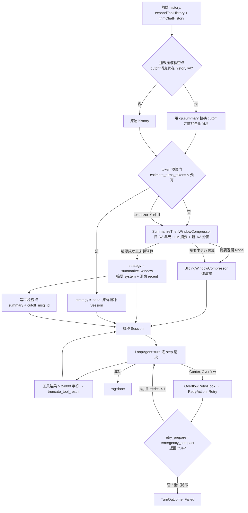

# 上下文工程：Token 预算、两级压缩与应急恢复

> 本文拆解 mdgo Agent 子系统如何把「对话历史」塞进模型窗口：预算怎么算、压缩怎么分级、检查点怎么省掉重复摘要、请求溢出时怎么用确定性手段自救，以及这条链路上已知的裂缝。
> 面向有 Rust/后端经验的工程师，尤其是正在给自研 Agent 做上下文治理的人。所有结论以当前代码为准（`tauri/src-tauri/src`）；与旧设计文档冲突处已在正文标注。

## 1. 上下文预算要解决什么

Agent 的上下文有三类硬约束，对应三种不同的失败方式：

1. **硬失败**：请求超过模型窗口，provider 直接返回 HTTP 400。代码把这类错误归一为 `LoopError::Llm(LlmError::ContextOverflow)`（`tauri/src-tauri/src/core/loop/error.rs:30`），OpenAI 兼容网关按 `context_length_exceeded` 文案识别（`tauri/src-tauri/src/core/loop/openai.rs:150`），Anthropic 侧按 `prompt is too long` 之类文案识别（`tauri/src-tauri/src/core/loop/anthropic.rs:163`）。归一的目的是让上层只需要判断一个枚举，而不是匹配两家厂商的错误字符串。
2. **成本与延迟**：prompt token 随轮次线性增长，而每一轮都要重发全量历史。多步工具任务里，一个 `grep` 结果就能顶掉几十轮对话的量。
3. **注意力稀释**：即使没超窗口，把 20 步前的完整工具输出塞给模型，也会显著降低它对当前目标的关注度。

### 1.1 为什么"字符预算"不够

这不是风格问题，代码里留着两次踩坑记录：

- **字节 ≠ 字符**。`core/context/mod.rs:91` 的注释写得很直白：`str::len()` 返回字节数，中文一字 ≈ 3 字节，若用字节跟字符预算比，中文历史会被误判超预算，导致过早压缩、保留过少。因此压缩器内部统一走 `char_len()`（`core/context/mod.rs:94`），并有一条回归测试 `chinese_content_not_over_compressed` 守着（`core/context/mod.rs:538`）。
- **字符 ≠ token**。同一段文本，中文约 1 token / 1.5 字符，英文约 1 token / 4 字符。任何单一系数都会在另一种语言上系统性偏移。当前代码里就并存着三个系数不同的估算器（见 §2.3），这本身就是"字符口径不构成事实来源"的证据。

### 1.2 一条请求里，预算其实有五个参与者

真正决定一次请求大小的，不只是"历史"：

| 参与者 | 收敛位置 | 当前做法 |
| --- | --- | --- |
| 前端历史裁剪 | `css_js/modules/chat-history.js:123` | 按 `LOCAL_LLM_CONTEXT_LENGTH * ratio` 裁（默认比例 0.6，RAG 传 0.4） |
| 历史压缩 | `commands/llm.rs:177` `prepare_history` | token 预算门 + 摘要/滑窗 |
| 单条工具结果 | `core/loop/session.rs:398` `truncate_tool_result` | 24k 字符首尾截断 |
| 历史工具结果累计 | `core/loop/session.rs:24` | 120k 字符，超出从最旧开始清成占位符 |
| 检索上下文 | `core/agent/mod.rs:601` `build_context_text` | `MAX_CONTEXT_CHARS`（12k）上限 |

**关键认识**：历史压缩的预算门（§2.2）只作用于第二项"历史消息"；前端裁剪、工具结果、检索上下文各自有独立旋钮，system prompt 与工具 schema 则完全没有预算。这是后文 §7 讨论估算误差的根源。

## 2. 预算体系与常量

### 2.1 分块路径：`ChunkBudget` 是真正的单一事实来源

文档索引侧（embedding）有一套更严格的预算，因为它约束的是"向量化输入"，超了就是静默截断，用户无感知但检索质量下降。`ChunkBudget` 定义在 `core/document/token_budget.rs:19`，由 `from_model_window`（同文件 `:45`）从模型窗口推导：

```text
hard_max = window - 8（special tokens 预留）       # :46
target   = (hard_max - 56).clamp(64, hard_max)     # :52
overlap  = 56，且强制 ≤ hard_max - target          # :83
min      = target * 0.36                           # :87
prefix   = min(40, target - 16)                    # :89
```

这些字段不是"建议值"，而是有 `debug_assert!` 守着的不变式（`I-budget-1/2/3`，`core/document/token_budget.rs:74`、`:92`）。`TokenBudgetValidator`（`core/db/token_budget.rs:291`）做最终裁决，超限走"按类型重切 → 显式降级截断并计数"，最多重切 2 轮（`max_resplit_rounds: 2`，同文件 `:309`）防振荡。这部分属于检索侧的分块预算，展开见 `docs/分块 Token 预算设计.md`；工具侧的内容预算见 04、05 篇。

### 2.2 对话路径：模型窗口的 80%

历史压缩的预算函数只有 11 行，但包含了三条决策（`tauri/src-tauri/src/commands/llm.rs:214`）：

```rust
fn compression_budget_tokens(context_length: u32) -> usize {
    const MIN_BUDGET_TOKENS: usize = 2_000;
    if context_length > 0 {
        (context_length as usize * 8 / 10).max(MIN_BUDGET_TOKENS)
    } else {
        MAX_MESSAGE_TOKENS
    }
}
```

- **80% 规则**：给输出 token、system prompt、工具 schema 留 20% 余量。固定阈值会让大窗口模型过早压缩，所以预算随窗口缩放。
- **`context_length == 0`（用户没填窗口）**：回退固定 `MAX_MESSAGE_TOKENS = 15_000`（`core/agent/limits.rs:16`）。这是旧行为的兜底口径。
- **下限 2_000**：极小窗口下防止预算被算成几十 token，导致每次请求都触发压缩。

### 2.3 token 估算：一个 gate，三个估算器

`prepare_history` 在进压缩器之前先做**精确 token 预算门**（`commands/llm.rs:195`）：

```rust
    // P1-2：精确 token 预算门——本地 tokenizer（BGE WordPiece）可用时，历史未超
    // token 预算直接原样返回（零压缩开销，且不再因字符/字节折算误判而过早压缩）；
    // tokenizer 不可用（模型未初始化/解析失败）回退字符预算口径（压缩器内部逻辑）。
    if let Some(total) = crate::core::context::estimate_turns_tokens(&turns) {
        if total <= budget_tokens {
            return crate::core::context::CompressedHistory {
                turns,
                dropped_chars: 0,
                strategy: "none",
                kept_from: 0,
            };
        }
    }
    compressor
        .compress(&turns, tokens_to_chars_budget(budget_tokens), cancel)
        .await
```

三个估算器的现状值得单独说清，因为**注释里的抽象和热路径上的实现并不是同一件事**：

| 名称 | 定义位置 | 系数 / 口径 | 是否在热路径 |
| --- | --- | --- | --- |
| `ApproxTokenEstimator` | `core/context/mod.rs:38` | `chars/2 + 1` | 否，`#[allow(dead_code)]` 预留 |
| `TokenizerBackedEstimator` | `core/context/mod.rs:50` | BGE WordPiece，失败回退 Approx | 否，代码中未见实例化点 |
| `estimate_turns_tokens` | `core/context/mod.rs:62` | `embedding::estimate_tokens`，逐 turn 累加 content + tool_call.arguments | **是**，唯一预算门 |
| `TokenCounter` / `BgeTokenizerCounter` | `core/document/token_budget.rs:105` / `:118` | `tokenize_with_offsets`，含 special tokens | 是，分块/校验路径 |
| `docagent::estimate_tokens` | `core/docagent/mod.rs:349` | CJK 1.5 字符/token，其余 4 字符/token | 是，文档子 Agent 预算 |

`core/context/mod.rs:25` 的注释承认了这一点："当前命令层直接使用 `tokens_to_chars_budget` 换算，trait/实现为预留接口"。所以真实链路是：

1. `estimate_turns_tokens`（精确 token）判门：不超预算 → 直接返回，零压缩成本。
2. 超预算 → 进入压缩器，但压缩器内部按**字符**计量，预算由 `tokens_to_chars_budget` 换算（`core/context/mod.rs:86`，即 `tokens * 2`）。
3. tokenizer 不可用（`estimate_turns_tokens` 返回 `None`）→ 跳过 gate，压缩器按字符预算自行判断。

第 2 步的换算是刻意宽松的：`tokens * 2` 字符意味着压缩器按 **1 token ≈ 2 字符** 记账。而中文实际约 1.5 字符/token——同一批字符折算出的真实 token 比预算多出约 1/3；英文（≈4 字符/token）则相反，会压得比必要更早。也就是说这个字符预算在两个语言方向上都会偏，精确性完全依赖第 1 步的 gate。代价见 §7.5。

### 2.4 预算常量真实值

下表全部来自源码常量，不是估算：

| 常量 | 值 | 位置 | 语义 |
| --- | --- | --- | --- |
| `DEFAULT_MAX_TURNS` | 20 | `core/agent/limits.rs:12` | 单请求模型调用轮次预算（第 21 次报 MaxTurns） |
| `MAX_MESSAGE_CHARS` | 30_000 | `core/agent/limits.rs:14` | **仅**截断"当前问题"，不参与历史压缩 |
| `MAX_MESSAGE_TOKENS` | 15_000 | `core/agent/limits.rs:16` | `context_length == 0` 时的历史预算回退 |
| `SUMMARY_MAX_CHARS` | 6_000 | `core/agent/limits.rs:18` | 摘要消息最大字符；同时决定摘要请求 `max_tokens = (6000/2).clamp(128,2048) = 2048` |
| `MAX_CONTEXT_CHARS` | 12_000 | `core/agent/limits.rs:24` | 预检索上下文拼接上限（注意是字节比较，见 §7） |
| `MAX_TOOL_RESULT_CHARS` | 24_000 | `core/loop/session.rs:18` | 单条工具结果进历史的字符上限（头 19_200 + 尾 4_800） |
| `MAX_HISTORY_TOOL_RESULT_CHARS` | 120_000 | `core/loop/session.rs:24` | 历史内全部工具结果的累计字符预算 |
| `COMPACT_TRIGGER_CHARS` | 120_000 | `core/loop/session.rs:31` | 触发应急压缩的整段历史字符阈值 |
| `MIN_BUDGET_TOKENS` | 2_000 | `commands/llm.rs:215` | 压缩预算下限 |
| 窗口比例 | 80% | `commands/llm.rs:217` | 历史 token 预算 = `context_length * 8 / 10` |
| `tokens_to_chars_budget` | ×2 | `core/context/mod.rs:86` | token 预算 → 压缩器字符预算 |
| `MAX_FILE_READ_CHARS` | 8_192 | `core/agent/limits.rs:56` | read 单次读取分页单元 |
| `MAX_GREP_OUTPUT_CHARS` | 60_000 | `core/agent/limits.rs:66` | grep 输出上限（远大于单条工具结果预算） |
| `WEBFETCH_MAX_CHARS` | 50_000 | `core/agent/limits.rs:99` | webfetch 提取文本上限 |
| `MCP_MAX_OUTPUT_CHARS` | 60_000 | `core/agent/limits.rs:122` | MCP 工具输出拼接后上限 |
| `MAX_EXTERNAL_RESPONSE_CHARS` | 100_000 | `core/agent/limits.rs:93` | 外部工具响应体上限 |
| `DOC_DEFAULT_BUDGET_TOKENS` | 16_000 | `core/agent/limits.rs:88` | DocAgent 单文件上下文默认预算 |
| `MAX_OUTPUT_TOKENS` | 512_000 | `core/agent/limits.rs:117` | `max_tokens` 配置的防御性 clamp 上限 |
| `DEFAULT_SPECIAL_RESERVE` | 8 | `core/document/token_budget.rs:36` | [CLS]/[SEP] 预留 |

表里 `60_000` 与 `24_000` 的落差不是笔误：工具**可以**产出 60k 字符（否则 grep 没意义），但**进入历史**必须被压到 24k。产出上限与上下文上限是两个旋钮。

### 2.5 成本治理：`max_tokens`、缓存命中与窗口回退

- `max_tokens` 走 `LoopConfig.max_tokens`（`core/loop/loop.rs:52`），在每次请求装配时写入 `req.max_tokens`（同文件 `:226`）。配置入口做了 clamp：`clamp(1, MAX_OUTPUT_TOKENS)`（`commands/config.rs:94`）。`None` 表示不发送该字段，交给服务端默认。
- `TokenUsage`（`core/loop/types.rs:100`）同时记录 `prompt_tokens` / `completion_tokens` / `cached_input_tokens` / `cache_creation_input_tokens`。OpenAI 侧从 `prompt_tokens_details.cached_tokens` 取（`core/loop/openai.rs:542`），Anthropic 侧从 `cache_read_input_tokens` / `cache_creation_input_tokens` 取（`core/loop/anthropic.rs:123`）。这四个数最终随 `rag:done` 传给前端（`commands/llm.rs:3013`），前端落库时保留（`css_js/modules/agent.js:1088`）。
- 需要说明：代码里只有**字段透传与展示**，没看到基于缓存命中率的计费/成本换算逻辑（`grep 命中率` 只命中注释与无关模块）。若要做成本面板，得另建一层。
- 上下文窗口回退：`context_length = 0` 时，历史预算退 `MAX_MESSAGE_TOKENS`（15k token）；DocAgent 单文件预算退 `DOC_DEFAULT_BUDGET_TOKENS`（16k token，`commands/llm.rs:2285`）；embedding 侧 `get_max_seq_len()` 在模型未初始化时退 512（`core/embedding.rs:34`）。三处回退值互不相同，都只是"安全默认"，不代表同一个模型。

### 2.6 检索上下文：另一条独立的预算线

上面的常量表里 `MAX_CONTEXT_CHARS = 12_000` 管的是**检索注入**，不经过历史压缩。它的收敛分三层：

- **文档级聚合**：`aggregate_hits`（`core/agent/mod.rs:480`）先按 `doc_name + chunk_index` 去重、再按分数域阈值过滤，最后用 `max_docs` / `max_chunks_per_doc` 截断进入上下文的片段数。这两个参数由 `resolve_retrieval_policy` 逐级决定（技能声明 → 请求级 → 全局兜底，`core/skill/policy.rs`），不写死。
- **拼接级**：`build_context_text`（`core/agent/mod.rs:601`）按文档分组，文档顺序沿用分数降序，文档内按 `chunk_index` 重排成阅读顺序（`:614`），并且在 `sentence_window` 与裸 chunk 之间优先前者——这样送进模型的是"带上下文的句子"而不是被切断的片段。总长受 `MAX_CONTEXT_CHARS` 约束（调用点 `commands/llm.rs:1773`）。
- **子 Agent 级**：DocAgent 的整篇文档上下文按模型窗口 30% 计算，`clamp(2048, DOC_DEFAULT_BUDGET_TOKENS)`（`commands/llm.rs:2285`）。窗口再大也不会把整本书塞进一次子请求。

工具侧检索（`kb_search` / `code_lookup`）复用同一套 `build_context_text` + `MAX_CONTEXT_CHARS`（`core/agent/mod.rs:405`），所以"模型从预检索拿到的上下文"和"模型自己调工具拿到的上下文"共享同一个上限，不会出现工具路径比预检索路径更宽松的漏洞。检索排序、阈值与融合策略见检索专题与 04 篇，这里只钉预算口径——注意这条线也有字节/字符混用的口径问题，见 §7.5。

## 3. 压缩决策链

历史压缩不是单点函数，而是一条四级链。下面这张图是本文的核心，箭头上的条件都对应可定位的代码分支：



四个层级各自的"触发者"不同，这点很重要：

1. **检查点**（§5）由命令层在请求装配时应用，压缩的是"上次已摘要过的旧历史"，属于**省钱**手段。
2. **token 预算门 + 摘要/滑窗**（§4）由 `prepare_history` + `ContextCompressor` 负责，属于**预防**手段。
3. **应急压缩**（§6.1）由 loop 的错误恢复路径触发，属于**补救**手段。
4. **工具结果截断**（§6.2）在每条工具结果进历史前发生，属于**日常限流**。

### 3.1 压缩在前端可见的部分

只有 RAG 路径会上报压缩状态（`commands/llm.rs:2720`）：

```rust
    if compressed.dropped_chars > 0 {
        log::info!(
            "[agent_query_v3] 对话历史已压缩 request_id={} dropped={} strategy={}",
            request_id,
            compressed.dropped_chars,
            compressed.strategy
        );
        let _ = app.emit(
            "rag:status",
            RagStatus {
                request_id: request_id.clone(),
                stage: "compressing".into(),
                message: format!("已压缩历史（节省 {} 字符）", compressed.dropped_chars),
            },
        );
    }
```

前端没有为 `compressing` 写专门分支，`rag:status` 是通用监听：把 `message` 直接当作流式状态文案（`css_js/modules/agent.js:967`），`stage` 只进 console 调试日志。所以用户看到的是"已压缩历史（节省 N 字符）"这一行文字，不是进度条。

需要如实说明：纯对话路径 `kb_llm_query_loop_v2`（`commands/llm.rs:2164`）和 DocAgent 路径（`commands/llm.rs:2496`）都调了 `prepare_history`，但**没有**对应的 `compressing` 事件。前端在这两条通道上看不到压缩发生，只能从日志里翻。

## 4. 摘要 + 滑窗的实现

### 4.1 两级策略与 trait 边界

`core/context/mod.rs` 定义了三个抽象，用依赖倒置把"压缩策略"和"去哪拿摘要"解耦：

- `ContextCompressor`（`:203`）：`compress(history, budget, cancel) -> CompressedHistory`。契约写明"未超预算必须原样返回（零副作用）；实现不得 panic，失败路径必须可降级"。
- `HistorySummarizer`（`:217`）：`summarize(turns, max_chars, cancel) -> Option<String>`。返回 `None` 表示摘要不可用。
- `CompressedHistory`（`:186`）：除了 `turns`，还带 `dropped_chars`（前端提示用）、`strategy`（观测用）、`kept_from`（写检查点用）。

生产装配逻辑在 RAG 路径（`commands/llm.rs:986`）把 `LLMClient` 包成 `HistorySummarizer`、塞进 `SummarizeThenWindowCompressor`，摘要上限用 `SUMMARY_MAX_CHARS`；纯对话路径（`:2152`）和 DocAgent 路径（`:2484`）各自重复了一遍同样的三行。**没有独立摘要小模型**——注释明确写了"单一模型：压缩器直接用主模型（不存在独立摘要小模型，避免跨模型分叉）"。

### 4.2 "旧 2/3 摘要 + 新 1/3 滑窗"

切分点是 `units.len() * 2 / 3`，但**切分单位不是消息，而是"工具调用单元"**（`core/context/mod.rs:315`）：

```rust
        // 1. 最旧的 2/3 用于摘要,最近的 1/3 原样保留；
        //    切分按「工具调用单元」边界进行，避免切断 tool_call 与 tool 结果配对
        let units = group_turns(history);
        let split_idx = units.len() * 2 / 3;
        let old_count: usize = units[..split_idx].iter().map(|(_, u)| u.len()).sum();
        if split_idx == 0 {
            // 历史过短无摘要价值,直接滑窗(避免空摘要空转)
            return SlidingWindowCompressor
                .compress(history, budget, CancellationToken::new())
                .await;
        }
```

`group_turns`（`:181`）委托给 `crate::core::chat_types::group_tool_units`，与事件溯源回放 `derive_history` 共享同一实现——一处改动不会让两条路径的配对语义漂移。如果切分把 assistant 的 `tool_calls` 和 tool 结果切到两侧，就会产生"孤儿 tool 消息"，OpenAI 协议直接拒绝请求。所以这不是优化，是正确性约束。

摘要成功后还有两道闸（`:349`、`:354`）。下面是分支要点而非原文：

```text
if char_len(summary) > budget          → 整段降级纯滑窗
recent_budget = budget - char_len(summary)
recent = SlidingWindowCompressor(recent, recent_budget)
```

摘要**恒保留**，滑窗只作用于 recent 段。否则摘要会被当成"最旧的消息"第一个砍掉，压缩就白做了。

`kept_from` 的算法是 `old_count + recent_result.kept_from`（`:375`），即"被摘要掉的原始消息数 + recent 段内滑窗保留起点"。命令层靠它定位检查点的 `cutoff_msg_id`。

### 4.3 摘要请求本身长什么样

`LLMClient` 的 `HistorySummarizer` 实现（`services/llm.rs:649`）就是一次普通非流式补全：

```rust
        // 构造 LlmAdapter 请求（非流式，与 expand_queries 一致）
        let mut request = LoopRequest::new(vec![LlmMessage::text(LlmRole::User, prompt)]);
        request.temperature = Some(0.3);
        request.max_tokens = Some((max_chars / 2).clamp(128, 2048) as u32);
        let request = self.apply_common_params(request);
```

提示词（`:659`）要求"压缩为不超过 {max_chars} 字的要点摘要，只输出摘要正文……必须保留：关键事实、已做的决定、未完成事项、用户的偏好与约束；不得编造内容"。`temperature = 0.3` 是压缩任务少见的低值——摘要不需要创造力。

失败处理很克制：空响应返回 `None`（`:692`），调用失败返回 `None`（`:707`），两者都只打 `warn!` 带 model / turns / chars / max_tokens，方便定位"是模型空回还是预算不够"。

### 4.4 纯滑窗兜底

`SlidingWindowCompressor`（`core/context/mod.rs:236`）是整条链的地基：纯内存、无外部依赖、无异步中断点。它从最新单元往回累加，放不下就停，但**至少保留一个单元**（`if !kept_units.is_empty() && used + len > budget`，`:258`）——这保证了"再窄的预算也不会返回空历史"。注意这个"至少一条"不等于"至少一条不超预算"：单条消息本身就超预算时，滑窗会把它原样留下，这是 §7 里的一个真实裂缝。

## 5. 检查点与增量压缩

### 5.1 `CompactionState` 存了什么

`CompactionState`（`core/context/mod.rs:125`）四个字段，序列化后整块 JSON 存进 `chat_sessions.compaction_state`：

| 字段 | 类型 | 语义 | 实际使用情况 |
| --- | --- | --- | --- |
| `summary` | `String` | 上次压缩对最旧部分生成的摘要 | 读回后作为 system 消息插入 |
| `cutoff_msg_id` | `Option<String>` | 压缩后保留的第一条原始消息 id | 读回后用于定位切点 |
| `tokens_before` | `usize` | 被压缩掉的 token 估算 | **写入处硬编码为 0**（`commands/llm.rs:2765`），目前只是形状占位 |
| `session_skills` | `Vec<SessionSkillRef>` | Session 生命周期技能引用 | 只写不读，见 §7 |

落库位置不是新表：`chat_sessions` 加列，旧库走幂等迁移（`services/chat.rs:220`，`ALTER TABLE ... ADD COLUMN compaction_state TEXT DEFAULT ''`）。读写各一个薄函数（`services/chat.rs:880` / `:898`）。反序列化失败返回 `None`（`core/context/mod.rs:143`），安全降级为"无检查点"，绝不因为一条脏 JSON 让请求失败。旧数据缺 `session_skills` 也能反序列化，有往返测试守着（`core/context/mod.rs:550`）。

### 5.2 应用：一行 `position` 决定的裁剪

`apply_compaction_checkpoint`（`commands/llm.rs:151`）的全部逻辑就是"找到 cutoff 消息，把前面的一切换成一条 system 摘要"：

```rust
    let mut out = Vec::with_capacity(messages.len() - idx + 1);
    out.push(crate::services::llm::ChatMessage {
        id: None,
        role: "system".into(),
        content: cp.summary.clone(),
        tool_calls: None,
        tool_call_id: None,
    });
    out.extend(messages[idx..].iter().cloned());
    out
```

三种情况下它原样返回（不压缩）：
- 没有检查点；
- `cutoff_msg_id` 为 `None`（旧数据）；
- 在 `messages` 里找不到这个 id——典型场景是前端 `trimChatHistory` 已经把那条消息裁掉了。

第三种是安全降级：找不到切点就退化成"全量重新压缩"，只是丢掉增量优化，不会产生错位历史。

### 5.3 写入：只有"摘要成功"才更新

写回逻辑在 `commands/llm.rs:2740`。三个前置条件缺一不可：

1. `compressed.strategy == "summarize+window"`——纯滑窗和未压缩都不写。
2. `history_messages` 里能找到一条 `role == "system"` 的消息作为摘要来源。
3. `hist_messages.get(compressed.kept_from)` 能取到 `Some(id)`——注意这里用的是**原始消息数组**（保留 id），不是转换后的 `ChatMessage`（`chat_turn_to_message` 会把 id 置 `None`，见 `commands/llm.rs:2082`）。

第 3 条是这套增量机制的关键细节：`kept_from` 是 `hist_messages`（`prepare_history` 的**输入**，元素保留原始 id）的下标，而 `turns` 只是它去掉最后一条后的前缀——两者下标对齐，所以能直接复用。写库走 `spawn_blocking` 且忽略错误（`:2771`），失败只意味着失去增量优化。

### 5.4 增量压缩真的"避免重复摘要"了吗

部分避免，但会形成摘要链：

- 第二次请求先应用检查点，历史变成 `[旧摘要(system)] + [cutoff 之后的增量]`。
- 若增量又超预算，压缩器把最旧 2/3 单元交给 LLM——**旧摘要本身就在这 2/3 里**，于是产生"摘要的摘要"。
- 这不算 bug（信息在收敛而非丢失），但摘要质量会随链长衰减，且每层都会丢掉一些细节。

还有一个更隐蔽的复算来源：**纯滑窗压缩不更新检查点**。假设第 N 轮走了滑窗（比如摘要失败），检查点仍是旧的 cutoff；第 N+1 轮请求会把检查点重新应用一遍，把滑窗刚丢掉的旧消息又捞回来，然后再压一次。结果不算错，但白烧一次压缩开销，`dropped_chars` 也会反复报同一批字符。

## 6. 应急压缩与工具结果截断

### 6.1 `emergency_compact`：不调用 LLM 的确定性摘要

当预算门和摘要/滑窗都没兜住、provider 真的返回了溢出，流程进入 `emergency_compact`（`core/loop/session.rs:284`）。它作用于**事件日志**而不是消息数组，这是事件溯源架构的红利：遮蔽是"标记"而非"删除"，原始事件仍在库里，回放/审计不受影响。

触发与切分（`core/loop/session.rs:298`）：

```rust
        if total <= COMPACT_TRIGGER_CHARS {
            return false;
        }
        let target = total / 2;
        // step 起点索引（保证切分在 step 边界）
        let boundaries: Vec<usize> = self
            .events
            .iter()
            .enumerate()
            .filter(|(_, e)| matches!(e.event, SessionEvent::StepStart { .. }))
            .map(|(i, _)| i)
            .collect();
        if boundaries.len() < 3 {
            return false;
        }
        // 至少保留最后 2 个 step（当前轮的最近上下文）
        let max_cut_steps = boundaries.len() - 2;
```

四个约束：

1. **阈值 120k 字符**（`COMPACT_TRIGGER_CHARS`），只统计**仍可见**的事件——已遮蔽的 seq 先排除（`:286`），否则重复溢出会越压越切。
2. **目标是总量的一半**（`total / 2`），不是"压到阈值以下"。留出余量，避免重试后立刻再次溢出。
3. **step 边界切分**。一个 step = 一次 assistant 消息 + 它的全部工具结果；按 step 遮蔽才能让 `tool_call` 与 `tool_result` 同进同退。测试 `emergency_compact_shadows_old_steps_and_keeps_pairs`（`:624`）专门断言遮蔽后 `tool_calls.len() == tool 消息数`。
4. **至少保留最后 2 个 step**（`boundaries.len() - 2`），且 `boundaries.len() < 3` 时直接放弃压缩（返回 `false`，让上层按失败处理）。

### 6.2 为什么必须"恢复路径本身不再溢出"

这是整条链最重要的设计约束，`core/loop/session.rs:434` 的注释写明了理由：溢出重试是**错误恢复路径**，此时再发一次大请求可能再次溢出；而且压缩必须是同步的（`retry_prepare` 是 `Fn(&mut Session) -> bool` 同步回调，见 `core/loop/loop.rs:55`）。所以这里不能调 LLM。

代价是摘要必须"确定性可生成"，`build_compact_summary`（`core/loop/session.rs:440`）用四类信息拼装：

| 组成 | 来源 | 上限 |
| --- | --- | --- |
| 被遮蔽事件数 | `shadowed_seqs.len()` | — |
| 用户当前请求原文 | 被遮蔽区间里最近一条 `UserMessage` | 600 字符 |
| 工具统计 | `ToolCall` 按 name 计数 → `read×3、grep×2` | 全部 |
| 涉及文件 | 从 `arguments` 里取 `rel_path`/`path`/`file`/`relPath` | 8 个 |
| 最近输出 | 最后一条非空 assistant 内容 | 400 字符 |

两个容易漏的细节：

- **"当前问题被切掉"必须补偿**。切点按 step 取，而本轮的 `UserMessage` 排在它自己的 step 之前，常常正好落在被遮蔽侧。代码专门把它捞出来放进摘要最前面（`:346`、`:479`），并有回归测试 `compaction_keeps_user_request_and_puts_summary_first`（`:657`）——注释里写着"实测会把整轮任务丢掉"。
- **旧摘要要继承**。上一次的 `CompactionSummary` 若也被遮蔽，其正文会并入新摘要（`:474`、`:498`），测试 `repeated_compaction_keeps_previous_summary_text`（`:684`）守着。否则反复压缩后信息归零。

摘要的注入位置在 `derive_history` 里被刻意前置（`:217`）：多条摘要合并成一条 `[历史摘要（上下文压缩）]…` 放在历史最前面。注释解释了原因——按事件顺序追加到末尾会让模型把摘要当成最新的用户指令，而且历史首条会变成 assistant，协议上很别扭。

### 6.3 重试是怎么被限住的

三层限制叠在一起，保证"压缩→重试"不会变成死循环：

```text
OverflowRetryHook: is_context_overflow() → RetryAction::Retry      # core/agent/loop_hooks.rs:181
LoopAgent::try_recover: retries >= max_request_retries → false     # core/loop/loop.rs:501
LoopConfig 默认 max_request_retries = 1                            # core/loop/loop.rs:64
retry_prepare 返回 false（未推进）→ 按失败处理                      # core/loop/loop.rs:508
```

接线点在 `commands/llm.rs:2796`：

```rust
    config.retry_prepare = Some(Arc::new(
        |session: &mut crate::core::r#loop::Session| session.emergency_compact(),
    ));
```

注意 `Retry` 只是"想重试"，真正决定能否重发的是 `retry_prepare` 的返回值。`emergency_compact` 在多种情况下返回 `false`（未超阈值、step 不足 3 个、没切出东西），此时 loop 立即按失败收尾，不会空转。

### 6.4 工具结果截断：两套视图

单条工具结果的截断发生在**写入会话事件之前**，`core/loop/loop.rs:346`：

```text
for ex in executions {                                   // 示意，字段有省略
    on_event(LoopEvent::ToolResult { ... });             // 完整结果 → 前端/日志
    self.session.append(SessionEvent::ToolResult {
        content: truncate_tool_result(&ex.result.content),   // 截断版 → 模型历史
        ...
    });
}
```

这就是"两套视图"的分界线：`LoopEvent::ToolResult` 先带着完整结果发给 sink（`commands/llm.rs:2864` 转发成 `agent:tool_result`，前端工具卡片看到全文），随后才把截断版写进事件日志。UI 与日志保留完整结果，模型只看首尾。

截断规则（`core/loop/session.rs:398`）：

```rust
pub fn truncate_tool_result(content: &str) -> String {
    let n = content.chars().count();
    if n <= MAX_TOOL_RESULT_CHARS {
        return content.to_string();
    }
    let head_len = MAX_TOOL_RESULT_CHARS * 4 / 5;
    let tail_len = MAX_TOOL_RESULT_CHARS - head_len;
    let head: String = content.chars().take(head_len).collect();
    let tail: String = content.chars().skip(n - tail_len).collect();
    format!(
        "{head}\n\n…[工具结果过长已截断：原 {n} 字符，仅保留首 {head_len} + 尾 {tail_len} 字符；如需完整内容请缩小参数范围后重新调用]\n\n{tail}"
    )
}
```

设计意图写在函数文档里（`:394`）：保留开头（上下文）与结尾（结论/错误信息），中间用一句可操作提示替换——"如需完整内容请缩小参数范围后重新调用"，把恢复动作明确交给模型。24_000 的 4/5 = 19_200 头 + 4_800 尾。测试 `truncates_oversized_tool_result_keeping_head_and_tail`（`:583`）与 loop 层的 `oversized_tool_result_is_truncated_in_history`（`core/loop/loop.rs:913`）双向守着。

还有第二道闸：即使每条都 ≤24k，20 条也能把窗口撑爆。`derive_history` 从最新往回累加工具结果字符数，超出 `MAX_HISTORY_TOOL_RESULT_CHARS`（120k）的**最旧**结果清成占位符（`core/loop/session.rs:250`）：

```text
（该工具结果已清理以节省上下文：原 {} 字符。如需该内容，请重新调用工具并缩小范围）
```

（上面是 `format!` 的字面模板，`{}` 处填入原字符数。）

被清理的是**内容**，事件本身还在——所以 `tool_call` 配对不受影响，协议合法性保住。测试 `derive_history_clears_oldest_tool_results_beyond_budget`（`:597`）断言"3 组配对全部保留、最旧被清理、最新完整"。

## 7. 设计取舍与已知限制

### 7.1 摘要质量与信息丢失

摘要是一次额外 LLM 调用，天然不可靠：`temperature 0.3` 也只能降低发散，不能保证事实保真。链式摘要（§5.4）会进一步衰减细节。代码给的补偿是"摘要恒保留 + recent 段原样 + 提示词强制保留未完成事项/用户约束"，但**没有**任何"摘要覆盖率"校验或原文回查机制。想验证摘要是否吃掉关键信息，只能靠人工读日志里的 `[llm] [历史摘要] 成功: chars_in=… chars_out=…`。

### 7.2 重复压缩与检查点的边界

三处已知的不经济：

1. 纯滑窗不更新检查点，下一轮会捞回旧消息重压（§5.4）。
2. 检查点携带的是**摘要文本**，不含被摘要的原文；一旦某轮压缩质量差，没有回头路。
3. `fork_session`（`services/chat.rs:750`）新建分支时不复制 `compaction_state`（INSERT 语句里没有这一列，见 `:775`），且分支的消息 id 全部重新生成（`:809`）。就算复制了，源会话的 `cutoff_msg_id` 也指向旧 id，必然失配。所以**每个分支都要从零开始压缩**。

### 7.3 并发与竞态

检查点写是"读-改-写"里的"写"，没有版本号、没有 CAS：

```text
两个请求并发 → 各自压缩 → 各自 spawn_blocking(set_compaction_state) → 后写的赢
```

因为写的是整块 JSON 且赋值覆盖（`UPDATE ... SET compaction_state = ?1`，`services/chat.rs:902`），输家的检查点静默丢失。影响有限（下一轮退化为全量重算），但如果两个请求的 `cutoff` 差异很大，可能出现摘要与 cutoff 不匹配的组合——摘要来自 A、cutoff 来自 B。当前没有防护。此外 `spawn_blocking` 的 `Result` 被 `let _ =` 丢弃（`commands/llm.rs:2771`），写失败连日志都没有。

### 7.4 超长单条消息

- **当前问题**：只截到 `MAX_MESSAGE_CHARS = 30_000`（`commands/llm.rs:1058`），且仅 RAG 路径做了这一步。
- **历史里的单条消息**：没有任何单条截断。`SlidingWindowCompressor` 的"至少保留一条"意味着一条 200k 字符的用户消息会原样通过滑窗。`SummarizeThenWindowCompressor` 会尝试摘要它，但摘要请求本身也可能超窗口。
- 结论：单条超长消息是当前链路的明文缺口，兜底只能靠 provider 报溢出后走 `emergency_compact`。

### 7.5 token 估算误差

预算门算的是 `estimate_turns_tokens`，它只累加 `content` 与 `tool_call.arguments`，漏掉了这几类真实开销：

| 漏算项 | 量级 | 说明 |
| --- | --- | --- |
| system prompt | 数千 token | Agent 规约 + 技能指令 + 检索上下文（`commands/llm.rs:2782`） |
| 工具 schema | 数千 token | 每轮随 `req.tools` 全量发送（`core/loop/loop.rs:227`） |
| 每条消息的角色/分隔 token | 每轮 ×4 左右 | ChatML 风格开销 |
| 摘要请求本身 | 一次额外调用 | 压缩是有成本的，不是免费的 |

所以 `context_length * 80%` 里的 20% 余量，实际是在给这些漏算项留位置。窗口越小、工具越多，这个余量越紧张——20% 对 8k 窗口不一定够。

另有两处口径不一致，值得在实际部署时盯住：

1. `build_context_text` 声称总长 ≤ `MAX_CONTEXT_CHARS`，但比较用的是 `header.len()` / `text.len()`（`core/agent/mod.rs:620`、`:628`），那是**字节**。中文场景下 12_000 字节 ≈ 4_000 汉字，等于把上下文预算砍到名义值的 1/3。功能没坏（更保守），但与文档宣称的"12k 字符"不符。
2. `prepare_history` 的契约是"输入包含当前问题、内部去掉最后一条"（`commands/llm.rs:183`）。RAG 路径传的是包含当前 query 的 `hist_messages`，正确；而 `kb_llm_query_loop_v2`（`:2163`）和 DocAgent（`:2495`）先 `split_at(len-1)` 再传入，于是**多丢一条历史消息**。是否有意（例如刻意不重复最近一轮助手回答）代码中未见说明。

### 7.6 降级矩阵：压缩链路上的每一次妥协

`LLMClient` 构造失败时直接降级纯滑窗（`commands/llm.rs:2155`、`:2487`，两处同款），日志会打 `LLMClient 构建失败，历史压缩降级纯滑窗`。其余降级都发生在压缩器内部：

| 触发条件 | 系统行为 | 是否报错 | 代码位置 |
| --- | --- | --- | --- |
| 历史 token ≤ 预算 | 原样返回，`strategy = none` | 否 | `commands/llm.rs:195` |
| tokenizer 不可用 | 跳过 token 门，按 `tokens*2` 字符预算判断 | 否 | `commands/llm.rs:206` |
| 历史超预算 | 旧 2/3 摘要 + 新 1/3 滑窗 | 否 | `core/context/mod.rs:297` |
| 单元数不足（`split_idx == 0`） | 转纯滑窗 | 否 | `core/context/mod.rs:320` |
| 摘要返回 `None`（空响应/调用失败/取消） | 转纯滑窗 | 否，仅 `warn!` | `core/context/mod.rs:336` |
| 摘要本身超预算 | 转纯滑窗 | 否 | `core/context/mod.rs:349` |
| 滑窗后仍只剩超预算的单条 | 保留该条（"至少一条"不变式优先） | 否 | `core/context/mod.rs:258` |
| 单条工具结果 > 24k 字符 | 首尾截断 + 提示文案 | 否 | `core/loop/session.rs:398` |
| 工具结果累计 > 120k 字符 | 最旧清成占位符，保留配对 | 否 | `core/loop/session.rs:250` |
| 整段历史 > 120k 且 step ≥ 3 | 遮蔽最旧 step + 确定性摘要 | 否 | `core/loop/session.rs:298` |
| 整段历史 > 120k 但 step < 3 | 放弃压缩，返回 `false` | 是（请求按失败收尾） | `core/loop/session.rs:310` |
| provider 返回 ContextOverflow | `emergency_compact` 后重试 1 次 | 重试耗尽则 `Failed` | `core/loop/loop.rs:500` |
| `LLMClient` 构建失败 | 压缩器退化为纯滑窗 | 否，仅 `warn!` | `commands/llm.rs:2155` |
| `compaction_state` JSON 非法 | 视为无检查点 | 否 | `core/context/mod.rs:143` |
| 分块 tokenizer 不可用 | 降级 1 字符 ≈ 1 token 重切 | 否，置 `degraded_token_count` | `core/db/token_budget.rs:402` |
| 分块重切 2 轮仍超限 | 显式降级截断 + 计数告警 | 否，`truncated_count += 1` | `core/db/token_budget.rs:367` |

这张表的整体形状可以概括为一句：**压缩链路上没有任何一个分支会抛错给用户**。除了"step 不足无法压缩"和"重试耗尽"这两种真的救不回来的情况，其余全部静默降级到更保守的策略。

### 7.7 旧文档与代码不一致之处

对照仓库里 `docs/` 的既有文档，以下几处已过时（本文以代码为准）：

| 旧文档说法 | 代码事实 |
| --- | --- |
| `docs/Agent 短板补齐规划.md:25` "摘要恒保留 + 滑窗（30k 字符预算）" | 历史预算已改为 token：`context_length * 80%`，下限 2_000；`context_length == 0` 回退 15_000 token（`commands/llm.rs:214`）。30_000 现仅用于截断当前问题 |
| 同文件 `:185` "`MAX_MESSAGE_CHARS` 字符口径退役" | 常量仍在使用，只是语义收窄为"当前问题截断"（`commands/llm.rs:1058`） |
| `docs/混合检索逻辑契约.md:133` "总长 ≤ `MAX_CONTEXT_CHARS = 12_000`" | 代码用字节比较（`.len()`），中文实际约 4_000 字符（`core/agent/mod.rs:620`） |
| `docs/数据存储评审与优化落地.md:48` "`session_skills` 恢复" | 该字段只写不读：写入在 `commands/llm.rs:2749`，全仓库未见读取消费点 |
| `docs/Agent 全链路评审与 DSH 对比.md:88` 隐含"检查点全路径生效" | 仅 RAG 路径应用检查点（`commands/llm.rs:2712`）；纯对话与 DocAgent 路径不读不写 |
| 同文件 `:117` "fork 后 `compaction_state` 不复制" | 仍然成立，且新分支消息 id 全量重生成，检查点必然失配（`services/chat.rs:775`、`:809`） |

另外 `CompactionState.tokens_before` 在文档里被描述为"被压缩掉的 token 估算（观测用）"，实际写入处恒为 `0`（`commands/llm.rs:2765`），日志里也从未出现这个值。

## 8. 小结与相关文件

把这条链路压缩成四句话：

1. **预算的唯一精确来源是 token**，但全链路只有一处真正生效：`estimate_turns_tokens` 的 gate。压缩器内部仍按字符计量，换算系数 `×2` 在两个语言方向上都会偏，精确性外包给了 gate。
2. **压缩分两级**：`SummarizeThenWindowCompressor`（旧 2/3 摘要 + 新 1/3 滑窗，摘要恒保留）优先，任何失败都退到纯内存的 `SlidingWindowCompressor`。压缩永不阻断主流程。
3. **检查点把"已摘要的旧历史"落库**，`summary + cutoff_msg_id` 让下一轮只压增量；代价是链式摘要与"滑窗不更新检查点"的复算。
4. **溢出后的自救必须不依赖 LLM**：`emergency_compact` 按 step 边界遮蔽事件、生成确定性摘要、把被遮蔽的当前问题写回摘要首位，然后由 `retry_prepare` 的返回值决定是否重试（默认最多 1 次）。

如果要继续往下读：

- 事件日志、`derive_history` 的配对投影、`session_events` 落库：见 [08-事件溯源会话与持久化.md](08-事件溯源会话与持久化.md)
- `turn`/`step` 状态机、请求装配与 hook 时序：见 [02-Loop 内核-turn-step 状态机与请求装配.md](<02-Loop 内核-turn-step 状态机与请求装配.md>)
- 工具契约、并行调度、工具 schema 如何进请求：见 [04-工具系统-契约-注册与并行调度.md](04-工具系统-契约-注册与并行调度.md)
- 文件读写工具自身的内容预算（`MAX_FILE_READ_CHARS` 等）：见 [05-工具实现-文件读写与结构化编辑.md](05-工具实现-文件读写与结构化编辑.md)
- 索引侧的分块 token 预算与 `TokenBudgetValidator`：见 [00-导读.md](00-导读.md) 与 `docs/分块 Token 预算设计.md`

本文涉及的源码文件：

| 文件 | 职责 |
| --- | --- |
| `tauri/src-tauri/src/core/context/mod.rs` | 压缩抽象、两级策略、`CompactionState`、token 估算器 |
| `tauri/src-tauri/src/core/loop/session.rs` | 事件溯源会话、`emergency_compact`、`truncate_tool_result`、工具结果累计预算 |
| `tauri/src-tauri/src/core/loop/loop.rs` | `LoopConfig.retry_prepare`、`try_recover`、工具结果入历史前截断 |
| `tauri/src-tauri/src/commands/llm.rs` | 压缩接线、检查点读写、80% 预算、`rag:status compressing` |
| `tauri/src-tauri/src/core/agent/limits.rs` | 全部预算常量（单一来源） |
| `tauri/src-tauri/src/services/llm.rs` | `HistorySummarizer` 的 LLM 实现与摘要提示词 |
| `tauri/src-tauri/src/core/document/token_budget.rs` | `ChunkBudget` / `TokenCounter`（索引侧预算基础层） |
| `tauri/src-tauri/src/core/db/token_budget.rs` | `TokenBudgetValidator` 最终裁决与重切策略 |
