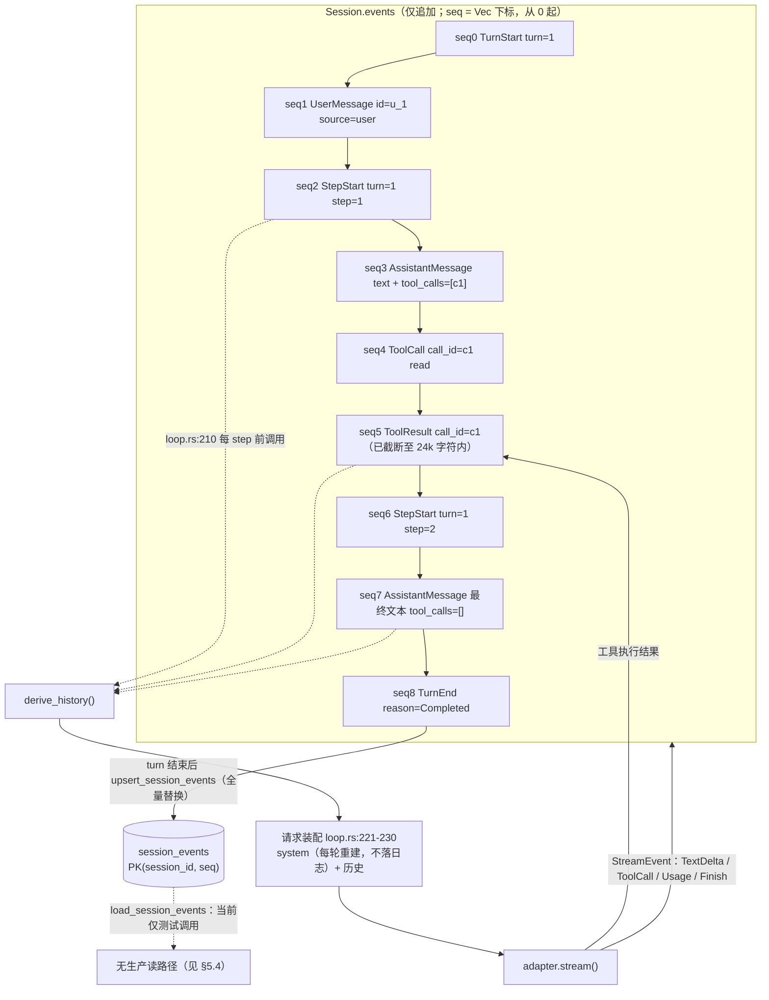

# 事件溯源会话与持久化：把 Agent 对话变成一条可投影的日志

> 本文拆解 mdgo（Tauri + Rust 本地知识库/Agent 应用）里 Agent 会话的存储层：`SessionEvent`
> 词表、`derive_history` 投影、SQLite `session_events` 表、压缩检查点与会话分叉。
> 所有结论都对齐当前代码，并标注 `路径:行号`。适合有 Rust/后端经验、正在给自家 Agent
> 设计会话层或做"消息表 → 事件日志"迁移的工程师读。第 7 节集中写了这套设计**没做到**的事，
> 如果只关心取舍，可以直接跳到那里。

---

## 1. 问题：会话状态为什么难存

最直觉的方案是 `messages: Vec<Message>` 存一张表，一轮一行。简单，直到你遇到下面五件事：

1. **工具调用必须成对出现**：协议要求 `assistant(tool_calls)` 后面紧跟对应的 `tool` 消息。
   某个工具结果没写进去（进程崩了、用户点了停止），历史里就留下孤儿 `tool_call`，
   下次请求直接被 provider 400。
2. **历史会被改写，而"改写"本身也是历史**：压缩把最旧一段换成一页摘要，消息表若只有一份，
   这一步就是有损 `DELETE`，压错无法回溯。
3. **取消要保留半截内容**：模型已吐的 300 字要不要进历史？进历史算不算"一条完整消息"？
4. **分叉**：从第 7 条往回改，要"复制前 7 条"又不能污染原会话。
5. **审计**：那一轮到底发了什么、调了哪些工具、usage 多少。

事件溯源（event sourcing）的答案是把"状态"降级为"投影"：**只追加事实，历史按需派生**。
`core/loop/session.rs` 的文件头注释把这套不变式写成一句话（`tauri/src-tauri/src/core/loop/session.rs:1-8`）：

> 会话是**仅追加**的事件日志；LLM 历史由 `derive_history` **派生**（增量缓存），从不单独存储。
> 不变式：**"模型可见即已记录"**。

先给出全篇最重要的一句诚实前提：**mdgo 的事件溯源是"投影式"而非"回放式"**。事件日志被真实写入
SQLite，但请求时的历史并不从事件日志回放，而是从 `chat_messages` 播种（第 5 节）。这让"日志"
当前的角色是**审计 + 未来迁移数据**，而不是恢复源。后文所有"取舍"都由此派生。

---

## 2. 事件模型

词表就 9 个变体，定义在 `session.rs:44-67`，逐字如下：

```rust
/// 会话事件（持久事实的最小词汇表，对齐 DSH SessionEventMap 子集）。
#[derive(Debug, Clone, PartialEq, Eq, serde::Serialize, serde::Deserialize)]
pub enum SessionEvent {
    TurnStart { turn: u32 },
    TurnEnd { turn: u32, reason: TurnEndReason },
    StepStart { turn: u32, step: u32 },
    StepEnd { turn: u32, step: u32 },
    /// 用户/注入上下文消息
    UserMessage { id: String, content: String, source: String },
    /// 组装后的助手消息（含工具调用与用量）
    AssistantMessage {
        content: String,
        tool_calls: Vec<ToolCall>,
        usage: Option<TokenUsage>,
        #[serde(default)]
        interrupted: bool,
    },
    /// 一次工具执行（记录模型发起的调用）
    ToolCall { call_id: String, name: String, arguments: String },
    /// 工具执行结果（`call_id` 与 AssistantMessage.tool_calls 配对）
    ToolResult { call_id: String, content: String, is_error: bool },
    /// 压缩摘要（shadowed 为被遮蔽的事件 seq，供回放/统计）
    CompactionSummary { summary: String, shadowed_seqs: Vec<u64> },
}
```

`TurnEndReason` 有 6 个变体（`session.rs:35-42`）：`Completed` / `Blocked` / `Aborted` /
`Error` / `MaxTokens` / `Interrupted`。**其中 `Blocked` 与 `Interrupted` 在整个 crate 里
只有声明和 `type_name()` 映射，没有任何构造点**——它们是给"审批门拦住一轮""外部中断"预留的
词汇，当前实现尚未使用。`StepEnd` 同理：声明了、`type_name()` 映射到 `"step_end"`
（`session.rs:76`），但 `LoopAgent` 从未 append 它（全仓 grep 仅命中定义处）。所以真实日志的
骨架是 `TurnStart → (StepStart → AssistantMessage → [ToolCall…] → [ToolResult…])* → TurnEnd`，
`StepEnd` 的位置由下一个 `StepStart`/`TurnEnd` 隐含。

### 2.1 `seq` 的真实语义

```rust
    /// 追加事件，返回其 seq。
    pub fn append(&mut self, ev: SessionEvent) -> u64 {
        let seq = self.events.len() as u64;
        if matches!(&ev, SessionEvent::StepStart { .. }) {
            self.current_step += 1;
        }
        if matches!(&ev, SessionEvent::TurnStart { .. }) {
            self.current_turn += 1;
            self.current_step = 0;
        }
        self.events.push(PersistedEvent { seq, event: ev });
        self.dirty = true;
        seq
    }
```

（`session.rs:124-137`）

`seq = events.len()`：**从 0 开始、无空洞、严格 +1**，因为它就是 `Vec` 下标。单测
`seq_monotonic`（`session.rs:573-580`）断言的就是这个。

但要注意它不是"会话级全局序列"：每个请求都会 `Session::new(...)` 重建、播种历史、再跑 turn
（`commands/llm.rs:2710`、`2162`），所以下一轮请求的 `seq` 又从 0 开始。**`seq` 的作用域是
"一次请求的事件窗口"，不是会话生命周期**。持久化层的主键 `(session_id, seq)` 因此只在单次
覆盖写内自洽——这是第 5.3 节幂等性讨论的关键，也是第 7 节"日志膨胀"的根因。

### 2.2 `turn` / `step` 语义

- `turn`：模型可见的一次用户请求-响应单元。`LoopAgent::turn()` 开头
  `let turn = self.session.current_turn() + 1;` 然后 `TurnStart { turn }`（`core/loop/loop.rs:180-181`）。
- `step`：turn 内的一次模型请求 + 一批工具执行。每进入循环 `steps += 1` 后
  `StepStart { turn, step: steps }`（`loop.rs:203-208`）。
- `Session` 内部的 `current_turn/current_step`（`session.rs:104-105`）只是记账：`StepStart`
  自增 `current_step`，`TurnStart` 自增 `current_turn` 并把 `current_step` 归零。**事件里携带的
  `turn`/`step` 数值由 `loop.rs` 传入，`Session` 不校验两者一致**。`current_step()` 这个
  getter 目前没有任何调用者；`current_turn()` 只有 `loop.rs:180` 一处。

### 2.3 为什么 `ToolCall` 和 `AssistantMessage.tool_calls` 重复记录

同一次调用会写两遍：`AssistantMessage` 里带 `Vec<ToolCall>`（模型原始产出，`loop.rs:317-322`），
随后每个 call 再单独 append 一条 `ToolCall` 事件（`loop.rs:328-334`）。重复是有意的：
前者是配对判定的唯一依据（投影成 `LlmMessage`），后者供工具名/参数统计与压缩摘要里的
"已执行工具：read×3"使用。`derive_history` 完全不读 `ToolCall` 事件（`session.rs:227-272`
的 match 里没有它），但 `event_chars` 把 `name + arguments` 计入压缩预算
（`session.rs:423-425`）。**即：`ToolCall` 事件占预算却不进历史**——量级很小（工具参数通常
是全轮最小的部分），但做 token 账时要记得。

### 2.4 SessionEvent 语义表

| 变体 | 字段 | 写入点 | 进 `LlmMessage`？ | 说明 |
|---|---|---|---|---|
| `TurnStart` | `turn` | `loop.rs:181` | 否 | 每轮开头；同时把 `current_step` 归零 |
| `TurnEnd` | `turn`, `reason` | `loop.rs:521-523`（`finish_turn`） | 否 | 6 种 reason，2 种从未被构造 |
| `StepStart` | `turn`, `step` | `loop.rs:208` | 否 | 压缩切分边界，也用于 step 计数 |
| `StepEnd` | `turn`, `step` | **无构造点** | 否 | 保留词汇；`type_name` 返回 `step_end` |
| `UserMessage` | `id`, `content`, `source` | `loop.rs:185-189`（id=`u_{turn}`）、播种 | 是（`role=user`） | `source` 播种时为 `"chat"`，运行时为 `"user"` |
| `AssistantMessage` | `content`, `tool_calls`, `usage`, `interrupted` | `loop.rs:317-322`（正常）/`295-300`（取消） | 是（文本块 + 已配对 tool_call） | `usage` 与 `interrupted` **不投影** |
| `ToolCall` | `call_id`, `name`, `arguments` | `loop.rs:329-333` | 否（仅计数/摘要） | 与 `AssistantMessage.tool_calls` 重复记录 |
| `ToolResult` | `call_id`, `content`, `is_error` | `loop.rs:349-353` | 是（`role=tool`），需 assistant 侧有配对 | 内容先经 `truncate_tool_result` |
| `CompactionSummary` | `summary`, `shadowed_seqs` | `session.rs:366-369`（`emergency_compact`） | 是（合成为**首条** `user`） | 被遮蔽事件整段不进历史 |

---

## 3. 一次 turn 的事件序列（mermaid）

下面是一轮"读文件 → 回答"的完整事件流，以及每条事件的两个出口：投影进请求、落库进 SQLite。



三个要点：

1. **投影发生在每个 step 开始前**，所以第 2 个 step 的请求里已包含第 1 个 step 的 assistant+tool
   消息——模型"记得"自己刚调过什么。
2. **写库发生在整个 turn 之后**（`commands/llm.rs:2891-2902`），不是每条事件都写。中途
   panic/进程被杀，这一轮事件全丢，但 `chat_messages` 侧可能已存了半截 assistant 消息。
3. 事件日志与 `chat_messages` 是**两条并行的写路径**，没有分布式事务，允许不一致——有意的
   过渡态，不是疏忽。

---

## 4. `derive_history` 投影规则

`derive_history` 在 `session.rs:157-277`，带一个 `dirty` 缓存（`session.rs:158-160`：
`if !self.dirty && !self.derived.is_empty()`，注意空历史永不命中缓存）。算法分四步。

### 4.1 第一步：收集压缩遮蔽集

遍历所有事件，把每条 `CompactionSummary.shadowed_seqs` 并进一个 `HashSet<u64>`
（`session.rs:161-167`）。多条摘要取并集，所以反复压缩可以叠加遮蔽，不会互相覆盖。

### 4.2 第二步：工具结果的内容预算（从最新往回）

倒序遍历未被遮蔽的 `ToolResult`，累计字符数不超过 `MAX_HISTORY_TOOL_RESULT_CHARS = 120_000`
（`session.rs:24`）的进 `kept_results`；放不下的**不删事件，只在投影时替换成占位符正文**
（"原 N 字符已清理，如需请重新调用并缩小范围"，`session.rs:250-257`），结构配对不受影响。
单测 `derive_history_clears_oldest_tool_results_beyond_budget`（`session.rs:596-620`）钉住了
这一点：3 组配对全部保留，最旧的一条被清、最新的一条完整。

### 4.3 第三步：两遍扫描求配对

第一遍只扫未被遮蔽的事件，建立 `call_id → 存在 assistant 调用` 与 `call_id → 存在 tool 结果`
两张表（`session.rs:185-202`）；第二遍投影时双向过滤：

- `AssistantMessage`：只保留**有结果**的 `tool_calls`（`session.rs:236-241`）；
- `ToolResult`：只重放**有 assistant 调用**的（`session.rs:247-249`）。

```rust
                SessionEvent::AssistantMessage { content, tool_calls, .. } => {
                    let mut blocks: Vec<ContentBlock> = Vec::new();
                    if !content.is_empty() {
                        blocks.push(ContentBlock::Text(content.clone()));
                    }
                    // 只保留已配对（有结果）的工具调用
                    let kept: Vec<&ToolCall> =
                        tool_calls.iter().filter(|tc| has_result.contains_key(tc.id.as_str())).collect();
                    for tc in &kept {
                        blocks.push(ContentBlock::ToolCall((*tc).clone()));
                    }
                    // 空消息（无文本且无有效工具调用）不进入历史
                    if !blocks.is_empty() {
                        out.push(LlmMessage { role: LlmRole::Assistant, content: blocks });
                    }
                }
```

（`session.rs:231-246`）

两个副作用值得注意：

- **只被过滤掉工具调用、但还有文本的 assistant 消息会被保留**（单测 `drops_orphan_tool_result_and_unpaired_tool_call`，`session.rs:548-560`：历史变成 `user + assistant(text)`，`tool_calls` 长度为 0）。这让"模型声称我要读文件"这句话留在历史里，但那个调用消失了。
- **既无文本又无有效调用的 assistant 消息整条丢弃**（`session.rs:242-245`），避免产生空的 assistant 消息（部分 provider 会拒绝）。

### 4.4 第四步：压缩摘要前置

摘要**不按事件顺序追加到末尾**，而是统一插到历史最前面、合并成一条 `user` 消息，正文前缀是
`[历史摘要（上下文压缩）]`（`session.rs:204-222`）。

原因写在注释里（`session.rs:205-207`）：摘要替代的是"最早的一段上下文"，若追加到末尾，模型会
把它当成最新的用户指令；且历史首条会变成 `assistant`，协议上也别扭。回归测试
`compaction_keeps_user_request_and_puts_summary_first`（`session.rs:656-680`）就是为此写的。

### 4.5 不进历史的东西

`TurnStart` / `TurnEnd` / `StepStart` / `StepEnd` / `ToolCall` / `CompactionSummary`（已前置）
全部走 `_ => {}`（`session.rs:269-271`）。另有三个**字段**级不投影：

- `AssistantMessage.usage`：token 用量只用于 UI 与统计，模型不需要；
- `AssistantMessage.interrupted`：见第 7.6 节，该字段目前是纯审计元数据；
- `UserMessage.id` / `source`：投影时只取 `content`，`id` 只在事件层做溯源。

---

## 5. 落库与回放

### 5.1 表结构

DDL 不在 `core/db/schema.rs`（那里只管 `skills` 域，`schema.rs:16-85`），而是和 ChatStore 的其它
表一起内联在 `services/chat.rs` 的 `init_tables` 里（`services/chat.rs:170-179`），逐字如下：

```sql
            -- v3 事件溯源会话日志（append-only；seq 单调，按 (session_id, seq) 幂等覆盖）
            CREATE TABLE IF NOT EXISTS session_events (
                session_id TEXT NOT NULL,
                seq INTEGER NOT NULL,
                event_type TEXT NOT NULL,
                payload TEXT NOT NULL,
                created_at INTEGER NOT NULL,
                PRIMARY KEY (session_id, seq)
            );
            CREATE INDEX IF NOT EXISTS idx_session_events_session ON session_events(session_id);
```

| 列 | 类型 | 约束/说明 |
|---|---|---|
| `session_id` | `TEXT NOT NULL` | 会话 ID（`chat_sessions.id`），**但没有外键** |
| `seq` | `INTEGER NOT NULL` | 内存 `Vec` 下标，每次请求从 0 重算 |
| `event_type` | `TEXT NOT NULL` | `SessionEvent::type_name()` 判决名（`session.rs:71-83`），供查询/索引 |
| `payload` | `TEXT NOT NULL` | `serde_json::to_string(&SessionEvent)` 无损 JSON（外部标记枚举） |
| `created_at` | `INTEGER NOT NULL` | 毫秒时间戳；**同一批事件共用一个值**（`chat.rs:925` 循环外取 `now`） |

索引与约束：

| 名称 | 类型 | 列 | 备注 |
|---|---|---|---|
| （隐式） | 主键索引 | `(session_id, seq)` | 唯一且有序；`WHERE session_id = ?` 已可走前缀 |
| `idx_session_events_session` | 普通索引 | `(session_id)` | **与主键前缀重复**，读写都多一份成本 |

也就是说这张表在新库上会建出**两个**以 `session_id` 打头的索引。按 `seq` 升序读
（`SELECT ... WHERE session_id = ?1 ORDER BY seq ASC`，`chat.rs:962`）本身不需要第二个索引。
这笔冗余是历史遗留，不影响正确性。

### 5.2 写入时机与实现

三个 v3 生成路径都在 `turn()` 结束后写一次全量窗口：

| 路径 | 位置 | 日志前缀 |
|---|---|---|
| 纯对话（chat） | `commands/llm.rs:2236-2246` | `[kb_llm_query_v3]` |
| 文档问答（doc） | `commands/llm.rs:2622-2633` | `[doc_agent_query]` |
| Agent/RAG | `commands/llm.rs:2891-2902` | `[agent_query_v3]` |

三处代码几乎逐字相同：取 `agent.session().events()`，映射成 `(seq, &event)`，调用
`store.upsert_session_events(sid, &events)`；**失败只 `log::warn`，不影响本轮结果**。这是对的：
事件日志不是权威数据源，写失败不该让用户看到错误。

写入实现是"先删后插"，单事务：

```rust
        self.pool.with_write_txn(|conn| {
            conn.execute("DELETE FROM session_events WHERE session_id = ?1", rusqlite::params![session_id])
                .map_err(|e| format!("清理旧会话事件失败: {}", e))?;
            if events.is_empty() {
                return Ok(());
            }
            let mut stmt = conn
                .prepare(
                    "INSERT INTO session_events (session_id, seq, event_type, payload, created_at)
                     VALUES (?1, ?2, ?3, ?4, ?5)",
                )
                .map_err(|e| format!("准备会话事件写入失败: {}", e))?;
```

（`services/chat.rs:926-937`；循环体在 `938-949`）

`with_write_txn` 是 `BEGIN IMMEDIATE` + panic 安全回滚（`core/db/pool.rs:142-173`），
`BEGIN IMMEDIATE` 的选择是为了在 WAL 下避免 `DEFERRED` 快照升级失败导致的
`SQLITE_BUSY_SNAPSHOT`（`pool.rs:134-136` 注释）。

### 5.3 幂等策略：不是"按 seq upsert"，是"整窗替换"

命名叫 `upsert`，但**没有 `INSERT OR REPLACE`，也没有 `ON CONFLICT`**——就是
`DELETE WHERE session_id` + 批量 `INSERT`。原因写在函数文档里（`chat.rs:910-919`）：

> 语义说明（B4 修复）：**全量删除后插入**而非按 seq REPLACE——前端按上下文预算裁剪历史后重发，
> 若按 seq 增量 REPLACE 会残留上一版窗口的高 seq 旧事件，造成日志混杂；全量替换保证事件日志 =
> 本次请求实际发送/产生的窗口（裁剪历史 + 新轮）。

所以"幂等"的正确表述是：**同一批事件重复写，结果一致**（单测
`upsert_is_idempotent_by_seq`，`chat.rs:1806-1816`），而不是"按主键 row-level 幂等合并"。
两点后果：

- 写放大是 O(窗口大小)：一个 40 步的长任务，每轮请求都把这 40 步重写一遍；
- 并发写同一会话，**后写者全胜**（前一个窗口的日志被删掉），不会合并。

顺带指出两处**注释与实现不符**的地方，读代码时容易踩：DDL 上面的注释写"按 (session_id, seq)
幂等覆盖"（`chat.rs:170`），`llm.rs:2891` 的注释写"幂等 upsert"。真正的语义是整窗替换。

### 5.4 读路径：历史不从事件日志回放

`load_session_events`（`chat.rs:954-979`）实现完整：按 `seq ASC` 读、逐行 `serde_json` 反序列化。
但**全仓没有生产调用者**——只有 `session_events_tests`（`chat.rs:1756-1844`）在用它。
唯一的写-删联动是清空消息时同步清事件（`commands/chat.rs:415-418`）。

真正的"历史加载"链路是三层，全部绕开 `session_events`：

1. **UI 读**：`chat_session_messages` → `get_session_messages`（`commands/chat.rs:336-346`、
   `services/chat.rs:566-603`），`SELECT ... ORDER BY created_at ASC, rowid ASC`。
2. **前端把历史再发回来**：`agent_query(..., messages: Vec<ChatMessage>, ...)`（`llm.rs:899-909`）、
   `kb_llm_query(..., messages, ...)`（`llm.rs:1975-1983`）。**模型看到的"跨轮历史"实际是前端
   截断/裁剪后回传的数组**，后端并不从 DB 重建。
3. **命令层把它播种成事件**：`seed_session_from_messages`（`llm.rs:2037-2079`）。

播种的映射是一张极简表：

| `ChatMessage.role` | 落成事件 | 丢掉的字段 |
|---|---|---|
| `user` | `UserMessage { id, content, source: "chat" }` | — |
| `assistant` | `AssistantMessage { content, tool_calls, usage: None, interrupted: false }` | usage、interrupted |
| `tool` | `ToolResult { call_id, content, is_error: false }` | **`is_error` 恒 false** |
| 其它（`system` 等） | 忽略（`_ => {}`） | 整条 |

```rust
            "tool" => {
                session.append(SessionEvent::ToolResult {
                    call_id: m.tool_call_id.clone().unwrap_or_default(),
                    content: m.content.clone(),
                    is_error: false,
                });
            }
```

（`llm.rs:2069-2075`；`assistant` 分支同理，硬编码 `usage: None, interrupted: false`，
见 `llm.rs:2051-2068`）

三个可观察的后果：

- **`is_error` 在回放后丢失**。`ChatMessage`（`core/chat_types.rs:63-77`）没有错误标记字段，
  所以历史里的失败工具调用在投影后变成"成功"。模型下一轮可能基于错误的成功幻觉继续推理。
- **播种不产生 `TurnStart`/`StepStart`**，所以历史事件的 `turn`/`step` 维度是空白的；本轮
  `TurnStart` 取 `current_turn()+1 = 1`，与历史里的"第 1 轮"在语义上并不重合。
- **`ChatTurn` → `ChatMessage` 是无损桥**（`llm.rs:2082-2090`），压缩产物走这条路进入播种，
  所以压缩摘要（role=`system`）在这里被**忽略**——摘要内容另行通过检查点注入，见 5.5。

### 5.5 压缩检查点：与事件日志正交的第二套机制

会话表上有一个 JSON 列 `chat_sessions.compaction_state`（旧库靠 `ALTER TABLE` 补列，
`chat.rs:220-229`）。类型是 `CompactionState`（`core/context/mod.rs:125-134`），四个字段：
`summary`（摘要正文）、`cutoff_msg_id`（压缩后保留的第一条原始消息 id，`None` 表示全部历史已
被摘要覆盖）、`tokens_before`（观测用）、`session_skills`（Session 生命周期技能的激活引用）。
后三个都带 `#[serde(default)]`，老 JSON 缺字段也能反序列化。

读：`load_compaction_checkpoint`（`llm.rs:2093-2111`）用 `spawn_blocking` 读列，
`from_json` 失败即 `None`（安全降级为无检查点）。用：`apply_compaction_checkpoint`
（`llm.rs:151-175`）在历史里找到 `cutoff_msg_id` 那条消息，用一条 `role="system"` 的摘要消息
替换它之前的所有消息。

写：仅在 `compressed.strategy == "summarize+window"`、摘要非空、且 `kept_from` 那条消息带
`id` 时写（`llm.rs:2739-2775`）。注释说明了为什么要求 id："可定位 cutoff"。

**两套压缩机制的对比**（这是最容易混淆的地方）：

| | `CompactionState`（检查点） | `CompactionSummary`（事件） |
|---|---|---|
| 位置 | `chat_sessions.compaction_state` 列 | `session_events` 行 |
| 触发 | 请求前 `prepare_history` 压缩 | turn 内溢出重试 `emergency_compact` |
| 依据 | 前端消息快照的 `cutoff_msg_id` | 会话内事件 `seq` 的 `shadowed_seqs` |
| 生效 | 替换历史前缀为 `system` 消息 | 投影时遮蔽事件 + 前置 `user` 摘要 |
| 失效条件 | 前端把 cutoff 消息裁掉 → 静默退化全量压缩 | 事件被整窗替换后自然消失 |

两条链路互不知情：`emergency_compact` 生成的事件摘要不会被写回 `compaction_state`，反之亦然。
这就是"同一会话可能有两份不同的摘要"的由来。

### 5.6 库文件位置与连接参数

会话数据不在全局单一 DB，而是**跟着知识库目录走**：

- `AppState::get_chat_store`（`lib.rs:355-375`）先 `sanitize_kb_dir` 规范化 `dir_path`，
  用规范路径做缓存 key，再 `join(".mdgo")` 交给 `ChatStore::new`；
- `ChatStore::new` 在该目录下 `join("mdgo.db")`（`services/chat.rs:114-127`），
  最终文件是 `{知识库根目录}/.mdgo/mdgo.db`；
- 路径工具函数在 `core/db/global.rs:40-43`（`KB_DB_FILENAME = "mdgo.db"`，
  `kb_db_path` 先校验目录再拼 `.mdgo`）。

所以"换知识库 = 换库文件"，会话天然按知识库隔离；代价是同一个 DB 文件会被
ChatStore / AiHistoryStore / PromptStore / Schedule / Skill 等多个域各自打开一个 `DbPool`。

每个池 = 1 条写连接 + 4 条读连接（`READ_CONNECTIONS = 4`，`pool.rs:27`），连接参数统一在
`apply_pragmas`：

```rust
pub fn apply_pragmas(conn: &Connection) -> Result<(), String> {
    conn.execute_batch(
        "PRAGMA journal_mode=WAL;
         PRAGMA busy_timeout=5000;
         PRAGMA synchronous=NORMAL;
         PRAGMA foreign_keys=ON;
         PRAGMA cache_size=-16384;
         PRAGMA mmap_size=268435456;
         PRAGMA temp_store=MEMORY;
         PRAGMA wal_autocheckpoint=1000;",
    )
    .map_err(|e| format!("初始化数据库连接失败: {}", e))
}
```

（`pool.rs:45-57`）取值与理由（注释在 `pool.rs:35-44`）：WAL 是多连接并发读写的基础；
`busy_timeout=5000` 是写写互斥的忙等待兜底；`synchronous=NORMAL` 是 WAL 推荐值（Windows 上
`FULL` 每事务 fsync 延迟过高）；`foreign_keys=ON` 供级联删除；`cache_size=-16384`（16MiB）+
`mmap_size=268435456`（256MiB 映射读）减少系统调用；`temp_store=MEMORY`；
`wal_autocheckpoint=1000` 显式声明默认值防 WAL 膨胀。注意 `foreign_keys=ON` 是**连接级**的，
而 `session_events` 压根没有外键（5.1），这条 PRAGMA 对它没有约束力——这正是 7.1 里"删会话
留孤儿行"的直接原因。

---

## 6. 压缩检查点与分叉

### 6.1 `emergency_compact` 的边界

溢出恢复走 `OverflowRetryHook` → `RetryAction::Retry` → `config.retry_prepare` 回调，
RAG 路径把它挂成 `|session| session.emergency_compact()`（`llm.rs:2794-2798`）。

**只有 RAG 路径（`agent_generate_loop_v2`）配置了 `retry_prepare`**。纯对话路径
（`kb_llm_query_loop_v2`，`llm.rs:2183-2185`）只设了 `max_tokens`，没有 `retry_prepare`，
因此**chat 模式没有溢出自动恢复**：上下文超限即整轮失败，报 `rag:error`/`llm:error`。
这是能力差异，不是配置疏漏，但值得在产品层面对齐。

`emergency_compact`（`session.rs:284-371`）的算法：

1. 汇总已遮蔽集合，只统计"仍可见"事件的字符数；未超 `COMPACT_TRIGGER_CHARS = 120_000`
   （`session.rs:31`）直接返回 `false`。
2. 以 `StepStart` 为边界（`session.rs:303-309`），**按 step 整体遮蔽**：一个 step = 一条
   assistant 消息 + 它的全部工具结果，按 step 切才能保证 tool_call 与 tool_result 同进同退，
   否则产生协议拒绝的孤儿消息（`session.rs:280-282`）。
3. 至少保留最后 2 个 step（`boundaries.len() - 2`），切到剩余量 ≤ 总量一半为止。
4. 关键补丁：本轮的 `UserMessage` 排在它自己的 step **之前**，常常正好被切掉。代码显式检查
   "最近一条用户消息是否落在被遮蔽区间"，若是则把原文写进摘要最前面
   （`session.rs:343-359`、`478-482`）；注释记录了实测后果："否则模型压缩后就不知道要做什么
   （实测会把整轮任务丢掉）"。
5. 摘要生成是**确定性的**（`build_compact_summary`，`session.rs:440-502`）：用户请求 +
   `工具×次数` + 涉及文件（从 `arguments` 里找 `rel_path`/`path`/`file`/`relPath` 四个候选键，
   最多 8 个）+ 最近 400 字输出 + 更早摘要的拼接。**不调用 LLM**，理由是溢出重试是错误恢复
   路径，再发一次大请求可能再次溢出，而且 `retry_prepare` 是同步回调（`session.rs:434-435`）。

### 6.2 `chat_fork`：复制边界只有 `chat_messages`

命令层很薄（`commands/chat.rs:266-280`），逻辑在 `ChatStore::fork_session`
（`services/chat.rs:750-875`）：

1. 读源会话 `type`（分支继承类型）；
2. 插入新会话：`parent_id = 源会话 id`、`branch_point = message_seq`、
   `message_count = message_seq`、**`token_usage = 0`**（`chat.rs:774-782`）；
3. `SELECT ... ORDER BY created_at ASC, rowid ASC LIMIT ?2` 取前 `message_seq` 条，
   逐条 `Uuid::new_v4()` 生成新 id 插入，维护 `id_map`（`chat.rs:785-818`）；
4. 按 `id_map` 复制 `chat_message_sources`（引用来源重映射到新消息 id，`chat.rs:820-855`）；
5. 回写 `message_count`（`chat.rs:857-861`）。

**复制边界与遗漏**：

| 数据 | 是否复制 | 依据 |
|---|---|---|
| 前 `message_seq` 条 `chat_messages` 的 role/content/token_count/created_at/tool_calls | 是 | `chat.rs:787-788` 的 SELECT 列表 |
| `chat_messages.thinking`（推理过程） | **否** | SELECT 与 INSERT 都不含该列（`chat.rs:811-813`） |
| `chat_message_sources` | 是 | `chat.rs:820-855` |
| `chat_session_skills`（会话挂载技能） | **否** | fork 函数内无相关语句 |
| `session_events` | **否** | 同上 |
| `compaction_state` | **否** | 同上（`INSERT` 列表无该列，取默认 `''`） |
| `token_usage` | 归零 | `chat.rs:776` 字面量 0 |

后果值得明说：**分支会话第一次提问时，它的历史来自 `chat_messages` 播种，而不是源会话的事件
日志；而这次请求结束后的 `upsert_session_events` 会把新会话的事件表填成"本次窗口"，与源会话的
事件日志没有任何继承关系**。所以"从事件流 fork"目前不成立——分叉在事件层没有对应机制。

---

## 7. 设计取舍与已知限制

### 7.1 日志膨胀与写放大

- **写放大**：整窗替换意味着每轮请求重写全部事件行。`session_events` 行数 ≈ 会话可见窗口的
  事件数（不是会话总事件数），所以有界；但每轮都是 O(n) 的 `DELETE` + n 次 `INSERT`。
- **没有清理/归档策略**：除了 `clear_session_events`（清空消息时调用，`commands/chat.rs:416`）
  与整窗替换，没有 TTL、分区或压缩。删除会话**不会**删其事件行：`delete_session`
  （`services/chat.rs:342-372`）只删 `chat_sessions` + `chat_config`，而 `session_events`
  **没有外键**，CASCADE 不触发；`chat.rs:301-338` 的"超 100 条自动删最旧会话"同样留下孤儿行。
- **payload 是明文 JSON**，含完整用户消息、助手文本、截断后的工具结果——单条工具结果上界
  `MAX_TOOL_RESULT_CHARS = 24_000`（`session.rs:18`，写入前由 `truncate_tool_result` 截成
  首 4/5 + 尾 1/5 + 说明，`session.rs:398-410`），单行 payload 量级几十 KB。
- WAL 由 `DbPool` 的周期维护兜底：距上次维护 ≥30 分钟或写计数差 ≥500 时执行
  `PRAGMA optimize; PRAGMA wal_checkpoint(TRUNCATE);`（`pool.rs:30`、`33`、`178-207`）。

### 7.2 迁移

- **表结构迁移是"探测 + ALTER"**，没有 `schema_version` 表：`init_tables` 里逐个
  `pragma_table_info` 检查列是否存在再 `ALTER TABLE ADD COLUMN`（`chat.rs:187-254`；
  `core/db/schema.rs:91-111` 也用同一手法给 `chat_session_skills` 补 `mount_mode`）。好处是幂等、
  无版本号冲突；坏处是没有降级路径，列只能加不能改语义。
- **payload 的兼容性风险最大**。`SessionEvent` 用 serde 默认的外部标记表示法，落地形态是
  `{"AssistantMessage":{"content":"...","tool_calls":[],"usage":null,"interrupted":false}}`：
  变体**改名或删除** → 老行反序列化失败；新增字段必须加 `#[serde(default)]`，否则老行缺字段即
  失败——当前只有 `interrupted` 带（`session.rs:58-59`），`shadowed_seqs`、`usage` 都没有。
  好在读失败是**显式 Err**（`chat.rs:973-975`），不会静默产出半截历史；加上没有生产调用者，
  当前风险是潜伏的而非已发生的。

### 7.3 并发写

同一个 DB 文件被多个域各开一个池（1 写 + 4 读），`pool.rs:6-9` 的注释明说"**并非全局单写
连接**"；跨池写写竞争靠 `busy_timeout=5000` + `BEGIN IMMEDIATE` + `with_busy_retry(3, ...)`
（`core/db/mod.rs:28-46`）三层兜底。剩下一个真竞态：`agent_query` 注册新任务时会取消同会话的
旧 Running 任务（`llm.rs:919-934`），但"取消"与"旧 turn 收尾写库"之间有窗口——旧请求可能在
取消后仍完成 `upsert_session_events`，把新请求刚写的窗口删掉（后写者全胜）。影响有限
（事件不是权威源），但做审计时会看到"日志少了一轮"。

### 7.4 损坏恢复

- 事件层**没有校验和、没有 gap 检测**：`load_session_events` 逐行反序列化，一行坏了整次读取
  失败；`derive_history` 只按 `Vec` 顺序遍历，压根不看 `seq`，缺号也照常投影。
- 兜底策略是"事件日志可弃"：权威数据仍是 `chat_messages`（UI）+ `compaction_state`（压缩），
  事件层坏了大不了失去审计。这让它**随时可重建**，也是它敢只 `log::warn` 的原因。

### 7.5 隐私

- 会话内容**明文落库**（`payload`、`chat_messages.content`、`chat_messages.thinking`），
  无字段级加密。本地应用的威胁模型是"磁盘被拿走"，与多数本地 Agent 一致，但需显式接受。
- 有一处不对称值得记：**`thinking`（推理过程）只存在 `chat_messages.thinking` 列，不在事件
  日志里**——`AssistantMessage` 没有 thinking 字段（`session.rs:54-60`），`loop.rs:272-274`
  收到 `ReasoningDelta` 只回调前端、不 append 事件。所以"事件日志能完整重建 UI"不成立。
- 反过来，**system prompt / 工具 schema 不落库**，降低了"把检索到的知识片段写进日志"的暴露面。

### 7.6 取消与中断：字段存在但语义未闭

取消的写路径是完整的：`loop.rs:294-303` 把已产出的 `step_content` 与 `step_tool_calls` 一起
append 成 `AssistantMessage { interrupted: true }`，再 `TurnEnd { reason: Aborted }`，返回
`TurnOutcome::Cancelled`。**部分内容被保留**，命令层按"取消保留部分内容"发 `llm:done`
（`llm.rs:2260-2267`、`2950-2960`）。但是：

- **`derive_history` 完全不看 `interrupted`**（`session.rs:231` 的模式用 `..` 忽略它）。被中断的
  assistant 消息只要 `content` 非空或带已配对 tool_call，就与正常消息一模一样进入下一轮历史；
  模型无法区分"我说完了"和"用户把我掐断了"。
- `TurnEndReason::Interrupted` 从未被构造（取消用 `Aborted`，`loop.rs:301`）。
- 因此 `interrupted` 目前是**纯审计元数据**，是留给"中断消息特殊投影"（加 `[用户中断]` 后缀、
  或不进历史）的挂点。

### 7.7 不变式靠结构，不靠断言

`docs/Agent 内核重构蓝图.md` 曾写"'模型可见即已记录'由 runtime 断言"。**代码里没有断言**，
它靠请求装配处只有一条路径（`loop.rs:221-230`）：

```rust
            let (system, active_tools, extra_params) = self.assemble_request(&hook_ctx, &history);
            let mut req = CompletionRequest::new(Vec::new());
            req.messages.push(LlmMessage::text(LlmRole::System, system));
            req.messages.extend(history);
```

`history` 只能是 `self.session.derive_history()` 的返回值（`loop.rs:210`），没有旁路能往
`req.messages` 里塞别的消息。比运行时断言弱，但成本为零。

**system prompt 与工具 schema 为什么刻意不落日志**：

- system 每轮重建：基础规约（`load_agent_rules`）+ Hook patch（技能指令、审批提示）+ 检索
  上下文 + 目录 + 预算预警（`llm.rs:2776-2789`、`loop.rs:362-419`）。它是"请求的即时装配
  产物"，落进日志会让回放与真实请求必然不一致。
- 时间块每次都变且被排除在缓存断点外：`assemble_request` 在 system 末尾拼
  `VOLATILE_SYSTEM_MARKER = "[当前时间]"`（`core/loop/llm_seam.rs:24`）开头的时间段落
  （`loop.rs:395-418`），适配器据此把它放进"无缓存断点"的块，稳定前缀才能命中 provider 前缀
  缓存。注释写得很直白："时间必须逐请求刷新、绝不落会话日志缓存"。
- 工具 schema 来自注册表 + `active_tools` 窄化（`loop.rs:227`、`379-381`），是**运行时配置**
  而非对话事实，写进每轮事件会巨量重复。

代价：**事件日志不足以复现一次请求**——想知道"那一轮带了哪些工具、system 长什么样"，得回到
代码与当时的技能挂载状态（`chat_session_skills`，`chat.rs:1612-1701`，含 `version` 快照）。
请求级可观测性靠 `core/trace`，不靠会话事件。

---

## 8. 小结与相关文件

一句话总结：mdgo 把会话拆成"**内存事件日志（追加式真相）+ `derive_history` 投影（模型看到的
历史）+ `session_events` 整窗快照（审计）+ `chat_messages`（UI 权威）+ `compaction_state`
（压缩检查点）**"五个部分。事件模型本身是干净的（9 个变体、`seq` 单调、配对/遮蔽可单测），
真正的债在**读路径未接线**（`load_session_events` 无生产调用者）、**整窗替换的写放大**、
**无外键导致的孤儿行**、**fork 不继承事件层**这四件事上。

如果你在设计类似结构，这套实现对得上的经验是：

1. 词表要小、要"事实化"，不要塞可重算的配置（system/schema）；
2. 配对与遮蔽做在投影层，事件层保留一切；
3. 摘要务必前置且保底带上被遮蔽的用户请求，否则压缩后模型会丢任务；
4. 投影层要能容忍孤儿与缺号（本项目唯一的硬要求是"tool_call 必须有结果"）；
5. 把"事件日志不是权威源"写进注释、写失败只 warn，否则会有人拿它做事务性承诺。

相关文件（相对仓库根目录）：

| 关注点 | 文件 |
|---|---|
| 事件词表、`seq`、`derive_history`、`emergency_compact` | [`tauri/src-tauri/src/core/loop/session.rs`](../../tauri/src-tauri/src/core/loop/session.rs) |
| turn/step 状态机、请求装配、事件写入点 | [`tauri/src-tauri/src/core/loop/loop.rs`](../../tauri/src-tauri/src/core/loop/loop.rs) |
| `session_events` 建表/读写、`fork_session`、压缩检查点列、技能挂载 | [`tauri/src-tauri/src/services/chat.rs`](../../tauri/src-tauri/src/services/chat.rs) |
| 三条生成路径的落库调用、播种、检查点应用 | [`tauri/src-tauri/src/commands/llm.rs`](../../tauri/src-tauri/src/commands/llm.rs) |
| 会话 CRUD / `chat_fork` / 清空消息 | [`tauri/src-tauri/src/commands/chat.rs`](../../tauri/src-tauri/src/commands/chat.rs) |
| 连接池与 PRAGMA、写事务、周期维护 | [`tauri/src-tauri/src/core/db/pool.rs`](../../tauri/src-tauri/src/core/db/pool.rs) |
| `{dir}/.mdgo/mdgo.db` 路径与目录校验 | [`tauri/src-tauri/src/core/db/global.rs`](../../tauri/src-tauri/src/core/db/global.rs) |
| 协议消息 DTO、`group_tool_units` 配对语义 | [`tauri/src-tauri/src/core/chat_types.rs`](../../tauri/src-tauri/src/core/chat_types.rs) |

同系列：

- [00-导读.md](<00-导读.md>)
- [02-Loop 内核-turn-step 状态机与请求装配.md](<02-Loop 内核-turn-step 状态机与请求装配.md>)
- [07-上下文工程-Token 预算与压缩.md](<07-上下文工程-Token 预算与压缩.md>)
- [09-子代理与多 Agent 协同.md](<09-子代理与多 Agent 协同.md>)
