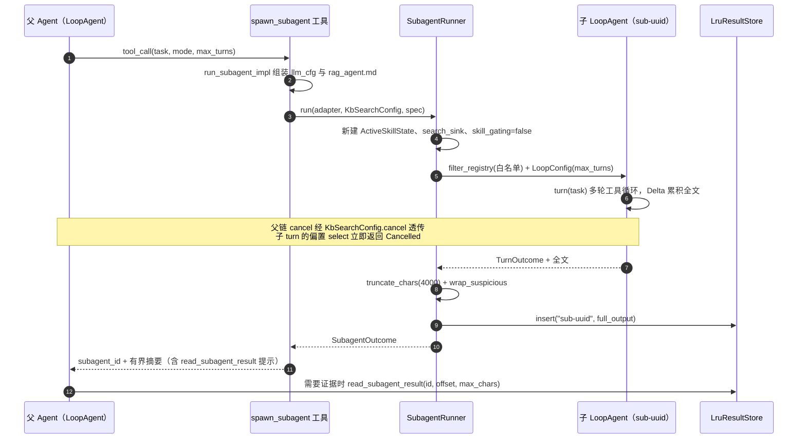
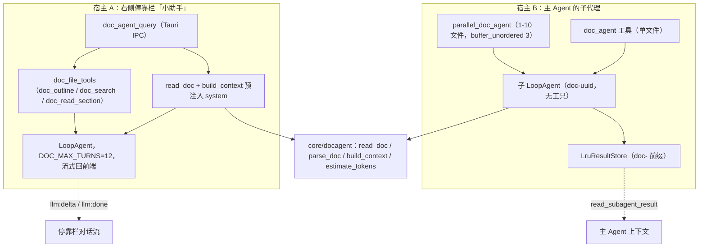
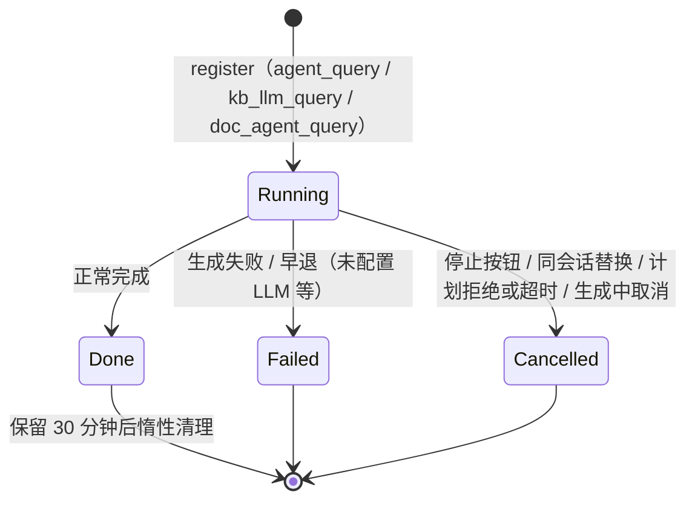

# 子代理与多 Agent 协同

> 本文讲 mdgo 里"一个 Agent 变多个 Agent"这件事是怎么落到代码上的：父链怎么把任务甩出去、子代理能碰什么、钱和轮次花在哪、结果怎么回来、跑飞了怎么收拾。
> 面向有 Rust/后端经验的工程师，默认你熟悉 `tokio`、`CancellationToken`、`Mutex`。所有结论以 `tauri/src-tauri/src` 当前代码为准；旧设计文档与代码冲突处，以代码为准（差异见 §7.6）。
> 建议先读 [01-Agent 技术全景](<01-Agent 技术全景-一次提问的完整链路.md>) 与 [02-Loop 内核](<02-Loop 内核-turn-step 状态机与请求装配.md>)，本文只展开"多 Agent"这条支线。

---

## 1. 为什么拆子代理

mdgo 的主链是单 Agent 循环：一个 `LoopAgent`、一份 `Session`、一个 `request_id`。所有检索命中、工具输出、推理增量都堆进同一份上下文。这在"读三个文件回答一个问题"时没问题，在"把这个知识库 200 篇文档过一遍，告诉我都在讲什么"时会直接失效——不是模型不够聪明，是上下文窗口和注意力都不够。

`core/subagent/mod.rs` 开头的模块注释把动机写得很直白（`tauri/src-tauri/src/core/subagent/mod.rs:1-7`）：

- 子代理用**独立 `request_id`**、**独立上下文**（独立 `ActiveSkillState`、独立检索命中收集器）执行；
- 只把**有界摘要**返回父链；
- 完整输出存进 `AppState.subagent_results`，父链需要细节时用 `read_subagent_result` 分页取。

归纳成四条设计动因：

| 动因 | 代码落点 | 效果 |
| --- | --- | --- |
| 父上下文隔离 | 独立 `sub_cfg.request_id` / `skill_state` / `search_sink`（`core/subagent/mod.rs:138-148`） | 调研过程（几十次工具输出）不进主对话历史 |
| 只读深度调研 | `read_only_tool_set()`（`core/subagent/mod.rs:42-52`） | 天然不触发审批弹窗，调研可以无人值守跑 |
| 并行调研 | `parallel_research` 的 `JoinSet`（`core/agent/loop_tools.rs:1380-1384`） | 3 个独立主题的墙钟时间 ≈ 最慢那个 |
| 结果可回填 | `LruResultStore` + `read_subagent_result`（`core/subagent/mod.rs:296`、`core/agent/loop_tools.rs:1196`） | 摘要给"结论"，分页给"证据"，按需付费 |

这里有个容易忽略的取舍：**父链拿到的不是子代理的完整输出，而是 4000 字符的摘要**（`SUBAGENT_SUMMARY_CHARS`，`core/agent/limits.rs:81`）。这不是省钱的小技巧，而是接口契约——子代理必须自己完成"压缩"，父链只消费结论。真正的细节留在 LRU 里，由模型自己决定要不要翻。

---

## 2. 子代理运行时（权限/预算/取消）

### 2.1 一个结构体定义一次子任务

`SubagentSpec` 就是全部输入（`core/subagent/mod.rs:77-88`）：`request_id`、`task`（作为子代理唯一的 user 消息）、`max_turns`、`summary_chars`、`mode`。输出是 `SubagentOutcome{summary, full_output, failed}`（`core/subagent/mod.rs:91-98`）。

注意 `SubagentRunner` 是**无状态**的（`core/subagent/mod.rs:122`）：`adapter`、`search_config`、`base_rules` 全部由调用方（`run_subagent_impl`）从 `AppState` 组装后传入。这条边界让子代理执行器不依赖命令层，也让 `deep_research` / `spawn_subagent` / `parallel_research` / `doc_agent` 四处复用同一段执行逻辑（`core/agent/tools/mod.rs:3293-3328`）。

### 2.2 工具权限：注册表级裁剪，而不是运行时拒绝

白名单的生效方式不是"调用时检查"，而是**根本不注册**：`filter_registry` 遍历白名单，只把命中的工具塞进新注册表（`core/agent/loop_tools.rs:3409-3420`），模型侧看不到、也调不到白名单外的工具。

```rust
pub fn read_only_tool_set() -> HashSet<String> {
    [
        "kb_search", "code_lookup", "read", "grep", "ls", "glob", "git_status", "git_diff", "webfetch",
        "web_search", "search_memory",
        // 大文档结构读：只读，无副作用
        "md_outline", "read_section", "read_relevant", "read_document",
    ]
    .iter()
    .map(|s| s.to_string())
    .collect()
}
```

（逐字来自 `tauri/src-tauri/src/core/subagent/mod.rs:42-52`）

写型集合是"只读集 + 9 个写工具"（`core/subagent/mod.rs:58-71`），并且**强制挂审批门**；如果 `AppState.approval_gate` 没启用，写型模式会**回退成只读白名单**并打 warn 日志（`core/subagent/mod.rs:157-183`）。这是典型的 fail-safe：宁可少做，不可无确认地改用户文件。

### 2.3 子代理工具权限矩阵

| 工具 | `mode=readonly` | `mode=write` | 说明 |
| --- | --- | --- | --- |
| `kb_search` `code_lookup` | ✅ | ✅ | 知识库/代码检索 |
| `read` `read_document` `grep` `ls` `glob` | ✅ | ✅ | 文件读取与枚举 |
| `md_outline` `read_section` `read_relevant` | ✅ | ✅ | 大文档结构读（`rag_agent.md` 要求，必须登记否则指令与工具集冲突） |
| `git_status` `git_diff` | ✅ | ✅ | 只读 git |
| `webfetch` `web_search` | ✅ | ✅ | 外网只读 |
| `search_memory` | ✅ | ✅ | 记忆**读**；`remember`/`forget` 两边都排除 |
| `edit` `write` `multi_edit` `delete` `apply_patch` `replace_section` `insert_after_heading` | ❌ | ✅（挂审批门） | 每次写操作仍需用户确认 |
| `git_commit` `git_checkout` | ❌ | ✅（挂审批门） | 改仓库历史/工作区 |
| `remember` `forget` | ❌ | ❌ | 记忆写仅主链负责，防子代理污染全局记忆 |
| `activate_skill` `deactivate_skill` | ❌ | ❌ | 子代理不共享父链技能态 |
| `pomodoro` `open-ui` `raw-parse` | ❌ | ❌ | 前端交互工具，子代理无人机交互界面 |
| `todo_write` `schedule` `ask_user_question` `self_review` | ❌ | ❌ | 请求级状态/等待用户/自审语义不适用于子代理 |
| `spawn_subagent` `parallel_research` `deep_research` `read_subagent_result` `doc_agent` `parallel_doc_agent` | ❌ | ❌ | **防无限递归**（深度硬上限 = 1） |

另有一条容易踩的坑：子代理构造时把 `skill_gating` 强制设为 `false`（`core/subagent/mod.rs:148`）。因为子代理的 `ActiveSkillState` 是空的，若继承主对话的软门禁，`kb_search` 会被判"技能未激活"并返回引导文案——子代理就彻底丧失检索能力。白名单已经在注册表层过滤，软门禁在这里是多余且有害的一层。

### 2.4 轮次、超时与取消传播

- **轮次**：`max_turns` 由工具参数传入，默认 12、schema 上限 30、实现层再 `clamp(1, 30)`（`core/agent/loop_tools.rs:1168`、`core/agent/loop_tools.rs:3316`）。注意 12 这个默认值只写死在工具 schema/解析里，**`limits.rs` 里没有 `SUBAGENT_MAX_TURNS` 常量**。真正的执行点在 loop 内核：每个 step 开始前检查 `cancel`，随后 `steps > max_turns` 即返回 `TurnOutcome::MaxTurns`（`core/loop/loop.rs:199-207`）。这里有个语义缺口：`SubagentRunner` 只把 `Failed` / `Cancelled` 标成 `failed = true`，`MaxTurns` 落进 `_ => {}`（`core/subagent/mod.rs:231-241`），于是"轮次耗尽"在父链看来是一次成功——摘要其实是截断的全文。见 §7.5。
- **超时**：**代码中未见子代理级墙钟超时**。`read_only_spec` 只设置 `concurrency_safe`，不设 `timeout_ms`（`core/agent/loop_tools.rs:141-149`），而 `ToolSpec::new` 的 `timeout_ms` 默认 `None`（`core/loop/tool.rs:37-46`）。也就是说 `deep_research` 的唯一预算是轮次上限 + 父链取消，慢模型上单次调研可以跑很久。真正的"到点必须死"来自模型请求本身的超时/重试，不是子代理预算。
- **取消**：父链的 `CancellationToken` 通过 `KbSearchConfig.cancel`（`core/agent/mod.rs:349-351`，主链在 `commands/llm.rs:1938` 注入）随 `cfg.clone()` 传给子代理，子代理侧直接复用同一个 token：

```rust
        let cancel = sub_cfg.cancel.clone().unwrap_or_else(CancellationToken::new);
        let full_registry = crate::core::agent::loop_tools::build_loop_tool_registry(sub_cfg.clone());
        let registry =
            crate::core::agent::loop_tools::filter_registry(&full_registry, &effective_whitelist);
        let config = crate::core::r#loop::LoopConfig::new(spec.max_turns, base_rules);
        let mut agent = crate::core::r#loop::LoopAgent::new(adapter, config, &spec.request_id);
        agent.set_tools(Arc::new(registry));
```

（逐字来自 `tauri/src-tauri/src/core/subagent/mod.rs:187-193`）

子代理**不注册 `TaskRegistry`**，没有独立的"取消子代理"命令。它靠 `LoopAgent::turn` 内的偏置 `select!` 优先响应取消，工具调度器也把 `ctx.cancel` 传给每个工具（`core/loop/tool_calls.rs:137-149`）。取消后 `TurnOutcome::Cancelled` 被映射为 `failed = true`，日志 `[subagent] 调研被父链取消 request_id=sub-...`，然后走正常收尾路径（`core/subagent/mod.rs:231-241`）。

### 2.5 事件隔离与清理

子代理的工具事件写进 `sub-*` 自己的桶，不转发前端；`ToolBusGuard` 用 `Drop` 兜底清理（`core/subagent/mod.rs:103-119`），正常路径也在返回前手动清一次（`core/subagent/mod.rs:244`）。trace 同理（`core/subagent/mod.rs:273`）。即使总线有 64 桶容量兜底（`core/agent/tools/mod.rs:292`），及时清理仍然更干净。

### 2.6 限额常量表

| 常量 / 参数 | 值 | 位置 | 作用 |
| --- | --- | --- | --- |
| `SUBAGENT_SUMMARY_CHARS` | 4000 | `core/agent/limits.rs:81` | 回传父链的摘要字符上限 |
| 子代理 `max_turns` | 默认 12 / 上限 30 | `core/agent/loop_tools.rs:1168`、`:3316` | 子代理模型调用轮次 |
| `LruResultStore` 容量 | 16 | `lib.rs:516` | 完整输出最多保留 16 条 |
| `read_subagent_result.max_chars` | 默认 8192 / 上限 60000 | `core/agent/loop_tools.rs:1230` | 单次分页读取字符数 |
| `parallel_research.tasks` | 2–5 | `core/agent/loop_tools.rs:1347-1348`、`:1374` | 并发子代理个数 |
| `parallel_doc_agent.file_paths` | 1–10，并发 3 | `core/agent/loop_tools.rs:1029-1030`、`:1079` | 多文件精读并发度 |
| `DOC_MAX_TURNS` | 12 | `core/agent/limits.rs:86` | DocAgent 两宿主的轮次 |
| `DOC_DEFAULT_BUDGET_TOKENS` | 16000 | `core/agent/limits.rs:88` | 单文件上下文预算上限 |
| `DEFAULT_MAX_TURNS` | 20 | `core/agent/limits.rs:12` | 主 Agent 轮次预算（对照项） |
| `MAX_TRACKED_REQUESTS` | 64 | `core/agent/tools/mod.rs:292` | ToolCallBus 事件桶上限 |
| `MAX_TRACKED_TASKS` / `RETAIN_DONE` | 64 / 30 分钟 | `core/agent/task_store.rs:106-108` | 任务快照容量与终态保留期 |
| 计划生成总时限 / 次数 | 90s / 3 次 | `commands/llm.rs:1141`、`:1146` | Planner 出计划的上限 |
| 计划确认超时 | 60s（fail-closed） | `commands/llm.rs:1278` | 等用户点"批准"的上限 |

---

## 3. spawn / parallel / self_review / deep_research

四个工具共享一条执行器，但**返回契约和失败语义各不相同**，这是最容易写错的地方。

### 3.1 父/子代理时序



### 3.2 `spawn_subagent`：泛化入口

schema 三个参数：`task`（必填）、`mode`（`readonly` / `write`，默认 `readonly`）、`max_turns`（`core/agent/loop_tools.rs:1279-1288`、`:1294`）。注意 schema 的 enum 写的是 `"readonly"`，而 `subagent_mode` 只判断 `s == "write"`，其它任何值（含拼错的 `read_only`）都会落到只读（`core/agent/loop_tools.rs:1119-1125`）——宽容解析，但旧文档里常见的 `mode=read_only` 写法其实不被识别为写型、也不会报错，属于静默降级。

返回值是一段文本：`subagent_id`、`mode`、`max_turns`、`failed`，加摘要；未失败时再追加"如需完整输出，调用 `read_subagent_result`"（`core/agent/loop_tools.rs:1305-1310`）。这是**提示驱动**的回读设计：工具不替模型决定要不要看细节。

### 3.3 `parallel_research`：JoinSet 并发 + 完成序收集

```rust
        let mut set = tokio::task::JoinSet::new();
        for task in tasks {
            let cfg = self.cfg.clone();
            set.spawn(async move { super::tools::run_subagent_impl(&cfg, task, crate::core::subagent::SubagentMode::ReadOnly, max_turns).await });
        }
        let mut entries: Vec<(String, String, bool)> = Vec::new();
        while let Some(joined) = set.join_next().await {
            match joined {
                Ok(Ok((id, outcome))) => entries.push((id, outcome.summary, outcome.failed)),
                Ok(Err(e)) => entries.push((String::new(), format!("子代理启动失败: {e}"), true)),
                Err(e) => entries.push((String::new(), format!("子代理任务异常: {e}"), true)),
            }
        }
```

（逐字来自 `tauri/src-tauri/src/core/agent/loop_tools.rs:1380-1392`）

要点与坑：

1. **并发度 = 任务数**（2–5），没有额外信号量。`max_parallel_tools`（字段在 `core/loop/loop.rs:45-46`，默认 4 在 `:65`）管的是同一轮内工具的并行度，不是这里。
2. **查询拆分不做**：任务数组由模型自己拆，代码只校验 2–5 个非空字符串（`core/agent/loop_tools.rs:1361-1378`）。"拆分策略"全在提示词里，不在代码里。
3. **合并策略是按完成序拼接**：`join_next()` 的返回顺序是完成顺序，不是输入顺序，`for (i, ...) in entries.iter().enumerate()` 因此标号不稳定（`core/agent/loop_tools.rs:1394-1401`）。对"三个主题各给结论"的场景没问题，对"任务 1 必须对应主题 1"的严格排序场景需要模型自己看标题。
4. **部分失败不降级为工具错误**：启动失败/任务异常都被转成 `(空 id, 错误文本, true)` 计入 `failed_count`，最终 `on_result` 的成功位是 `failed_count == 0`（`core/agent/loop_tools.rs:1403`），但函数仍返回 `Ok(String)`——父链一定会看到"2 个成功 + 1 个失败标注"，不会整批丢失。这是有意的：并行调研里单个子任务失败不该让父链重跑全部。
5. 每个子代理独立 `sub-*` 请求 id 与独立 LRU 条目，`id.is_empty()` 的失败项不输出回读提示（`core/agent/loop_tools.rs:1398-1400`）。

### 3.4 `deep_research`：单子代理 + 多轮检索

`deep_research` 与 `spawn_subagent(mode=readonly)` 在实现上是**同一路径**（都调 `run_subagent_impl`，`core/agent/loop_tools.rs:1175`），差异只在语义与提示文案：它把"多轮检索 + 精读 + 出报告"这套行为交给子代理的 system prompt（`rag_agent.md`）+ 工具描述去引导，代码层面**没有**"先检索 N 次再精读 M 篇"的硬编码阶段机。所谓"多轮检索 + 精读 + 报告生成"是模型在 12 轮预算内的自由行为，预算就是 `max_turns`。

失败处理也刻意"软"：`outcome.failed` 时追加"调研未完成，可重试或检查 LLM 配置"，仍返回 `Ok`（`core/agent/loop_tools.rs:1176-1191`）；只有 LLM 完全未配置才返回 `Err`（`core/agent/tools/mod.rs:3305-3307`）。取消则走 `TurnOutcome::Cancelled` → `failed=true` → 摘要前缀"调研在生成过程中中断"（`core/subagent/mod.rs:252-257`），把已产出的部分留给父链。

### 3.5 `self_review`：模型自选的反思质量门

三件事必须按代码说清楚，不然容易误解：

1. **触发条件是"模型主动调用"**：没有 Hook、没有规则路由；`resources/` 下的 Agent 规约与技能文档里搜不到 `self_review`（全仓仅工具实现与 `BASE_TOOLS` 注册命中它）。工具描述里写的是"适合长答案或多轮工具任务后使用"（`core/agent/loop_tools.rs:1694`）。
2. **评审是一次独立的非流式调用**，复用 `LLMClient::review_text`（`core/agent/loop_tools.rs:1730`）。prompt 结构固定为四问 + 强制 JSON：覆盖目标 / 事实与引用一致 / 无遗漏步骤或明显错误 / 结构清晰，输出 `{"verdict","issues":[{"issue","fix"}]}`，`temperature=0.2`、`max_tokens=1024`（`services/llm.rs:735-743`），并用 `JsonSchemaValidator` 校验，非法输出视为评审失败（`services/llm.rs:746-750`）。
3. **不阻断**：有 `issues` 时工具返回问题清单并提示"逐条修正后输出最终答案"（`core/agent/loop_tools.rs:1731-1738`）；无问题时返回"审查通过，请直接输出最终答案"；评审不可用时返回"审查不可用…请自行检查初稿"，且仍是 `Ok`（`core/agent/loop_tools.rs:1745-1749`）。是否真的改，由模型下一轮决定。代码里没有"未通过就禁止输出"的强制门。

另外 `self_review` 不在子代理白名单里（§2.3），所以"子代理自审"目前做不到。

---

## 4. 结果回传与 LRU

### 4.1 存储契约

`run_subagent_impl` 在子代理结束后**无条件**把全文写入全局 LRU，键是 `sub-{uuid}`（`core/agent/tools/mod.rs:3311-3326`）；DocAgent 用 `doc-{uuid}` 写同一张表（`core/agent/loop_tools.rs:928`、`:987`）。所以 `read_subagent_result` 一张入口同时服务两类子代理——前缀只是命名约定，代码不校验。

失败或取消的子代理也会写入（`insert` 在 `match` 之后、无条件执行），因此父链在"部分产出"场景仍能回读已生成的内容。

### 4.2 `LruResultStore` 的实现

`map: Mutex<HashMap<String, (u64, String)>>` + `seq: AtomicU64` + `max: usize`（`core/subagent/mod.rs:296-300`）。用单调递增访问序号做 LRU，不依赖时间戳，可单测：

```rust
    /// 写入结果；新 id 且已达上限时淘汰最久未访问的一条。
    pub fn insert(&self, id: String, text: String) {
        let seq = self.seq.fetch_add(1, Ordering::Relaxed);
        if let Ok(mut map) = self.map.lock() {
            if !map.contains_key(&id) && map.len() >= self.max {
                if let Some(oldest) = map
                    .iter()
                    .min_by_key(|(_, (s, _))| *s)
                    .map(|(k, _)| k.clone())
                {
                    map.remove(&oldest);
                }
            }
            map.insert(id, (seq, text));
        }
    }
```

（逐字来自 `tauri/src-tauri/src/core/subagent/mod.rs:311-326`）

`get` 会刷新访问序（`core/subagent/mod.rs:329-342`），所以模型反复翻同一条结果不会把它翻出局。容量 16 在 `lib.rs:516` 组装。语义取舍：相比"满则清空"，LRU 保证 `read_subagent_result` 更不易失效；相比无限增长，16 条是内存上界。

### 4.3 分页读取

`read_subagent_result` 按字符（不是字节）分页：`offset` 默认 0、`max_chars` 默认 8192 且 `clamp(1, 60_000)`（`core/agent/loop_tools.rs:1229-1230`）。命中不存在/已淘汰的 id 返回 `ToolError::Failed("subagent_id 不存在或已过期")`（`core/agent/loop_tools.rs:1238-1242`）——这是 LRU 淘汰后**唯一**的用户可见症状，模型需要学会"要么立刻读，要么接受摘要"。`offset >= total` 时返回"已读取到末尾"而不是空串（`:1244-1248`），避免模型陷入"空结果 → 重试"的循环。

`truncate_chars` 按字符边界截断并把提示拼进摘要（`core/subagent/mod.rs:351-358`），不会切坏 UTF-8。摘要回传前还会过一遍 `wrap_suspicious`（`core/subagent/mod.rs:263`），把可疑指令包裹提示而不是丢弃（详见 [10-安全防线](<10-安全防线-审批-注入防护与防幻觉.md>)）。

### 4.4 为什么结果不进会话事件流

子代理结果走进程内 LRU，**没有**并入事件溯源（`session_events`）。代价是进程重启后历史子代理结果不可回读；收益是主会话的事件流不被几十 KB 的调研原文污染，`Session::derive_history` 也不会因此膨胀。这是一个明确取舍：子代理输出是"可再生的中间产物"，不是"必须可回放的事实"。事件溯源本身的取舍见 [08-事件溯源会话与持久化](<08-事件溯源会话与持久化.md>)。

---

## 5. DocAgent 的两宿主架构

### 5.1 一能力两宿主

同一套"读文档 → 按问题选章节 → 带 `[§N]` 引用协议回答"的能力，被挂在两个完全不同的宿主上：



| 维度 | 宿主 A（停靠栏） | 宿主 B（主 Agent 子代理） |
| --- | --- | --- |
| 入口 | `doc_agent_query` 命令（`commands/llm.rs:2355`） | `doc_agent` / `parallel_doc_agent` 工具（`core/agent/loop_tools.rs:782-783`） |
| 工具体系 | 3 个只读取文工具，绑定当前文件 | 无工具（纯上下文问答） |
| 上下文预算 | `doc_context_budget_tokens`：窗口 30%，clamp 2048–16000（`commands/llm.rs:2285-2292`） | `doc_budget_tokens_for`：同口径（`core/agent/loop_tools.rs:821-828`） |
| 输出 | 流式 `llm:delta` / `llm:thinking` / `llm:usage` | 4000 字符摘要 + `doc-` id 入 LRU |
| 轮次 | `DOC_MAX_TURNS = 12` | 同 12 |
| 取消 | `kb_cancel_task` → `TaskRegistry` | 父链 `KbSearchConfig.cancel` 透传 |
| 多文件 | 前端圈选，最多 +3 个关联文档，每个 6000 token 预算 | `parallel_doc_agent`，1–10 文件、并发 3 |

### 5.2 上下文构建（`core/docagent`）

`read_doc` 做三件事：路径防逃逸（canonicalize + 前缀校验，`core/docagent/mod.rs:156-178`）、文档加载（统一走 `DocumentLoader`，已登记格式转换失败**绝不**退化为 `from_utf8_lossy`，`core/docagent/mod.rs:180-199`）、按 ATX 标题切章节并记行号（`parse_doc`，`:267-346`）。

缓存是进程级 `(mtime, size)` 双键（`core/docagent/mod.rs:205-234`，容量 64 条，`:26`）。为什么带 size：只比 mtime 时同毫秒写入或低分辨率文件系统会命中旧解析结果，而 `replace_section` 依赖 `line_start/line_end`，过期行号会写错范围（注释在 `:205-209`）。

`build_context` 的预算策略（`core/docagent/mod.rs:468-539`）：

1. 全文估算 `≤ budget` → 全文注入，保留所有 `§` 标记；
2. 超预算 → **先强制纳入问题里显式点名的章节**（`§14` / `第14章`，最多 3 节，`referenced_section_ids`，`:435-459`），再按 `score_section` 的词频打分补足；
3. 输出开头附"未纳入章节"清单（带行号区间），模型可据此调 `doc_read_section` 自取。

第 2 步是这套设计的关键：用户问"第 14 章讲了什么"时，如果 14 章没被预算选中，模型只能回答"未纳入上下文"——体验上就是"它读不到文档"。所以显式引用必须无条件进上下文（`core/docagent/mod.rs:498-506`）。

章节引用语义有严格区分：`§N` 是**章节序号**（按标题出现顺序分配），`第N章`/`裸数字 14` 是**作者写的章号**，解析与回退策略不同（`core/docagent/tools.rs:95-129`、`:488-512`）。早期实现把两者混为一谈，导致 `§12` 命中"标题含 12 的那一节"。

### 5.3 相关文档 / 目录 / 标签查询

这三个是宿主 A 的周边能力，全部只读、范围限定"当前文件同目录"：

- `doc_dir_files`：同目录文档候选，判定口径统一走 `filekind::is_document_material`，覆盖 PDF/Office/EPUB 转换形态（`commands/doc.rs:48-85`）。
- `doc_tag_files`：按 frontmatter 标签匹配同目录文档，最多 3 个、排除自身（`commands/doc.rs:89-145`）；标签解析支持 `- 项`、`[a, b]`、逗号/空格分隔（`core/docagent/mod.rs:63-109`）。
- `doc_related`：词面重叠近似语义，`score_overlap` = 交集 / `min(b.len(), 200)`，`limit` 默认 3、clamp 1–5（`commands/doc.rs:36-44`、`:154`）。

### 5.4 `doc_agent_query` 的链路与预算

顺序（`commands/llm.rs:2355-2659`）：

1. 注册取消 token + 任务快照（`mode="doc"`）→ 早退统一走 `doc_abort!` 宏（发 `llm:error`、`finish(Failed)`、`unregister`）；
2. 快/深档覆盖 `reasoning_effort`（`high/medium/low`）；
3. 文档上下文：有选区且 `end > start` 走 `build_selection_context`（只给选区原文 + 行号），否则整篇按问题选章节；
4. `@提及` / `[[双链]]` / `@文件夹`：文件夹最多 2 个、每个最多 3 个候选，最终最多再加 3 个关联文档，每个按 6000 token 预算构建（`commands/llm.rs:2434-2476`）；
5. 历史压缩：`SummarizeThenWindow`，`LLMClient` 构建失败降级纯滑窗；
6. system prompt = `doc_agent.md` + 上一请求过程摘要 + 文档上下文 + 长期记忆（top 5）+ 会话风格模板（截断 500 字符）+ 相关书签（最多 3 条、每条 400 字符）；
7. `LoopAgent` + `doc_file_tools`（3 个只读工具）+ `DOC_MAX_TURNS=12`；
8. 逐事件转发 + 事件溯源落库 + 按 `TurnOutcome` 收尾（Failed / Cancelled / Done）。

宿主 A 是**全链路最"重"的一条**：system prompt 里塞了 6 类块，但每一块都有硬截断，这是"上下文工程"的常见形态——不给无限预算，给明确优先级 + 明确上限。

### 5.5 宿主 B 为什么不给工具

`run_doc_agent_direct` 构造的 `LoopAgent` **一个工具都不注册**（`core/agent/loop_tools.rs:934-943`，只有 `LoopConfig` + adapter）。这跟宿主 A 正好相反，理由是隔离与代价：

- 宿主 B 跑在父 Agent 的工具调用里，如果再给它文件工具，就同时打开了"路径参数面"和"递归面"，需要额外一层路径校验与白名单维护；
- 它只需要回答"针对这一个文件的这个问题"，上下文由 `build_context` 一次性选好，单轮问答足够。

代价也很直接：**宿主 B 无法"按需取文"**。当文档超预算时，`build_context` 只给部分章节 + 省略清单（`core/docagent/mod.rs:526-538`），模型没有 `doc_read_section` 可调，只能基于已注入章节作答，或用 `read_subagent_result` 读回自己那次运行的全文——而全文是整篇、不受章节预算控制，粒度反而更粗。宿主 A 的 `doc_outline` / `doc_search` / `doc_read_section` 三件套正是为补这个缺口而存在（`core/docagent/tools.rs:1-19` 的模块注释把动机写得很清楚）。

---

## 6. Planner 与任务状态中心

### 6.1 `should_plan`：零 LLM 开销的规则路由

`planner.rs` 只做三件事：判定要不要规划、解析计划 JSON、把计划渲染成 preamble。LLM 调用本体在 `services/llm.rs::generate_plan_json`（依赖倒置，`core/agent/planner.rs:1-11`）。

规则（`core/agent/planner.rs:87-128`）：

- 长度 ≥ `LONG_QUERY_CHARS = 120` → 复杂任务候选；
- 含 `PLAN_VERBS`（重构/设计/分析/迁移/实现/搭建/规划/评估/对比…，`:59-63`）→ 候选；
- 中等长度且含多意图连接词（`并且/同时/以及/然后/还要`，`:69`）→ 候选；
- 抑制项：轻量单动作（查看/解释/翻译/读取/总结/汇总/概括…，`:96-99`）且无多意图连接词 → 不规划；疑问句结尾（`?/？/吗/呢/什么/哪些`）→ 不规划。

两个抑制项都是踩过坑的产物：`先……再……` 曾被当作多意图信号导致误报（`:65-69`），"总结一下"曾触发 7 步规划 + 用户确认白等一次慢 LLM 调用（`:281-289` 的回归测试）。阈值常量：

```rust
/// 长问题判定阈值（字符）：超过即直接视为复杂任务。
const LONG_QUERY_CHARS: usize = 120;

/// 短问题判定阈值（字符）：低于且无任务动词时不规划。
const SHORT_QUERY_CHARS: usize = 40;
```

（逐字来自 `tauri/src-tauri/src/core/agent/planner.rs:71-75`）

### 6.2 Plan 结构与注入

`Plan` 七个字段（`core/agent/planner.rs:140-160`）：`goal`、`steps`、`acceptance` 必填，`risks`、`touchpoints`、`non_goals`、`rollback` 可选（`serde(default)`）。JSON Schema 在 `plan_json_schema()`（`:22-37`），校验用 `JsonSchemaValidator`，并会先剥掉 Markdown 代码围栏、截取首个 `{` 到末个 `}`（`:43-52`、`:237-246`）；`parse_plan` 宽松解析，解析失败返回 `None` 由调用方 fail-open（`:208-234`）。

`to_preamble_text()`（`:164-202`）渲染成"【已确认的任务计划，请严格按此执行】+ 目标 / 步骤 / 验收标准 / 涉及范围 / 风险注意 / 非目标 / 失败回滚"。它被拼进 `context`（检索上下文块）而不是 system prompt（`commands/llm.rs:1839-1843`）——每轮请求都会带上，属于"约束最强"的位置。

### 6.3 确认通道：`plan:request` / `plan_respond`

流程（`commands/llm.rs:1110-1358`）：

1. `should_plan` 为真 → 发 `rag:status(stage="planning")` + trace 起点；
2. 规划模型可选（`planner_model`，失败回退主模型）；
3. 最多 3 次尝试，校验失败用 `build_fix_prompt` 构造修正提示重发；空响应追加"只输出 JSON"的修正；
4. 整个生成过程套 **90s 总时限**（`PLAN_GENERATION_DEADLINE_SECS`，`:1146`、`:1196-1209`），超时 fail-open 不规划——修的是"3 次尝试 × 每次最多 5 次重试 × 600s 超时"可挂 30 分钟的问题；
5. 拿到 plan → 生成 `plan_id`，`oneshot::Sender` 存进 `AppState.plan_pending`，emit `plan:request`（含完整七字段）：

```rust
            let plan_id = uuid::Uuid::new_v4().to_string();
            let (tx, rx) =
                tokio::sync::oneshot::channel::<crate::core::agent::planner::PlanDecision>();
            {
                let mut pending = state.plan_pending.lock().unwrap_or_else(|e| e.into_inner());
                pending.insert(plan_id.clone(), tx);
            }
```

（逐字来自 `tauri/src-tauri/src/commands/llm.rs:1217-1223`）

6. 等待确认时同时监听取消与 60s 超时：`res = tokio::time::timeout(Duration::from_secs(60), rx) => res`（`:1278`），取消分支立刻清挂起表、`finish(Cancelled)`、`unregister` 并返回；
7. 只有 `PlanDecision::Approved` 才 `task_plan = Some(plan)`（`:1281-1292`）。拒绝、通道异常、超时**一律按拒绝处理（fail-closed）**：清挂起表、trace 记 `denied`、非用户主动拒绝时额外 emit `plan:rejected` 让前端弹 sticky 提醒、`rag:done` 内容置空（避免污染对话历史）、任务状态置 `Cancelled`（`:1293-1357`）。

`plan_respond` 只做一件事：从挂起表 `remove` 出 sender 并回传；未知 `plan_id`（已超时/已处理）返回错误让前端忽略（`commands/plan.rs:13-34`）。这与审批通道 `approval_respond` 完全同构——两条人机确认通道共用一套模式：挂起表 + oneshot + 前端事件 + 超时 fail-closed。

失败降级是"可见的失败"：3 次仍未解析出计划时，不是静默继续，而是 emit `rag:status("规划生成失败，已降级为直接执行")` 再走原流程（`commands/llm.rs:1359-1369`）。这修的是"前端完全没反馈、用户以为卡死"的问题。

### 6.4 任务状态中心 `TaskStore`

`BackgroundAgentTask` 是一份"切回页面能重建视图"的快照（`core/agent/task_store.rs:56-93`）：`content`（流式增量累积）、`sources`、`tool_traces`（按 seq 回填 call/result）、`trace_events`、`thinking`、token 用量、`status_message`、`user_message`、时间戳。前端通过 `agent_task_list` / `agent_task_get` 恢复（`commands/llm.rs:880-894`）。

状态机只有四个值（`core/agent/task_store.rs:19-26`，`serde(rename_all="lowercase")`）：



收尾必须显式调用：所有提前 `return` 的分支都手动 `finish(...)` + `unregister`，否则全局任务条会一直转（`commands/llm.rs:2128-2141` 就是一个典型早退收尾）。`kb_cancel_task` 除了 `token.cancel()`，还会把仍是 `Running` 的快照直接置 `Cancelled`，作为"无终态事件路径"的兜底（`commands/llm.rs:858-874`）。

容量治理（`core/agent/task_store.rs:307-335`）：终态且空闲超过 `RETAIN_DONE`(30 分钟) 的删掉；总数超 `MAX_TRACKED_TASKS`(64) 时按 `updated_at` 淘汰最旧**终态**，`Running` 永不淘汰。注意淘汰是**惰性的、只在 `register` 写路径触发**——只读不写的进程不会清理。

### 6.5 同会话新请求替换旧任务

`agent_query` 在注册新任务后，遍历所有 `Running` 快照，把**同一 `session_id` 且 `request_id` 不同**的旧任务 `cancel` + `finish(Cancelled)`（`commands/llm.rs:916-936`）。这是"停止按钮 / 同会话替换 / 应用退出"三个取消入口里的中间那个，防的是同会话并发 Agent 任务堆积。

一个代码层面的事实：这段逻辑**只在 `agent_query` 里**，`kb_llm_query_loop_v2` 与 `doc_agent_query` 都没有等价替换。宿主 A 同一会话并发时依赖前端先中断。

---

## 7. 设计取舍与已知限制

### 7.1 深度硬上限 = 1，靠白名单而非计数器

代码里**没有** `max_depth` 之类的常量。递归被两道措施同时挡住：子代理白名单不含 `spawn_subagent` / `parallel_research` / `deep_research` / `read_subagent_result` / `doc_agent`（§2.3），且注册表级过滤让模型看不到这些工具。好处是零运行时开销、不可能绕过；代价是做不到 DSH 那种 `depth≤2` 的分层编排（对比见 `docs/Agent 短板补齐规划.md` 的能力对照表），也无法支持"子代理再派子代理"的分层调研。

### 7.2 成本模型：轮次是唯一硬预算

一次 `deep_research` 最坏是 30 轮 × 每轮全部工具输出；`parallel_research` 最坏是 5 × 30 轮并发打到同一端点。没有 token 预算、没有墙钟超时、没有并发信号量。实际使用要靠模型自己收敛 + 用户点停止。这是当前最明显的成本风险点，缓解手段只有默认 `max_turns=12` 和摘要 4000 字符。

### 7.3 一次性子代理，不可续

没有 `list_agents` / `send_message` / `interrupt_agent`，也没有"后台续跑"。子代理返回即销毁，唯一的后续交互是 `read_subagent_result` 读它的全文。想做"先调研、看到中间结论再追加指令"目前做不到——只能重新派一个。

### 7.4 只读 vs 写型：默认安全，写型依赖审批门

只读子代理天然绕过审批弹窗，这让"无人值守调研"成立；写型子代理的每一次 `edit`/`delete`/`write`/`apply_patch`/`replace_section`/`git_commit` 都要过审批（`core/approval/policy.rs:45-155`），且审批门缺失时整体回退只读。代价是写型子代理基本没法"一口气改十个文件"——每个文件一次确认，交互成本高。

### 7.5 其他坑（读代码时容易被绊到的）

- **`parallel_research` 结果顺序不稳定**：完成序即顺序（§3.3），严格对齐需要模型按任务标题自行匹配。
- **LRU 淘汰是静默的**：16 条之外的子代理结果调 `read_subagent_result` 会得到"不存在或已过期"，父链上下文里没有任何提示。高并发调研时这个概率不低。
- **摘要截断提示依赖模型自觉**：`truncate_chars` 只拼一句"完整结果可用 read_subagent_result 分页读取"（`core/subagent/mod.rs:356`），模型不读就永远只有摘要。
- **轮次耗尽被当作成功**：`TurnOutcome::MaxTurns` 不置 `failed`（`core/subagent/mod.rs:231-241`），父链无法区分"调研完成"与"预算烧完被迫截断"，`deep_research` 的返回头里 `failed=false` 也可能是半成品。
- **`spawn_subagent` 的 mode 容错过度**：只认 `write`，其余全部只读（§3.2），写错不报错。
- **计划生成是独立调用，不占 20 轮预算**（`commands/llm.rs:1106-1108`），但会计费；一次复杂请求实际是"规划 1 次 + 执行 N 轮"。
- **`doc_agent_query` 的 system prompt 很长**：6 类块叠加，虽然每块都有截断，但小上下文模型上仍可能挤掉文档正文。

### 7.6 旧文档与代码不一致处（本次核对）

| 旧文档说法 | 代码事实 |
| --- | --- |
| `spawn_subagent(mode=read_only\|write)` | schema enum 是 `["readonly","write"]`；`read_only` 会被静默当作只读（`core/agent/loop_tools.rs:1283`、`:1119-1125`） |
| 只读白名单 = kb_search / code_lookup / read / grep / ls / git_status | 实际 15 个，另含 `glob` `read_document` `md_outline` `read_section` `read_relevant` `git_diff` `webfetch` `web_search` `search_memory`（`core/subagent/mod.rs:42-52`） |
| `SUBAGENT_MAX_TURNS` 常量 | 当前无此常量；轮次由 `SubagentSpec.max_turns` 字段传入，默认 12/上限 30 写死在工具层（`core/agent/loop_tools.rs:1168`、`:3316`） |
| `deep_research` 返回 `{summary, subagent_id, max_turns, failed}` | 实际返回**一段拼好的文本**，不是 JSON 对象（`core/agent/loop_tools.rs:1177`） |
| 子代理有超时保护 | 代码中未见子代理级超时；只有 `max_turns` + 取消（§2.4） |
| 同会话新请求替换旧任务（泛指） | 仅 `agent_query` 实现（`commands/llm.rs:916-936`），chat/doc 路径没有 |

---

## 8. 小结与相关文件

mdgo 的多 Agent 不是"编排框架"，而是**四个粒度不同的原语 + 一套共享基础设施**：

- 原语：`deep_research`（单只读子代理）、`spawn_subagent`（只读/写型）、`parallel_research`（2–5 并发）、`doc_agent` / `parallel_doc_agent`（文档专精）；
- 基础设施：白名单注册表过滤（权限）、`KbSearchConfig.cancel` 透传（取消）、`LruResultStore` + `read_subagent_result`（结果）、`TaskStore`（状态）、`Planner`（计划确认）。

设计主线可以概括成一句话：**把"读得多"从父链剥离，把"写"锁进审批，把"确认"做成可超时的通道，把所有内存结构都加上界。**

相关文件：

| 文件 | 职责 |
| --- | --- |
| `tauri/src-tauri/src/core/subagent/mod.rs` | 子代理执行器、白名单、LRU 结果存储、截断 |
| `tauri/src-tauri/src/core/agent/loop_tools.rs` | `deep_research` / `spawn_subagent` / `parallel_research` / `self_review` / `read_subagent_result` / `doc_agent` / `filter_registry` |
| `tauri/src-tauri/src/core/agent/tools/mod.rs` | `run_subagent_impl` 公共执行器（`sub-*` id、全文入 LRU） |
| `tauri/src-tauri/src/core/agent/limits.rs` | 子代理与 DocAgent 的限额常量 |
| `tauri/src-tauri/src/core/docagent/{mod,tools}.rs` | 文档解析/章节锚点/预算上下文、宿主 A 只读取文工具 |
| `tauri/src-tauri/src/commands/llm.rs` | 规划确认、任务状态、`doc_agent_query`、同会话替换、取消 |
| `tauri/src-tauri/src/core/agent/planner.rs` | `should_plan`、`Plan`、`to_preamble_text` |
| `tauri/src-tauri/src/core/agent/task_store.rs` | 后台任务快照与容量治理 |
| `tauri/src-tauri/src/core/loop/tool_calls.rs` | 工具并行调度、`ctx.cancel` 与 `timeout_ms` 裁决 |

延伸阅读：[00-导读](00-导读.md)、[04-工具系统](<04-工具系统-契约-注册与并行调度.md>)（白名单与并行调度底座）、[08-事件溯源会话与持久化](<08-事件溯源会话与持久化.md>)（子代理不写入会话事件流的取舍）、[10-安全防线](<10-安全防线-审批-注入防护与防幻觉.md>)（审批门与注入包裹）。
