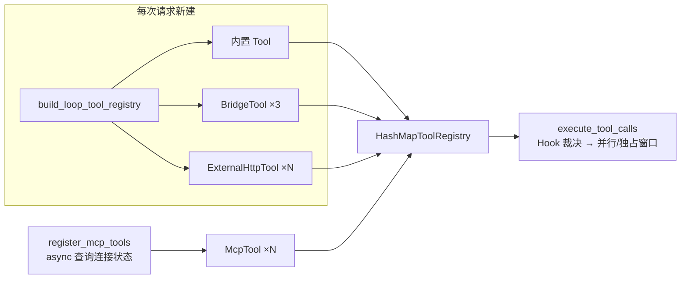
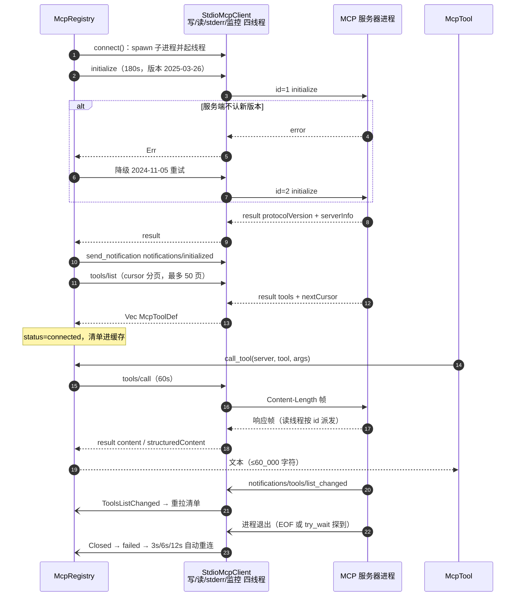
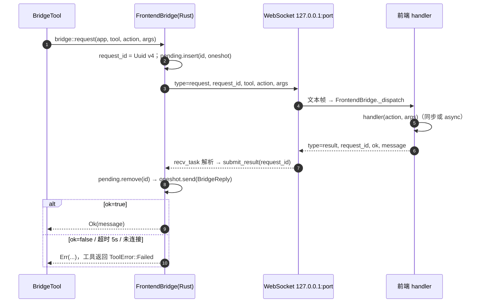

---
title: MCP、动态外部工具与前端事件桥：把外部能力接进 Agent
date: 2026-11-10
tags: [Agent, Rust, MCP, WebSocket]
summary: 从 McpRegistry 的连接状态机、stdio/HTTP-SSE 双传输与 JSON-RPC 关联，到动态外部工具的 mtime 缓存和 WebSocket 事件桥的请求关联，梳理 mdgo 如何把"不受自己控制的外部能力"安全地放进工具表。
---

# MCP、动态外部工具与前端事件桥：把外部能力接进 Agent

> 前三类工具（文件、检索、子代理）都是仓库内自己写的 Rust，schema、错误、超时全由自己决定。
> 本文讲的是**另一类**：能力边界在仓库之外——MCP 服务器是别人的子进程，动态外部工具是别人
> 的 HTTP 端点，前端桥要等浏览器里的 JS 处理完才回来。这三条路的共同问题是：它们都不受
> 我们的 schema 约束、都可能永久挂住、都可能返回 10 万字符。代码怎么把不可控变成可控，是本文
> 的主线。
>
> 适合读者：有 Rust/后端经验，想知道 MCP 生命周期管理、非可信工具接入、进程/WebSocket 桥的
> 工程细节。工具契约本身（`Tool` trait、并行调度）见 [04 工具系统](<04-工具系统-契约-注册与并行调度.md>)，
> 审批与门禁见 [06 Hook 体系与技能门禁](<06-Hook 体系与技能门禁.md>) 和
> [10 安全防线](<10-安全防线-审批-注入防护与防幻觉.md>)。

## 1. 外部工具的三类来源

`build_loop_tool_registry`（`tauri/src-tauri/src/core/agent/loop_tools.rs:746-798`）是**每次请求**
新建注册表的入口。它按固定顺序注册，最后三行把"外部性"引进来：

```rust
    // 前端桥接工具（pomodoro/raw-parse/open-ui，技能声明门控）+ 外部 HTTP 工具（配置驱动）
    register_bridge_tools(&mut reg, cfg.clone());
    register_external_tools(&mut reg, cfg.clone());
    // 网络工具：web_search（搜索互联网，配置驱动）+ webfetch（抓取单页）
    reg.register(Arc::new(WebSearchTool::new(cfg.clone())));
    reg.register(Arc::new(WebfetchTool::new(cfg)));
```

逐字来自 `tauri/src-tauri/src/core/agent/loop_tools.rs:791-796`。

MCP 工具则**不在**这个函数里，而是在命令层（`commands/llm.rs:2802-2809`）追加：

```rust
    let mut registry = crate::core::agent::loop_tools::build_loop_tool_registry(search_config.clone());
    crate::core::agent::loop_tools::register_skill_tools(...);
    let mcp_tool_names = crate::core::agent::loop_tools::register_mcp_tools(&mut registry, search_config.clone()).await;
```

三个来源的差别不只是"注册在哪"，而是**信任级别完全不同**：

| 维度 | 内置工具 | 动态外部工具（`agent_tools.yaml`） | MCP 服务器工具 |
|---|---|---|---|
| 注册位置 | `build_loop_tool_registry`（`:746-790`） | 同函数内 `:793` → `register_external_tools`（`:2189-2193`） | `register_mcp_tools`（`:2236-2277`），注册表建好后追加 |
| 工具名来源 | 源码里的 `&'static str` | 配置文件 `name` 字段 | `mcp_{server}_{tool}` 规范化 |
| schema 来源 | 手写 `json!`，与代码 clamp 同源 | 配置文件 `params_schema` | 服务端 `tools/list` 返回值 |
| 执行位置 | 本进程 | 本进程发 HTTP，逻辑在远端点 | 子进程（stdio）或远端（HTTP） |
| 超时 | 工具内部常量（如 webfetch 10s） | `timeout_secs`，默认 30s | 传输层 60s（握手 180s） |
| 输出上限 | 各工具 `MAX_*` | 100_000 字符 | 60_000 字符 |
| 是否需审批 | 按 `DestructiveWritePolicy` 分工具 | **代码中未见**（策略无对应分支） | 默认需确认（`mcp_` 通配） |
| 能否并行 | `concurrency_safe` 显式声明 | 否（`ToolSpec::new` 默认 false） | 否（同上） |
| 加载方式 | 编译期固定 | 每次请求读缓存（mtime 判定） | 运行时查 `McpRegistry`，只挂已连接 |

这张表的最后三行是本文后面所有设计的动因：**名字和 schema 都不由我们定义，所以校验、截断、
审批要额外做一层**；默认不可并行，是因为 `ToolSpec::new` 的 `concurrency_safe` 默认 `false`
（`tauri/src-tauri/src/core/loop/tool.rs:36-44`），外部工具没有显式改成 `true`——保守默认。



`BridgeTool` 和 `ExternalHttpTool` 虽然一个走 WebSocket、一个走 HTTP，但都在同一个注册函数里
同步注册；只有 MCP 需要 `await`（要读注册表状态），所以它的注册是 async 且独立成函数。

## 2. MCP 协议与传输

### 2.1 握手：版本协商优先，失败降级

`connect`（`core/mcp/mod.rs:447-582`）的握手序列是：**initialize（180s 超时）→ 校验 result →
`notifications/initialized` → 建立接收流 → tools/list 分页**。

initialize 参数由 `init_params` 生成（`mod.rs:223-229`）：

```rust
        serde_json::json!({
            "protocolVersion": version,
            "capabilities": { "roots": { "listChanged": true } },
            "clientInfo": { "name": "mdgo", "version": "1.0.0" },
        })
```

客户端只声明了 `roots` 一项能力——即"我可以把工作区根目录告诉你"。`sampling`、`elicitation`
都没有声明，因此服务端若反向请求这些方法，会被统一回 `-32601`（`core/mcp/client.rs:599-617`）。

版本策略是**先新后旧**：先试 `MCP_PROTOCOL_VERSION = "2025-03-26"`，失败再用
`MCP_PROTOCOL_VERSION_FALLBACK = "2024-11-05"` 重试一次（`client.rs:45-47`、
`mod.rs:515-533`）。两次都失败才把状态标记 `failed`。超时给到 **180s** 而不是 60s，注释里写了
原因：首次运行 `npx` 需要下载依赖包（`mod.rs:514`）。

握手成功后不再等响应，直接发 `notifications/initialized`（`mod.rs:546`）——这是无 `id` 的
JSON-RPC notification，代码里走 `send_notification`，队列满或已关闭只记一条 warn
（`client.rs:471-480`）。

### 2.2 tools/list：cursor 分页与防御上限

`list_all_tools`（`mod.rs:232-260`）按 `nextCursor` 循环拉取，`MAX_PAGES = 50` 是防御异常
服务端无限翻页的硬上限。单页内任何一个工具项反序列化失败会被**静默跳过**（`mod.rs:245-247`），
不会让整次连接失败——外部 schema 的兼容性优先。

### 2.3 tools/call 与 JSON-RPC id 关联

stdio 客户端用一个自增 `AtomicU64` 生成 `id`，用 `HashMap<u64, oneshot::Sender>` 挂起在途请求，
写线程负责写帧、读线程按 `id` 派发（`client.rs:438-449`）：

```rust
        let id = self.next_id.fetch_add(1, Ordering::Relaxed);
        let (reply_tx, reply_rx) = oneshot::channel();
        {
            let mut p = self.pending.lock().unwrap_or_else(|e| e.into_inner());
            p.insert(id, reply_tx);
        }
        let msg = serde_json::json!({
            "jsonrpc": "2.0",
            "id": id,
            "method": method,
            "params": params,
        });
```

读线程收到帧后按"有 id 无 method / 有 id 有 method / 有 method 无 id"三分（`client.rs:296-316`）：
响应按 id 回传、服务端请求即时应答、通知走事件回调。这个三分是 v3 的关键——v2 单 IO 线程串行
处理请求时，慢工具会阻塞后续所有请求，且空闲时服务端推送会被管道缓冲住（`client.rs:8-20` 的
模块注释记录了这个修复）。

超时不是"杀掉请求"，而是**只结束等待**：`tokio::time::timeout` 到期后把 pending 里那一项移除，
迟到响应被读线程丢弃（`client.rs:457-467`）。请求入队用 `try_send`，队列容量
`CTL_CHANNEL_CAPACITY = 64`，满时立刻返回"请求队列已满"而不是阻塞（`client.rs:49,450-456`）。

### 2.4 错误对象映射

JSON-RPC 的 `error` 对象在这里被**降维成字符串**，这决定了上层能做什么：

| 路径 | 代码 | 映射结果 |
|---|---|---|
| stdio 响应 | `resp_to_result`（`client.rs:620-630`） | 取 `error.message`，**丢弃 `code` 与 `data`** |
| HTTP JSON 响应 | `call_impl`（`core/mcp/http.rs:233-239`） | 同样只取 `message` |
| HTTP SSE 响应 | `match_response`（`http.rs:425-439`） | 包装成 `{"__mcp_error__": msg}`，由 `extract_result` 解包（`client.rs:633-638`） |
| 工具级失败 | `tools/call` 结果的 `isError: true` | 在 `call_tool` 里转成 `Err(text)`（`mod.rs:893-900`） |

后果：上层拿不到错误码，无法区分"参数不合法"和"服务端内部错误"，所以 `call_tool` 里判断
"要不要把连接标记为 failed"只能靠**错误文本子串匹配**（`is_transport_error`，`mod.rs:906-922`）。
这是本模块最脆弱的一处，`docs/Agent 全链路评审与 DSH 对比.md:124` 也把它列为未修复项。

### 2.5 通知与服务端反向请求

`handle_notification`（`client.rs:575-594`）只消费两种通知，其余（如 `progress`）忽略：

- `notifications/tools/list_changed` → `McpServerEvent::ToolsListChanged` → 重拉清单；
- `notifications/message` → `LogMessage { level, data }` → 进运行日志。

服务端发起的请求由 `server_request_response`（`client.rs:599-617`）应答：`ping` 回空 result，
`roots/list` 回工作区根（`mod.rs:208-220` 把目录转成 `file:///G:/gitProject/mdgo` 形态），
其余方法回 `error.code = -32601`。



### 2.6 传输层之一：stdio 子进程

四条线程构成一个 stdio 连接（`client.rs:256-405`），全部是 `std::thread`——因为读写的是阻塞的
`ChildStdin`/`ChildStdout`：

| 线程 | 职责 | 关键行 |
|---|---|---|
| `mcp-stdio-writer` | 消费 `Ctl::{Write,Shutdown}`，逐帧写 stdin | `:262-280` |
| `mcp-stdio-reader` | 常驻读帧，按 id/通知/反向请求三分派 | `:290-340` |
| `mcp-stdio-stderr` | 逐行读 stderr → `LogMessage { level: "stderr" }` | `:347-371` |
| `mcp-stdio-monitor` | 1s 轮询 `try_wait`，进程退出即 `Closed` | `:380-404` |

分帧格式是 **`Content-Length: N\r\n\r\n` + JSON**（`write_frame`，`client.rs:663-671`；
`read_frame`，`:674-699`）。这里有一个需要指出的兼容性风险：读帧**只认** `Content-Length` 头，
拿不到就直接报 `InvalidData("缺少 Content-Length 头")`（`client.rs:690-692`），随后 `mark_closed`。
而 MCP 官方 stdio transport 规定的是"按换行分隔的 JSON、消息内不得含换行"，不存在
`Content-Length`。也就是说**只实现官方行分隔格式的服务器在本客户端上会被判为连接失败**——
代码中未见行分隔的回退解析。若接入真实第三方服务器时握手即失败，这是第一个要查的地方。

Windows 上起进程有两个坑，`spawn_stdio_command`（`client.rs:163-225`）都处理了：

1. `Command::new("npx")` 只解析 `npx.exe`，而 npm 装的是 `npx.cmd`（`CreateProcess` 不走
   `PATHEXT`）→ 先按原样试，失败回退 `cmd /C "npx ..."` 整条命令；
2. 从 GUI 进程 spawn 控制台程序会闪黑窗 → 所有 spawn 都带 `CREATE_NO_WINDOW = 0x0800_0000`
   （`client.rs:172`）。

断开时不能让 `node` 孙进程残留：`kill_process_tree` 在 Windows 上先 `taskkill /T /F /PID`，
再 `child.kill()` + `wait()`（`client.rs:641-660`）；`Drop for StdioMcpClient` 也调用
`disconnect`（`:506-510`），所以"忘了断开"至少有兜底。

### 2.7 传输层之二：streamable HTTP + SSE

`HttpStreamableClient`（`core/mcp/http.rs:28-38`）把连接拆成两半：

- **请求**：`POST {url}`，`accept: application/json, text/event-stream`；响应可能是单个 JSON，
  也可能是 SSE 流——后者逐帧找 `id` 匹配的那一条（`http.rs:201-231`）。
- **推送**：`GET {url}` 建 SSE 接收流，**必须在 initialize 之后**调用（`start_receiver` →
  `start_sse`，`http.rs:72-130`），因为要先从响应头捕获 `mcp-session-id`，再随 GET 与后续
  POST 回传（`http.rs:97-99`、`:187-189`），否则服务端会把通知推给另一个会话。

SSE 帧解析有两个实现细节值得记：

- `find_frame_end`（`http.rs:384-404`）把"空行"定义为"行内无内容或仅含 `\r`"，从而同时支持
  `\n\n`、`\r\n\r\n`、`\n\r\n`、`\r\n\n` 四种换行组合。注释点名了实际踩坑对象：tavily 返回的是
  `event: message\r\ndata: {...}\n\r\n`（`http.rs:375-383`）。只匹配 `\n\n` 会让帧永远解析不完，
  调用挂到超时。
- 请求侧 SSE 只等**匹配 id 的那一帧**，其余帧（通知、反向请求）在 POST 内联路径里被丢弃；
  GET 流里带 id 的响应帧也直接丢弃，因为"POST 内联已处理，规范允许重复"（`http.rs:307-338`）。

GET 流建立失败是**静默降级**：只 warn 一条"降级为纯请求-响应"（`http.rs:90-95`），连接仍然
可用，只是收不到 `tools/list_changed`。流结束时若 `closed` 尚未置位，就上报 `Closed`
（`http.rs:123-127`）——与 stdio 的 `mark_closed` 幂等语义对齐。

### 2.8 状态机与失败恢复

四个状态是纯字符串常量（`mod.rs:35-38`）：`stopped` / `connecting` / `connected` / `failed`，
直接序列化给前端。

| 当前状态 | 事件 | 下一状态 | 附带动作 |
|---|---|---|---|
| `stopped` | `mcp_connect` / upsert 且 `enabled` | `connecting` | 起客户端；防重入：已在 `connecting` 直接报错（`mod.rs:453-458`） |
| `connecting` | 握手 + 清单成功 | `connected` | 写 `tools` 缓存、push 日志、`updated_at` |
| `connecting` | 任一步失败 | `failed` | `error` 存脱敏后的原因（`mod.rs:570-580`） |
| `connected` | `notifications/tools/list_changed` | `connected` | 重拉清单（`mod.rs:691-714`） |
| `connected` | 进程退出 / 流结束 / 传输故障 | `failed` | 释放客户端 + 指数退避重连 3s/6s/12s（`mod.rs:735-803`） |
| `failed` | 用户手动 `mcp_connect` | `connecting` | 重置 `auto_reconnect_exhausted`（`mod.rs:462-465`） |
| 任意 | `mcp_disconnect` | `stopped` | 清空 `tools`、重置耗尽标记（`mod.rs:585-601`） |

自动重连有三道刹车，全部是"避免无限重试"：

1. 明确断开（`stopped`）不重连（`mod.rs:747`）；
2. 每次退避前复查状态，若不是 `failed`（用户已手动连接/断开）就放弃（`mod.rs:766-775`）；
3. 三次全失败后置 `auto_reconnect_exhausted = true`，此后 `Closed` 不再触发重连，只能手动点
   （`mod.rs:786-801`）。

`handle_closed` 特意写成返回 `Pin<Box<dyn Future + Send>>` 的普通函数而不是 `async fn`
（`mod.rs:732-738`）：`connect → 事件回调 → handle_closed → connect` 形成递归，用 `async fn`
会让编译器下钻 opaque 类型并报 E0391 循环依赖。

## 3. 注册表与生命周期

### 3.1 结构：两级锁

```rust
pub struct McpRegistry {
    dir_path: Mutex<Option<PathBuf>>,
    servers: Mutex<HashMap<String, Arc<Mutex<McpServerState>>>>,
}
```

逐字来自 `tauri/src-tauri/src/core/mcp/mod.rs:131-134`（`tokio::sync::Mutex`）。

锁粒度是**全局表锁 + 每服务器独立锁**：取列表只持表锁，改单个服务器状态只持该服务器的锁
（`Arc<Mutex<McpServerState>>`），所以一个服务器卡在握手不会阻塞另一个的 `list()`。代价是
`upsert`/`delete` 需要"遍历所有服务器收集配置"时用 `try_lock`——拿不到就**跳过该服务器并打
warn**，而不是用默认值覆盖（`mod.rs:356-367`、`:427-439`）。这是一个显式的取舍：并发编辑时
可能丢一条配置，但绝不会把配置清空。

### 3.2 配置：三格式、json 优先、空表删文件

`config_paths`（`mod.rs:151-158`）按 `mcp.json` → `mcp.yaml` → `mcp.yml` 顺序找，
**第一个能读且含 `mcpServers` 的文件生效**，后面的不再看（`mod.rs:161-189`）。持久化只写
`mcp.json`（`save_configs`，`:192-205`），且 servers 为空时**删除文件**而不是写空对象——避免仓库里
留一个空配置。`created_at` 由 upsert 补齐：新建记当前秒，已存在沿用旧值（`mod.rs:369-378`）。

### 3.3 运行日志：环形 100 条 + 统一脱敏出口

`push_log`（`mod.rs:84-95`）是唯一写入口：`MAX_LOGS = 100`，超限 `drain` 掉最旧的。更重要的是
**所有外部文本都在这里过一遍 `redact_all_urls`**，包括 stderr 行、服务端 `notifications/message`、
连接事件（`mod.rs:985-1012`）。脱敏本身还有两个配套函数：`redact_args` 把
`--api-key=xxx` / `--api-key xxx` 两种形态的值替换成 `***`（`mod.rs:937-969`），`redact_url` 剥离
URL 里的 userinfo（`:973-981`）。这三处的测试覆盖了 `--token=xyz`、空格分隔、多个 URL 混合等
形态（`mod.rs:1093-1151`）。

### 3.4 `set_root`：只加载，不自动连接

这一条是安全设计，注释写得比代码长（`mod.rs:262-283`）：

```rust
    /// 安全：**仅加载不自动连接**——`.mdgo/mcp.json` 中的 command 可执行任意本地命令，
    /// 打开外部仓库时自动拉起子进程属于无确认执行（注入面）。连接需用户在 MCP
    /// 管理页显式点击「连接」（upsert 为用户主动配置，保留其自动连接行为）。
```

也就是说：`mcp_list` / `mcp_get` / `kb_mcp` 这些命令都会先调 `set_root`，把配置读进内存，但
**不会 spawn 任何进程**；只有 `upsert`（用户自己在管理页填的配置）在 `enabled` 时自动
`connect`（`mod.rs:408-411`）。同目录重复 `set_root` 幂等（`mod.rs:269-272`），换目录才
`clear` 重建。

### 3.5 命令面

九个命令在 `commands/mcp.rs`，都是薄适配层：先 `set_root(dir_path)`，再转注册表方法。

| 命令 | 定义 | 注册于 | 语义 / 副作用 |
|---|---|---|---|
| `mcp_list` | `commands/mcp.rs:18-24` | `lib.rs:705` | 名称/状态/工具数/错误/enabled，按名排序 |
| `mcp_get` | `:28-39` | `:706` | 配置 + 工具清单（不含日志） |
| `mcp_logs` | `:43-54` | `:707` | 按需拉运行日志（≤100 条） |
| `mcp_upsert` | `:58-66` | `:708` | 写盘 + 断开旧连接 + `enabled` 则重连 |
| `mcp_delete` | `:70-77` | `:709` | 断开 + 删配置 + 重写 json |
| `mcp_connect` | `:81-88` | `:710` | 起进程/HTTP + 握手 + 拉清单 |
| `mcp_disconnect` | `:92-99` | `:711` | 释放客户端 + 清工具 + `stopped` |
| `mcp_restart` | `:103-110` | `:712` | `disconnect` 后 `connect` |
| `mcp_test` | `:114-119` | `:713` | **不落盘、不影响现有状态**，返回工具数 |

`mcp_test`（`mod.rs:616-686`）是唯一"探测型"方法：不写配置、不建 SSE、`roots` 传空数组，
结束后立刻 `client.disconnect()`。错误按三段包装上下文——传输建立、握手（两次错误一并展示，
各自截断 500 字符）、拉清单——让用户在管理页能看出是"命令起不来"还是"协议不兼容"。

另有一个聚合统计命令 `kb_mcp`（`commands/knowledge.rs:454-483`），把状态压成三个计数：
`connected` 计数、`failed` 计数、其余（含 `connecting`）算"已断开"。口径见
`mod.rs:303-325` 的 `stats()`：类型由配置推断，`url` 非空即 `http`，否则 `stdio`。

## 4. 进入 Agent 工具表

### 4.1 命名与冲突

`register_mcp_tools`（`loop_tools.rs:2236-2277`）先 `mcp.list()`，**只处理
`status == "connected"` 的服务器**，再逐个 `get()` 拿工具清单。注册名是规范化后的形式
（`loop_tools.rs:2246-2250`）：

```rust
                let normalized = format!(
                    "mcp_{}_{}",
                    info.name.replace([' ', ':'], "_"),
                    def.name.replace([' ', ':'], "_")
                );
```

只用下划线替换空格与冒号，理由写在结构体注释里：兼容 OpenAI function name 约束
（`loop_tools.rs:2196`）。闭包内仍持有原始 `server` / `tool` 名，调用时用原名
（`McpTool::execute` → `registry.call_tool(&self.server, &self.tool, ...)`，`:2221`）。

冲突处理需要明说：`HashMapToolRegistry::register` 就是 `map.insert(name, tool)`
（`core/loop/tool.rs:138-141`）——**同名静默覆盖，无告警**。因此两种冲突都不会被发现：

- 两个 MCP 工具规范化后同名（如服务器 `a` 的工具 `b:c` 与服务器 `a:b` 的工具 `c`）；
- MCP 工具与内置工具同名（规范化后的名字以 `mcp_` 开头，实际很难撞上内置名，但
  `agent_tools.yaml` 的外部工具**可以**直接调用 `edit`、`read`，覆盖内置实现）。

返回值 `names: Vec<String>` 也没有去重（`loop_tools.rs:2269`），重复名会重复进向量；好在
下游 `allow_extra` 是 `HashSet`、`SkillInstructionHook` 的可见列表逐项去重
（`loop_hooks.rs:99-103`），不会造成模型看到两条。

### 4.2 schema 转换与裁剪

MCP 工具定义只有三个字段（`client.rs:107-114`）：`name`、`description`、`input_schema`
（内部字段名就是 snake_case，`tools/list` 返回的 `inputSchema` 靠 serde 默认行为——注意这里
**没有** `rename_all = "camelCase"`，也就是说 `input_schema` 反序列化期待的键是 `input_schema`，
服务端若按规范返回 `inputSchema` 则 `#[serde(default)]` 会兜成 `Value::Null`）。

这一点在注册处有对应的兜底（`loop_tools.rs:2256-2260`）：schema 为 null 或不是 object 时，
退化成 `{"type":"object","properties":{}}`。所以**所有 MCP 工具至少能出现在工具表里**，即使
schema 没解析出来——代价是模型拿不到参数说明。

schema 不做任何"裁剪"（不改 `required`、不删 `$schema`、不限制 `maxLength`），原样透传给模型；
执行前只有一层轻量校验 `validate_args`（`mod.rs:1016-1032`）：**只检查 `required` 里的字段
是否存在，不校验类型**，参数不是 JSON 对象则直接报错。这与内置工具"schema 与代码 clamp 同源"
的做法形成对比：外部 schema 不可信，所以宁可少校验也不能假设模型会遵守。

### 4.3 可见性：两个 Hook 的放行集

MCP 工具能进工具表 ≠ 模型能看到、能调用。中间有两道 Hook（`commands/llm.rs:2809-2835`）：

1. `allow_extra = 外部工具名 ∪ mcp_tool_names`，传给 `SkillGateHook`；命中即 `Run`
   （`loop_hooks.rs:136-138`）。注意**门禁先於审批**：门禁只看名字，不看参数。
2. `SkillInstructionHook.mcp_tool_names`：`pre_request` 里把名字并进 `patch.active_tools`
   （`loop_hooks.rs:86-111`），这是模型真正看到的工具列表的来源。

由于 `mcp_tool_names` 是在**请求开始时**算好并捕获的，会话中途 `tools/list_changed` 刷新的清单
不会进入当前请求。代码对此有明确提示："当前 Agent 会话仍在使用旧工具列表。新工具将在下一次
对话中生效"（`mod.rs:709-710`）。

### 4.4 调用与结果整形

`call_tool`（`mod.rs:806-902`）做四件事：查状态 → 查传输是否已关闭 → 发 `tools/call` →
把结果压成文本。传输健康检查是**实时**的（`mod.rs:817-828`）：事件回调经
`tauri::async_runtime::spawn` 派发有延迟，所以调用前额外看一次 `is_closed()`，命中就地把状态改
`failed` 并快速失败。

结果整形先拼 `content` 数组（text 直取、image 变占位符 `[图片资源（image）]`、resource 取
`resource.text` 否则占位），再拼 `structuredContent`，最后截断
（`mod.rs:879-892`）：

```rust
        if let Some(sc) = resp.get("structuredContent") {
            if !sc.is_null() {
                parts.push(format!(
                    "（结构化数据）{}",
                    serde_json::to_string(sc).unwrap_or_default()
                ));
            }
        }
        let mut text = parts.join("\n");
        if text.trim().is_empty() {
            text = serde_json::to_string(&resp).unwrap_or_else(|_| "（空结果）".to_string());
        }
        // 输出上限（防撑爆模型上下文，对齐内置工具 MAX_* 护栏）
        text = truncate_output(&text, MCP_MAX_OUTPUT_CHARS);
```

`content` 与 `structuredContent` **会同时出现**（规范允许），所以模型会看到"人读文本 + JSON"两份
信息，token 成本翻倍——这正是 60_000 上限存在的原因（`core/agent/limits.rs:122`）。截断保留头部
并按**字符**计数（`mod.rs:925-931`），避免中文被按字节切断。

`isError: true` 的处理顺序值得注意：**先截断，再判错**（`mod.rs:893-900`），所以错误文本也受
60_000 上限保护；`isError` 为真时返回 `Err`，由 `McpTool::execute` 转成 `ToolError::Failed`
（`loop_tools.rs:2226-2229`），轨迹里 `ok=false`。传输层故障（超时/通道关闭/队列满/读失败/
HTTP 错误）还会额外把服务器标 `failed` 并释放客户端（`mod.rs:833-851`），用户可一键重启恢复。

还有一个默认行为容易被忽略：`McpTool` 用 `ToolSpec::new` 构造（`loop_tools.rs:2262`），
`concurrency_safe` 是 `false`，所以**多个 MCP 工具调用会被串行化**，即使远端只读。调度器会把
非并发安全的工具单独成组、作为屏障（`core/loop/tool_calls.rs:78-108`）。这是安全默认换来的吞吐
损失，想放开必须为具体工具显式置 `concurrency_safe = true`。

## 5. 动态外部工具

### 5.1 配置格式

`ExternalToolDef`（`core/agent/external_tools.rs:27-44`）五个字段，除 `name/description/url` 外
都有默认值：

```yaml
- name: weather                      # 必填；不得与内置工具重名（代码不拦，见 4.1）
  description: 查询天气               # 必填，模型选工具的依据
  url: https://example.com/weather   # 必填，HTTP 端点
  method: POST                       # 默认 POST
  timeout_secs: 30                   # 默认 EXTERNAL_TIMEOUT_SECS = 30
  params_schema:                     # 默认 {"type":"object","properties":{}}
    type: object
    properties: { city: { type: string } }
    required: [city]
```

（上例为格式示意，字段定义见 `external_tools.rs:28-44`。）

默认路径按平台拼：Windows `%APPDATA%/com.mdgo/agent_tools.yaml`，macOS
`~/Library/Application Support/com.mdgo/agent_tools.yaml`，Linux
`~/.local/share/com.mdgo/agent_tools.yaml`（`external_tools.rs:59-77`）。加载时跳过 `name` 或
`url` 为空的条目（`:95-98`）；文件不存在或为空返回空集，解析失败由调用方降级为空集并 warn
（`:84-99`、`:130-141`）——外部工具是可选能力，不能阻断启动。

### 5.2 mtime 缓存

`load_external_tools_or_default` 被调用的频率很高：`build_loop_tool_registry` 一次、
`SkillInstructionHook::pre_request` 每轮一次（`loop_hooks.rs:94`）、`allow_extra` 构造一次
（`commands/llm.rs:2810`）。所以有进程级缓存（`external_tools.rs:107-142`）：
`OnceLock<Mutex<Option<(SystemTime, Vec<ExternalToolDef>)>>>`，比较文件 mtime；文件从未存在时
用 `UNIX_EPOCH` 作为缓存键（`:121-124`），所以"文件一直不存在"也命中缓存，不会每轮 stat 后
重新报错。

一个边界：缓存只认 mtime，**同一秒内的两次写入**（mtime 精度不足的文件系统）可能读到旧内容；
也没有文件监听（`kb_start_watcher` 只监听知识库目录），改完配置要等下一次 mtime 变化或重启。

### 5.3 执行方式与超时

`ExternalHttpTool::execute`（`loop_tools.rs:2114-2186`）：`GET` 走 `query(&args)`，其余方法一律
`POST` + `json(&args)`；外层 `tokio::time::timeout(timeout_secs.max(1))`；2xx 才成功，响应体超过
`MAX_EXTERNAL_RESPONSE_CHARS = 100_000`（`limits.rs:93`）按字符截断并标注原始长度；非 2xx 把
状态码和 body 一起作为错误返回。

注意三点与 MCP 的差别：

- **没有参数校验**：不调 `validate_args`，直接把模型给的 JSON 作为请求体/查询串发出去；
- **没有重定向与 SSRF 校验**：`reqwest::Client::new()` 默认策略，可以 302 到内网；`url` 来自
  本地配置文件，被认为是可信输入（对比 `webfetch` 的逐跳校验，见 7.3）；
- **不进审批**：`DestructiveWritePolicy` 没有匹配外部工具名的分支（`core/approval/policy.rs:44-183`），
  只有用户自己写 `approval.yaml` 规则（`ConfigApprovalPolicy`，`:250-295`）才能让它弹窗。

## 6. WebSocket 事件桥

### 6.1 为什么需要一座桥

`BridgeTool`（`loop_tools.rs:1934-2004`）代表一类特殊工具：**真正的执行者在前端 JS 里**。番茄钟
状态、RAW 解析、打开文件/页面，这些能力只在渲染进程里存在（有 DOM、有 Tauri 窗口 API）。而工具
`execute` 是 Rust 侧 `async fn`，中间不能"调一段 JS"。

早期做法是 Tauri 事件（`emit` + `listen` + 一次性回传），现在是**进程内 WebSocket 服务端**：
`core/bridge/mod.rs` 在 `setup()` 里 `TcpListener::bind("127.0.0.1:0")` 起服务（`lib.rs:563-569`），
端口写进 `TokioOnceCell`，前端通过命令 `get_bridge_port` 取到端口再连
（`commands/bridge.rs:13-15`；前端 `css_js/modules/frontend-bridge.js:47-55` 拿不到端口就 500ms
后重试）。选随机端口 + 只绑 `127.0.0.1`，是为了不固定端口、不暴露到局域网。

### 6.2 消息协议

两个结构体就是全部协议（`core/bridge/mod.rs:54-77`）：

| 方向 | `type` | 字段 | 处理 |
|---|---|---|---|
| Rust → 前端 | `request` | `request_id`、`tool`、`action`、`args` | 前端 `_dispatch` 路由到 `register(tool, handler)` |
| 前端 → Rust | `result` | `request_id`、`ok`、`message` | `submit_result` 找 pending 并回填 |
| 前端 → Rust | `ready` | `ready`（bool） | `set_ready`，**仅用于日志观测** |

`ready` 不参与任何决策——模块注释写得很直接："请求决策唯一依赖超时——前端未就绪时自然超时，
不会死锁"（`mod.rs:30-31`）。

### 6.3 请求/响应关联

关联靠三件东西：`Uuid::new_v4()` 生成的 `request_id`、`DashMap<String, Pending>`（分片锁，不同
id 互不竞争）、每条请求独立的 `oneshot`（`mod.rs:184-199`）：

```rust
    let request_id = Uuid::new_v4().to_string();
    let (tx, rx) = oneshot::channel::<BridgeReply>();

    // 容量治理：超过上限先清扫过期条目
    if bridge().pending.len() >= MAX_PENDING {
        let cutoff = Instant::now() - timeout;
        bridge().pending.retain(|_, p| p.created_at >= cutoff);
    }

    bridge().pending.insert(
        request_id.clone(),
        Pending {
            tx,
            created_at: Instant::now(),
        },
    );
```

三条失败路径都会显式清 pending，防泄漏：发送时 `ws_tx` 为 `None`（`:218-221`）、超时
（`:228-234`）、应答通道异常（`:235-238`）。`MAX_PENDING = 64`，到顶就按"创建时间早于
`now - timeout`"清扫（`:47-49`、`:187-191`）——同一个 `timeout` 既做等待上限也做清扫阈值，
所以自定义超时的调用（如审批）不会误删别人的条目。



### 6.4 超时与断线

默认超时 5s（`REQUEST_TIMEOUT`，`mod.rs:47`），语义是 **fail-closed**：超时按失败处理，
`BridgeTool` 把 `Err` 转成 `ToolError::Failed` 并写轨迹（`loop_tools.rs:1998-2001`）。
前端侧不看 `ready`，只用指数退避重连：500ms → 1000 → 2000 → 4000 → 上限 5000ms
（`frontend-bridge.js:92-99`）。

服务端有一个必须点明的**单前端假设**：`FrontendBridgeState.ws_tx` 是
`Mutex<Option<mpsc::UnboundedSender<String>>>` **单个槽位**（`mod.rs:95`）。`handle_connection`
在握手成功后直接 `*guard = Some(tx)` 覆盖（`mod.rs:283-286`），任一连接结束时又直接置 `None`
（`mod.rs:347-350`）。所以：

- 同时开两个窗口/两个 WebView，后连的会抢走通道，先连的收不到任何 `request`；
- 先连的那个断开时，会把整个 `ws_tx` 清成 `None`，**正在使用的另一个连接也一起失联**；
- 仍在 pending 里的请求只能等 5s 超时。

这一点对 pomodoro/open-ui 这类 UI 工具是可接受的（用户面前只有一个主窗口），但如果将来要支持
多窗口，`ws_tx` 需要改成按连接 id 的多槽结构。

### 6.5 鉴权：没有

代码中未见任何 token、Origin 校验或握手鉴权：`start_server` 只 `bind` 后
`accept`（`mod.rs:122-153`），`handle_connection` 直接 `accept_async`（`:270-277`）。安全边界
完全依赖"绑定在 `127.0.0.1` 的随机端口"这一事实。理论上本机任意进程只要拿到端口，就能：

- 冒充前端发送 `{"type":"result", request_id, ok:true, ...}`，让某个工具假装成功（需要猜 UUID，
  但 `request_id` 在失败信息里会出现在前端日志）；
- 发送 `ready:false` 影响观测日志；
- 抢占 `ws_tx` 槽位，让真实前端收不到请求。

这是"本地单用户桌面应用"这一威胁模型下接受的取舍，但不应被误读为"桥是安全的 IPC"。

## 7. 安全边界与已知限制

### 7.1 外部进程的信任级别

MCP stdio 服务器 = **任意本地命令**。所以代码在三处收口：

1. `set_root` 只加载配置、不连接（`mod.rs:262-283`），防止"打开一个陌生仓库就执行它的
   `mcp.json`"；
2. `upsert` 自动连接是"用户自己填的"（`mod.rs:408-411`），语义上等价于用户授权；
3. 命令与参数**不做白名单校验**（没有 `command` 允许列表），只做展示层脱敏
   （`redact_args` / `redact_url` / `redact_all_urls`）。也就是说：防的是"密钥进日志/前端"，
   不是"命令是否安全"。

### 7.2 审批是否覆盖外部工具

以代码为准，三类外部能力的审批覆盖并不一致：

| 工具类别 | 默认审批 | 依据 | read-only 模式 |
|---|---|---|---|
| `mcp_*` | **需确认**（通配分支） | `core/approval/policy.rs:161-166` | 拒绝（`starts_with("mcp_")` 算写类，`commands/approval.rs:133-135`） |
| `open-ui` 的 `open_file` | 需确认 | `policy.rs:169-181` | 未列入写类，可执行 |
| `pomodoro` / `raw-parse` / `open-ui(open_page)` | **不弹窗** | 策略无匹配分支 → `None` | 可执行 |
| `agent_tools.yaml` 的外部工具 | **不弹窗**（除非 `approval.yaml` 写规则） | `policy.rs:44-183` 无匹配 | 未列入写类，可执行 |

`mcp_*` 的通配理由写在注释里：外部服务器可执行任意逻辑（读写文件、执行命令、网络访问），
对齐主流客户端对 MCP 的默认 prompt 权限（`policy.rs:158-166`）。而动态外部工具虽然同样
"发任意 HTTP"，却没有任何默认策略——**这是当前安全面里最不一致的一处**，接入第三方端点前
建议先在 `approval.yaml` 里给该工具名加一条 `ask` 规则（`policy.rs:250-295`）。

### 7.3 webfetch 的 SSRF 拦截（对照）

同样是"访问外部 URL"，`webfetch` 的护栏明显更严（`core/agent/tools/mod.rs:3042-3150`），值得
作为对照：

- 只允许 `http/https`；
- `redirect(Policy::none())`，改为**手动逐跳**跟随，每一跳都重新校验 host 与协议
  （`mod.rs:3047-3098`），跳数上限 `WEBFETCH_MAX_REDIRECTS = 5`；
- host 命中回环/私网/链路本地/未指定地址直接拒绝；若是域名，先解析出全部地址，任一命中私网即
  拒绝（防 DNS 重绑定，`mod.rs:3063-3074`、`:2952-2975`）；
- 响应体超 200KB 中止（流式累计判断，`mod.rs:3105-3113`），文本上限 50K 字符；
- 正文经 `readability` + `ammonia` 消毒，最终结果再过 `wrap_suspicious` 包裹（`mod.rs:3119-3149`）。

对比之下，`web_search` 的三家提供商（Tavily / Brave / Exa，`core/agent/search_providers.rs:1-15`）
和外部 HTTP 工具都是"直接 reqwest 到配置里的 URL"，不走这套校验——它们的端点被视为可信配置，
不是模型可控输入。

### 7.4 已知限制清单

| 限制 | 位置 | 现状 / 影响 |
|---|---|---|
| MCP 分帧用 `Content-Length`，官方规范是行分隔 JSON | `client.rs:663-699` | 只实现官方格式的服务器会报"缺少 Content-Length 头"；代码中未见行分隔回退 |
| 传输故障判定靠中文子串匹配 | `mod.rs:906-922` | 改错误文案即失效；非传输错误可能被误判为 failed |
| JSON-RPC `error.code` / `data` 被丢弃 | `client.rs:620-630` | 上层无法按错误码分流 |
| 无 `notifications/cancelled` | 整个 `core/mcp/`（grep 无匹配） | 用户中断生成时 loop 用 `select!` 丢弃 future（`tool_calls.rs:148-151`），服务端仍在跑；stdio 的 pending 条目要等响应或断开才清 |
| `tools/list_changed` 只对下次对话生效 | `mod.rs:709-710` | 会话中刷新不会改当前 `active_tools` |
| 工具名冲突静默覆盖 | `core/loop/tool.rs:138-141` | MCP 规范化撞名、外部工具覆盖内置名都不报错 |
| MCP 工具不能并行 | `loop_tools.rs:2262` | `ToolSpec::new` 默认 `concurrency_safe=false`，多工具调用串行 |
| MCP 工具不进子代理 | `register_mcp_tools` 注释（`loop_tools.rs:2235`） | 子代理白名单不含 `mcp_*` |
| SSE 帧缓冲无上限 | `http.rs:101-118` | 恶意/异常服务端可让 `buf` 无限增长（`docs/Agent 全链路评审与 DSH 对比.md:132` 已列为未修复） |
| 桥单前端槽位 | `bridge/mod.rs:95,283-286,347-350` | 多窗口互相踢线（见 6.4） |
| 桥无鉴权 | `bridge/mod.rs:270-277` | 本机任意进程可连（见 6.5） |
| 外部工具配置同秒写入可能读旧缓存 | `external_tools.rs:112-142` | 只有 mtime 判定，无内容哈希/监听 |
| 进程泄漏兜底依赖 `taskkill` | `client.rs:641-660` | 非 Windows 只 `kill()` 直接子进程，`cmd`-less 的进程树可能残留 |

## 8. 小结与相关文件

把三条外部能力路径放在一起看，会发现同一个模式反复出现：**入口收窄、过程可观测、出口截断**。

- 入口：MCP 只挂"已连接"的服务器（`loop_tools.rs:2241-2243`），`set_root` 只加载不连接；
  外部工具只有 `name`/`url` 齐全才生效；桥只有 `ws_tx` 存在才发请求。
- 过程：状态机四态 + 事件回调（清单变更/日志/断开），失败必写 `error` 与日志，传输故障立刻
  降级为 `failed` 而不是留在 `connected` 骗上层。
- 出口：MCP 60_000 字符、外部工具 100_000 字符、桥的 response 仍是 `String`——三者都在进模型
  上下文之前截断。

至于"能不能信"，代码给的是**分层信任**：内置工具靠 schema 与代码 clamp 自洽；MCP 靠"默认审批 +
只暴露已连接"；动态外部工具最弱（无审批、无 SSRF 校验），桥居中（UI 动作局限、但无鉴权）。
读这套代码时最该记住的一句是：`mcp_` 前缀不只是命名约定，它同时是审批通配、只读模式写类判定、
门禁放行集的键（`policy.rs:161`、`commands/approval.rs:134`、`loop_hooks.rs:136`）——改命名规则会
同时动摇这三个语义。

| 文件 | 职责 | 关键行 |
|---|---|---|
| `core/mcp/mod.rs` | 注册表、状态机、握手、清单缓存、`call_tool` 结果整形、脱敏 | `:49-96`、`:232-260`、`:447-582`、`:806-902` |
| `core/mcp/client.rs` | stdio 传输（4 线程、分帧、id 关联、通知/反向请求、进程树清理） | `:43-51`、`:256-405`、`:438-467`、`:575-617` |
| `core/mcp/http.rs` | streamable HTTP + SSE 传输、会话 id、帧解析 | `:72-130`、`:160-241`、`:384-439` |
| `core/bridge/mod.rs` | WebSocket 桥：端口、pending 关联、超时、就绪观测 | `:47-49`、`:164-248`、`:270-352` |
| `commands/mcp.rs` | 9 个 `mcp_*` 命令（薄适配） | `:18-119` |
| `commands/bridge.rs` | `get_bridge_port` | `:13-15` |
| `core/agent/external_tools.rs` | 外部工具定义、YAML 加载、mtime 缓存 | `:27-44`、`:84-142` |
| `core/agent/loop_tools.rs` | `BridgeTool` / `ExternalHttpTool` / `McpTool` / `register_mcp_tools` | `:1934-2004`、`:2007-2087`、`:2114-2193`、`:2199-2277` |
| `core/agent/loop_hooks.rs` | `SkillGateHook.allow_extra`、可见性窄化、审批 Hook | `:86-111`、`:117-148`、`:150-171` |
| `core/approval/policy.rs` | `mcp_` 通配审批、`open-ui`、配置规则 | `:44-183`、`:250-295` |
| `commands/llm.rs` | 工具表装配、`allow_extra`、Hook 挂载顺序 | `:2802-2835` |
| `core/agent/limits.rs` | `MCP_MAX_OUTPUT_CHARS`、`EXTERNAL_TIMEOUT_SECS`、`MAX_EXTERNAL_RESPONSE_CHARS` | `:93-95`、`:122` |

延伸阅读：工具契约与并行调度见 [04 工具系统](<04-工具系统-契约-注册与并行调度.md>)，
软门禁与 `allow_extra` 的完整语义见 [06 Hook 体系与技能门禁](<06-Hook 体系与技能门禁.md>)，
审批门与注入防护见 [10 安全防线](<10-安全防线-审批-注入防护与防幻觉.md>)。
